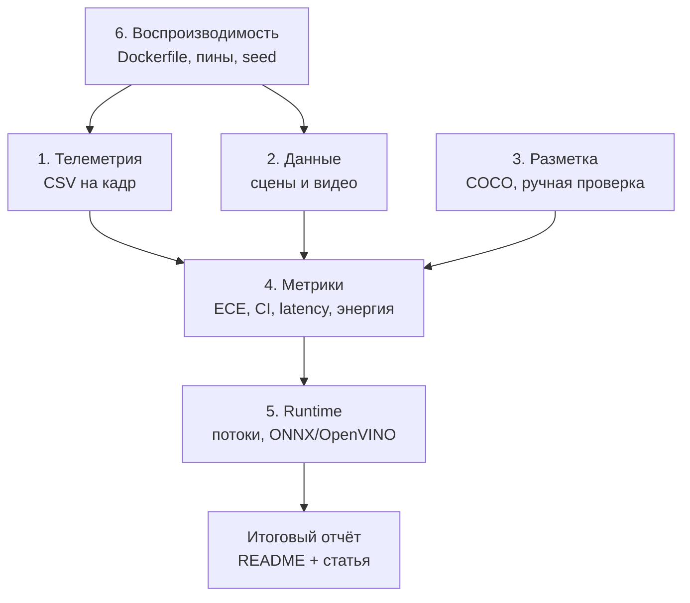

# План развития Gazebo-бенчмарка

## Цель

Превратить текущий бенчмарк (5 моделей, 9 классов, 48 ракурсов, 88 GT)
в воспроизводимый стенд с построчной телеметрией, несколькими сценами,
ручной валидацией разметки и метриками надёжности.

## Принципы

- Один пункт — один коммит.
- Сначала измерение, потом вывод.
- Все артефакты — в `data/gazebo/exp/`.
- Результат должен воспроизводиться одной командой.
- Если данных для вывода не хватает, это фиксируется как ограничение,
  а не заменяется оценкой.

## Декомпозиция

## Чек-лист

### 1. Построчная телеметрия

- [x] 1.1 Схема двух CSV: кадры и детекции.
- [x] 1.2 Сбор `T_pre`, `T_infer`, `T_post`, `T_total`, RSS, CPU, RAPL.
- [x] 1.3 Матчинг TP/FP/FN на каждом кадре.
- [x] 1.4 Сводка p50/p95/p99, fps, пропуски кадров.
- [x] 1.5 ROS: `rosbag2` + `ros2 topic delay`.
- [x] 1.6 Валидация: число строк, отсутствие NaN, сверка медианы T
  с `benchmark_results.csv`.
- [x] 1.7 EDA-скрипт: таблицы, графики, `REPORT.md`.

**Критерий готовности:** `telemetry_frames.csv` содержит по строке на
кадр и модель, `telemetry_detections.csv` — по строке на детекцию;
`telemetry_summary.json` содержит перцентили; медиана T отличается от
бенчмарка не более чем на 15 % (разброс по разным кадрам).

### 2. Больше данных

- [x] 2.1 Параметризация генератора: свет, фон, позы камеры и объектов.
- [x] 2.2 Три–пять сцен с разными условиями.
- [x] 2.3 Видео-последовательности (движение камеры) вместо одиночных
  кадров.
- [x] 2.4 Манифест датасета: сцена, ракурс, объект, класс, GT.
- [x] 2.5 Агрегированный бенчмарк по сценам с доверительными интервалами.

**Критерий готовности:** не менее 200 GT-инстансов и двух
различающихся сцен; результаты по сценам сведены в одну таблицу.

### 3. Разметка

- [x] 3.1 Экспорт GT в COCO JSON (bbox + класс + видимость).
- [x] 3.2 Ручная валидация выборки 10–20 кадров.
- [x] 3.3 Ориентированные боксы или маски для тонких объектов
  (ножки столов, бутылки).
- [x] 3.4 Отчёт о качестве GT: расхождение ручной и аналитической
  разметки.

**Критерий готовности:** доля кадров с ручной проверкой известна,
среднее расхождение боксов < 10 % по площади.

### 4. Метрики

- [x] 4.1 ECE — калибровка уверенности.
- [x] 4.2 Bootstrap-интервалы для mAP и F1.
- [x] 4.3 Latency p50/p95/p99 по кадрам.
- [x] 4.4 Энергия на кадр (RAPL; при недоступности — `null` и
  ограничение).
- [x] 4.5 Интеграция в README и статью.

**Критерий готовности:** метрики воспроизводятся из
`telemetry_frames.csv`; для каждой оценки указан интервал или
оговорка о невозможности.

### 5. Runtime

- [x] 5.1 Sweep числа потоков torch (1, 2, 4, 8).
- [x] 5.2 CPU affinity и приоритет.
- [x] 5.3 Экспорт ONNX и OpenVINO.
- [x] 5.4 Сравнение FP32/FP16/INT8 (FP32/FP16; INT8 не запускался).
- [x] 5.5 Отчёт: T, fps, mAP, RSS для каждого варианта.

**Критерий готовности:** таблица вариантов с одинаковым протоколом
измерения; выбран режим для борта.

### 6. Воспроизводимость

- [x] 6.1 Dockerfile: `torchvision==0.29.1+cpu` с CPU-индекса PyTorch.
- [x] 6.2 Пины версий (torch, ultralytics, opencv, numpy).
- [x] 6.3 Seed для генерации сцен и сэмплирования.
- [x] 6.4 Одна команда запуска всего пайплайна.
- [x] 6.5 README: требования, команды, известные ограничения.

**Критерий готовности:** чистый контейнер после `docker compose build`
запускает пайплайн без ручных доустановок.

## Текущий статус

| Пункт | Статус |
| --- | --- |
| 1. Телеметрия | готово |
| 2. Данные | готово |
| 3. Разметка | готово |
| 4. Метрики | готово |
| 5. Runtime | готово (INT8 не запускался) |
| 6. Воспроизводимость | готово |
