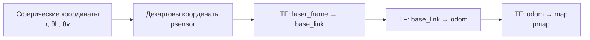

# Глава 2. Математические модели и методы

## 2.2 Математическая модель проецирования данных LiDAR

Данные лазерного сканирования представлены набором измерений «дальность — направление»; переход к облаку точек в системе координат карты определяет точность построения карты высот и оценки проходимости.

### 2.2.1 Сферическая модель и дискретизация скана

Измерение трёхмерного LiDAR задаётся в сферических координатах: дальностью $r$, азимутом $\theta_h$ и углом места $\theta_v$. В системе координат сенсора точка имеет декартовы координаты

$$
\begin{aligned}
x &= r\cos\theta_v\cos\theta_h, \\
y &= r\cos\theta_v\sin\theta_h, \\
z &= r\sin\theta_v.
\end{aligned}
$$

Обратное преобразование: $r=\sqrt{x^2+y^2+z^2}$, $\theta_h=\operatorname{atan2}(y,x)$, $\theta_v=\arcsin(z/r)$.

Скан дискретизирован по обеим угловым координатам: 360 горизонтальных отсчётов с шагом 1° и 16 вертикальных лучей в диапазоне ±15° по спецификации (в модели — ±0,26 рад, то есть ≈ 14,9°). Вертикальный шаг составляет $2\cdot 14{,}9^\circ/15\approx 1{,}99^\circ$, или 0,0347 рад; дальность ограничена интервалом 0,05–12 м, частота обновления — 10 Гц. Линейный шаг по высоте растёт с дальностью: $\Delta z\approx 0{,}0347\,R$, что на 10 м составляет ≈35 см, поэтому полезная дальность карты высот ограничена 10 м. Принятые параметры приведены в таблице 2.1.

Таблица 2.1 — Параметры моделирования трёхмерного LiDAR

| Параметр | Значение |
| --- | --- |
| Горизонтальных отсчётов | 360, шаг 1° |
| Вертикальных лучей | 16 |
| Вертикальный обзор | ±15° (±0,26 рад) |
| Вертикальный шаг | 1,99° (0,0347 рад) |
| Дальность | 0,05–12 м |
| Частота обновления | 10 Гц |

### 2.2.2 Переход в систему координат карты

Точка $\mathbf{p}_{\mathrm{sensor}}$ переводится в систему координат карты по цепочке TF-дерева map → odom → base_link → laser_frame:

$$
\mathbf{p}_{\mathrm{map}}=\mathbf{T}_{\mathrm{sensor}\to\mathrm{map}}\,\mathbf{p}_{\mathrm{sensor}},\qquad
\mathbf{T}_{\mathrm{sensor}\to\mathrm{map}}=\mathbf{T}_{\mathrm{map}\leftarrow\mathrm{odom}}\,\mathbf{T}_{\mathrm{odom}\leftarrow\mathrm{base}}\,\mathbf{T}_{\mathrm{base}\leftarrow\mathrm{laser}},
$$

где индексы base и laser обозначают фреймы base_link и laser_frame. Сенсор закреплён на корпусе с позой (0,22; 0; 0,095) м относительно base_link. Последовательность преобразований показана на рисунке 2.1.

Рисунок 2.1 — Преобразование измерения LiDAR в систему координат карты

### 2.2.3 Альтернативы и границы применимости

Двумерный LiDAR не даёт трёхмерного рельефа, а RGB-D камера плотнее на близких дистанциях, но имеет узкий угол обзора и зависит от освещения [1]. Выбран 16-лучевой трёхмерный LiDAR как компромисс между обзором 360° и вычислительной нагрузкой; платформа описана в [16], симуляция сенсора — в Gazebo Harmonic [19], программная среда — ROS 2 Jazzy [17]. Ограничения модели: разрежение облака с ростом дальности, вертикальная дискретизация и чувствительность к позе сенсора.
