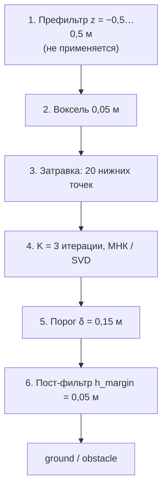

# Глава 2. Математические модели и методы

## 2.3 Математическая модель сегментации ground/non-ground

Для построения карты высот облако точек разделяется на поверхность земли и препятствия: карта обновляется по опорной поверхности, а препятствия накапливаются независимо.

### 2.3.1 Постановка задачи

Пусть $\mathcal{P}=\{\mathbf{p}_i\}_{i=1}^{N}$ — облако точек. Требуется найти разбиение $\mathcal{P}=\mathcal{G}\cup\mathcal{O}$, где $\mathcal{G}$ — точки ground, $\mathcal{O}$ — препятствия. Критерием служит отклонение точки от локально подогнанной плоскости:

$$
\mathcal{G}=\{\mathbf{p}\in\mathcal{P}:|\mathbf{n}^{\top}\mathbf{p}+c|<\delta\},\qquad \mathcal{O}=\mathcal{P}\setminus\mathcal{G},
$$

где $\mathbf{n}$ — единичная нормаль, $c$ — смещение. Неровный рельеф и шум размывают границу: наклонная поверхность проходима, но отклоняется от горизонтали, а выбросы смещают оценку.

### 2.3.2 Метод Ground Plane Fitting

Метод Ground Plane Fitting (GPF) [15] итеративно уточняет плоскость земли и относит к ней точки в пределах порога. В принятой реализации сохранены шаги метода, а стохастическая подгонка заменена детерминированной.

1. **Префильтр по высоте.** Классическая формулировка отбрасывает точки вне $z\in[-0{,}5;\,0{,}5]$ м; в принятой реализации префильтр не применяется — отличие от исходного описания.
2. **Воксельное прореживание** с размером 0,05 м сокращает объём данных без заметной потери рельефа.
3. **Затравка** — 20 точек с наименьшей высотой.
4. **Подгонка плоскости**, $K=3$ итерации. В классическом GPF — RANSAC по трём случайным точкам; в принятой реализации — детерминированная подгонка по затравке методом наименьших квадратов через сингулярное разложение, где нормаль — собственный вектор ковариационной матрицы, соответствующий минимальному собственному значению.
5. **Классификация.** Точки с $|\mathbf{n}^{\top}\mathbf{p}+c|<\delta=0{,}15$ м относятся к ground (inliers), остальные — к препятствиям (outliers). В классике порог нарастает (0,15/0,25/0,35 м), в принятой реализации фиксирован — отличие.
6. **Пост-фильтр.** Точки выше средней высоты ground более чем на $h_{\mathrm{margin}}=0{,}05$ м переносятся в препятствия.

Шаги показаны на рисунке 2.2, параметры — в таблице 2.2.

Рисунок 2.2 — Этапы сегментации ground/non-ground

Таблица 2.2 — Параметры сегментации ground/non-ground

| Параметр | Значение |
| --- | --- |
| Воксель | 0,05 м |
| Затравка | 20 точек, наименьшая высота |
| Итераций подгонки K | 3 |
| Порог δ | 0,15 м |
| Отступ h_margin | 0,05 м |
| Подгонка плоскости | МНК / SVD |

### 2.3.3 Альтернативы и границы применимости

RANSAC-подгонка устойчива к выбросам, но стохастична и вычислительно дороже. Полярно-сеточные методы [8] быстрее, но опираются на радиальную структуру и локальную плоскостность. Оценивание опорной поверхности для шагающих роботов [9] точнее на крупноблочном рельефе, но существенно сложнее. Выбран GPF-подобный метод с детерминированной подгонкой — компромисс точности, быстродействия и отсутствия обучения. Границы применимости: на склонах круче ≈20° ground-точки могут теряться, фиксированный порог чувствителен к шуму, а мелкий размер вокселя даёт неустойчивую затравку.
