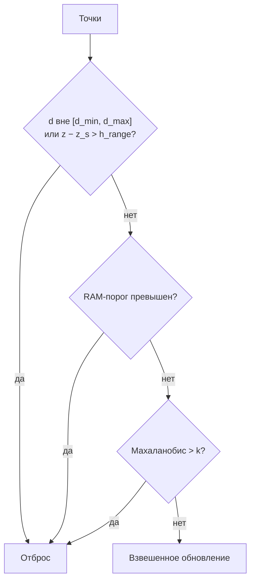

# Глава 2. Математические модели и методы

## 2.4 Математическая модель фильтрации облака точек

Измерения лидара содержат шум, точки на корпусе и сквозные измерения, поэтому перед обновлением карты применяется последовательность фильтров.

### 2.4.1 Дистанционная и высотная фильтрация

Точки с $d < d_{\min}$ отбрасываются, поскольку на малых дистанциях луч попадает на корпус; точки с $d > d_{\max}$ не используются, что ограничивает рабочую зону. Второй отсекатель отбрасывает точки выше сенсора на $h_{\mathrm{range}}$: $z - z_s > h_{\mathrm{range}}$, где $z_s$ — высота сенсора.

### 2.4.2 Адаптивный порог высоты

RAM-фильтр (Ramped Adaptive Maximum height) задаёт порог высоты, растущий с горизонтальной дальностью:

$$
h_{\max}(d) = \begin{cases} c, & d < b, \\ a\,(d - b) + c, & d \geq b, \end{cases}
$$

При $a=0{,}3$, $b=1{,}0$ м, $c=0{,}2$ м точка отбрасывается, если

$$
z - z_s > \max\left(\sqrt{x^2 + y^2} - b,\ 0\right) a + c,
$$

где начало координат — центр карты.

### 2.4.3 Критерий Махаланобиса и шум

Выбросы подавляются критерием Махаланобиса: $|h_{\mathrm{map}} - z| > \sigma_{\mathrm{map}}\,k$ при $k=2{,}0$. Классическая форма использует среднеквадратическое отклонение, а в принятой реализации порог равен $k\,\sigma^2_{\mathrm{map}}$, то есть сравнение идёт с дисперсией — особенность реализации. Дисперсия измерения растёт с дальностью: $v=\alpha r^2$, $\alpha=0{,}05$, вес измерения $w_k=1/v$.

### 2.4.4 Очистка и взвешенное обновление

Очистка сквозных измерений снижает уверенность ячеек на пути луча, не подтверждённых измерением поверхности: $c \leftarrow c - \Delta c$, где шаг $\Delta c = \Delta c_0\,d_{\max}/d_{\mathrm{ray}}$ нормируется на длину луча, $\Delta c_0=0{,}1$; в принятой конфигурации она отключена. Принятые точки обновляют высоту и дисперсию взвешенно:

$$
h \leftarrow \frac{w h + w_k z}{w + w_k}, \quad \sigma^2 \leftarrow \frac{1}{1/\sigma^2 + 1/v},
$$

где $w=1/\sigma^2$ — вес ячейки, $w_k=1/v$ — вес измерения; дисперсия обновляется гармонически. Схема — рисунок 2.3, параметры — таблица 2.3.

Рисунок 2.3 — Последовательность фильтрации облака точек

Таблица 2.3 — Параметры фильтрации облака точек

| Параметр | Значение |
| --- | --- |
| $d_{\min}$, $d_{\max}$, $h_{\mathrm{range}}$ | 0,3 м; 10,0 м; 3,0 м |
| $a$, $b$, $c$ | 0,3; 1,0 м; 0,2 м |
| $k$, $\alpha$, $\Delta c_0$ | 2,0; 0,05; 0,1 |

### 2.4.5 Альтернативы и границы применимости

Фиксированный z-коридор проще, но не адаптируется к рельефу; медианная фильтрация устойчива к выбросам, но сглаживает рельеф и требует $O(N\log N)$; вероятностные модели занятости и TSDF универсальнее, но дороже. Выбрано семейство elevation mapping [5], [6], [4] с GPU-реализацией [12]; сеточное представление — [1]. При отключённой очистке динамические объекты могут накапливаться; на дальних дистанциях разрешение ограничено угловым шагом, а вес падает как $1/r^2$.
