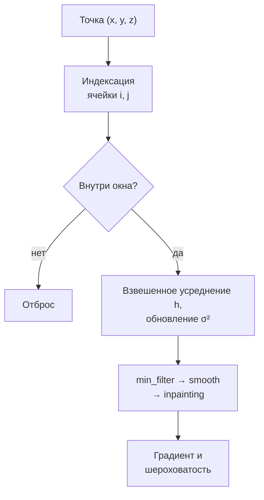

# Глава 2. Математические модели и методы

## 2.5 Математическая модель карты высот (DEM)

Цифровая модель высот (Digital Elevation Model, DEM) хранит оценку рельефа, по которой вычисляются уклон, шероховатость и проходимость. Описаны структура 2.5D-карты, индексация и обновление ячеек, градиент, шероховатость и постобработка.

### 2.5.1 Структура карты

Карта высот — регулярная 2.5D-сетка $200 \times 200$ ячеек с разрешением $r=0{,}1$ м, покрывающая участок $20 \times 20$ м. Окно центрируется на роботе и перемещается вместе с ним. В ячейке хранятся высота $h$, дисперсия $\sigma^2$ и признак валидности; для ненаблюдённых ячеек $\sigma^2_0=1000$, для инициализированных $\sigma^2_{\mathrm{init}}=10$, верхняя граница $\sigma^2_{\max}=100$. Параметры приведены в таблице 2.4, структура — на рисунке 2.4.

Рисунок 2.4 — Структура карты высот и последовательность её обновления

Таблица 2.4 — Параметры карты высот

| Параметр | Значение |
| --- | --- |
| Размер сетки | 200 × 200 ячеек |
| Разрешение | 0,1 м |
| Покрытие | 20 × 20 м |
| Дисперсии $\sigma^2_0$, $\sigma^2_{\mathrm{init}}$, $\sigma^2_{\max}$ | 1000; 10; 100 |

### 2.5.2 Индексация ячеек

$$
i = \left\lfloor \frac{x - x_0}{r} \right\rfloor, \quad j = \left\lfloor \frac{y - y_0}{r} \right\rfloor,
$$

где $(x_0, y_0)$ — левый нижний угол окна. Точки за пределами окна отбрасываются; при сдвиге окна новые ячейки получают априорную дисперсию.

### 2.5.3 Взвешенное обновление

Измерение $z_k$ с дисперсией $v$ обновляет ячейку по правилам раздела 2.4:

$$
h \leftarrow \frac{w h + w_k z_k}{w + w_k}, \quad \sigma^2 \leftarrow \frac{1}{1/\sigma^2 + 1/v},
$$

где $w=1/\sigma^2$, $w_k=1/v$. Усреднение подавляет шум, а гармоническое обновление дисперсии уменьшает неопределённость.

### 2.5.4 Градиент поверхности

Наклон оценивается центральными конечными разностями:

$$
g_x = \frac{h_{i+1,j} - h_{i-1,j}}{2r}, \quad g_y = \frac{h_{i,j+1} - h_{i,j-1}}{2r}, \quad \mathrm{slope} = \arctan\sqrt{g_x^2 + g_y^2}.
$$

Значение выражено в радианах. В принятой реализации шаг сетки не передаётся, поэтому производная вычисляется на ячейку без деления на $r$: в области малых углов $\mathrm{slope} \approx r\theta$, где $\theta$ — физический угол. Альтернатива — подгонка плоскости или оценка нормали по окну $3 \times 3$ методом главных компонент: точнее на неоднородных участках, но дороже.

### 2.5.5 Шероховатость и постобработка

Шероховатость — среднеквадратическое отклонение высоты в окне $5 \times 5$:

$$
\rho_{ij} = \sqrt{\frac{1}{25}\sum_{k=-2}^{2}\sum_{l=-2}^{2}\left(h_{i+k,j+l} - \bar{h}_{ij}\right)^2},
$$

где $\bar{h}_{ij}$ — средняя высота. Перед вычислением производных min-фильтр заполняет невалидные ячейки (радиус 1, 30 итераций), затем выполняется сглаживание (два прохода $3 \times 3$) и восстановление пропусков методом Telea; слой проходимости эродируется. Альтернативы — медианный фильтр $3 \times 3$ и порог по дисперсии — проще, но хуже сохраняют связность.

### 2.5.6 Реализация, альтернативы и границы применимости

Основные операции выполняются GPU-ядрами с использованием CUDA [20], при отсутствии GPU — на numpy; выигрыш по частоте оценивается в главе 4. Альтернативы — grid_map [5], многомодальная карта [3], оценивание опорной поверхности [9]; выбрано семейство elevation mapping [4], [6] с GPU-реализацией [12]. Ограничения 2.5D-представления: одна высота на ячейку не описывает вертикальные структуры, окклюзии дают пропуски, окно $20 \times 20$ м ограничивает область, при редких наблюдениях дисперсия растёт.

