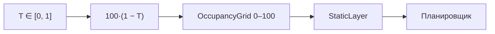

# Глава 2. Математические модели и методы

## 2.6 Математическая модель функции стоимости пути

Бинарная классификация «проходимо — непроходимо» либо запрещает движение, либо игнорирует степень риска. Поэтому вводится непрерывная оценка проходимости ячейки карты высот, переводимая в стоимостную карту Nav2. Далее приведены формула, параметры, классификация местности, интеграция с планировщиком и границы применимости модели.

### 2.6.1 Непрерывная оценка проходимости

Проходимость (traversability) ячейки определяется величиной $T \in [0, 1]$:

$$
T = 1 - \bigl(w_s \cdot s + w_r \cdot \rho + w_e \cdot e\bigr),
$$

где $s$, $\rho$, $e$ — нормированные компоненты уклона, шероховатости и перепада высот:

$$
s = \min\left(\frac{\mathrm{slope}}{\mathrm{maxSlope}}, 1\right), \quad
\rho = \min\left(\frac{\mathrm{roughness}}{\mathrm{maxRoughness}}, 1\right), \quad
e = \min\left(\frac{|h - h_{\mathrm{loc}}|}{\Delta z_{\max}}, 1\right).
$$

Здесь $\mathrm{slope}$ и $\mathrm{roughness}$ — уклон и среднеквадратичное отклонение высот, $h$ — высота ячейки, $h_{\mathrm{loc}}$ — локальное среднее в окне $11 \times 11$ ячеек. Принятые параметры сведены в Таблицу 2.5.

Таблица 2.5 — Параметры функции стоимости пути

| Параметр | Обозначение | Значение |
| --- | --- | --- |
| Вес уклона | $w_s$ | 0,4 |
| Вес шероховатости | $w_r$ | 0,4 |
| Вес перепада высот | $w_e$ | 0,2 |
| Максимальный уклон | $\mathrm{maxSlope}$ | 0,35 рад (≈ 20,05°) |
| Максимальная шероховатость | $\mathrm{maxRoughness}$ | 0,05 м |
| Перепад высот | $\Delta z_{\max}$ | 0,30 м |

### 2.6.2 Классификация местности

По величине проходимости местность относится к одному из трёх классов: Safe при $T > 0{,}7$, Medium при $0{,}3 \le T \le 0{,}7$, Unsafe при $T < 0{,}3$.

### 2.6.3 Интеграция с планировщиком

Величина $T$ преобразуется в OccupancyGrid по шкале 0–100 с инверсией: высокой проходимости соответствует свободная ячейка, низкой — занятая; пороги — 0,3 и 0,5, неизвестная ячейка помечается $-1$. Карта подключается в глобальную и локальную costmap как плагин StaticLayer библиотеки costmap_2d [10], [11]; схема показана на Рисунке 2.5.

Рисунок 2.5 — Преобразование traversability в стоимостную карту и маршрут планировщика

В принятой конфигурации применяется NavfnPlanner (поиск по сетке алгоритмом Дейкстры или A*); альтернатива — SmacPlanner2D на state lattice с функцией стоимости ребра $\mathrm{edgeCost} = \alpha \cdot \mathrm{distance} + \beta \cdot (1 - T)$.

### 2.6.4 Альтернативы и обоснование выбора

Бинарная пороговая классификация проста, но теряет градации риска. Обучаемый фильтр точнее на сложных данных, однако требует разметки и менее интерпретируем. Аддитивная взвешенная функция стоимости интерпретируема, настраиваема и вычислительно дешева; выбран третий вариант [2], [7], [13], [14].

### 2.6.5 Границы применимости

Веса и пороги подбираются под конкретного робота; неизвестные ячейки трактуются консервативно. 2.5D-представление не описывает нависающие препятствия, а настраиваемость порогов сохраняет эвристический характер классификации.
