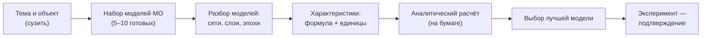

# Консультация с Горячкиным Б.С. (13.10.2026): обоснование выбора модели МО

> **Уточнение 20.10.2026:** преподаватель потребовал вернуть эргономическую
> рамку. Технический выбор модели сам по себе не является эргономическим
> анализом; см. `2026-10-20_consultation-goryachkin.md`.

**Дата консультации:** 2026-10-13
**Консультант:** Горячкин Б.С. (к.т.н., доц. каф. ИУ5)
**Тема (по итогам):** обоснование выбора модели машинного обучения
**Источник:** аудиозапись ~16 мин (`private/КонсультацияГорячкина13102026.wav`)
**Расшифровка:** whisper.cpp `large-v3` (GPU, VAD) — см. Приложение A
**Отчёт составлен:** 2026-10-13 (уточнён по лучшей расшифровке)

---

## 1. Краткая сводка

Консультация переопределила постановку курсовой. Ключевое:

1. **Тема формулируется иначе.** Говорить следует
   **«Обоснование выбора модели машинного обучения»**. В ходе беседы тему
   зафиксировали сокращённо как **«Анализ ММО»**.
2. **Задача:** даны **несколько моделей МО** (5–10, уже готовых) — нужно
   **выбрать одну** и **обосновать** выбор.
3. **Обоснование — по характеристикам, а не по стандартным метрикам.**
   «Стандартные метрики меня не интересуют».
4. **Каждая характеристика должна быть численно определена:** что это,
   **как считается**, **в каких единицах**.
5. **Порядок строгий:** сначала **аналитический расчёт** (на бумаге),
   затем **эксперимент как подтверждение**.
6. **Только объективные числа и факты.** Экспертные (субъективные)
   оценки и метод взвешенной суммы **не используются**.
7. **Сузить объект**: локальные входные данные, конкретная задача — не
   «весь искусственный интеллект».

---

## 2. Установки преподавателя

### 2.1. Формулировка темы

- Тема фактически не была сформулирована.
- Требуемая формулировка: **«Обоснование выбора модели машинного
  обучения»**.
- По ходу беседе преподаватель **записал** тему как «Анализ ММО»
  (анализ моделей машинного обучения).

### 2.2. Суть задачи

- Есть **несколько готовых моделей МО**; **сами мы их не обучаем и «не
  прогоняем»**.
- Нужно **выбрать одну** — и **доказать**, что она лучшая.
- Метафора преподавателя: «тебе дали деньги купить **одну** модель; ты
  отвечаешь за то, что она лучшая». Если эксперимент подтвердит выбор —
  «орден»; если нет — «уволят».

### 2.3. Характеристики вместо метрик

- Стандартные метрики (точность, F1, mAP и др.) **не принимаются** как
  основание выбора: «метрики меня не интересуют».
- Преподаватель назвал допустимые **характеристики**: **однозначность
  класса**, **наглядность**, **различимость**, **эффективность**,
  **читаемость** — «но ты должен понять, **как ты сможешь это оценить**».
- По каждой характеристике требуется: определение, **формула/способ
  счёта**, **единицы измерения**.
  - «В каких единицах измеряется однозначность класса?»
  - «Чему равна различимость? Пишите, как вы различимость будете
    считать».

### 2.4. Порядок работ

- **Сначала аналитика на бумаге:** «прежде чем перейдём к
  экспериментальным исследованиям, мы должны **на бумажечке посчитать
  этот параметр**».
- **Эксперимент — подтверждение, а не основание:** прогон и замер —
  «это вторая часть… это экспериментальное исследование»; «эксперимент
  подтверждает теоретические выкладки. Вот суть курсовой работы».
- Характеристики предполагается **сравнивать без экспериментов и без
  датасетов**: «смотрим на число, сравниваем и всё».

### 2.5. Аналитический разбор моделей

- Каждую модель нужно **разобрать «на мелкие кусочки»** и по ней
  **составить математическую модель**.
- Учитывать: тип сетей (**свёрточные, рекуррентные** и др.), число
  **слоёв**, число **эпох**; задача (графика/текст) — по выбору.
- Пример аналитического расчёта: **время прохождения одной операции** —
  считать расчётно, а не замером на машине.
- Обоснование: МО-модель — «это техника, вычислитель, аппаратное и
  программное обеспечение»; время вычисления нужно уметь **посчитать**, а
  не замерить.

### 2.6. Объективность

- «Мы **отдаляем субъективное мнение**. Смотрим только на числа, на
  факты».
- **Метод взвешенной суммы** и произвольные веса важности — **отвергнуты**:
  «метода взвешенной суммы нет».
- **Экспертные оценки** (субъективные) — **не используются**: «нас
  интересуют **объективные** анализы».
  - *Примечание к расшифровке:* в аудио звучит «экспортные оценки» —
    по смыслу это **экспертные** оценки (Whisper ошибочно распознал
    слово).

### 2.7. Сужение задачи

- «Поставь себе входные данные **более локальные**».
- Не пытаться охватить весь ИИ: иначе «это не орден, а памятник рядом с
  Бауманом».

### 2.8. Новизна

- «У нас типовых задач нет»; «**до тебя этого никто не делал**»; «ты
  первый»; «пытались, но не получилось». (Мотивационная формулировка.)

---

## 3. Что предлагалось и почему не принято

| Предложение студента | Реакция преподавателя | Причина |
| --- | --- | --- |
| «Ошибка распространения модели», «метрика представления» | «метрики меня не интересуют» | это техника, не характеристики выбора |
| Стандартные метрики (F1, mAP, точность) | «не интересуют» | не основание выбора |
| «Однозначность класса» | «что это? в каких единицах?» | нет определения, формулы, единиц |
| «Наглядность» (в процентах) | «Не знаю такого. Никогда не слышал»; «кто определяет проценты?» | неясен способ измерения |
| «Различимость» | «Какая формула различимости?» | нет способа расчёта |
| Весовой коэффициент важности / взвешенная сумма | «метода взвешенной суммы нет» | субъективность весов |
| Прогон моделей и замер времени | «это эксперимент, это вторая часть» | порядок: сначала расчёт |
| Экспертные/качественные оценки | «мы отдаляем субъективное мнение» | только числа и факты |

**Вывод:** формулировки характеристик пока не годятся — нужны определения,
**формулы** и **единицы измерения**.

---

## 4. Требования к характеристикам (формируем)

Каждая характеристика должна быть:

1. **числовой** (измеримой величиной);
2. **объективной** (без субъективных весов и экспертных оценок);
3. **аналитически вычислимой** (по модели/параметрам, до эксперимента);
4. **с определением, формулой и единицами измерения**;
5. **различимой между моделями** (позволяет сравнить и выбрать одну).

---

## 5. Порядок работ (по преподавателю)

---

## 6. Что это меняет в текущих материалах

- **Формулировка темы** в материалах по эргономике требует правки: акцент
  смещается на **обоснование выбора модели МО** (характеристики), а не на
  «представление результатов распознавания оператору».
- **Характеристики** (однозначность, наглядность, различимость и др.)
  должны получить **формулы и единицы** — сейчас этого нет.
- **Эксперимент** в текстах курсовой — только **подтверждение**; основание
  — аналитический расчёт.
- Ранее принятая «3-звенная цепочка» и метрики (ECE и различимость) —
  фрагменты, которые нужно привести к рамке «выбор модели».

---

## 7. План действий

1. Зафиксировать формулировку темы: **«Обоснование выбора модели
   машинного обучения»** (согласовать с научруком и преподавателем).
2. Определить **набор моделей** для сравнения (5–10).
3. **Разобрать каждую модель**: архитектура, слои, эпохи.
4. Выбрать **3–5 характеристик**, по каждой — определение, формула,
   единицы измерения.
5. Провести **аналитический расчёт** характеристик по моделям.
6. По расчёту выбрать лучшую модель.
7. Согласовать набор характеристик и метод с преподавателем **до**
   эксперимента.
8. Эксперимент — как **подтверждение**.

---

## 8. Открытые вопросы

1. Точная формулировка темы в зачётных документах.
2. Какие модели МО брать (тип задачи: изображения? текст?).
3. Итоговый список характеристик и их формулы/единицы.
4. Как связать характеристики с выбором (правило сравнения без весов).
5. Место и объём эксперимента-подтверждения.

---

## Приложение A. Источник и расшифровка

**Итоговая (лучшая) расшифровка:**

| Параметр | Значение |
| --- | --- |
| Аудио | `private/КонсультацияГорячкина13102026.wav` (~16 мин, ≈278 МБ) |
| Модель распознавания | whisper.cpp `ggml-large-v3` |
| Устройство | GPU (CUDA, RTX 5070 Ti, `sm_120`) |
| Настройки | чанки 60 с, `-l ru`, beam 3, **VAD** (silero), без prompt |
| Скрипт | `scripts/transcribe_wav.py` |
| Результат | `private/Конса_горячкин_13102026_расшифровка.txt` и `.srt` |

**Сравнение прогонов** (качество):

| Прогон | Устройство | Настройки | Результат |
| --- | --- | --- | --- |
| A | CPU | чанки 120 с, жадное | приемлемо, местами повторы |
| B | GPU | чанки 300 с, beam 5, prompt | **зацикливание** (галлюцинации-повторы) |
| C | GPU | чанки 60 с, beam 3, **VAD** | **лучший** — без зацикливаний |

Вывод: качество определяется не «мощностью» модели (large-v3 и так
максимальная для Whisper), а **настройками** — VAD, короткие чанки и
отказ от prompt убирают галлюцинации на тишине/шуме. GPU ускоряет
обработку примерно в 11 раз.

Материалы консультации относятся к персональным данным и хранятся в
`private/` (не в git). В отчёте приведены только рабочие формулировки.
