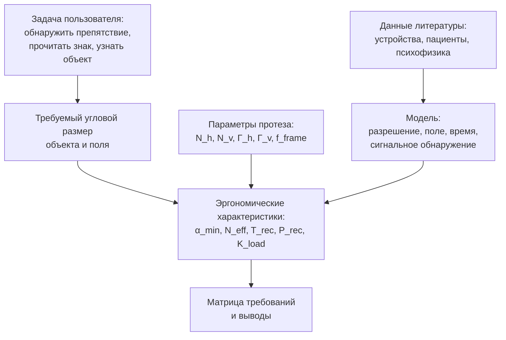

# Эргономические требования к зрительному нейропротезу: анализ темы и пути усиления

**Дата:** 2026-10-25  
**Ветка:** `feat/publications`  
**Статус:** аналитический отчёт по альтернативной теме; основная тема КР — обнаружение аномалий оператором — не меняется.  
**Назначение:** показать, как могла бы выглядеть КР по зрительному нейропротезу на втором (обзорно-аналитическом) пути, какие эргономические характеристики здесь есть, что можно усилить и где находятся данные.  
**Связанные документы:** `docs/ergonomics-methodology/2026-10-25_topic-selection.md`, `docs/ergonomics-methodology/2026-10-25_formal-model.md`, `docs/ergonomics-methodology/AGENT_RU.md`, `docs/ergonomics-methodology/AGENTS.md`.

---

## Оглавление

1. [Резюме](#1-резюме)
2. [Текущее состояние материалов](#2-текущее-состояние-материалов)
3. [Гипотеза проблемы](#3-гипотеза-проблемы)
4. [Почему второй путь](#4-почему-второй-путь)
5. [Целевая исследовательская архитектура](#5-целевая-исследовательская-архитектура)
6. [Объект и границы](#6-объект-и-границы)
7. [Эргономические характеристики](#7-эргономические-характеристики)
8. [Формальная модель требований](#8-формальная-модель-требований)
9. [Что можно усилить](#9-что-можно-усилить)
10. [Что можно покопать глубже](#10-что-можно-покопать-глубже)
11. [Данные и источники](#11-данные-и-источники)
12. [Метод анализа](#12-метод-анализа)
13. [Структура РПЗ по второму пути](#13-структура-рпз-по-второму-пути)
14. [Дорожная карта](#14-дорожная-карта)
15. [Риски и митигации](#15-риски-и-митигации)
16. [Связанные документы](#16-связанные-документы)
17. [Приложение A. Глоссарий](#приложение-a-глоссарий)
18. [Приложение B. Шаблон таблицы источников](#приложение-b-шаблон-таблицы-источников)
19. [Приложение C. Чек-лист самопроверки](#приложение-c-чек-лист-самопроверки)

---

## 1. Резюме

Зрительный нейропротез — это не «чип, который ускоряет человека», а **канал передачи зрительной информации**. Эргономическая задача здесь не в том, чтобы «улучшить мозг», а в том, чтобы определить, сколько различимых элементов, в каком поле зрения и с какой скоростью нужно человеку для конкретной задачи: распознать препятствие, прочитать знак, узнать объект, безопасно переместиться.

Основная тема КР остаётся прежней: **эргономическое обеспечение деятельности оператора при обнаружении аномалий шагающего робота**. Этот отчёт — разбор альтернативы, а не смена темы.

**Главная идея одной фразой:** эргономические требования к зрительному протезу выводятся из задачи и измеряются через угловое разрешение, поле зрения и время распознавания, а не через «быстродействие чипа».

### Ключевые решения

| Вопрос | Решение |
|---|---|
| Основная тема КР | Обнаружение аномалий оператором; не меняется |
| Роль этого отчёта | Альтернативная тема для второго пути |
| Объект нейротемы | «Человек с протезом — устройство — среда — задача» |
| Ядро | Пропускная способность зрительного канала |
| Основные критерии | Разрешение, поле зрения, время распознавания |
| Данные | Клинические и технические публикации; не `archive`/`model-selection` |
| Эксперимент | С пациентами — нет; возможна симуляция или мета-анализ |
| Формат | Второй путь: системный анализ + статья |
| Главный риск | Скатиться в медицину и не показать эргономику |

### Что можно усилить сразу

1. Сузить задачу до одной: «обнаружение препятствия при ходьбе» или «чтение указателя».
2. Ввести цепочку «параметры устройства → угловое разрешение → размер объекта → время → критерий».
3. Показать компромисс «разрешение — поле зрения» при фиксированном числе электродов.
4. Добавить вероятность правильного распознавания и ложной тревоги, а не только геометрию.
5. Учесть временную эргономику: частоту обновления, инерцию зрения, мелькание.
6. Разделить технические ограничения стимуляции и эргономические характеристики.
7. Построить матрицу требований, а не «обзор вообще».
8. Проверить устойчивость выводов к разбросу клинических данных.

---

## 2. Текущее состояние материалов

### 2.1. Что уже есть в проекте

В проекте накоплены материалы, которые можно использовать как **методический каркас**, но не как данные по нейропротезам.

| Источник | Что даёт | Чего не даёт |
|---|---|---|
| `Горячкин лекции/Лекция 7 Зрит анализатор.md` | Пороги яркости, контраста, поля зрения, время реакции, разрешающая способность | Данных по имплантам |
| `Горячкин лекции/Лекция 15 ЭС.md` | Формулы $t_{\text{ип}}$, $I$, $h_{\text{э}}$, нормы сертификата | Клинических исходов |
| `Горячкин лекции/Лекция 16 ЭО.md` | $G_{\text{техн}} \le G_{\text{воспр}}$, оптимизация разрешения | Параметров электродных массивов |
| `archive/2026-09-15/a2-*` | Структура анализа деятельности, ИМ, план РПЗ | Нейрофизиологических данных |
| `archive/recognition-objects/archive/formulas.tex` | $\theta = 2\arctan\left(\frac{h}{2d}\right)$, $\mathrm{RT} = a + b\log_2(n+1)$, $d'$ | Данных по протезам |
| `model-selection/` | Декомпозиция технического слоя, работа с неопределённостью | Эргономических характеристик протеза |

### 2.2. Чего в проекте нет

- нет таблицы клинических исследований зрительных протезов;
- нет параметров конкретных электродных массивов;
- нет данных о распознавании объектов и чтении у пользователей;
- нет данных о частоте обновления и мелькании;
- нет данных о нагрузке и обучении;
- нет этического заключения и доступа к пациентам.

Это не означает, что тема невозможна. Это означает, что она **литературная**, а не экспериментальная.

### 2.3. Почему нельзя выдать `archive`/`model-selection` за данные

`archive/2026-09-15/a2-*` — это черновик КР про информационную модель шагающего робота. `model-selection` — сравнение моделей обнаружения объектов. Ни там, ни там нет нейропротезов, электродных массивов, фосфенов, пациентов или клинических исходов.

Использовать их можно только так:

- структура анализа деятельности;
- способ разделения технического и эргономического слоёв;
- формулы времени реакции и различимости;
- дисциплина источников и самопроверки.

Если подставить данные робота в нейротему, получится подлог. Это прямо запрещено правилами проекта.

### 2.4. Что нужно добавить

Нужна отдельная источниковая база:

- технические описания ретинальных и кортикальных имплантов;
- клинические исследования зрительных протезов;
- психофизические работы по распознаванию, чтению, локализации;
- нормативные документы по безопасности стимуляции;
- обзоры и мета-анализы.

---

## 3. Гипотеза проблемы

### 3.1. Симптом

Зрительные нейропротезы дают очень ограниченный канал: мало элементов, узкое поле, невысокая частота, длительное обучение. Пользователь не видит «картинку» как здоровый глаз; он получает разреженную мозаику ощущений. Из-за этого:

- объект может не попасть в поле;
- объект может быть слишком мал по угловому размеру;
- пользователь может не успеть распознать его до опасного сближения;
- высокая плотность стимуляции может давать мелькание, утомление, ошибки.

### 3.2. Гипотеза

**Если** параметры протеза (число элементов, поле, частота) не соответствуют угловому размеру задачи и допустимому времени реакции, **то** пользователь не сможет надёжно выполнить задачу, даже если отдельные компоненты устройства работают «правильно».

**Если** требования заданы через задачу и проверяются по разрешению, полю и времени, **то** можно сравнивать разные протезы и формулировать эргономические требования, не сводя всё к числу электродов.

### 3.3. Что здесь не является проблемой

- «чип медленный» — это техническая формулировка;
- «человек быстрее» — это физиологическое утверждение без эргономической задачи;
- «больше электродов — лучше» — неверно без учёта поля, плотности и задачи;
- «клинический результат хороший» — не эргономическая характеристика без нормализации.

### 3.4. Проверяемые утверждения

1. При фиксированном числе элементов увеличение поля зрения ухудшает угловое разрешение.
2. Для объекта заданного углового размера существует минимальное число элементов по объекту, ниже которого распознавание падает.
3. Время распознавания растёт при уменьшении поля зрения из-за необходимости сканирования.
4. Частота обновления ниже критической вызывает мелькание и ухудшает распознавание.
5. Разные задачи (препятствие, чтение, лицо) дают разные требования к разрешению и полю.

---

## 4. Почему второй путь

### 4.1. Ограничения эксперимента

С пациентами эксперимент невозможен по этическим и организационным причинам. С здоровыми добровольцами можно моделировать фосфеновое зрение, но это уже не исследование конкретного импланта, а модельный эксперимент. Он полезен, но не заменяет клинические данные.

### 4.2. Что даёт второй путь

Второй путь — системный анализ и подготовка статьи. Он позволяет:

- собрать и нормализовать разрозненные клинические данные;
- сравнить устройства по эргономическим, а не только техническим параметрам;
- построить матрицу требований;
- выявить противоречия и пробелы;
- сформулировать направления будущих исследований.

### 4.3. Что должно быть результатом

Не «обзор вообще», а:

- таблица устройств и исследований;
- единая система характеристик;
- расчёт требований для 1–2 задач;
- анализ чувствительности;
- вывод о том, какие параметры критичны, а какие вторичны;
- статья.

### 4.4. Чем второй путь хуже

- нет собственного эксперимента;
- сильная зависимость от качества публикаций;
- трудно доказать новизну;
- много источников;
- есть риск, что работа станет медицинским обзором.

---

## 5. Целевая исследовательская архитектура

**Принцип работы:** сначала описывается задача и её угловые/временные требования, затем из параметров устройства выводятся эргономические характеристики, затем проверяется, попадают ли они в допустимые границы.

**Заменяемый элемент:** конкретное устройство. Модель требований должна работать для разных имплантов, если известны $N_h$, $N_v$, $\Gamma_h$, $\Gamma_v$, $f_{\text{frame}}$.

---

## 6. Объект и границы

### 6.1. Объект

Система:

> **человек с зрительным нейропротезом — внешнее устройство (камера, процессор, стимулятор) — среда — задача распознавания**

Человек здесь не «оператор» в классическом смысле, а пользователь с сенсорным каналом. Это допустимо для эргономики, потому что объект — человеко-машинная система, а не медицинская процедура.

### 6.2. Что входит

- параметры электродного массива;
- поле стимуляции;
- частота обновления;
- задача распознавания;
- время реакции;
- вероятность правильного распознавания;
- нагрузка и обучение;
- ограничения безопасности стимуляции как технические рамки.

### 6.3. Что не входит

- хирургия и послеоперационное ведение;
- лечение заболеваний;
- клинические рекомендации;
- сравнение медицинской эффективности;
- персональные данные пациентов.

### 6.4. Выбор задачи

Для КР лучше выбрать одну задачу, иначе требования расплываются.

| Задача | Что важно | Риск |
|---|---|---|
| Обнаружение препятствия при ходьбе | Поле, время, контраст | Нужны сценарии и нормативы |
| Чтение указателя/надписи | Разрешение, устойчивость | Сильно зависит от шрифта и расстояния |
| Узнавание бытового объекта | Разрешение, обучение | Трудно нормировать |
| Навигация в помещении | Поле, сканирование, время | Много факторов |
| Распознавание лица | Высокое разрешение | Почти невозможно для текущих протезов |

Рекомендация: **обнаружение препятствия при ходьбе** как наиболее близкая к безопасности и к лекции 7.

---

## 7. Эргономические характеристики

### 7.1. Угловое разрешение

**Определение:** минимальный угловой размер элемента, который пользователь может различить.

Пусть $N_h$, $N_v$ — число элементов по горизонтали и вертикали, $\Gamma_h$, $\Gamma_v$ — поле зрения в градусах.

$$
\alpha_h = \frac{\Gamma_h}{N_h}
$$

$$
\alpha_v = \frac{\Gamma_v}{N_v}
$$

$$
\alpha_{\min} = \max(\alpha_h, \alpha_v)
$$

**Единицы:** угловые минуты или градусы.

**Направление:** меньше — лучше.

**Критерий:** $\alpha_{\min} \le \alpha_{\text{obj}} / n_{\text{obj}}$, где $\alpha_{\text{obj}}$ — угловой размер объекта, $n_{\text{obj}}$ — число элементов, необходимое для распознавания.

**Эффект:** при недостаточном разрешении объект распадается на слишком крупные пятна, пользователь не может выделить признаки, растёт время и число ошибок.

**Почему это эргономика:** характеристика описывает, как человек воспринимает объект, а не сколько электродов в чипе.

### 7.2. Поле зрения

**Определение:** угловой размер области, в которой протез даёт различимые ощущения.

$$
\Gamma_h \times \Gamma_v
$$

**Единицы:** градусы.

**Направление:** больше — лучше до предела, определяемого задачей.

**Критерий:** $\Gamma_h \ge \Gamma_{\text{req},h}$, $\Gamma_v \ge \Gamma_{\text{req},v}$.

$$
\Gamma_{\text{req}} = 2\arctan\left(\frac{W}{2D}\right)
$$

где $W$ — ширина рабочей зоны, $D$ — расстояние.

**Эффект:** при узком поле пользователь вынужден постоянно сканировать пространство; растёт время поиска, нагрузка, риск пропуска.

**Почему это эргономика:** поле определяет, какую часть среды человек может воспринять без движения головы и глаз.

### 7.3. Число эффективных элементов

**Определение:** сколько различимых элементов приходится на поле.

$$
N_{\text{eff}} = \frac{\Gamma_h}{\alpha_{\min}}\cdot\frac{\Gamma_v}{\alpha_{\min}}
$$

Или, если $\alpha_{\min}$ уже учитывает худшее направление:

$$
N_{\text{eff}} = N_h \cdot N_v
$$

**Единицы:** шт.

**Направление:** больше — лучше при фиксированной задаче.

**Критерий:** $N_{\text{eff}} \ge N_{\text{req}}$, где $N_{\text{req}}$ выводится из размера объекта и числа элементов на объект.

**Эффект:** слишком малое число элементов не позволяет сформировать признаки объекта.

### 7.4. Время распознавания

**Определение:** время от появления объекта до правильного ответа пользователя.

$$
T_{\text{rec}} = T_{\text{lat}} + T_{\text{search}} + T_{\text{dec}} + T_{\text{act}}
$$

- $T_{\text{lat}} = 0{,}16\text{--}0{,}24\ \text{с}$ — латентный период зрительной реакции;
- $T_{\text{search}} = \frac{E+a}{a}(1+H_\alpha)t_{\text{fix}}$ — время информационного поиска;
- $T_{\text{dec}} = a + b \log_2(N_{\text{alt}})$ — время выбора;
- $T_{\text{act}}$ — моторное время.

**Единицы:** секунды.

**Направление:** меньше — лучше.

**Критерий:** $T_{\text{rec}} \le T_{\text{req}}$.

**Эффект:** при превышении времени пользователь не успевает среагировать; для ходьбы это означает столкновение или падение.

**Почему это эргономика:** это время деятельности человека, а не задержка камеры.

### 7.5. Частота обновления

**Определение:** частота смены кадров/стимуляции.

$$
f_{\text{frame}} = \frac{1}{T_{\text{frame}}}
$$

**Единицы:** Гц.

**Направление:** больше — лучше до физиологического предела.

**Критерий:** $f_{\text{frame}} \ge f_{\text{req}}$; верхняя граница связана с критической частотой мельканий 14–70 Гц.

**Эффект:** слишком низкая частота даёт мелькание и разрывы; слишком высокая может быть не нужна и расходовать ресурс.

### 7.6. Вероятность правильного распознавания

**Определение:** доля правильных ответов в задаче.

$$
P_{\text{rec}} = \frac{N_{\text{correct}}}{N_{\text{trials}}}
$$

**Единицы:** безразм.

**Направление:** больше — лучше.

**Критерий:** $P_{\text{rec}} \ge P_{\text{req}}$.

**Эффект:** недостаточная вероятность делает канал ненадёжным, даже если геометрия «правильная».

### 7.7. Загрузка и обучение

**Определение:** доля времени/усилий, затрачиваемых на распознавание и проверку.

$$
K_{\text{load}} = \frac{T_{\text{busy}}}{T_{\text{total}}}
$$

**Единицы:** безразм.

**Направление:** меньше — лучше.

**Критерий:** $K_{\text{load}} \le K_{\text{req}}$.

**Эффект:** высокая загрузка ведёт к утомлению и ошибкам.

### 7.8. Сводная таблица

| Характеристика | Формула | Единицы | Направление | Критерий | Эффект |
|---|---|---|---|---|---|
| Угловое разрешение | $\alpha_{\min} = \max\left(\frac{\Gamma_h}{N_h},\frac{\Gamma_v}{N_v}\right)$ | град/угл. мин | меньше | $\alpha_{\min} \le \frac{\alpha_{\text{obj}}}{n_{\text{obj}}}$ | Различимость объекта |
| Поле зрения | $\Gamma_h \times \Gamma_v$ | град | больше | $\Gamma \ge \Gamma_{\text{req}}$ | Поиск и сканирование |
| Эффективные элементы | $N_{\text{eff}} = \frac{\Gamma_h}{\alpha_{\min}}\cdot\frac{\Gamma_v}{\alpha_{\min}}$ | шт. | больше | $N_{\text{eff}} \ge N_{\text{req}}$ | Формирование признаков |
| Время распознавания | $T_{\text{rec}} = T_{\text{lat}} + T_{\text{search}} + T_{\text{dec}} + T_{\text{act}}$ | с | меньше | $T_{\text{rec}} \le T_{\text{req}}$ | Своевременность |
| Частота обновления | $f_{\text{frame}} = \frac{1}{T_{\text{frame}}}$ | Гц | больше | $f_{\text{frame}} \ge f_{\text{req}}$ | Мелькание, непрерывность |
| Вероятность распознавания | $P_{\text{rec}} = \frac{N_{\text{correct}}}{N_{\text{trials}}}$ | безразм. | больше | $P_{\text{rec}} \ge P_{\text{req}}$ | Надёжность |
| Загрузка | $K_{\text{load}} = \frac{T_{\text{busy}}}{T_{\text{total}}}$ | безразм. | меньше | $K_{\text{load}} \le K_{\text{req}}$ | Утомление |

---

## 8. Формальная модель требований

### 8.1. Цепочка вывода

1. Задача задаёт объект и расстояние.
2. Объект даёт угловой размер.
3. Угловой размер и число элементов на объект дают требуемое разрешение.
4. Разрешение и поле дают требуемое число элементов.
5. Время задачи даёт допустимое время распознавания.
6. Частота обновления ограничивается временем и физиологией.
7. Параметры устройства проверяются по всем ограничениям.

### 8.2. Угловой размер объекта

$$
\alpha_{\text{obj}} = 2\arctan\left(\frac{h}{2D}\right)
$$

где $h$ — высота объекта, $D$ — расстояние.

Если объект шириной $w$, аналогично:

$$
\alpha_{\text{obj},h} = 2\arctan\left(\frac{w}{2D}\right)
$$

### 8.3. Требуемое разрешение

$$
\alpha_{\text{req}} = \frac{\alpha_{\text{obj}}}{n_{\text{obj}}}
$$

$$
\alpha_{\min} \le \alpha_{\text{req}}
$$

Число $n_{\text{obj}}$ — не «вес», а параметр задачи: сколько элементов нужно, чтобы выделить признаки. Он берётся из психофизических исследований или задаётся как явное допущение.

### 8.4. Требуемое число элементов

При фиксированном поле:

$$
N_h \ge \frac{\Gamma_h}{\alpha_{\text{req}}}
$$

$$
N_v \ge \frac{\Gamma_v}{\alpha_{\text{req}}}
$$

$$
N_{\text{req}} = N_h \cdot N_v
$$

### 8.5. Компромисс «разрешение — поле»

При фиксированном числе электродов $N = N_h \cdot N_v$:

- увеличение $\Gamma_h$ при том же $N_h$ ухудшает $\alpha_h$;
- увеличение поля требует больше элементов для сохранения разрешения;
- нельзя одновременно максимизировать поле и разрешение при фиксированном $N$.

Это ключевой эргономический компромисс, который стоит показать в КР.

### 8.6. Время

$$
T_{\text{rec}} = T_{\text{lat}} + T_{\text{search}} + T_{\text{dec}} + T_{\text{act}}
$$

$T_{\text{search}}$ зависит от числа элементов и поля:

- больше элементов — больше время поиска;
- меньше поле — больше сканирования;
- больше альтернатив — больше время решения.

Отсюда следуют неочевидные выводы:

- увеличение разрешения может ускорить распознавание, но замедлить поиск;
- увеличение поля может уменьшить сканирование, но ухудшить разрешение;
- оптимум зависит от задачи.

### 8.7. Частота

$$
f_{\text{frame}} \ge f_{\text{req}}
$$

$f_{\text{req}}$ задаётся динамикой задачи. Для статического чтения достаточно низкой частоты; для движения — выше.

Верхняя граница:

$$
f_{\text{frame}} \le f_{\text{fusion}}
$$

где $f_{\text{fusion}}$ — критическая частота слияния мельканий (14–70 Гц по лекции 7). Выше неё отдельные стимулы сливаются.

### 8.8. Вероятность

Если задача бинарная (есть объект/нет), можно использовать сигнальное обнаружение:

$$
P_{\text{rec}} = \Phi\left(\frac{d'}{2}-c\right)
$$

$$
P_{\text{fa}} = \Phi\left(-\frac{d'}{2}-c\right)
$$

Критерий:

$P_{\text{rec}} \ge P_{\text{req}}$, $P_{\text{fa}} \le \alpha$

Это связывает геометрию канала с вероятностью правильного ответа.

### 8.9. Пример расчёта

Ниже — **иллюстративный пример**, не данные конкретного устройства.

Пусть:

- поле $\Gamma_h = 20^\circ$, $\Gamma_v = 15^\circ$;
- массив $N_h = 100$, $N_v = 75$;
- объект высотой $0{,}5\ \text{м}$ на расстоянии $10\ \text{м}$;
- требуется $n_{\text{obj}} = 8$ элементов по объекту.

Тогда:

$$
\alpha_h = \frac{20}{100} = 0{,}2^\circ
$$

$$
\alpha_v = \frac{15}{75} = 0{,}2^\circ
$$

$$
\alpha_{\text{obj}} = 2\arctan\left(\frac{0{,}5}{2\cdot10}\right) \approx 2{,}86^\circ
$$

$$
\alpha_{\text{req}} = \frac{2{,}86}{8} \approx 0{,}36^\circ
$$

$\alpha_{\min} = 0{,}2^\circ \le 0{,}36^\circ$ — разрешение достаточно.

$T_{\text{search}}$ и $T_{\text{rec}}$ считаются по формулам с параметрами задачи.

Этот пример показывает ход расчёта, но не является результатом обзора.

### 8.10. Что проверять в чувствительности

- $n_{\text{obj}}$ от 4 до 16;
- $\alpha_{\text{obj}}$ при разных расстояниях;
- $\Gamma$ от $10^\circ$ до $40^\circ$;
- $N$ от 60 до 2000;
- $f_{\text{frame}}$ от $5$ до $60\ \text{Гц}$;
- $T_{\text{req}}$ от 1 до 5 с.

Если вывод меняется при разумных допущениях, это нужно показать, а не скрывать.

### 8.11. Проверка примера по ограничениям

| Проверка | Что сравнивается | Действие при несоответствии |
|---|---|---|
| Разрешение | $\alpha_{\min}$ и $\alpha_{\text{req}}$ | Увеличить $N$ или уменьшить поле |
| Поле | $\Gamma$ и $\Gamma_{\text{req}}$ | Расширить поле или изменить задачу |
| Число элементов | $N_{\text{eff}}$ и $N_{\text{req}}$ | Пересмотреть массив |
| Время | $T_{\text{rec}}$ и $T_{\text{req}}$ | Ускорить поиск/решение или сузить задачу |
| Частота | $f_{\text{frame}}$ и $f_{\text{req}}$ | Изменить частоту стимуляции |
| Вероятность | $P_{\text{rec}}$ и $P_{\text{req}}$ | Улучшить разрешение/обучение |
| Загрузка | $K_{\text{load}}$ и $K_{\text{req}}$ | Уменьшить плотность/число проверок |
| Безопасность | Параметры стимуляции | Техническое ограничение, не эргономика |

Проверка идёт сверху вниз: если не проходит разрешение, нет смысла обсуждать вероятность; если не проходит поле, время поиска уже не спасёт.

### 8.12. Что считать «усилением» модели

Усиление — это не добавление новых коэффициентов, а:

- явная задача;
- явная граница применимости;
- проверка на чувствительность;
- отделение технических ограничений;
- подтверждение источниками;
- отказ от «универсального» вывода.

---

## 9. Что можно усилить

### 9.1. Сузить задачу

«Зрительный протез вообще» — слишком широко. Нужна одна задача: препятствие при ходьбе, чтение знака, навигация. Иначе критерии будут противоречить друг другу.

### 9.2. Ввести цепочку требований

Не «разрешение хорошее», а:

`объект → угловой размер → требуемое разрешение → требуемое число элементов → проверка устройства`

Это делает работу инженерной, а не описательной.

### 9.3. Показать компромисс «разрешение — поле»

При фиксированном числе электродов нельзя иметь и большое поле, и высокое разрешение. Это сильный аналитический результат, который можно показать графически.

### 9.4. Добавить вероятность распознавания

Геометрия говорит, что объект «попал на матрицу», но не говорит, что человек его узнал. Нужны $P_{\text{rec}}$ и $P_{\text{fa}}$.

### 9.5. Учесть время поиска

Время поиска зависит от поля и числа элементов. Это связывает пространственные и временные характеристики.

### 9.6. Учесть временную эргономику

Частота обновления, инерция зрения, мелькание, адаптация. Это не «ещё одна техническая метрика», а условие восприятия.

### 9.7. Разделить технику и эргономику

Технические ограничения стимуляции (ток, температура, биосовместимость) — это рамки, а не эргономические характеристики. Их нельзя выдавать за эргономику.

### 9.8. Сделать матрицу требований

Итог — таблица «задача → разрешение → поле → время → вероятность → допуск». Это удобно для защиты и для статьи.

### 9.9. Проверить источники

Клинические данные разнородны. Нужны критерии включения, нормализация и анализ чувствительности.

### 9.10. Сформулировать ограничения

Чего нельзя утверждать: что протез «заменяет зрение», что он «ускоряет человека», что он «безопасен вообще». Можно утверждать только то, что следует из данных и модели.

### 9.11. Что это даёт по сравнению с темой аномалий

| Критерий | Аномалии робота | Зрительный протез |
|---|---|---|
| Объект | Оператор, ИМ, робот | Человек с протезом, устройство, среда |
| Данные | Телеметрия и сценарии | Литература |
| Эксперимент | Возможен на симуляции | С пациентами — нет |
| Формулы | Сигнальное обнаружение, время, загрузка | Разрешение, поле, время |
| Риск «не эргономика» | Ниже | Выше |
| Новизна | Средняя | Высокая |
| Основной путь | Путь 1 | Путь 2 |

Тема протеза выигрывает в новизне, но проигрывает в данных и проверяемости. Поэтому она и остаётся альтернативой, а не заменой.

---

## 10. Что можно покопать глубже

### 10.1. Разрешение — это не просто число электродов

Между числом электродов и воспринимаемым разрешением стоят:

- карта фосфенов;
- взаимодействие соседних стимулов;
- краудинг;
- неоднородность порогов;
- адаптация.

Поэтому $\alpha_{\min}$ — это модель, а не прямое измерение.

### 10.2. Поле — это не просто градусы

Важны:

- полезное поле;
- сканирование головой и глазами;
- края поля;
- неравномерность разрешения по полю.

### 10.3. Время — это не просто задержка

Нужно разделять:

- латентный период;
- поиск;
- принятие решения;
- моторное действие;
- обучение.

### 10.4. Задачи разные

Обнаружение препятствия, чтение, узнавание лица и навигация дают разные требования. Нельзя строить одну «универсальную» матрицу без задачи.

### 10.5. Индивидуальные различия

Пороги, обучение и стратегии сканирования различаются. Это ограничение обобщаемости.

### 10.6. Сигнальное обнаружение

$P_{\text{rec}}$ и $P_{\text{fa}}$ можно связать с $d'$ и критерием. Это делает модель ближе к реальной деятельности, чем чистая геометрия.

### 10.7. Информационная ёмкость

Можно оценить число бит на кадр, но не превращать это в «скорость человека». Информационная ёмкость — вспомогательная характеристика.

### 10.8. Эргономический сертификат

Можно построить сертификат по лекции 15: таблица характеристик, нормы, допустимость, рекомендации.

### 10.9. Сравнение с естественным зрением

Естественное зрение даёт ориентир: фовеа 0,5–1 угл. мин, ясное поле 30–35°, полное 180°. Но протез не обязан повторять естественное зрение; он должен решать задачу.

### 10.10. Этические и регуляторные рамки

Нельзя обещать лечение. Нельзя публиковать персональные данные. Нельзя проводить эксперименты с пациентами без разрешения. Это ограничивает путь 1 и усиливает аргумент за путь 2.

### 10.11. Вопросы для углубления

1. Какая минимальная задача даёт устойчивые требования?
2. Сколько элементов нужно на объект для разных классов?
3. Как меняется время поиска при сужении поля?
4. Что важнее для безопасности: разрешение или поле?
5. Как учитывать краудинг и взаимодействие фосфенов?
6. Насколько данные клинических исследований сопоставимы?
7. Какие задачи вообще не решаются современными протезами?
8. Где предел обучения и адаптации?
9. Как нормировать «полезное поле»?
10. Какие ограничения стимуляции критичны?
11. Можно ли переносить результаты между устройствами?
12. Что даёт симуляция фосфенового зрения?
13. Какие метрики не являются эргономическими?
14. Как выглядит эргономический сертификат для протеза?
15. Что останется за пределами КР?

---

## 11. Данные и источники

### 11.1. Что искать

| Группа | Что извлекать |
|---|---|
| Технические описания устройств | Число электродов, размер массива, поле, частота, расположение |
| Клинические исследования | Острота, поле, распознавание, чтение, время, осложнения |
| Психофизика | Пороги, краудинг, обучение, стратегии сканирования |
| Обзоры и мета-анализы | Сводные оценки, разнородность, ограничения |
| Нормативы | Пределы стимуляции, безопасности, биосовместимости |

### 11.2. Критерии включения

- есть параметры устройства;
- есть хотя бы одна эргономическая характеристика;
- понятна задача;
- указан размер выборки;
- описан метод.

### 11.3. Критерии исключения

- только маркетинг;
- нет данных;
- смешаны задачи без разделения;
- нет описания метода;
- невозможно нормализовать.

### 11.4. Сколько нужно

Для второго пути по методичке:

- 25–30 источников;
- не менее 20 ссылок в тексте;
- не менее 5 источников не старше 5 лет;
- 2–5 источников авторов МГТУ;
- желательно DOI;
- не более 2 источников не на английском.

### 11.5. Что делать с разнородностью

- фиксировать задачу;
- фиксировать параметры устройства;
- нормализовать показатели;
- не усреднять несопоставимые данные;
- показывать разброс;
- делать анализ чувствительности.

### 11.6. Чего нельзя делать

- выдумывать параметры устройства;
- переносить данные одного протеза на другой;
- смешивать задачи;
- называть клинический результат эргономической характеристикой без нормализации;
- использовать экспертные баллы вместо данных.

### 11.7. Источники по лекциям

| Лекция | Что берём | Как использовать |
|---|---|---|
| 7 | Пороги, поля, время реакции | Нормативная база |
| 15 | $t_{\text{ип}}$, $I$, $h_{\text{э}}$ | Формулы времени и плотности |
| 16 | $G_{\text{техн}} \le G_{\text{воспр}}$ | Связь разрешения и восприятия |
| 12 | ИПП и ЭП | Требования и ограничения |
| 13 | ЭЭ | Проверка и оформление |

Лекции дают язык и нормы, но не данные по имплантам. Это нужно писать явно.

---

## 12. Метод анализа

### 12.1. Этапы

1. Постановка задачи и выбор одной задачи.
2. Поиск источников.
3. Отбор по критериям.
4. Извлечение данных.
5. Нормализация.
6. Расчёт характеристик.
7. Сравнение.
8. Анализ чувствительности.
9. Выводы.
10. Статья.

### 12.2. Нормализация

Для каждого устройства:

- $\alpha_{\min}$ из числа элементов и поля;
- $\Gamma$ из описания;
- $T_{\text{rec}}$ из публикации или модели;
- $P_{\text{rec}}$ из публикации;
- $f_{\text{frame}}$ из описания.

Если данных нет, ставится «нет данных», а не выдуманное значение.

### 12.3. Сравнение

Сравнивать нужно не «устройства вообще», а «устройства в задаче». Один и тот же протез может быть хорош для обнаружения препятствия и плох для чтения.

### 12.4. Анализ чувствительности

Проверить, как меняется вывод при:

- $n_{\text{obj}}$;
- расстоянии;
- поле;
- частоте;
- времени реакции;
- вероятности.

### 12.5. Валидация

- сравнение с опубликованными данными;
- проверка порядка величин;
- проверка противоречий;
- при возможности — симуляция фосфенового зрения.

### 12.6. Проверка порядка величин

Перед выводами полезно проверить:

- угловое разрешение не может быть меньше физического шага электродов;
- поле не может быть больше поля стимуляции;
- время реакции не может быть меньше латентного периода;
- частота не может превышать физиологический предел;
- вероятность не может быть больше 1.

Если модель даёт физически невозможное значение, ошибка в допущениях, а не «новый эффект».

---

## 13. Структура РПЗ по второму пути

### 13.1. Титульный лист

Стандартный.

### 13.2. Содержание

По разделам.

### 13.3. Введение

- проблема;
- актуальность;
- объект;
- предмет;
- цель;
- задачи;
- границы.

### 13.4. Методы и подходы

- системный анализ;
- эргономические характеристики;
- источниковая база;
- критерии отбора.

### 13.5. Результаты и обсуждение

- обзор устройств;
- нормализованные характеристики;
- матрица требований;
- чувствительность;
- ограничения.

### 13.6. Заключение

- что выявлено;
- какие требования;
- что не проверено;
- что дальше.

### 13.7. Источники

25–30.

### 13.8. Статья

По требованиям методички.

### 13.9. Объём

25–30 страниц без приложений.

### 13.10. РПК

- РПК-1: тема и задача.
- РПК-2: источники.
- РПК-3: акценты.
- РПК-4: результаты.
- РПК-5: статья.

### 13.11. Артефакты для статьи

Для статьи нужны:

- таблица источников;
- матрица требований;
- график «разрешение — поле»;
- график «время — поле»;
- анализ чувствительности;
- вывод по задаче.

Без этих артефактов статья будет обзором без результата.

---

## 14. Дорожная карта

| Этап | Действие | Критерий готовности |
|---|---|---|
| 1 | Выбрать задачу | Одна задача, один объект, один критерий |
| 2 | Собрать источники | 25–30, критерии отбора |
| 3 | Извлечь данные | Таблица устройств и параметров |
| 4 | Нормализовать | $\alpha_{\min}$, $\Gamma$, $T_{\text{rec}}$, $P_{\text{rec}}$ |
| 5 | Построить модель | Формулы и границы |
| 6 | Проверить чувствительность | Выводы устойчивы или показаны границы |
| 7 | Написать РПЗ | 25–30 страниц |
| 8 | Подготовить статью | По требованиям |
| 9 | Защита | Вопросы и ответы |

### 14.1. План по неделям

| Неделя | Работа | Результат |
|---:|---|---|
| 1 | Выбор задачи и объекта | Одна формулировка |
| 2 | Поиск источников | 25–30 кандидатов |
| 3 | Отбор и извлечение | Таблица данных |
| 4 | Нормализация | Расчёт характеристик |
| 5 | Модель и чувствительность | Графики, выводы |
| 6 | Черновик РПЗ | 15–20 страниц |
| 7 | Полный текст | 25–30 страниц |
| 8 | Статья и защита | Готовый пакет |

---

## 15. Риски и митигации

| Риск | Вероятность | Влияние | Митигация |
|---|---|---|---|
| Тема воспринимается как медицина | Высокая | Высокое | Явно рамка «человеко-машинный канал», не лечение |
| Нет данных по устройствам | Средняя | Высокое | Расширить поиск, включить обзоры |
| Данные разнородны | Высокая | Среднее | Критерии, нормализация, чувствительность |
| Нет эксперимента | Высокая | Среднее | Путь 2, мета-анализ |
| Мало источников МГТУ | Средняя | Низкое | Искать профильные работы, не выдумывать |
| Слишком широко | Высокая | Высокое | Одна задача |
| Смешение технических и эргономических метрик | Высокая | Высокое | Разделение слоёв |
| Нет DOI | Средняя | Низкое | Приоритет DOI, остальное — как исключение |
| Этические ограничения | Средняя | Высокое | Только литература, без пациентов |
| Срыв сроков | Средняя | Высокое | Этапы и ранняя фиксация задачи |

### 15.1. Ограничения, которые нельзя обойти

- нет доступа к пациентам;
- нет собственного эксперимента;
- данные разных устройств несопоставимы;
- клинические публикации не всегда содержат эргономические параметры;
- нельзя обещать лечение;
- нельзя выдавать технические параметры за эргономические.

Эти ограничения нужно писать во введении, а не прятать в конце.

---

## 16. Связанные документы

| Документ | Что даёт |
|---|---|
| `docs/ergonomics-methodology/2026-10-25_topic-selection.md` | Основная тема и ядро |
| `docs/ergonomics-methodology/2026-10-25_formal-model.md` | Формальная модель для аномалий |
| `docs/ergonomics-methodology/AGENT_RU.md` | Правила работы |
| `docs/ergonomics-methodology/AGENTS.md` | Английская версия правил |
| `docs/ergonomics-methodology/archive/2026-09-15/a2-draft.md` | Пример структуры КР |
| `docs/ergonomics-methodology/archive/recognition-objects/archive/formulas.tex` | Формулы угла, времени, $d'$ |
| `docs/ergonomics-methodology/model-selection/` | Декомпозиция технического слоя |

---

## Приложение A. Глоссарий

**Фосфен** — ощущение светящейся точки, возникающее при стимуляции зрительной системы.

**Электродный массив** — набор электродов, через которые подаётся стимуляция.

**Угловое разрешение** — минимальный угловой размер различимого элемента.

**Поле зрения** — угловая область, в которой воспринимается стимуляция.

**Время распознавания** — время от появления объекта до правильного ответа.

**Сигнальное обнаружение** — модель различения сигнала и шума с вероятностями попадания и ложной тревоги.

**Краудинг** — ухудшение распознавания объекта при наличии соседних объектов.

**Критическая частота мельканий** — частота, при которой отдельные вспышки сливаются в непрерывный свет.

---

## Приложение B. Шаблон таблицы источников

| № | Автор, год | Устройство | Задача | N электродов | Поле | Разрешение | Время | $P_{\text{rec}}$ | Метод | Ограничения |
|---:|---|---|---|---:|---|---|---|---|---|---|
| 1 |  |  |  |  |  |  |  |  |  |  |
| 2 |  |  |  |  |  |  |  |  |  |  |

---

## Приложение C. Чек-лист самопроверки

- [ ] Выбрана одна задача.
- [ ] Объект — человеко-машинная система.
- [ ] Три основные характеристики имеют формулы и критерии.
- [ ] Технические параметры отделены от эргономических.
- [ ] Нет весов и экспертных баллов.
- [ ] Данные берутся из источников, а не из головы.
- [ ] Указаны ограничения и чувствительность.
- [ ] Выбран второй путь.
- [ ] Есть статья.
- [ ] Нет медицинских обещаний.

---

## Приложение D. Шаблон матрицы требований

| Задача | Объект | $\alpha_{\text{obj}}$ | $n_{\text{obj}}$ | $\alpha_{\text{req}}$ | $\Gamma_{\text{req}}$ | $T_{\text{req}}$ | $P_{\text{req}}$ | Допустимое устройство |
|---|---|---:|---:|---:|---:|---:|---:|---|
| Обнаружение препятствия |  |  |  |  |  |  |  |  |
| Чтение знака |  |  |  |  |  |  |  |  |
| Навигация |  |  |  |  |  |  |  |  |

Матрица заполняется по источникам и расчёту; пустые ячейки означают «нет данных», а не ноль.
