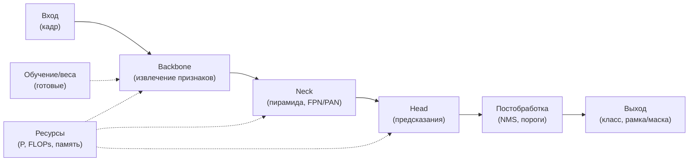

# Декомпозиция модели МО и характеристики для выбора (робототехника)

**Тема:** Обоснование выбора модели машинного обучения для распознавания
объектов оператору мобильного робота
**Дата:** 2026-10-13
**Основание:** консультация с Горячкиным Б.С. 13.10.2026
**Связанный документ:** `model-choice.md` (формулы характеристик)
**Статус:** черновик к согласованию

Идея: **разложить модель МО на составные части** (как «вычислитель» и как
устройство распознавания), по каждой части считать **свои
характеристики**, затем по ним **сравнить модели** и выбрать лучшую **под
задачу робототехники**.

---

## 1. Декомпозиция модели МО

Части: **вход → backbone → neck → head → постобработка → выход**, плюс
**обучение/веса** и сквозные **ресурсы**.

---

## 2. Характеристики по частям

### 2.1. Вход

| Характеристика | Обозн. | Формула/единица | Аналитически |
| --- | --- | --- | --- |
| Разрешение входа | $R_{in}$ | px (напр. 640×640) | по спецификации |
| Число каналов | $C_{in}$ | шт. (3 — RGB) | по спецификации |
| Нормализация входа | — | тип (mean/std) | по спецификации |
| Мин. различимый объект | $S_{min}$ | px (размер объекта) | $S_{min}=R_{in}/\text{stride}_{max}$ |

### 2.2. Backbone (извлечение признаков)

| Характеристика | Обозн. | Формула | Единицы |
| --- | --- | --- | --- |
| Тип операций | — | свёртки / внимание | — |
| Глубина | $L_b$ | число слоёв | шт. |
| Ширины (каналы) | $c_i$ | по стадиям | шт. |
| Параметры | $P_b$ | $\sum (k^2c_{i-1}c_i)$ | шт. |
| FLOPs | $F_b$ | $\sum 2k^2c_{i-1}c_i H_iW_i$ | оп. |
| Рецептивное поле | $R_{rf}$ | $1+\sum_i (k_i-1)\prod_{j<i}s_j$ | px |
| Число стадий | $N_s$ | шт. | шт. |

### 2.3. Neck (пирамида)

| Характеристика | Обозн. | Формула | Единицы |
| --- | --- | --- | --- |
| Наличие FPN/PAN | — | да/нет | — |
| Число уровней пирамиды | $N_l$ | шт. | шт. |
| Доп. параметры | $P_n$ | по слоям | шт. |
| Доп. FLOPs | $F_n$ | по слоям | оп. |

### 2.4. Head (предсказания)

| Характеристика | Обозн. | Формула | Единицы |
| --- | --- | --- | --- |
| Тип головы | — | anchor-based / anchor-free / set | — |
| Число предсказаний | $N_p$ | по сетке | шт. |
| Параметры головы | $P_h$ | по слоям | шт. |
| FLOPs головы | $F_h$ | по слоям | оп. |
| Однозначность класса | $O$ | $O=1/k$ | безразм. |

### 2.5. Постобработка

| Характеристика | Обозн. | Формула | Единицы |
| --- | --- | --- | --- |
| NMS | — | есть/нет | — |
| Зависимость от порогов | — | число гиперпараметров | шт. |
| Детерминизм | — | да/нет | — |

### 2.6. Выход

| Характеристика | Обозн. | Формула | Единицы |
| --- | --- | --- | --- |
| Тип результата | — | рамка / маска / точка | — |
| Число классов | $k$ | шт. | шт. |
| Формат уверенности | — | softmax / sigmoid | — |
| Однозначность класса | $O$ | $O=1/k$ | безразм. |
| Наглядность | $H$ | $H=1/\log_2(k+1)$ | безразм. |

### 2.7. Обучение / веса

| Характеристика | Обозн. | Значение | Единицы |
| --- | --- | --- | --- |
| Предобучение | — | набор данных | — |
| Число эпох | $E_p$ | шт. | шт. |
| Доступность весов | — | да/нет | — |

### 2.8. Ресурсы (сквозные)

| Характеристика | Обозн. | Формула | Единицы |
| --- | --- | --- | --- |
| Параметры | $P$ | $\sum P_i$ | шт. |
| FLOPs | $F$ | $\sum F_i$ | оп. |
| Память | $M$ | $M=4P$ (fp32), $2P$ (fp16) | байт |
| Задержка (расчётно) | $T$ | $T=F/\Pi$ ($\Pi$ — оп./с) | с |
| Эффективность | $E$ | $E=1/F$ | 1/оп. |
| Энергия | $Q$ | $Q=P_{pow}\cdot T$ | Дж |

### 2.9. Ёмкость и читаемость

| Характеристика | Обозн. | Формула | Единицы |
| --- | --- | --- | --- |
| Линейные области | $R$ | $\prod_i\sum_{j=1}^{d}\binom{n_i}{j}$ | шт. |
| VC-размерность | $\mathrm{VCdim}$ | $O(WL\log W)$ | шт. |
| Читаемость | $C$ | $\tfrac{1}{\log_2(P+1)}\tau$ | безразм. |

### 2.10. Робототехника (надёжность и реальное время)

| Характеристика | Обозн. | Формула/критерий | Единицы |
| --- | --- | --- | --- |
| Требование реального времени | $f_{min}$ | $f_{min}\ge$ частоты управления | Гц |
| Запас по задержке | $\Delta$ | $\Delta=1/f_{min}-T$ | с |
| Размер для борта | $M$ | $\le$ память бортового модуля | байт |
| Детерминизм выхода | — | нет случайных компонент | да/нет |
| Устойчивость к шуму | — | есть аугментации/регуляризация | да/нет |

---

## 3. Сводный перечень характеристик

| № | Характеристика | Обозн. | Часть |
| --- | --- | --- | --- |
| 1 | Разрешение входа | $R_{in}$ | вход |
| 2 | Глубина backbone | $L_b$ | backbone |
| 3 | Параметры | $P$ | ресурсы |
| 4 | FLOPs | $F$ | ресурсы |
| 5 | Память | $M$ | ресурсы |
| 6 | Задержка | $T$ | ресурсы |
| 7 | Эффективность | $E$ | ресурсы |
| 8 | Рецептивное поле | $R_{rf}$ | backbone |
| 9 | Число уровней пирамиды | $N_l$ | neck |
| 10 | Число предсказаний | $N_p$ | head |
| 11 | Однозначность класса | $O$ | выход |
| 12 | Наглядность | $H$ | выход |
| 13 | Линейные области | $R$ | ёмкость |
| 14 | VC-размерность | $\mathrm{VCdim}$ | ёмкость |
| 15 | Читаемость | $C$ | ёмкость |
| 16 | Запас по задержке | $\Delta$ | робототехника |
| 17 | Детерминизм | — | робототехника |

---

## 4. Приоритеты для задачи робототехники

| Уровень | Характеристики | Почему |
| --- | --- | --- |
| Критичные | $T,\ \Delta,\ M,\ O$ | реальное время, борт, однозначность решения |
| Важные | $E,\ R,\ H,\ C$ | эффективность, различимость, понятность оператору |
| Фоновые | $L_b,\ N_s,\ E_p$ | архитектурные детали |

---

## 5. Сравнение моделей и выбор

1. Заполнить **матрицу** «модель × характеристика».
2. **Доминирование (Парето):** модель лучше, если не хуже по всем и лучше
   хотя бы по одной.
3. **Лексикографический** порядок по приоритету из §4 (без весов).
4. **Пороговый отсев** по критичным характеристикам
   ($T\le T_{max}$, $M\le M_{max}$).
5. Победитель — **обоснованный выбор**.

---

## 6. Шаблон матрицы сравнения

| Модель | $P$ | $F$ | $M$ | $T$ | $E$ | $R_{rf}$ | $O$ | $H$ | $R$ | $C$ | $\Delta$ |
| --- | --- | --- | --- | --- | --- | --- | --- | --- | --- | --- | --- |
| YOLOv8 | … | … | … | … | … | … | 1 | … | … | … | … |
| YOLOv11 | … | … | … | … | … | … | 1 | … | … | … | … |
| RT-DETR | … | … | … | … | … | … | 1 | … | … | … | … |
| YOLOv8-seg | … | … | … | … | … | … | 1 | … | … | … | … |
| Mask R-CNN | … | … | … | … | … | … | 1 | … | … | … | … |

---

## 7. Открытые вопросы к преподавателю

1. Какие характеристики считать **критичными** для задачи?
2. Принять ли ёмкостные оценки ($R$, $\mathrm{VCdim}$) как «различимость»?
3. Как задать **приоритет** для лексикографического правила?
4. Итоговый набор моделей-кандидатов.
5. Задавать ли требование реального времени числом (Гц).
