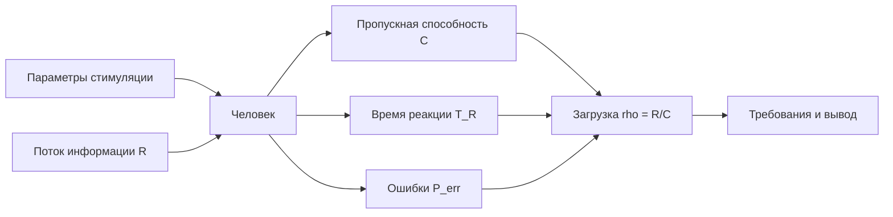

# Сужение темы: нейростимуляция зрительного канала и пропускная способность восприятия

**Дата:** 2026-10-25  
**Ветка:** `feat/publications`  
**Статус:** аналитическая записка по сужению альтернативной темы; основная тема КР — обнаружение аномалий оператором — не меняется.  
**Связанный отчёт:** `2026-10-25_neuroprosthesis-topic.md` (перенесён в эту папку).  
**Назначение:** проверить формулировку «нейростимулятор, ускоряющий восприятие потока информации», сузить её до защищаемой эргономической постановки и оценить источниковую базу.

---

## Оглавление

1. [Резюме](#1-резюме)
2. [Исходная формулировка и её проблема](#2-исходная-формулировка-и-её-проблема)
3. [Что значит «ускорять восприятие»](#3-что-значит-ускорять-восприятие)
4. [Варианты сужения](#4-варианты-сужения)
5. [Рекомендуемая постановка](#5-рекомендуемая-постановка)
6. [Эргономические характеристики](#6-эргономические-характеристики)
7. [Формальная модель](#7-формальная-модель)
8. [Источниковая стратегия](#8-источниковая-стратегия)
9. [Метод анализа](#9-метод-анализа)
10. [Что можно усилить](#10-что-можно-усилить)
11. [Риски](#11-риски)
12. [Структура возможной КР](#12-структура-возможной-кр)
13. [Дорожная карта](#13-дорожная-карта)
14. [Итоговый вывод](#14-итоговый-вывод)
15. [Связанные документы](#15-связанные-документы)

---

## 1. Резюме

Формулировка «нейростимулятор, который ускоряет быстродействие восприятия потока информации» интуитивно понятна, но в таком виде плохо защищается:

- неясно, что именно ускоряется: реакция, пропускная способность, время поиска или субъективное ощущение;
- «чип» обычно означает имплантируемое устройство, а литература по имплантам посвящена восстановлению зрения, а не ускорению восприятия;
- эффекты неинвазивной стимуляции на время реакции существуют, но они малы и разнородны;
- легко скатиться в медицинское обещание «ускорить мозг».

**Рекомендуемое сужение:**

> **«Эргономические требования к нейростимуляции зрительного канала по пропускной способности и времени реакции».**

Это уже не «чип ускоряет человека», а измеримая задача: при заданном потоке информации проверить, растёт ли пропускная способность, снижается ли время реакции и не ухудшаются ли ошибки, нагрузка и безопасность.

**Главная идея одной фразой:** ускорение восприятия — это не характеристика чипа, а изменение отношения «поток информации — пропускная способность человека — время реакции — ошибки».

---

## 2. Исходная формулировка и её проблема

### 2.1. Как звучит сейчас

«Нейростимуляторный чип, который обеспечивает ускорение восприятия потока информации».

### 2.2. Что здесь не определено

| Элемент | Вопрос |
|---|---|
| «Нейростимулятор» | Инвазивный имплант или неинвазивная стимуляция? |
| «Чип» | Имплантируемый массив, внешний контроллер или всё вместе? |
| «Ускорение» | Время реакции, пропускная способность, темп обучения? |
| «Восприятие» | Зрение, слух, мультимодальный канал? |
| «Поток информации» | Бит/с, объектов/с, кадров/с, символов/с? |
| «Эффект» | Улучшение, отсутствие ухудшения или субъективное ощущение? |

Без этих определений тема распадается на медицинское обещание и техническое описание.

### 2.3. Почему источники трудно найти

- Имплантируемые зрительные протезы изучаются как средство восстановления зрения, а не ускорения восприятия.
- Неинвазивная стимуляция изучается в когнитивных задачах, но эффекты часто малы, разнородны и плохо воспроизводятся.
- «Ускорение восприятия» редко является первичной конечной точкой; чаще измеряют время реакции, точность или субъективные шкалы.
- Клинические выборки малы, протоколы различаются, метрики несопоставимы.
- Прямых исследований «чип ускоряет поток информации» может почти не быть.

Это не приговор теме, а причина **сузить** её до измеримой характеристики и честно назвать источник.

### 2.4. Что нельзя обещать

- что устройство «ускоряет мозг»;
- что оно «повышает интеллект»;
- что оно «безопасно для всех»;
- что оно «заменяет зрение»;
- что эффект переносится на любые задачи.

---

## 3. Что значит «ускорять восприятие»

### 3.1. Три разных скорости

Нужно различать:

1. **Скорость поступления информации** `R` — сколько информации в единицу времени подаётся.
2. **Пропускная способность человека** `C` — сколько информации он успевает переработать.
3. **Время реакции** `T_R` — сколько времени проходит до ответа.

Это разные величины. Устройство может увеличить `R`, но не увеличить `C`; может снизить `T_R`, но ухудшить точность; может улучшить одну задачу и ухудшить другую.

### 3.2. Поток информации

Для дискретных сигналов:

$$
H = -\sum_{i=1}^{n} p_i \log_2 p_i
$$

где `H` — энтропия одного сигнала в битах.

Если сигналы поступают с частотой `f_s`, то:

$$
R = H \cdot f_s
$$

Единицы: бит/с.

Если задача не информационная, а сенсорная, можно использовать:

$$
R = \frac{N}{T}
$$

где `N` — число объектов/символов, `T` — время. Единицы: объектов/с или символов/с.

### 3.3. Пропускная способность

`C` — максимальный темп, при котором человек выполняет задачу с допустимой точностью.

$$
C = \frac{H}{T}
$$

или

$$
C = \frac{N}{T}
$$

`C` не является константой: она зависит от задачи, обучения, усталости, модальности и качества сигнала.

### 3.4. Загрузка канала

$$
\rho = \frac{R}{C}
$$

- `rho < 1` — запас;
- `rho = 1` — предел;
- `rho > 1` — перегрузка.

Критерий:

$$
\rho \le \rho_{\text{доп}}
$$

где `rho_доп` задаётся требованиями задачи и безопасности.

### 3.5. Время реакции

$$
T_R = T_{\text{лат}} + T_{\text{поиск}} + T_{\text{реш}} + T_{\text{действ}}
$$

Это разложение уже использовалось в отчёте по нейропротезу и опирается на лекции 7 и 15.

### 3.6. Ошибки

$$
P_{\text{err}} = \frac{N_{\text{err}}}{N_{\text{trials}}}
$$

Критерий:

$$
P_{\text{err}} \le P_{\text{доп}}
$$

Ускорение без сохранения ошибок не является улучшением.

---

## 4. Варианты сужения

### 4.1. Вариант A. Имплантируемый зрительный протез

**Формулировка:** «Эргономические требования к имплантируемому нейростимулятору зрительного канала по пропускной способности восприятия».

**Объект:** человек с имплантом — устройство — среда — задача.

**Плюсы:** есть клиническая литература по зрительным протезам, понятная техническая база, связь с лекцией 7.

**Минусы:** литература о восстановлении зрения, а не об ускорении; «чип» и «ускорение» плохо сочетаются; мало данных о `C` и `T_R`.

**Оценка источников:** средняя.

### 4.2. Вариант B. Неинвазивная нейростимуляция

**Формулировка:** «Эргономические требования к неинвазивной нейростимуляции зрительного канала по пропускной способности и времени реакции».

**Объект:** человек с неинвазивной стимуляцией — задача — информационный поток.

**Плюсы:** больше литературы по tDCS/tACS и времени реакции; можно собрать мета-анализ; нет хирургии.

**Минусы:** эффекты малы и разнородны; «чип» уже не имплант; трудно доказать ускорение.

**Оценка источников:** средне-высокая.

### 4.3. Вариант C. Чип, который ускоряет восприятие

**Формулировка:** «Нейростимуляторный чип для ускорения восприятия информационного потока».

**Проблема:** прямых исследований может не быть; формулировка обещает то, что не доказано.

**Оценка источников:** низкая.

**Вывод:** как основная тема не рекомендуется.

### 4.4. Вариант D. Нейростимулятор как канал с заданной пропускной способностью

**Формулировка:** «Эргономические требования к нейростимулятору зрительного канала по пропускной способности и времени реакции».

**Плюсы:** не обещает ускорения; можно изучать и импланты, и неинвазивные устройства; есть формулы и критерии.

**Минусы:** нужно чётко определить класс устройства.

**Оценка источников:** средняя.

### 4.5. Сравнение

| Вариант | Источники | Эргономическая ясность | Риск медицинского обещания | Вердикт |
|---|---|---|---|---|
| A. Имплант по пропускной способности | Средняя | Высокая | Средний | Возможен |
| B. Неинвазивная стимуляция | Средне-высокая | Средняя | Средний | Возможен |
| C. Чип ускоряет восприятие | Низкая | Низкая | Высокий | Не рекомендуется |
| D. Нейростимулятор как канал | Средняя | Высокая | Низкий | Рекомендуется |

---

## 5. Рекомендуемая постановка

### 5.1. Рабочее название

> **«Эргономические требования к нейростимуляции зрительного канала по пропускной способности и времени реакции».**

Если нужен именно «чип», уточнить:

> **«Эргономические требования к имплантируемому нейростимулятору зрительного канала по пропускной способности восприятия».**

### 5.2. Объект

Система:

> **человек с нейростимулятором — информационный поток — задача — среда**

### 5.3. Эргономическое ядро

Не «ускорение мозга», а **соответствие темпа потока информации пропускной способности человека** при заданных времени реакции, ошибках и нагрузке.

### 5.4. Что должно быть результатом

- матрица требований к `R`, `C`, `T_R`, `P_err`, `K_load`;
- анализ литературы по эффектам стимуляции;
- вывод, подтверждается ли ускорение и при каких условиях;
- ограничения и противопоказания;
- статья.

### 5.5. Что не должно быть результатом

- обещание лечения;
- универсальная «таблетка скорости»;
- сравнение устройств без задачи;
- экспертные баллы вместо данных.

---

## 6. Эргономические характеристики

### 6.1. Пропускная способность

$$
C = \frac{H}{T}
$$

Единицы: бит/с.

Направление: больше — лучше при сохранении точности.

Критерий:

$$
C \ge C_{\text{треб}}
$$

Эффект: если `C` ниже `R`, возникает перегрузка и ошибки.

### 6.2. Загрузка канала

$$
\rho = \frac{R}{C}
$$

Единицы: безразм.

Направление: меньше — лучше.

Критерий:

$$
\rho \le \rho_{\text{доп}}
$$

Эффект: перегрузка ведёт к пропуску сигналов и утомлению.

### 6.3. Время реакции

$$
T_R = T_{\text{лат}} + T_{\text{поиск}} + T_{\text{реш}} + T_{\text{действ}}
$$

Единицы: с.

Направление: меньше — лучше.

Критерий:

$$
T_R \le T_{\text{доп}}
$$

Эффект: запаздывание реакции снижает безопасность.

### 6.4. Ошибки

$$
P_{\text{err}} = \frac{N_{\text{err}}}{N_{\text{trials}}}
$$

Единицы: безразм.

Направление: меньше — лучше.

Критерий:

$$
P_{\text{err}} \le P_{\text{доп}}
$$

Эффект: ускорение без точности не является улучшением.

### 6.5. Загрузка оператора

$$
K_{\text{load}} = \frac{T_{\text{busy}}}{T_{\text{total}}}
$$

Единицы: безразм.

Направление: меньше — лучше.

Критерий:

$$
K_{\text{load}} \le K_{\text{доп}}
$$

### 6.6. Параметры стимуляции

Это технические входы, а не эргономические характеристики:

- амплитуда/ток;
- частота;
- длительность импульса;
- скважность;
- расположение электродов;
- длительность сеанса.

Их влияние на `C`, `T_R`, `P_err`, `K_load` и есть предмет анализа.

### 6.7. Сводная таблица

| Характеристика | Формула | Единицы | Направление | Критерий |
|---|---|---|---|---|
| Пропускная способность | $C = H/T$ | бит/с | больше | $C \ge C_{\text{треб}}$ |
| Загрузка канала | $\rho = R/C$ | безразм. | меньше | $\rho \le \rho_{\text{доп}}$ |
| Время реакции | $T_R = T_{\text{лат}} + T_{\text{поиск}} + T_{\text{реш}} + T_{\text{действ}}$ | с | меньше | $T_R \le T_{\text{доп}}$ |
| Ошибки | $P_{\text{err}} = N_{\text{err}}/N_{\text{trials}}$ | безразм. | меньше | $P_{\text{err}} \le P_{\text{доп}}$ |
| Загрузка | $K_{\text{load}} = T_{\text{busy}}/T_{\text{total}}$ | безразм. | меньше | $K_{\text{load}} \le K_{\text{доп}}$ |

---

## 7. Формальная модель

### 7.1. Эффект стимуляции

Пусть `T_R^{0}` — время реакции без стимуляции, `T_R^{s}` — со стимуляцией.

$$
\Delta T_R = T_R^{0} - T_R^{s}
$$

Если `Delta T_R > 0`, стимуляция ускоряет реакцию.

Аналогично:

$$
\Delta C = C^{s} - C^{0}
$$

Если `Delta C > 0`, пропускная способность растёт.

### 7.2. Критерий улучшения

Улучшение есть, только если одновременно:

$$
\Delta T_R \ge \Delta_{\text{min}}
$$

или

$$
\Delta C \ge \Delta_{\text{min}}
$$

и

$$
P_{\text{err}}^{s} \le P_{\text{err}}^{0} + \delta
$$

и

$$
K_{\text{load}}^{s} \le K_{\text{load}}^{0} + \delta_K
$$

где `Delta_min`, `delta`, `delta_K` — заранее заданные допустимые границы, а не веса.

### 7.3. Не ухудшение

Если стимуляция не ускоряет, но и не ухудшает показатели, это может быть приемлемо как «не хуже», но не как «ускорение».

### 7.4. Условие безопасности

Параметры стимуляции должны находиться в допустимых пределах. Это техническое ограничение, а не эргономическая характеристика.

### 7.5. Схема

---

## 8. Источниковая стратегия

### 8.1. Где искать

| Направление | Что искать |
|---|---|
| Неинвазивная стимуляция | tDCS, tACS, реакция, внимание, зрительное восприятие |
| Имплантируемые протезы | электродные массивы, поле, разрешение, распознавание |
| Информационная теория | пропускная способность человека, энтропия, темп |
| Эргономика | время реакции, нагрузка, ошибки, критерии |
| Безопасность | пределы стимуляции, побочные эффекты, этика |

### 8.2. Поисковые ключи

- «transcranial direct current stimulation reaction time»
- «transcranial alternating current stimulation visual perception»
- «visual prosthesis information transfer»
- «human channel capacity information rate»
- «workload time on task»
- «neurostimulation safety limits»

Это ключи, а не готовые ссылки. Каждую ссылку нужно проверить.

### 8.3. Критерии включения

- есть измеримый эффект на `T_R`, `C`, `P_err` или `K_load`;
- указан протокол стимуляции;
- указана задача;
- есть контроль/сравнение;
- известен размер выборки.

### 8.4. Критерии исключения

- только маркетинг;
- нет числовых результатов;
- смешаны задачи;
- нет контроля;
- невозможно нормализовать.

### 8.5. Сколько нужно

Для второго пути:

- 25–30 источников;
- 20+ ссылок в тексте;
- 5 источников не старше 5 лет;
- 2–5 авторов МГТУ;
- DOI приоритетно;
- не более 2 не на английском.

### 8.6. Реалистичность

Для неинвазивной стимуляции источников больше, чем для «чипа, ускоряющего восприятие». Для имплантируемого протеза источников больше по разрешению/полю, чем по ускорению. Поэтому **класс устройства нужно выбрать до поиска**, иначе база расползётся.

---

## 9. Метод анализа

### 9.1. Путь 2

1. Выбрать класс устройства.
2. Выбрать задачу и информационный поток.
3. Собрать источники.
4. Извлечь `T_R`, `C`, `P_err`, `K_load`, параметры стимуляции.
5. Нормализовать.
6. Оценить эффекты.
7. Проверить разнородность.
8. Сделать вывод.
9. Написать статью.

### 9.2. Нормализация

- `T_R` в секундах;
- `C` в бит/с или символов/с;
- `P_err` в долях;
- `K_load` в долях;
- параметры стимуляции в физических единицах.

### 9.3. Анализ эффектов

- среднее изменение;
- доверительный интервал;
- разнородность;
- подгруппы по типу стимуляции;
- подгруппы по задаче.

### 9.4. Что нельзя делать

- усреднять разные задачи без оговорок;
- складывать эффекты разных протоколов;
- выдавать малые эффекты за «ускорение»;
- игнорировать побочные эффекты;
- использовать экспертные баллы.

---

## 10. Что можно усилить

### 10.1. Определить класс устройства

Имплант или неинвазивная стимуляция. Без этого тема расплывается.

### 10.2. Определить задачу

Например: обнаружение сигнала в потоке, чтение, поиск объекта. Для каждой задачи свои `R`, `C`, `T_R`.

### 10.3. Ввести `rho`

Отношение потока к пропускной способности — сильная эргономическая характеристика. Она показывает перегрузку, а не «скорость чипа».

### 10.4. Разделить скорость и точность

Ускорение без сохранения ошибок не считается улучшением.

### 10.5. Ввести не ухудшение

Даже если эффекта нет, важно показать, что стимуляция не ухудшает показатели.

### 10.6. Учесть побочные эффекты

Головная боль, усталость, дискомфорт, кожные реакции — это ограничения, а не «мелочи».

### 10.7. Проверить воспроизводимость

Если эффект есть в одном исследовании и исчезает в другом, это нужно показать.

### 10.8. Отделить технические параметры

Ток, частота, длительность — входы, а не эргономические характеристики.

---

## 11. Риски

| Риск | Вероятность | Влияние | Митигация |
|---|---|---|---|
| Нет прямых источников по «чипу» | Высокая | Высокое | Сменить класс на неинвазивный или на протез |
| Эффекты малы и разнородны | Высокая | Среднее | Мета-анализ, подгруппы, честные выводы |
| Медицинское обещание | Средняя | Высокое | Язык требований, не лечения |
| Этические ограничения | Средняя | Высокое | Только литература, без пациентов |
| Нет данных по `C` | Высокая | Среднее | Использовать `T_R` и `P_err`, `C` как модель |
| Смешение задач | Высокая | Высокое | Одна задача |
| Мало авторов МГТУ | Средняя | Низкое | Искать профильные работы |
| Срыв сроков | Средняя | Высокое | Сначала источники, потом текст |

---

## 12. Структура возможной КР

### 12.1. Введение

- поток информации в деятельности оператора;
- проблема перегрузки;
- нейростимуляция как возможное средство;
- границы: не лечение, не «ускорение мозга».

### 12.2. Методы

- системный анализ;
- информационная модель;
- критерии `C`, `rho`, `T_R`, `P_err`, `K_load`;
- источниковая база.

### 12.3. Результаты

- обзор исследований;
- нормализованные эффекты;
- подгруппы;
- ограничения.

### 12.4. Обсуждение

- подтверждается ли ускорение;
- при каких условиях;
- что не проверено;
- что нельзя обещать.

### 12.5. Заключение

- требования;
- ограничения;
- направления.

### 12.6. Статья

По требованиям второго пути.

---

## 13. Дорожная карта

| Этап | Действие | Критерий готовности |
|---|---|---|
| 1 | Выбрать класс устройства | Имплант или неинвазивная стимуляция |
| 2 | Выбрать задачу | Одна задача и один поток |
| 3 | Собрать источники | 25–30, критерии отбора |
| 4 | Извлечь данные | Таблица `T_R`, `C`, `P_err` |
| 5 | Нормализовать | Единые единицы |
| 6 | Оценить эффекты | Средние, интервалы, разнородность |
| 7 | Написать РПЗ | 25–30 страниц |
| 8 | Статья | По требованиям |
| 9 | Защита | Вопросы и ответы |

---

## 14. Итоговый вывод

**Вариант «чип, ускоряющий восприятие»** интересен, но в чистом виде рискован: прямых источников мало, эффект легко переоценить, а формулировка обещает больше, чем можно доказать.

**Лучшее сужение:**

> **«Эргономические требования к нейростимуляции зрительного канала по пропускной способности и времени реакции».**

Если нужен именно чип:

> **«Эргономические требования к имплантируемому нейростимулятору зрительного канала по пропускной способности восприятия».**

Но в этом случае лучше говорить не об «ускорении», а о **пропускной способности, времени реакции и ошибках**. Тогда тема остаётся эргономической и не превращается в медицинское обещание.

**Основная тема КР** при этом остаётся прежней: обнаружение аномалий оператором. Нейростимуляция — альтернативная линия, не замена.

---

## 15. Связанные документы

| Документ | Что даёт |
|---|---|
| `2026-10-25_neuroprosthesis-topic.md` | Общий разбор нейропротеза |
| `../2026-10-25_topic-selection.md` | Основная тема КР |
| `../2026-10-25_formal-model.md` | Формальная модель аномалий |
| `../AGENT_RU.md` | Правила работы |
| `../AGENTS.md` | Английская версия правил |
| `../archive/recognition-objects/archive/formulas.tex` | Формулы угла, времени, `d'` |
| `../model-selection/` | Декомпозиция технического слоя |
