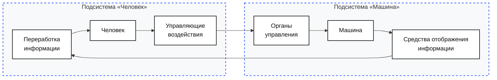
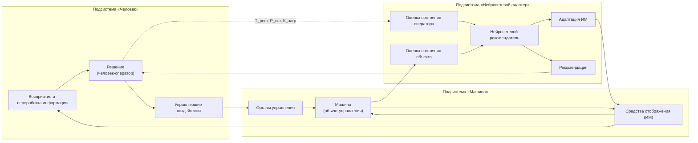
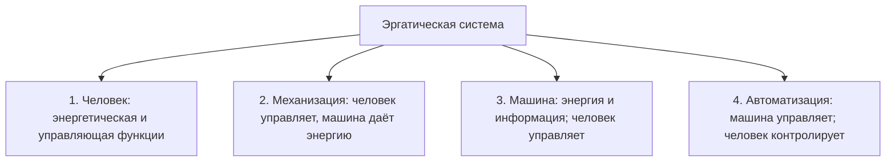
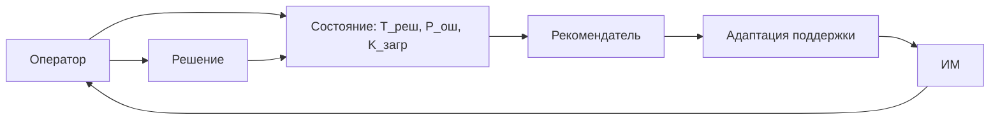

# Эргономические требования к адаптивной нейросетевой системе рекомендаций для оператора

**Материалы к консультации**  
**Дисциплина:** «Эргономический анализ»  
**Исполнитель:** Папин А.В., группа ИУ5Ц-31М  
**Консультация:** Б.С. Горячкин, 2026-10-25  
**Статус:** предлагаемая тема КР; окончательная формулировка и состав характеристик требуют обсуждения.  
**Альтернативный вариант:** `2026-10-25_decision-stage-kp.md` — без ИИ-рекомендателя, путь 2.

---

## Оглавление

1. [Резюме](#1-резюме)
2. [Постановка проблемы](#2-постановка-проблемы)
3. [Объект и эргатическая схема](#3-объект-и-эргатическая-схема)
4. [Эргономическое ядро](#4-эргономическое-ядро)
5. [Что именно адаптируется](#5-что-именно-адаптируется)
6. [Эргономические характеристики](#6-эргономические-характеристики)
7. [Почему это эргономика, а не ML-обзор](#7-почему-это-эргономика-а-не-ml-обзор)
8. [Метод](#8-метод)
9. [Ожидаемый результат](#9-ожидаемый-результат)
10. [Что обсудить на консультации](#10-что-обсудить-на-консультации)
11. [Ограничения](#11-ограничения)
12. [Предварительная структура КР](#12-предварительная-структура-кр)
13. [Дорожная карта](#13-дорожная-карта)
14. [Источники](#14-источники)
15. [Приложение. Схемы](#15-приложение-схемы)

---

## 1. Резюме

Предлагается тема КР:

> **«Эргономические требования к адаптивной нейросетевой системе рекомендаций для оператора».**

**Проблема.** При высоком потоке информации оператор тратит значительное время на поиск, оценку и выбор действия. Нейросетевой рекомендатель может сократить это время и уменьшить ошибки, но только если он учитывает не «средние» возможности человека, а текущее эргономическое состояние конкретного оператора: нагрузку, темп, ошибки, внимание и опыт.

**Идея.** Нейросеть работает не как замена оператора, а как **адаптивный рекомендатель**:

- оценивает состояние оператора и объекта;
- меняет информационную модель под текущую нагрузку;
- предлагает вариант действия;
- оставляет решение и контроль человеку.

**Что даёт.** Потенциально:

- сокращение времени решения;
- снижение числа ошибок;
- снижение нагрузки;
- персонализацию поддержки;
- уменьшение числа лишних проверок и ложных тревог.

**Что ограничивает.** Автоматизационная зависимость, потеря ситуационной осведомлённости, нестабильная адаптация, неверная оценка состояния, приватность и ответственность.

**Почему это эргономика.** Объект — не нейросеть, а деятельность оператора в эргатической системе. Характеристики — время, ошибки, нагрузка, обучение, передача управления. Технические метрики модели — только вход.

---

## 2. Постановка проблемы

### 2.1. Поток информации и возможности человека

Пусть:

- `R` — темп поступления информации, бит/с или сигналов/с;
- `C` — пропускная способность человека в задаче;
- `T_R` — время реакции;
- `P_ош` — вероятность ошибки;
- `K_загр` — загрузка.

При высоком `R` человек не успевает:

- заметить сигнал;
- понять ситуацию;
- выбрать действие;
- выполнить его без ошибки.

### 2.2. Что может сделать адаптивный рекомендатель

Он может:

- уменьшить объём информации;
- поднять приоритет критичных сигналов;
- сменить модальность;
- предложить действие;
- дать объяснение;
- предупредить о риске.

Но он же может:

- усилить слепое доверие;
- скрыть важный сигнал;
- ошибиться в оценке состояния;
- сделать оператора пассивным.

Поэтому адаптация должна быть **ограниченной, прозрачной и контролируемой**.

### 2.3. Рабочая гипотеза

**Если** рекомендатель адаптирует информационную модель под измеримое состояние оператора, **то** время решения и ошибки снижаются без роста нагрузки и потери контроля — **при условии**, что адаптация устойчива, понятна и оператор может её отключить.

---

## 3. Объект и эргатическая схема

### 3.1. Объект

Эргатическая система:

> **оператор — адаптивный нейросетевой рекомендатель — информационная модель — объект управления — среда**

### 3.2. Схема эргатической системы из лекции 2

В этой схеме:

- средства отображения (`SOI`) передают информацию человеку;
- человек (`CH`) перерабатывает информацию и формирует управляющие воздействия (`UV`);
- органы управления (`OU`) передают воздействие машине (`M`);
- машина меняет состояние и снова отображает его.

### 3.3. Схема с адаптивным нейросетевым рекомендателем

### 3.4. Кто принимает решение

**Решение принимает человек-оператор** (`H2`).

Нейросеть (`A2`):

- рекомендует;
- объясняет;
- адаптирует ИМ;
- не заменяет решение.

Машина (`M2`) — объект управления. Она исполняет воздействие, но не выбирает действие.

Если нейросеть начинает управлять напрямую, это уже другой уровень автоматизации и другая постановка, требующая отдельного анализа безопасности.

### 3.5. Что такое T, P, K

В схеме `T, P, K` — это не «магические» переменные, а три группы наблюдаемых показателей:

| Символ | Что означает | Примеры | Единицы |
|---|---|---|---|
| `T` | время | $T_{\text{реш}}$, $T_{\text{пров}}$, $T_R$ | с |
| `P` | вероятность/ошибка | $P_{\text{ош}}$, $P_{\text{обн}}$, $P_{\text{лт}}$ | безразм. |
| `K` | загрузка | $K_{\text{загр}}$ | безразм. |

`P` — это не performance и не прибыль, а вероятность/ошибка. `K` — не качество, а загрузка оператора.

---

## 4. Эргономическое ядро

Не «нейросеть ускоряет человека», а:

> **адаптивная поддержка согласует поток информации и поддержку с текущими возможностями оператора, снижая время и ошибки без потери контроля.**

Это означает:

- адаптируется **поддержка**, а не человек;
- оператор остаётся в контуре;
- технические метрики модели — вход;
- эргономические характеристики — время, ошибки, нагрузка, обучение, передача управления.

---

## 5. Что именно адаптируется

- объём информации;
- приоритеты сигналов;
- модальность (зрение, слух, осязание);
- темп подачи;
- уровень автоматизации;
- частота подсказок;
- сложность представления.

Не адаптируется:

- критичность события;
- право оператора отключить поддержку;
- ответственность за решение.

---

## 6. Эргономические характеристики

### 6.1. Список параметров и обозначений

Сначала — важное различие:

- **параметр** — измеряемая величина (время поиска, число элементов, число стабильных циклов);
- **характеристика** — эргономическая оценка, которая получается из параметров по формуле (время решения, вероятность ошибки, загрузка).

| Обозначение | Смысл | Единицы | Тип |
|---|---|---|---|
| $T_R$ | общее время реакции | с | характеристика |
| $T_{\text{реш}}$ | время решения | с | характеристика |
| $T_{\text{ориент}}$ | время ориентации в ситуации | с | параметр |
| $t_{\text{ип}}$ | время информационного поиска | с | характеристика/параметр |
| $T_{\text{сравн}}$ | время сравнения вариантов | с | параметр |
| $T_{\text{выбор}}$ | время выбора | с | параметр |
| $T_{\text{подтв}}$ | время подтверждения | с | параметр |
| $T_{\text{доп}}$ | допустимое время решения | с | норма |
| $P_{\text{ош}}$ | вероятность ошибки | безразм. | характеристика |
| $P_{\text{ИИ-ош}}$ | вероятность ошибки ИИ | безразм. | параметр |
| $P_{\text{принять}\mid\text{ош}}$ | вероятность принять ошибочную рекомендацию | безразм. | параметр |
| $P_{\text{отклонить}\mid\text{верно}}$ | вероятность отклонить верную рекомендацию | безразм. | параметр |
| $P_{\text{доп}}$ | допустимая вероятность ошибки | безразм. | норма |
| $K_{\text{загр}}$ | загрузка оператора | безразм. | характеристика |
| $T_{\text{зан}}$ | занятое время | с | параметр |
| $T_{\text{цикла}}$ | длительность цикла | с | параметр |
| $K_{\text{доп}}$ | допустимая загрузка | безразм. | норма |
| $E$ | объём элементов ИМ | шт. | параметр |
| $a$ | объём зрительного восприятия | шт. | параметр |
| $H_\alpha$ | число элементов с заданным набором признаков | шт. | параметр |
| $t_{\text{фик}}$ | длительность зрительной фиксации | с | параметр |
| $I$ | информационная насыщенность | элементов | характеристика |
| $\nu$ | пропускная способность | элементов/с | параметр |
| $t_{\text{эк}}$ | время экспозиции | с | параметр |
| $t_{\text{изм}}$ | время измерения состояния | с | параметр |
| $t_{\text{анализа}}$ | время анализа состояния | с | параметр |
| $t_{\text{перестройки}}$ | время перестройки ИМ | с | параметр |
| $t_{\text{доп}}$ | допустимое время поиска | с | норма |
| $I_{\text{доп}}$ | допустимая насыщенность | элементов | норма |
| $T_{\text{адапт,доп}}$ | допустимое время адаптации | с | норма |
| $P_{\text{уст,доп}}$ | допустимая устойчивость | безразм. | норма |
| $T_{\text{адапт}}$ | время адаптации | с | характеристика |
| $P_{\text{уст}}$ | устойчивость адаптации | безразм. | характеристика |
| $N_{\text{стаб}}$ | число стабильных циклов | шт. | параметр |
| $N_{\text{циклов}}$ | общее число циклов | шт. | параметр |

### 6.2. Время решения

**Идея.** Показывает, сколько времени проходит от понимания ситуации до подтверждённого выбора. Это не «скорость нейросети», а время деятельности оператора.

**Формула:**

$$
T_{\text{реш}} = T_{\text{ориент}} + t_{\text{ип}} + T_{\text{сравн}} + T_{\text{выбор}} + T_{\text{подтв}}
$$

**Критерий:**

$$
T_{\text{реш}} \le T_{\text{доп}}
$$

**Зачем.** По этой характеристике проверяется, действительно ли адаптивная поддержка ускоряет решение, а не просто добавляет ещё один элемент в интерфейс.

**Практика в быту.** В навигаторе с подсказкой «поверните направо через 300 м» водитель быстрее выбирает полосу, чем при самостоятельном чтении карты. В кофейном автомате меню из трёх кнопок выбирается быстрее, чем меню из пятнадцати. Если подсказка появляется слишком поздно, она не ускоряет решение, а отвлекает.

**Источник.** Лекции 2 и 4; формула $t_{\text{ип}}$ — лекция 15.

### 6.3. Ошибка

**Идея.** Показывает вероятность неправильного решения с учётом двух источников: ошибки ИИ и ошибки оператора при проверке рекомендации.

**Формула:**

$$
P_{\text{ош}} = P_{\text{ИИ-ош}} \cdot P_{\text{принять}\mid\text{ош}} + (1 - P_{\text{ИИ-ош}}) \cdot P_{\text{отклонить}\mid\text{верно}}
$$

**Критерий:**

$$
P_{\text{ош}} \le P_{\text{доп}}
$$

**Зачем.** Ускорение без сохранения правильности не является улучшением. Формула показывает, что даже хорошая модель может давать плохой эргономический результат, если оператор слепо принимает её ошибки или, наоборот, постоянно отклоняет верные рекомендации.

**Практика в быту.** Навигатор может предложить неверный поворот, и водитель принимает ошибку, потому что не смотрит на знаки. Или наоборот: хорошая подсказка отклоняется, потому что водитель привык ей не доверять. В обоих случаях страдает не «точность модели», а совместное решение человека и системы.

**Источник.** Лекции 5 и 15; модель ошибки — двухступенчатая.

### 6.4. Загрузка

**Идея.** Показывает, какую долю цикла оператор занят обработкой сигналов, проверкой и действиями.

**Формула:**

$$
K_{\text{загр}} = \frac{T_{\text{зан}}}{T_{\text{цикла}}}
$$

**Критерий:**

$$
K_{\text{загр}} \le K_{\text{доп}}
$$

**Зачем.** Адаптивная поддержка не должна перегружать оператора. Если она добавляет больше проверок, чем убирает, выигрыша нет.

**Практика в быту.** Смартфон с двадцатью уведомлениями в минуту заставляет постоянно отвлекаться, а один важный сигнал — нет. Автомобиль с непрерывными предупреждениями утомляет водителя, и он начинает их игнорировать. Хорошая поддержка снижает загрузку, а не перекладывает её на человека.

**Источник.** Лекции 4 и 15.

### 6.5. Время информационного поиска

**Идея.** Показывает, сколько времени нужно, чтобы найти нужный элемент в ИМ.

**Формула:**

$$
t_{\text{ип}} = \frac{E + a}{a}(1 + H_\alpha)t_{\text{фик}}
$$

**Критерий:**

$$
t_{\text{ип}} \le t_{\text{доп}}
$$

**Зачем.** Адаптация должна уменьшать поиск, а не добавлять новые элементы. Если после «упрощения» оператор дольше ищет критичный сигнал, адаптация вредна.

**Практика в быту.** На табло аэропорта легко найти рейс, когда строки сгруппированы по времени. В перегруженном списке из ста строк поиск занимает больше времени. Подсказка, которая подсвечивает нужную строку, ускоряет поиск; подсказка, которая добавляет ещё одну строку, — замедляет.

**Источник.** Лекция 15.

### 6.6. Информационная насыщенность

**Идея.** Показывает, сколько элементов ИМ приходится на единицу пространства/времени и не превышает ли это возможности восприятия.

**Формула:**

$$
I = \nu t_{\text{эк}}
$$

**Критерий:**

$$
I \le I_{\text{доп}}
$$

**Практика в быту.** Приборная панель с десятками значков читается хуже, чем несколько крупных индикаторов. Сайт с плотным текстом и рекламой заставляет искать нужное дольше, чем страница с ясной структурой. Адаптация должна уменьшать плотность, а не добавлять «ещё одну полезную кнопку».

**Источник.** Лекция 15; ориентиры: 1000–1200 знаков/м², 30–40 см/дм².

### 6.7. Время адаптации

**Идея.** Показывает, сколько времени проходит от изменения состояния оператора до полезного изменения поддержки.

**Формула:**

$$
T_{\text{адапт}} = t_{\text{изм}} + t_{\text{анализа}} + t_{\text{перестройки}}
$$

**Критерий:**

$$
T_{\text{адапт}} \le T_{\text{адапт,доп}}
$$

**Зачем.** Слишком медленная адаптация бесполезна: к моменту изменения поддержки ситуация уже изменилась.

**Практика в быту.** Автоматическая яркость экрана, которая реагирует через полминуты, раздражает; быстрая реакция помогает. Автокоррекция текста, которая срабатывает с задержкой, мешает печатать. В обоих случаях важна не «умность», а своевременность.

**Источник.** Лекции 4 и 16.

### 6.8. Устойчивость

**Идея.** Показывает, как часто адаптация остаётся стабильной и не «дёргается» между режимами.

**Формула:**

$$
P_{\text{уст}} = \frac{N_{\text{стаб}}}{N_{\text{циклов}}}
$$

**Критерий:**

$$
P_{\text{уст}} \ge P_{\text{уст,доп}}
$$

**Зачем.** Нестабильная адаптация хуже фиксированного режима: оператор не успевает понять, как система работает.

**Практика в быту.** Автоматическая яркость, которая постоянно прыгает, мешает читать. Круиз-контроль, который рывками меняет скорость, утомляет. Хорошая адаптация должна быть плавной и предсказуемой.

**Источник.** Лекции 4 и 16.

### 6.9. Сводная таблица

| Характеристика | Формула | Единицы | Направление | Критерий |
|---|---|---|---|---|
| Время решения | $T_{\text{реш}}$ | с | меньше | $T_{\text{реш}} \le T_{\text{доп}}$ |
| Ошибка | $P_{\text{ош}}$ | безразм. | меньше | $P_{\text{ош}} \le P_{\text{доп}}$ |
| Загрузка | $K_{\text{загр}}$ | безразм. | меньше | $K_{\text{загр}} \le K_{\text{доп}}$ |
| Поиск | $t_{\text{ип}}$ | с | меньше | $t_{\text{ип}} \le t_{\text{доп}}$ |
| Насыщенность | $I$ | элементов | меньше | $I \le I_{\text{доп}}$ |
| Адаптация | $T_{\text{адапт}}$ | с | меньше | $T_{\text{адапт}} \le T_{\text{адапт,доп}}$ |
| Устойчивость | $P_{\text{уст}}$ | безразм. | больше | $P_{\text{уст}} \ge P_{\text{уст,доп}}$ |

---

## 7. Почему это эргономика, а не ML-обзор

| Вопрос | Ответ |
|---|---|
| Объект | Деятельность оператора в эргатической системе |
| Нейросеть | Компонент, а не объект |
| Технические метрики | Вход, ограничения, прокси |
| Эргономические характеристики | Время, ошибки, нагрузка, обучение |
| Метод | Аналитика + проверка, не выбор модели |
| Результат | Требования к ИМ и поддержке |

Нейросеть может быть сколь угодно точной, но если она увеличивает нагрузку, снижает контроль или создаёт слепое доверие — эргономический результат отрицательный.

---

## 8. Метод

### 8.1. Предлагаемый путь

**Путь 2 — системный анализ и подготовка статьи.**

Эксперимент не проектируется. Причина: нет доступа к реальным операторам и сопоставимым условиям деятельности, но есть литература по adaptive automation, human-AI teaming, automation bias и workload-adaptive systems.

### 8.2. Что делается

1. Описать деятельность оператора.
2. Выбрать тип рекомендателя.
3. Описать ИМ.
4. Выбрать 7 характеристик.
5. Собрать источники.
6. Сравнить адаптивный и фиксированный режимы по литературным данным, без эксперимента.
7. Сделать вывод.
8. Подготовить статью.

### 8.3. Что проверяется

- снижается ли `T_реш`;
- снижается ли `P_ош`;
- не растёт ли `K_загр`;
- устойчива ли адаптация;
- сохраняет ли оператор контроль.

---

## 9. Ожидаемый результат

- матрица требований к адаптивной поддержке;
- критерии выбора уровня адаптации;
- перечень запрещённых режимов;
- рекомендации по прозрачности и ручному режиму;
- основа для статьи.

---

## 10. Что обсудить на консультации

1. Принимается ли тема в такой формулировке?
2. Правильно ли, что решение остаётся за человеком-оператором?
3. Достаточно ли характеристик: `T_реш`, `P_ош`, `K_загр`, `t_ип`, `I`, `T_адапт`, `P_уст`?
4. Достаточно ли аналитического сравнения без эксперимента?
5. Какие лекционные критерии усилить?
6. Нет ли риска, что тема снова уйдёт в ML?

---

## 11. Ограничения

- нет собственного эксперимента; сравнение опирается на литературу;
- состояние оператора трудно измерить;
- данные о нагрузке чувствительны;
- адаптация может быть нестабильной;
- нет универсальных норм для адаптивных систем;
- ответственность за решение остаётся у оператора.

---

## 12. Предварительная структура КР

1. Введение.
2. Эргономический анализ деятельности.
3. Информационная модель и адаптивная поддержка.
4. Технический слой: рекомендатель.
5. Эргономические характеристики.
6. Метод оценки.
7. Результаты и обсуждение.
8. Заключение.
9. Источники.
10. Приложения.

---

## 13. Дорожная карта

| Этап | Действие | Результат |
|---|---|---|
| 1 | Согласовать тему | Формулировка |
| 2 | Описать деятельность | Схема и точки решения |
| 3 | Описать ИМ | Требования |
| 4 | Выбрать характеристики | 7 формул |
| 5 | Собрать источники | 25–30 |
| 6 | Сравнить режимы | Таблица |
| 7 | Написать РПЗ | 25–30 страниц |
| 8 | Статья | По требованиям |

---

## 14. Источники

### 14.1. Лекции

#### Лекция 2. Эргономика, эргатические системы

В лекции 2 вводится эргатическая система и обязательный элемент — человек-оператор. Показаны типы деятельности: операционная, оперативная и тактическая, а также типы операторов. Для темы это важно потому, что рекомендатель не должен подменять деятельность оператора: он встраивается в его контур, а решение остаётся за человеком.

#### Лекция 3. Системно-деятельностный подход

Лекция 3 задаёт порядок проектирования: сначала деятельность, затем информационные потребности, затем требования к средствам. Для адаптивного рекомендателя это означает, что нельзя начинать с «умной нейросети»; сначала нужно описать, какие решения принимает оператор и какая информация ему нужна.

#### Лекция 4. Функциономика

Лекция 4 рассматривает алгоритмы деятельности, тренируемость, утомляемость и психофизиологический контроль. Адаптивная поддержка должна учитывать не только текущую нагрузку, но и обучение, утомление и риск потери навыка. Иначе «помощь» может ухудшить деятельность в долгосрочной перспективе.

#### Лекция 5. Эргономическое обеспечение: управляемость

Лекция 5 вводит критерий управляемости: сложность процесса, качество ИМ, качество рабочего места, комфортность и адаптируемость. Адаптивный рекомендатель влияет на сложность, качество ИМ и надёжность взаимодействия, поэтому его нельзя оценивать только по точности модели.

#### Лекция 6. Эргономическое обеспечение: освояемость и обитаемость

Лекция 6 показывает, что обучение и освоение системы — часть эргономического качества. Адаптивная поддержка должна быть понятной, предсказуемой и не требовать длительного переобучения при каждом изменении режима. Иначе выигрыш в скорости будет потерян на обучении.

#### Лекция 7. Зрительный анализатор

Лекция 7 даёт пороги восприятия, время поиска, поля зрения и разрешающую способность. Эти данные нужны, чтобы адаптация ИМ не противоречила возможностям зрительного канала: нельзя «упрощать» ИМ так, чтобы критичный сигнал стал менее заметным.

#### Лекция 9. Информационные модели

Лекция 9 определяет ИМ как организованное отображение состояний объекта, среды и способов воздействия. Рекомендатель и его уверенность — часть ИМ, а не отдельная «магия». Поэтому его выход должен подчиняться требованиям к ИМ, а не только требованиям ML.

#### Лекция 10. Требования к ИМ

Лекция 10 задаёт требования к ИМ: визуальная однозначность, доступность, информационная ёмкость, частота смены кадра, надёжность, аварийная фиксация внимания. Адаптивная ИМ должна выполнять эти требования в каждом режиме, а не только в «среднем».

#### Лекция 12. Инженерно-психологическое проектирование

Лекция 12 описывает требования и ограничения к человеку-оператору и техническим средствам. Адаптивный рекомендатель должен работать внутри этих ограничений: не перегружать, не скрывать критичное, не требовать невозможного темпа.

#### Лекция 13. Эргономическая экспертиза

Лекция 13 задаёт процедуру эргономической экспертизы: проверка выполнения требований и разработка рекомендаций. Для темы это означает, что адаптивная система должна оцениваться по эргономическим критериям, а не только по метрикам модели.

#### Лекция 15. Эргономический сертификат

Лекция 15 даёт количественные характеристики: $t_{\text{ип}}$, $I$, пороговые размеры, цветовые пороги и нормы. Эти формулы — основа для оценки ИМ с адаптивной поддержкой и для сертификата.

#### Лекция 16. Эргономическая оптимизация

Лекция 16 связывает параметры ИМ с характеристиками человека и вводит условие $G_{\text{техн}} \le G_{\text{воспр}}$. Для адаптивного рекомендателя это означает, что параметры ИМ должны выбираться по возможностям восприятия, а не только по возможностям модели.

### 14.2. Внешние источники

- adaptive automation;
- adaptive aiding;
- human-AI teaming;
- automation bias;
- trust calibration;
- workload-adaptive systems;
- human-in-the-loop;
- explainable AI;
- recommender systems.

Для пути 2 потребуется 25–30 источников, не менее 20 ссылок в тексте, 5 источников не старше 5 лет, 2–5 авторов МГТУ, DOI приоритетно.

---

## 15. Приложение. Схемы

### 15.1. Классификация эргатических систем по уровням организации

Адаптивный рекомендатель — вариант четвёртого уровня, но с сохранением контроля человека.

### 15.2. Контур адаптации

