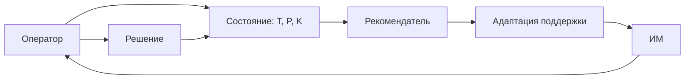

# Сужение темы: адаптивный нейросетевой рекомендатель для оператора

**Дата:** 2026-10-25  
**Ветка:** `feat/publications`  
**Статус:** дальнейшее сужение ИИ-ветви этапа решения; основная тема КР — методы снижения времени реакции — сохраняется.  
**Связанные отчёты:** `2026-10-25_decision-stage-ai.md`, `2026-10-25_decision-stage-ergonomic.md`, `2026-10-25_concept.md`.  
**Назначение:** проверить идею нейросети-рекомендателя, которая автоматически подстраивается под эргономическое состояние оператора, и определить, что здесь действительно эргономика, а что — обещание.

---

## Оглавление

1. [Резюме](#1-резюме)
2. [Что именно сужается](#2-что-именно-сужается)
3. [Эргономическое ядро](#3-эргономическое-ядро)
4. [Лекционная рамка](#4-лекционная-рамка)
5. [Объект и границы](#5-объект-и-границы)
6. [Как работает адаптивный рекомендатель](#6-как-работает-адаптивный-рекомендатель)
7. [Что именно адаптируется](#7-что-именно-адаптируется)
8. [Эргономические характеристики](#8-эргономические-характеристики)
9. [Формальная модель](#9-формальная-модель)
10. [Плюсы — но условные](#10-плюсы--но-условные)
11. [Риски и ограничения](#11-риски-и-ограничения)
12. [Методы и дизайн](#12-методы-и-дизайн)
13. [Экспертиза и сертификат](#13-экспертиза-и-сертификат)
14. [Источники](#14-источники)
15. [Структура КР](#15-структура-кр)
16. [Дорожная карта](#16-дорожная-карта)
17. [Итог](#17-итог)
18. [Связанные документы](#18-связанные-документы)

---

## 1. Резюме

Идея сильная, но её нужно правильно назвать.

Не «нейросеть, которая ускоряет человека», а:

> **«Эргономические требования к адаптивной нейросетевой системе рекомендаций, подстраивающей поддержку под состояние оператора».**

**Объект:** эргатическая система

> **оператор — адаптивный ИИ-рекомендатель — информационная модель — объект управления — среда**

**Эргономическое ядро:** система наблюдает за состоянием оператора и меняет **поддержку**, а не решения:

- что показывать;
- в каком объёме;
- в какой модальности;
- когда подсказывать;
- когда упрощать;
- когда предупреждать.

**Главная идея:** адаптация должна снижать время и ошибки, не создавая зависимость, потерю контроля и нестабильность.

---

## 2. Что именно сужается

### 2.1. Было

ИИ-компонент в этапе решения:

- рекомендация;
- уверенность;
- объяснение;
- альтернативы.

### 2.2. Стало

ИИ-компонент, который **автоматически адаптирует поддержку** под эргономическое состояние оператора:

- нагрузку;
- внимание;
- усталость;
- темп;
- ошибки;
- опыт.

### 2.3. Что не меняется

- объект — человеко-машинная система;
- ядро — деятельность оператора;
- технические метрики — вход;
- эргономические характеристики — время, ошибки, нагрузка, обучение.

---

## 3. Эргономическое ядро

### 3.1. Формула

$$
\text{состояние} \rightarrow \text{адаптация} \rightarrow \text{поддержка} \rightarrow \text{деятельность}
$$

### 3.2. Что такое «эргономическое состояние»

Это не «настроение», а измеримые показатели:

- `T_реш` — время решения;
- `P_ош` — ошибки;
- `K_загр` — загрузка;
- `t_ип` — время поиска;
- `R_отм` — отмены рекомендаций;
- `T_пров` — время проверки;
- частота обращений к помощи;
- число пропусков.

### 3.3. Что адаптируется

Не «человек», а **поддержка**:

- объем информации;
- приоритеты;
- модальность;
- темп;
- уровень автоматизации;
- частота подсказок.

Это принципиально: система не «ускоряет мозг», а **снижает требования к переработке информации**.

---

## 4. Лекционная рамка

| Лекция | Что даёт |
|---|---|
| 2. Эргатические системы | Оператор и машина; типы деятельности |
| 3. СДП | Деятельность → информационные потребности → требования |
| 4. Функциономика | Алгоритм, обучение, утомление, психофизиологический контроль |
| 5. Управляемость | Сложность, автоматизация, качество ИМ, надёжность |
| 6. Освояемость | Обучение и адаптация |
| 7. Зрительный анализатор | Пороги, поиск, время |
| 9–10. ИМ | Структура, требования, ёмкость |
| 12. ИПП | Ограничения и требования |
| 13. ЭЭ | Проверка |
| 15. Сертификат | `t_ип`, `I`, нормы |
| 16. Оптимизация | Связь параметров и характеристик |

---

## 5. Объект и границы

### 5.1. Объект

> **оператор — адаптивный рекомендатель — ИМ — объект управления — среда**

### 5.2. Входит

- состояние оператора;
- адаптация поддержки;
- ИМ;
- время, ошибки, нагрузка;
- обучение;
- контроль оператора.

### 5.3. Не входит

- «ускорение мозга»;
- нейростимуляция;
- лечение;
- автономное принятие решений за оператора;
- субъективные оценки «удобства»;
- mAP/F1 как эргономика.

### 5.4. Тип рекомендателя

Лучше выбрать один:

- рекомендатель действий;
- рекомендатель информации;
- адаптивный фильтр тревог;
- адаптивный уровень автоматизации.

---

## 6. Как работает адаптивный рекомендатель

### 6.1. Контур

### 6.2. Шаги

1. Собрать признаки состояния.
2. Оценить нагрузку/ошибки/темп.
3. Выбрать уровень поддержки.
4. Показать ИМ.
5. Оператор решает.
6. Обновить состояние.

### 6.3. Что важно

- адаптация должна быть **прозрачной**;
- оператор должен знать, что система изменила поддержку;
- должен быть ручной режим;
- не должно быть скрытого управления.

---

## 7. Что именно адаптируется

### 7.1. Объём информации

Больше нагрузки → меньше деталей, выше приоритет.

### 7.2. Приоритеты

Больше срочности → критичные сигналы выше.

### 7.3. Модальность

Зрительная перегрузка → слух/осязание.

### 7.4. Темп

Слишком быстрый поток → пауза/агрегация.

### 7.5. Уровень автоматизации

Высокая нагрузка → больше помощи; низкая → меньше.

### 7.6. Частота подсказок

Слишком много → реже; слишком мало → чаще.

### 7.7. Сложность

Новичок → проще; эксперт → короче.

---

## 8. Эргономические характеристики

### 8.1. Пропускная способность

$$
C = \frac{H}{T}
$$

Единицы: бит/с.

Критерий:

$$
C \ge C_{\text{треб}}
$$

### 8.2. Время решения

$$
T_{\text{реш}} \le T_{\text{доп}}
$$

### 8.3. Ошибка

$$
P_{\text{ош}} = \frac{N_{\text{ош}}}{N_{\text{попыток}}}
$$

Критерий:

$$
P_{\text{ош}} \le P_{\text{доп}}
$$

### 8.4. Загрузка

$$
K_{\text{загр}} = \frac{T_{\text{зан}}}{T_{\text{цикла}}}
$$

Критерий:

$$
K_{\text{загр}} \le K_{\text{доп}}
$$

### 8.5. Время адаптации

$$
T_{\text{адапт}} \le T_{\text{адапт,доп}}
$$

Единицы: с.

Эффект: слишком медленная адаптация бесполезна.

### 8.6. Устойчивость

$$
P_{\text{уст}} = \frac{N_{\text{стаб}}}{N_{\text{циклов}}}
$$

Единицы: безразм.

Эффект: адаптация не должна «дёргаться».

### 8.7. Отмены рекомендаций

$$
R_{\text{отм}} = \frac{N_{\text{отм}}}{N_{\text{рек}}}
$$

Поведенческий прокси доверия/проверки.

### 8.8. Время проверки

$$
T_{\text{пров}} \le T_{\text{пров,доп}}
$$

### 8.9. Сводная таблица

| Характеристика | Формула | Единицы | Направление | Критерий |
|---|---|---|---|---|
| Пропускная способность | $C = H/T$ | бит/с | больше | $C \ge C_{\text{треб}}$ |
| Время решения | $T_{\text{реш}}$ | с | меньше | $T_{\text{реш}} \le T_{\text{доп}}$ |
| Ошибка | $P_{\text{ош}}$ | безразм. | меньше | $P_{\text{ош}} \le P_{\text{доп}}$ |
| Загрузка | $K_{\text{загр}}$ | безразм. | меньше | $K_{\text{загр}} \le K_{\text{доп}}$ |
| Адаптация | $T_{\text{адапт}}$ | с | меньше | $T_{\text{адапт}} \le T_{\text{адапт,доп}}$ |
| Устойчивость | $P_{\text{уст}}$ | безразм. | больше | $P_{\text{уст}} \ge P_{\text{уст,доп}}$ |
| Отмены | $R_{\text{отм}}$ | безразм. | диагностика | — |
| Проверка | $T_{\text{пров}}$ | с | меньше | $T_{\text{пров}} \le T_{\text{пров,доп}}$ |

---

## 9. Формальная модель

### 9.1. Состояние

$$
s_t = \{T_{\text{реш}}, P_{\text{ош}}, K_{\text{загр}}, t_{\text{ип}}, T_{\text{пров}}\}
$$

### 9.2. Адаптация

$$
a_t = \pi(x_t)
$$

где $a_t$ — уровень поддержки, $x_t$ — признаки состояния.

### 9.3. Эффект

$$
\Delta C = C^{\text{адапт}} - C^{0}
$$

$$
\Delta T_{\text{реш}} = T_{\text{реш}}^{0} - T_{\text{реш}}^{\text{адапт}}
$$

$$
\Delta P_{\text{ош}} = P_{\text{ош}}^{0} - P_{\text{ош}}^{\text{адапт}}
$$

### 9.4. Критерий улучшения

Адаптация улучшает деятельность, если:

$$
\Delta C \ge \Delta_{\text{min}}
$$

или

$$
\Delta T_{\text{реш}} \ge \Delta_{\text{min}}
$$

и при этом:

$$
P_{\text{ош}}^{\text{адапт}} \le P_{\text{ош}}^{0} + \delta
$$

$$
K_{\text{загр}}^{\text{адапт}} \le K_{\text{загр}}^{0} + \delta_K
$$

### 9.5. Правило выбора

1. Все ограничения выполняются.
2. Максимальный $\Delta C$.
3. При равенстве — минимальный $\Delta T_{\text{реш}}$.
4. При равенстве — минимальный $\Delta P_{\text{ош}}$.

Без весов и Парето.

### 9.6. Риск обратной связи

Адаптация может ухудшить состояние:

- слишком много помощи → потеря навыка;
- слишком мало помощи → перегрузка;
- неправильная оценка состояния → неверная адаптация.

Нужны ограничения и устойчивость.

---

## 10. Плюсы — но условные

| Плюс | Условие | Риск |
|---|---|---|
| Быстрее решение | Адаптация точная | Ошибка оценки |
| Меньше ошибок | Поддержка уместна | Автоматизационная зависимость |
| Меньше нагрузки | Не слишком много помощи | Потеря навыка |
| Персонализация | Есть данные о состоянии | Приватность |
| Лучше обучение | Есть объяснения | Перегрузка |
| Меньше ложных тревог | Калибровка | Пропуск редких событий |

**Вывод:** плюсы реальны только при выполнении условий. Сама по себе «адаптивная нейросеть» их не гарантирует.

---

## 11. Риски и ограничения

### 11.1. Автоматизационная зависимость

Чем лучше рекомендации, тем меньше проверяют.

### 11.2. Потеря ситуации

Оператор может перестать понимать, что происходит.

### 11.3. Неверная оценка состояния

Система может неправильно понять нагрузку и дать не ту поддержку.

### 11.4. Нестабильность

Адаптация может «дёргаться» и мешать.

### 11.5. Приватность

Данные о состоянии — чувствительные.

### 11.6. Справедливость

Адаптация может работать хуже для новичков/опытных.

### 11.7. Ответственность

Кто отвечает за ошибку: оператор или система?

---

## 12. Методы и дизайн

### 12.1. Прозрачность

Показывать, что и почему изменилось.

### 12.2. Ручной режим

Оператор может отключить адаптацию.

### 12.3. Ограничения

Не менять слишком часто; не скрывать критичные сигналы.

### 12.4. Обучение

Учить оператора работать с адаптацией и ее ошибками.

### 12.5. Мониторинг

Отслеживать отмены, проверки, ошибки.

### 12.6. Оценка

Сравнивать адаптивный и фиксированный режимы.

---

## 13. Экспертиза и сертификат

| Характеристика | Норма | Значение | Вердикт |
|---|---|---|---|
| $C$ | $C_{\text{треб}}$ |  |  |
| $T_{\text{реш}}$ | $T_{\text{доп}}$ |  |  |
| $P_{\text{ош}}$ | $P_{\text{доп}}$ |  |  |
| $K_{\text{загр}}$ | $K_{\text{доп}}$ |  |  |
| $T_{\text{адапт}}$ | $T_{\text{адапт,доп}}$ |  |  |
| $P_{\text{уст}}$ | $P_{\text{уст,доп}}$ |  |  |

---

## 14. Источники

### 14.1. Лекции

2, 3, 4, 5, 6, 7, 9, 10, 12, 13, 15, 16.

### 14.2. Внешние

- adaptive automation;
- adaptive aiding;
- human-AI teaming;
- recommender systems;
- workload-adaptive systems;
- physiological computing;
- automation bias;
- explainable AI.

### 14.3. Сколько

25–30 источников, 20+ ссылок, 5 не старше 5 лет, 2–5 авторов МГТУ, DOI.

---

## 15. Структура КР

### 15.1. Введение

- проблема;
- объект;
- деятельность;
- цель;
- задачи.

### 15.2. Эргономический анализ

- оператор;
- состояние;
- ИМ;
- режимы.

### 15.3. Технический слой

- рекомендатель;
- признаки;
- ограничения.

### 15.4. Характеристики

- $C$;
- $T_{\text{реш}}$;
- $P_{\text{ош}}$;
- $K_{\text{загр}}$;
- $T_{\text{адапт}}$;
- $P_{\text{уст}}$.

### 15.5. Методы

- прозрачность;
- ручной режим;
- ограничения;
- обучение;
- мониторинг.

### 15.6. Экспертиза

- сравнение;
- сертификат;
- рекомендации.

---

## 16. Дорожная карта

| Этап | Действие | Критерий готовности |
|---|---|---|
| 1 | Выбрать тип адаптации | Что именно адаптируется |
| 2 | Описать состояние | Признаки и метрики |
| 3 | Описать ИМ | Что меняется |
| 4 | Выбрать характеристики | 5–6 |
| 5 | Собрать источники | 25–30 |
| 6 | Сравнить режимы | Адаптивный vs фиксированный |
| 7 | Написать | 25–30 страниц |
| 8 | Статья | По требованиям |

---

## 17. Итог

Идея **адаптивного нейросетевого рекомендателя** может быть эргономикой, если:

- он адаптирует **поддержку**, а не человека;
- сохраняет контроль оператора;
- снижает время/ошибки/нагрузку;
- устойчив и прозрачен;
- проверен сравнением с фиксированным режимом.

Нельзя:

- обещать «ускорение мозга»;
- скрывать адаптацию;
- отдавать решение нейросети;
- измерять успех только mAP.

**Рекомендуемая тема:**

> **«Эргономические требования к адаптивной нейросетевой системе рекомендаций для оператора».**

---

## 18. Связанные документы

| Документ | Что даёт |
|---|---|
| `2026-10-25_decision-stage-ai.md` | ИИ-компонент в решении |
| `2026-10-25_decision-stage-ergonomic.md` | Усиленная рамка решения |
| `2026-10-25_concept.md` | Концепция текущей темы |
| `../ai-ergonomics/2026-10-25_ai-ml-dl-ergonomics.md` | Общая AI-эргономика |
| `../2026-10-25_topic-selection.md` | Резервная линия аномалий |
| `../AGENT_RU.md` | Правила работы |
| `../AGENTS.md` | Английская версия правил |
