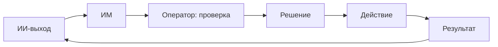
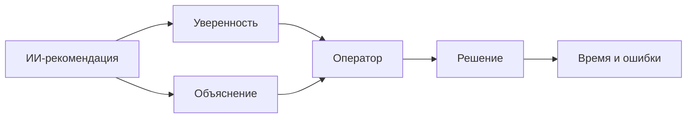

# ИИ-компонент в эргономике этапа решения

**Дата:** 2026-10-25  
**Ветка:** `feat/publications`  
**Статус:** расширение усиленной рамки этапа решения; основная тема КР — методы снижения времени реакции — сохраняется.  
**Связанные отчёты:** `2026-10-25_decision-stage-ergonomic.md`, `2026-10-25_decision-stage-narrowing.md`, `2026-10-25_concept.md`.  
**Назначение:** показать, как встроить ИИ/нейросеть в эргономическую рамку принятия решения, не превращая работу в технический обзор модели.

---

## Оглавление

1. [Резюме](#1-резюме)
2. [Место в усиленной рамке](#2-место-в-усиленной-рамке)
3. [Что именно добавляет ИИ](#3-что-именно-добавляет-ии)
4. [Объект и границы](#4-объект-и-границы)
5. [Типы ИИ-компонентов](#5-типы-ии-компонентов)
6. [Деятельность оператора с ИИ](#6-деятельность-оператора-с-ии)
7. [Информационная модель с ИИ](#7-информационная-модель-с-ии)
8. [Эргономические характеристики](#8-эргономические-характеристики)
9. [Формальная модель](#9-формальная-модель)
10. [Методы](#10-методы)
11. [Эргономическая экспертиза и сертификат](#11-эргономическая-экспертиза-и-сертификат)
12. [Источники](#12-источники)
13. [Что усилить и где копать глубже](#13-что-усилить-и-где-копать-глубже)
14. [Структура КР](#14-структура-кр)
15. [Дорожная карта](#15-дорожная-карта)
16. [Риски](#16-риски)
17. [Итог](#17-итог)
18. [Связанные документы](#18-связанные-документы)

---

## 1. Резюме

Да, ИИ-компонент можно добавить. Но не как «эргономику нейросети», а как **эргономику деятельности оператора, которому нейросеть выдаёт рекомендацию, уверенность, объяснение или тревогу**.

**Рабочая формулировка:**

> **«Эргономические требования к информационной модели оператора с ИИ-поддержкой принятия решений».**

**Объект:** эргатическая система

> **оператор — ИМ с ИИ-рекомендацией — объект управления — среда**

**Ядро:** ИИ меняет не «скорость модели», а:

- сколько оператор проверяет;
- сколько времени тратит на решение;
- сколько ошибается;
- насколько загружен;
- как доверяет — через поведение, а не через субъективную шкалу.

---

## 2. Место в усиленной рамке

Усиленная рамка этапа решения уже содержит:

- деятельность оператора;
- информационную модель;
- $t_{\text{ип}}$, $I$, $T_{\text{реш}}$, $P_{\text{ош}}$, $K_{\text{загр}}$;
- эргономическую экспертизу и сертификат.

ИИ-компонент добавляет в эту рамку:

- источник рекомендации;
- источник уверенности;
- источник объяснения;
- источник тревоги;
- источник ошибок и неопределённости.

Он **не заменяет** рамку, а встраивается в неё.

### 2.1. Было / стало

| Элемент | Без ИИ | С ИИ |
|---|---|---|
| Решение | Оператор выбирает сам | Оператор выбирает с рекомендацией |
| ИМ | Данные и сигналы | Данные + рекомендация + уверенность |
| Ошибки | Ошибки оператора | Ошибки оператора + ошибки ИИ |
| Доверие | К системе | К ИИ и к ИМ |
| Нагрузка | Своя | Своя + проверка ИИ |
| Обучение | Работа с системой | Работа с ИИ и его ошибками |

---

## 3. Что именно добавляет ИИ

### 3.1. Рекомендацию

Нейросеть может предложить:

- класс ситуации;
- вариант действия;
- приоритет;
- прогноз последствия.

### 3.2. Уверенность

Нейросеть может выдать:

- вероятность класса;
- интервал;
- оценку риска;
- флаг «не знаю».

### 3.3. Объяснение

Нейросеть или внешний модуль может выдать:

- признаки, повлиявшие на решение;
- похожие случаи;
- причину тревоги.

### 3.4. Тревогу

Нейросеть может:

- обнаружить событие;
- оценить опасность;
- предложить вмешательство.

### 3.5. Ошибку

Любая нейросеть ошибается:

- ложная тревога;
- пропуск;
- неверный класс;
- неверная рекомендация;
- чрезмерная уверенность.

Эргономика изучает, **как эти ошибки меняют деятельность оператора**, а не только их вероятность.

---

## 4. Объект и границы

### 4.1. Объект

> **оператор — ИМ с ИИ-поддержкой — объект управления — среда**

### 4.2. Входит

- деятельность оператора;
- ИМ с рекомендацией;
- уверенность и объяснение;
- ошибки ИИ;
- время решения;
- нагрузка;
- обучение;
- передача управления.

### 4.3. Не входит

- обучение нейросети;
- выбор архитектуры;
- оптимизация гиперпараметров;
- mAP/F1 как эргономические характеристики;
- лечение;
- медицинские рекомендации;
- персональные данные.

### 4.4. Тип ИИ

Для КР лучше выбрать один тип:

- классификатор;
- детектор;
- рекомендатель;
- генеративный ассистент;
- RL-политика.

Для этапа решения наиболее удобен **рекомендатель/классификатор**, потому что он выдаёт варианты и уверенность.

---

## 5. Типы ИИ-компонентов

### 5.1. Классификатор

Что делает:

- относит ситуацию к классу;
- выдаёт вероятность.

Эргономический вопрос:

- как оператор использует вероятность;
- как часто проверяет;
- как реагирует на ошибку.

### 5.2. Детектор

Что делает:

- находит объект/событие;
- выдаёт рамку/тревогу.

Эргономический вопрос:

- сколько ложных тревог;
- сколько проверок;
- сколько пропусков.

### 5.3. Рекомендатель

Что делает:

- предлагает действие;
- ранжирует варианты.

Эргономический вопрос:

- следует ли оператор рекомендации;
- проверяет ли альтернативы;
- как быстро отменяет.

### 5.4. Генеративный ассистент

Что делает:

- формирует текст/объяснение/план.

Эргономический вопрос:

- сколько времени на проверку;
- сколько ошибок;
- как влияет на доверие.

### 5.5. RL-политика

Что делает:

- управляет объектом;
- предлагает действие.

Эргономический вопрос:

- как передаётся управление;
- как оператор понимает режим;
- как восстанавливает контроль.

---

## 6. Деятельность оператора с ИИ

### 6.1. Схема

### 6.2. Точки решения

1. Принять рекомендацию.
2. Отклонить рекомендацию.
3. Запросить объяснение.
4. Проверить альтернативу.
5. Передать управление.
6. Отменить действие.

### 6.3. Режимы

| Режим | Что делает ИИ | Что делает оператор |
|---|---|---|
| Подсказка | Предлагает вариант | Решает сам |
| Совместный | Предлагает и помогает | Подтверждает/корректирует |
| Автоматический | Действует | Контролирует |
| Аварийный | Сигналит | Берёт управление |

---

## 7. Информационная модель с ИИ

### 7.1. Состав

ИМ должна показывать:

- рекомендацию;
- уверенность;
- альтернативы;
- объяснение;
- риск;
- время;
- источник данных.

### 7.2. Требования

По лекциям 9–10:

- визуальная однозначность;
- доступность;
- информационная ёмкость;
- надёжность;
- частота обновления;
- аварийная фиксация внимания.

### 7.3. Что нельзя показывать

- «ИИ уверен» без числа;
- одну рекомендацию без альтернатив;
- объяснение, которое перегружает;
- ложную точность;
- скрытую неопределённость.

---

## 8. Эргономические характеристики

### 8.1. Время решения

$$
T_{\text{реш}} = T_{\text{ориент}} + t_{\text{ип}} + T_{\text{сравн}} + T_{\text{выбор}} + T_{\text{подтв}}
$$

Критерий:

$$
T_{\text{реш}} \le T_{\text{доп}}
$$

### 8.2. Ошибка решения

$$
P_{\text{ош}} = P_{\text{ИИ-ош}} \cdot P_{\text{принять|ош}} + (1 - P_{\text{ИИ-ош}}) \cdot P_{\text{отклонить|верно}}
$$

Критерий:

$$
P_{\text{ош}} \le P_{\text{доп}}
$$

Это ключевая формула: ошибка возникает не только из-за ИИ, но и из-за поведения оператора.

### 8.3. Загрузка

$$
K_{\text{загр}} = \frac{T_{\text{зан}}}{T_{\text{цикла}}}
$$

Критерий:

$$
K_{\text{загр}} \le K_{\text{доп}}
$$

### 8.4. Время информационного поиска

$$
t_{\text{ип}} = \frac{E + a}{a}(1 + H_\alpha)t_{\text{фик}}
$$

Критерий:

$$
t_{\text{ип}} \le t_{\text{доп}}
$$

### 8.5. Информационная насыщенность

$$
I = \nu t_{\text{эк}}
$$

Критерий:

$$
I \le I_{\text{доп}}
$$

### 8.6. Время проверки

$$
T_{\text{пров}} \le T_{\text{пров,доп}}
$$

### 8.7. Доля отмен

$$
R_{\text{отм}} = \frac{N_{\text{отм}}}{N_{\text{рек}}}
$$

Это поведенческий прокси доверия/проверки, а не субъективная шкала.

### 8.8. Вероятность обнаружения

$$
P_{\text{обн}} \ge P_{\text{треб}}
$$

### 8.9. Вероятность ложной тревоги

$$
P_{\text{лт}} \le \alpha
$$

### 8.10. Сводная таблица

| Характеристика | Формула | Единицы | Направление | Критерий |
|---|---|---|---|---|
| Время решения | $T_{\text{реш}}$ | с | меньше | $T_{\text{реш}} \le T_{\text{доп}}$ |
| Ошибка | $P_{\text{ош}}$ | безразм. | меньше | $P_{\text{ош}} \le P_{\text{доп}}$ |
| Загрузка | $K_{\text{загр}}$ | безразм. | меньше | $K_{\text{загр}} \le K_{\text{доп}}$ |
| Поиск | $t_{\text{ип}}$ | с | меньше | $t_{\text{ип}} \le t_{\text{доп}}$ |
| Насыщенность | $I$ | элементов | меньше | $I \le I_{\text{доп}}$ |
| Проверка | $T_{\text{пров}}$ | с | меньше | $T_{\text{пров}} \le T_{\text{пров,доп}}$ |
| Отмены | $R_{\text{отм}}$ | безразм. | диагностика | — |
| Обнаружение | $P_{\text{обн}}$ | безразм. | больше | $P_{\text{обн}} \ge P_{\text{треб}}$ |
| Ложная тревога | $P_{\text{лт}}$ | безразм. | меньше | $P_{\text{лт}} \le \alpha$ |

---

## 9. Формальная модель

### 9.1. Двухступенчатое решение

1. ИИ выдаёт рекомендацию.
2. Оператор принимает/отклоняет.
3. Решение фиксируется.

Ошибка:

$$
P_{\text{ош}} = P_{\text{ИИ-ош}} P_{\text{принять|ош}} + (1 - P_{\text{ИИ-ош}}) P_{\text{отклонить|верно}}
$$

### 9.2. Эффект ИИ

$$
\Delta T_{\text{реш}} = T_{\text{реш}}^{0} - T_{\text{реш}}^{\text{ИИ}}
$$

$$
\Delta P_{\text{ош}} = P_{\text{ош}}^{0} - P_{\text{ош}}^{\text{ИИ}}
$$

### 9.3. Критерий улучшения

ИИ улучшает решение, если:

$$
\Delta T_{\text{реш}} \ge \Delta_{\text{min}}
$$

и при этом:

$$
P_{\text{ош}}^{\text{ИИ}} \le P_{\text{ош}}^{0} - \delta
$$

$$
K_{\text{загр}}^{\text{ИИ}} \le K_{\text{загр}}^{0} + \delta_K
$$

### 9.4. Правило выбора

1. Все ограничения выполняются.
2. Максимальный $\Delta T_{\text{реш}}$.
3. При равенстве — минимальный $P_{\text{ош}}$.
4. При равенстве — минимальный $K_{\text{загр}}$.

Без весов и Парето.

### 9.5. Схема

---

## 10. Методы

### 10.1. Рекомендация + альтернативы

Что делает:

- показывает не один вариант, а 2–3;
- даёт сравнение.

Механизм: снижает автоматизационную зависимость.

### 10.2. Уверенность

Что делает:

- показывает вероятность;
- показывает интервал;
- показывает «не знаю».

Механизм: помогает проверке.

Риск: ложная точность.

### 10.3. Объяснение

Что делает:

- показывает признаки;
- показывает похожие случаи.

Механизм: помогает понять, но может перегружать.

### 10.4. Подтверждение

Что делает:

- требует подтверждения для опасных действий.

Механизм: снижает ошибки, но замедляет.

### 10.5. Адаптивный уровень автоматизации

Что делает:

- меняет степень самостоятельности ИИ.

Механизм: баланс нагрузки и контроля.

### 10.6. Обучение на ошибках ИИ

Что делает:

- показывает типовые ошибки;
- учит проверять.

Механизм: снижает слепое доверие.

### 10.7. Мониторинг поведения

Что делает:

- отслеживает отмены, проверки, пропуски.

Механизм: выявляет автоматизационную зависимость.

### 10.8. Сводная таблица

| Метод | Что меняет | Механизм | Риск |
|---|---|---|---|
| Альтернативы | ИМ | Меньше слепого доверия | Перегрузка |
| Уверенность | ИМ | Лучше проверка | Ложная точность |
| Объяснение | ИМ | Понимание | Перегрузка |
| Подтверждение | Процесс | Меньше ошибок | Медленнее |
| Адаптация | Режим | Баланс | Сложность |
| Обучение | Навык | Проверка | Время |
| Мониторинг | Процесс | Выявление зависимости | Приватность |

---

## 11. Эргономическая экспертиза и сертификат

### 11.1. Процедура

1. Описать деятельность.
2. Описать ИМ с ИИ.
3. Выбрать характеристики.
4. Рассчитать/измерить.
5. Сравнить с нормами.
6. Оформить сертификат.
7. Дать рекомендации.

### 11.2. Таблица

| Характеристика | Норма | Значение | Вердикт |
|---|---|---|---|
| $T_{\text{реш}}$ | $T_{\text{доп}}$ |  |  |
| $P_{\text{ош}}$ | $P_{\text{доп}}$ |  |  |
| $K_{\text{загр}}$ | $K_{\text{доп}}$ |  |  |
| $t_{\text{ип}}$ | $t_{\text{доп}}$ |  |  |
| $I$ | $I_{\text{доп}}$ |  |  |

---

## 12. Источники

### 12.1. Лекции

- 2 — эргатическая система, деятельность;
- 4 — алгоритм, обучение, утомление;
- 5 — управляемость;
- 9–10 — ИМ;
- 12 — ИПП;
- 13 — ЭЭ;
- 15 — сертификат;
- 16 — оптимизация.

### 12.2. Внешние

- human-AI interaction;
- automation bias;
- trust calibration;
- explainable AI;
- decision support;
- overreliance;
- human-in-the-loop.

### 12.3. Сколько

- 25–30 источников;
- 20+ ссылок;
- 5 не старше 5 лет;
- 2–5 авторов МГТУ;
- DOI.

---

## 13. Что усилить и где копать глубже

### 13.1. Автоматизационная зависимость

Чем лучше ИИ, тем меньше проверяют. Это главный риск.

### 13.2. Доверие через поведение

Не субъективные шкалы, а отмены, проверки, время.

### 13.3. Объяснение

Может помогать, а может перегружать. Нужны данные.

### 13.4. Уверенность

Плохая калибровка хуже, чем отсутствие уверенности.

### 13.5. Передача управления

Самый уязвимый режим.

### 13.6. Обучение

Оператор должен учиться на ошибках ИИ.

### 13.7. Домены

Эффект может исчезнуть на другом домене.

### 13.8. Этика

Не обещать лечение, не скрывать ошибки, не снимать ответственность с оператора.

---

## 14. Структура КР

### 14.1. Введение

- проблема;
- объект;
- деятельность;
- цель;
- задачи.

### 14.2. Эргономический анализ

- оператор;
- ИИ;
- ИМ;
- режимы;
- точки решения.

### 14.3. Технический слой

- модель;
- выходы;
- уверенность;
- ограничения.

### 14.4. Характеристики

- $T_{\text{реш}}$;
- $P_{\text{ош}}$;
- $K_{\text{загр}}$;
- $t_{\text{ип}}$;
- $I$;
- $T_{\text{пров}}$.

### 14.5. Методы

- альтернативы;
- уверенность;
- объяснение;
- подтверждение;
- адаптация;
- обучение.

### 14.6. Экспертиза

- расчёт;
- сертификат;
- рекомендации.

---

## 15. Дорожная карта

| Этап | Действие | Критерий готовности |
|---|---|---|
| 1 | Выбрать тип ИИ | Классификатор/рекомендатель |
| 2 | Описать деятельность | Точки решения |
| 3 | Описать ИМ | Рекомендация, уверенность, альтернативы |
| 4 | Выбрать характеристики | 5 штук |
| 5 | Собрать источники | 25–30 |
| 6 | Рассчитать | Таблица |
| 7 | Написать | 25–30 страниц |
| 8 | Статья | По требованиям |

---

## 16. Риски

| Риск | Вероятность | Влияние | Митигация |
|---|---|---|---|
| Автоматизационная зависимость | Высокая | Высокое | Альтернативы, обучение |
| Ложная уверенность | Средняя | Высокое | Калибровка, интервалы |
| Перегрузка объяснениями | Средняя | Среднее | Краткость, уровни |
| Ошибки ИИ | Высокая | Высокое | Проверка, подтверждение |
| Медицинские обещания | Средняя | Высокое | Язык требований |
| Нет данных | Высокая | Среднее | Путь 2, литература |

---

## 17. Итог

ИИ-компонент можно добавить, если:

- он встроен в деятельность оператора;
- он меняет ИМ, время, ошибки, нагрузку;
- технические метрики остаются входом;
- есть эргономическая экспертиза.

Нельзя:

- называть mAP эргономикой;
- изучать модель без оператора;
- обещать «ИИ решает лучше человека»;
- использовать субъективное доверие.

**Рекомендуемая тема:**

> **«Эргономические требования к информационной модели оператора с ИИ-поддержкой принятия решений».**

---

## 18. Связанные документы

| Документ | Что даёт |
|---|---|
| `2026-10-25_decision-stage-ergonomic.md` | Усиленная рамка решения |
| `2026-10-25_decision-stage-narrowing.md` | Первая версия решения |
| `2026-10-25_adaptive-recommender-narrowing.md` | Адаптивный рекомендатель |
| `2026-10-25_concept.md` | Концепция текущей темы |
| `../ai-ergonomics/2026-10-25_ai-ml-dl-ergonomics.md` | Общий разбор AI-эргономики |
| `../2026-10-25_topic-selection.md` | Резервная линия аномалий |
| `../AGENT_RU.md` | Правила работы |
| `../AGENTS.md` | Английская версия правил |
