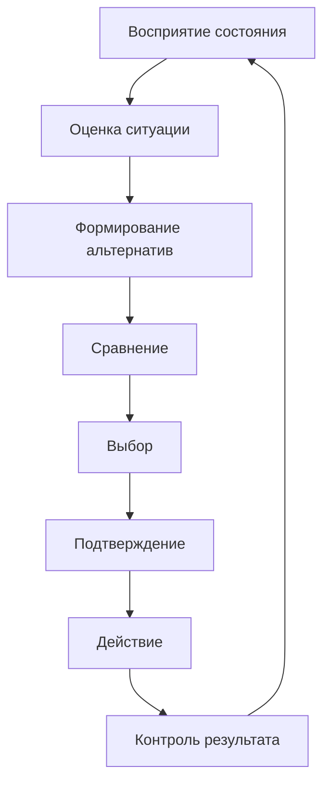

# Усиленная эргономическая рамка: принятие решения оператором

**Дата:** 2026-10-25  
**Ветка:** `feat/publications`  
**Статус:** усиленная версия отчёта по этапу решения; основная тема КР — методы снижения времени реакции — сохраняется.  
**Связанные отчёты:** `2026-10-25_topic-narrowing.md`, `2026-10-25_concept.md`, `2026-10-25_decision-stage-narrowing.md`.  
**Назначение:** переписать этап решения не как обзор decision science, а как эргономическую задачу о деятельности оператора и информационной модели.

---

## Оглавление

1. [Резюме](#1-резюме)
2. [Что было не так в предыдущей версии](#2-что-было-не-так-в-предыдущей-версии)
3. [Эргономическая рамка](#3-эргономическая-рамка)
4. [Деятельность оператора](#4-деятельность-оператора)
5. [Информационная модель](#5-информационная-модель)
6. [Эргономические характеристики](#6-эргономические-характеристики)
7. [Методы усиления решения через ИМ](#7-методы-усиления-решения-через-им)
8. [Формальная модель](#8-формальная-модель)
9. [Эргономическая экспертиза и сертификат](#9-эргономическая-экспертиза-и-сертификат)
10. [Источниковая стратегия](#10-источниковая-стратегия)
11. [Что усилить и где копать глубже](#11-что-усилить-и-где-копать-глубже)
12. [Структура возможной КР](#12-структура-возможной-кр)
13. [Дорожная карта](#13-дорожная-карта)
14. [Риски](#14-риски)
15. [Итоговый вывод](#15-итоговый-вывод)
16. [Связанные документы](#16-связанные-документы)

---

## 1. Резюме

Предыдущая версия отчёта была посвящена этапу решения, но рассматривала его как абстрактную задачу выбора: закон Хика, энтропия, накопление свидетельств, поддержка решения. Формально это полезно, но для дисциплины «Эргономический анализ» этого недостаточно.

**Усиленная постановка:**

> **«Эргономические требования к информационной модели оператора для ускорения принятия решений при высоком потоке информации».**

**Объект:** эргатическая система «оператор — информационная модель — объект управления — среда».

**Ядро:** информационная модель должна давать оператору структурированные, приоритетные и своевременные признаки для выбора действия, чтобы время решения и ошибки укладывались в допустимые границы, а нагрузка не превышала норму.

**Что меняется:**

| Было | Стало |
|---|---|
| Абстрактная задача выбора | Деятельность оператора в эргатической системе |
| Методы ускорения решения | Требования к ИМ и деятельности |
| Hick/DDM как ядро | Hick/DDM как модели внутри эргономической рамки |
| Нейростимуляция как метод | Нейростимуляция — только примечание |
| Нет экспертизы | Есть эргономическая экспертиза и сертификат |

---

## 2. Что было не так в предыдущей версии

### 2.1. Абстрактный объект

В предыдущей версии объект был описан как «оператор — поток — альтернативы — задача — среда», но не был проанализирован как эргатическая система:

- не указан тип оператора;
- не указан режим деятельности;
- не разобрана структура деятельности;
- не показано, откуда берутся альтернативы;
- не описана ИМ;
- не показаны последствия ошибок.

### 2.2. Методы вне ИМ

«Сокращение альтернатив», «подсказки», «значения по умолчанию», «поддержка решения» рассматривались как универсальные приёмы. В эргономике они должны быть **свойствами информационной модели и организации деятельности**, а не абстрактными советами.

### 2.3. Нет лекционной базы

Отчёт почти не опирался на лекции:

- лекция 2 — типы деятельности и когнитивная эргономика;
- лекция 4 — алгоритм деятельности, обучение, утомление;
- лекции 5–6 — критерии эргономического обеспечения;
- лекции 9–10 — ИМ и требования к ней;
- лекция 12 — инженерно-психологические требования;
- лекция 13 — эргономическая экспертиза;
- лекция 15 — сертификат и формулы.

### 2.4. Нейростимуляция

Нейростимуляция была одним из методов, но не имела отношения к лекциям и уводила в медицинскую рамку. В усиленной версии она остаётся только примечанием.

---

## 3. Эргономическая рамка

### 3.1. Эргатическая система

Эргатическая система — система, в которой обязательным элементом является человек-оператор (лекция 2). Для нашей задачи:

- человек-оператор;
- информационная модель;
- объект управления;
- рабочая среда.

### 3.2. Тип деятельности

По лекции 2:

- **операционная деятельность** — наблюдение за состоянием объекта;
- **оперативная деятельность** — наблюдение плюс принятие решения по альтернативам;
- **тактическая деятельность** — решения в аварийных и нештатных ситуациях.

Наш этап — **оперативная и тактическая деятельность**, потому что оператор выбирает действие.

### 3.3. Тип оператора

По лекции 2:

- оператор-технолог;
- оператор-манипулятор;
- оператор-наблюдатель;
- оператор-исследователь;
- оператор-руководитель.

Для КР нужно выбрать один тип. Иначе требования к решению будут разными.

### 3.4. Системно-деятельностный подход

По лекции 3:

1. описывается деятельность;
2. определяются информационные потребности;
3. формируются требования к ИМ;
4. только потом выбираются средства.

Нельзя начинать с «меню из пяти пунктов» и потом искать, где тут эргономика.

### 3.5. Функциономика

По лекции 4:

- алгоритм деятельности;
- границы возможностей;
- нормативы и объёмы работ;
- распределение функций;
- обучение и утомление;
- психофизиологический контроль.

Всё это влияет на время решения.

---

## 4. Деятельность оператора

### 4.1. Цель деятельности

Цель — выбрать и выполнить действие, которое приводит объект управления в требуемое состояние без нарушения безопасности.

### 4.2. Алгоритм

### 4.3. Режимы

| Режим | Что меняется | Что важно |
|---|---|---|
| Штатный | Мало альтернатив, есть время | Скорость и удобство |
| Аварийный | Мало времени, высокая цена ошибки | Приоритет и однозначность |
| Нештатный | Неопределённость, неполные данные | Поддержка и прогноз |
| Обучение | Есть время, можно ошибаться | Понятность и обратная связь |

### 4.4. Критические точки

- обнаружение отклонения;
- классификация ситуации;
- выбор действия;
- подтверждение;
- отмена/коррекция.

### 4.5. Информационные потребности

Оператору нужно:

- что произошло;
- насколько это опасно;
- какие варианты доступны;
- какие последствия;
- сколько времени;
- что будет, если не действовать.

ИМ должна отвечать на эти вопросы, а не просто показывать данные.

---

## 5. Информационная модель

### 5.1. Определение

По лекции 9:

> Информационная модель — организованное в соответствии с определённой системой правил отображение состояний объекта управления, внешней среды и способов воздействия на них.

### 5.2. Элементы

- элементы ИМ;
- алфавит;
- информационное поле;
- формат;
- структура;
- плотность;
- приоритеты.

### 5.3. Требования

По лекции 10:

- по назначению;
- по расположению;
- по воспроизводимому материалу;
- по восприятию зрительным анализатором;
- по работе в СЧМ.

Для этапа решения особенно важны:

- визуальная однозначность;
- доступность;
- информационная ёмкость;
- частота смены кадра;
- надёжность;
- наличие точки аварийной фиксации внимания.

### 5.4. Качество ИМ

По лекции 5, качество ИМ включает:

- адекватность индексации;
- достоверность;
- время осмотра и решения;
- пространственное размещение;
- скорость воспроизведения.

Это уже эргономические требования, а не «удобство».

---

## 6. Эргономические характеристики

### 6.1. Время информационного поиска

По лекции 15:

$$
t_{\text{ип}} = \frac{E + a}{a}(1 + H_\alpha)t_{\text{фик}}
$$

где:

- $E$ — объём элементов ИМ;
- $a$ — объём зрительного восприятия;
- $H_\alpha$ — число элементов с заданным набором признаков;
- $t_{\text{фик}}$ — длительность зрительной фиксации.

Критерий:

$$
t_{\text{ип}} \le t_{\text{доп}}
$$

Эффект: чем дольше поиск, тем позже решение.

### 6.2. Информационная насыщенность

По лекции 15:

$$
I = \nu t_{\text{эк}}
$$

Плотность:

$$
\rho_{\text{инф}} = \frac{N}{S}
$$

Критерий:

$$
I \le I_{\text{доп}}, \qquad \rho_{\text{инф}} \le \rho_{\text{доп}}
$$

Ориентиры из лекции 15:

- графические обозначения — 1000–1200 знаков/м²;
- векторная информация — 30–40 см/дм².

Эффект: перегрузка ведёт к пропуску и ошибкам.

### 6.3. Время решения

$$
T_{\text{реш}} = T_{\text{ориент}} + t_{\text{ип}} + T_{\text{сравн}} + T_{\text{выбор}} + T_{\text{подтв}}
$$

Для выбора из $N$ альтернатив:

$$
T_{\text{выбор}} = a + b \log_2(N+1)
$$

Критерий:

$$
T_{\text{реш}} \le T_{\text{доп}}
$$

### 6.4. Вероятность ошибки

$$
P_{\text{ош}} = \frac{N_{\text{ош}}}{N_{\text{попыток}}}
$$

Критерий:

$$
P_{\text{ош}} \le P_{\text{доп}}
$$

Эффект: неверное действие, ложная тревога, пропуск.

### 6.5. Загрузка оператора

$$
K_{\text{загр}} = \frac{T_{\text{зан}}}{T_{\text{цикла}}}
$$

Критерий:

$$
K_{\text{загр}} \le K_{\text{доп}}
$$

Эффект: утомление, снижение внимания, ошибки.

### 6.6. Сводная таблица

| Характеристика | Формула | Единицы | Направление | Критерий | Лекция |
|---|---|---|---|---|---|
| Время поиска | $t_{\text{ип}} = \frac{E+a}{a}(1+H_\alpha)t_{\text{фик}}$ | с | меньше | $t_{\text{ип}} \le t_{\text{доп}}$ | 15 |
| Насыщенность | $I = \nu t_{\text{эк}}$ | элементов | меньше | $I \le I_{\text{доп}}$ | 15 |
| Плотность | $\rho_{\text{инф}} = N/S$ | знаков/м² | меньше | $\rho_{\text{инф}} \le \rho_{\text{доп}}$ | 15 |
| Время решения | $T_{\text{реш}}$ | с | меньше | $T_{\text{реш}} \le T_{\text{доп}}$ | 2, 4 |
| Ошибки | $P_{\text{ош}}$ | безразм. | меньше | $P_{\text{ош}} \le P_{\text{доп}}$ | 5, 15 |
| Загрузка | $K_{\text{загр}}$ | безразм. | меньше | $K_{\text{загр}} \le K_{\text{доп}}$ | 4 |

---

## 7. Методы усиления решения через ИМ

### 7.1. Сокращение числа альтернатив

Что меняется в ИМ:

- меньше пунктов;
- прогрессивное раскрытие;
- группировка.

Механизм: меньше $N$ и энтропия.

Эргономическая опора: лекция 10 — информационная ёмкость и визуальная однозначность.

### 7.2. Приоритизация

Что меняется:

- критичные действия — выше;
- аварийные — отдельно;
- фон — слабее.

Механизм: меньше поиск и сравнение.

Эргономическая опора: лекция 10 — точка аварийной фиксации внимания.

### 7.3. Кодирование и сигналы

Что меняется:

- цвет;
- форма;
- положение;
- дублирование слухом.

Механизм: быстрее опознание.

Эргономическая опора: лекции 7 и 15 — цвет, контраст, пороги.

### 7.4. Подсказки и прогноз

Что меняется:

- показ последствий;
- вероятный вариант;
- время до события.

Механизм: меньше неопределённость.

Эргономическая опора: лекция 9 — ИМ как отображение состояния и способов воздействия.

### 7.5. Поддержка решения

Что меняется:

- рекомендация;
- объяснение;
- оценка риска.

Механизм: меньше сравнение.

Риск: автоматизационная зависимость.

Эргономическая опора: лекция 5 — распределение функций и надёжность.

### 7.6. Обучение и тренировка

Что меняется:

- тренажёр;
- типовые сценарии;
- обратная связь.

Механизм: автоматизация навыка.

Эргономическая опора: лекции 4 и 6 — обучение, тренируемость, освояемость.

### 7.7. Управление утомлением

Что меняется:

- режим труда и отдыха;
- контроль состояния;
- ротация.

Механизм: меньше ошибок и времени.

Эргономическая опора: лекция 4 — утомляемость и психофизиологический контроль.

### 7.8. Нейростимуляция

Не является ядром. Может рассматриваться как примечание, но не как основной метод: нет лекционной базы, есть медицинские риски, эффекты разнородны.

### 7.9. Сводная таблица

| Метод | Что меняет в ИМ | Механизм | Опора |
|---|---|---|---|
| Меньше альтернатив | Состав | Меньше $N$ | Лекция 10 |
| Приоритизация | Структура | Меньше поиск | Лекция 10 |
| Кодирование | Форма | Быстрее опознание | Лекции 7, 15 |
| Подсказки | Контекст | Меньше $H$ | Лекция 9 |
| Поддержка | Рекомендация | Меньше сравнение | Лекция 5 |
| Обучение | Навык | Автоматизм | Лекции 4, 6 |
| Утомление | Режим | Меньше ошибок | Лекция 4 |

---

## 8. Формальная модель

### 8.1. Время решения

$$
T_{\text{реш}} = T_{\text{ориент}} + t_{\text{ип}} + T_{\text{сравн}} + T_{\text{выбор}} + T_{\text{подтв}}
$$

### 8.2. Эффект метода

$$
\Delta T_{\text{реш}} = T_{\text{реш}}^{0} - T_{\text{реш}}^{m}
$$

$$
\Delta P_{\text{ош}} = P_{\text{ош}}^{m} - P_{\text{ош}}^{0}
$$

### 8.3. Критерий улучшения

Метод улучшает решение, если:

$$
\Delta T_{\text{реш}} \ge \Delta_{\text{min}}
$$

и при этом:

$$
P_{\text{ош}}^{m} \le P_{\text{ош}}^{0} + \delta
$$

$$
K_{\text{загр}}^{m} \le K_{\text{загр}}^{0} + \delta_K
$$

### 8.4. Правило выбора

1. Все ограничения выполняются.
2. Максимальный $\Delta T_{\text{реш}}$.
3. При равенстве — минимальный $\Delta P_{\text{ош}}$.
4. При равенстве — минимальный $\Delta K_{\text{загр}}$.

Без весов и Парето.

### 8.5. Схема

---

## 9. Эргономическая экспертиза и сертификат

### 9.1. Процедура

1. Описать деятельность оператора.
2. Определить информационные потребности.
3. Описать ИМ.
4. Рассчитать характеристики.
5. Сравнить с нормами.
6. Оформить сертификат.
7. Дать рекомендации.

### 9.2. Таблица сертификата

| Характеристика | Норма | Расчёт | Вердикт |
|---|---|---|---|
| $t_{\text{ип}}$ | $t_{\text{доп}}$ | по формуле | соответствует/нет |
| $I$ | $I_{\text{доп}}$ | по формуле | соответствует/нет |
| $\rho_{\text{инф}}$ | $\rho_{\text{доп}}$ | $N/S$ | соответствует/нет |
| $T_{\text{реш}}$ | $T_{\text{доп}}$ | сумма | соответствует/нет |
| $P_{\text{ош}}$ | $P_{\text{доп}}$ | доля | соответствует/нет |
| $K_{\text{загр}}$ | $K_{\text{доп}}$ | доля | соответствует/нет |

### 9.3. Что это даёт

Это уже не «обзор методов», а **эргономическая экспертиза ИМ**, привязанная к лекциям 13 и 15.

---

## 10. Источниковая стратегия

### 10.1. Лекции

| Лекция | Что берём |
|---|---|
| 2 | Типы деятельности, операторы, когнитивная эргономика |
| 3 | Системно-деятельностный подход |
| 4 | Алгоритм, обучение, утомление |
| 5 | Управляемость, качество ИМ |
| 6 | Освояемость, обитаемость |
| 7 | Зрительный анализатор |
| 9 | ИМ |
| 10 | Требования к ИМ |
| 12 | ИПП и ЭП |
| 13 | ЭЭ |
| 15 | Сертификат, $t_{\text{ип}}$, $I$ |
| 16 | Оптимизация |

### 10.2. Внешние источники

- Hick;
- drift-diffusion;
- decision support;
- automation bias;
- learning/fatigue;
- HCI.

### 10.3. Сколько нужно

Для второго пути:

- 25–30 источников;
- 20+ ссылок;
- 5 не старше 5 лет;
- 2–5 авторов МГТУ;
- DOI приоритетно.

---

## 11. Что усилить и где копать глубже

### 11.1. Деятельность

Не «решение вообще», а конкретный тип оператора и режим.

### 11.2. ИМ

Не «альтернативы», а состав, структура, плотность, приоритеты.

### 11.3. Лекционные критерии

$t_{\text{ип}}$, $I$, качество ИМ, управляемость.

### 11.4. Обучение и утомление

Время решения зависит от тренировки и состояния.

### 11.5. Ошибки и последствия

Не только вероятность, но и цена.

### 11.6. Экспертиза

Сертификат, а не просто вывод.

### 11.7. Нейростимуляция

Только примечание, не ядро.

### 11.8. Переносимость

Лабораторные эффекты могут не работать в реальной среде.

---

## 12. Структура возможной КР

### 12.1. Введение

- проблема;
- объект;
- деятельность;
- цель;
- задачи.

### 12.2. Эргономический анализ деятельности

- тип оператора;
- режимы;
- алгоритм;
- критические точки;
- информационные потребности.

### 12.3. Информационная модель

- состав;
- структура;
- требования;
- качество.

### 12.4. Характеристики

- $t_{\text{ип}}$;
- $I$;
- $T_{\text{реш}}$;
- $P_{\text{ош}}$;
- $K_{\text{загр}}$.

### 12.5. Методы

- ИМ;
- приоритизация;
- кодирование;
- подсказки;
- поддержка;
- обучение;
- утомление.

### 12.6. Экспертиза

- расчёт;
- сертификат;
- рекомендации.

### 12.7. Заключение

- что подтверждено;
- что нет;
- что дальше.

---

## 13. Дорожная карта

| Этап | Действие | Критерий готовности |
|---|---|---|
| 1 | Выбрать оператора и режим | Один тип, один режим |
| 2 | Описать деятельность | Алгоритм и критические точки |
| 3 | Описать ИМ | Состав и структура |
| 4 | Выбрать характеристики | 5 штук с формулами |
| 5 | Собрать источники | 25–30 |
| 6 | Рассчитать | Таблица сертификата |
| 7 | Написать РПЗ | 25–30 страниц |
| 8 | Статья | По требованиям |

---

## 14. Риски

| Риск | Вероятность | Влияние | Митигация |
|---|---|---|---|
| Снова уйти в decision science | Высокая | Высокое | Держать ИМ и деятельность в центре |
| Нет данных по $P_{\text{ош}}$ | Средняя | Высокое | Аналитика + литература |
| Слишком широкий объект | Высокая | Высокое | Один оператор, один режим |
| Нейростимуляция уводит в медицину | Средняя | Высокое | Убрать из ядра |
| Мало источников МГТУ | Средняя | Низкое | Искать профильные работы |
| Нет эксперимента | Высокая | Среднее | Путь 2 + сертификат |

---

## 15. Итоговый вывод

Предыдущая версия была полезным обзором, но не КР по эргономике. Усиленная версия:

- ставит в центр деятельность оператора;
- использует ИМ как объект;
- опирается на лекции 2–16;
- вводит $t_{\text{ип}}$, $I$, $T_{\text{реш}}$, $P_{\text{ош}}$, $K_{\text{загр}}$;
- заканчивается эргономической экспертизой и сертификатом;
- оставляет нейростимуляцию только примечанием.

**Рекомендуемая формулировка:**

> **«Эргономические требования к информационной модели оператора для ускорения принятия решений при высоком потоке информации».**

---

## 16. Связанные документы

| Документ | Что даёт |
|---|---|
| `2026-10-25_topic-narrowing.md` | Общая тема «время реакции» |
| `2026-10-25_concept.md` | Концепция текущей темы |
| `2026-10-25_decision-stage-narrowing.md` | Первая версия этапа решения |
| `2026-10-25_decision-stage-ai.md` | ИИ-компонент в рамке решения |
| `2026-10-25_motor-response-narrowing.md` | Двигательный этап |
| `../2026-10-25_topic-selection.md` | Резервная линия аномалий |
| `../AGENT_RU.md` | Правила работы |
| `../AGENTS.md` | Английская версия правил |
