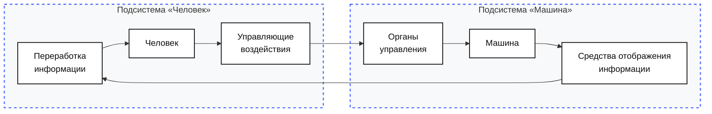
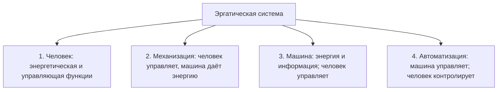

# Эргономические требования к информационной модели оператора для ускорения принятия решений при высоком потоке информации

**Материалы к консультации. Вариант КР без ИИ-рекомендателя**  
**Дисциплина:** «Эргономический анализ»  
**Исполнитель:** Папин А.В., группа ИУ5Ц-31М  
**Консультация:** Б.С. Горячкин, 2026-10-25  
**Статус:** предлагаемая тема КР; окончательная формулировка и состав характеристик требуют обсуждения.  
**Альтернативный вариант:** `2026-10-25_adaptive-recommender-kp.md` — с адаптивным нейросетевым рекомендателем, путь 2.

---

## Оглавление

1. [Резюме](#1-резюме)
2. [Два варианта темы](#2-два-варианта-темы)
3. [Постановка проблемы](#3-постановка-проблемы)
4. [Объект и эргатическая схема](#4-объект-и-эргатическая-схема)
5. [Эргономическое ядро](#5-эргономическое-ядро)
6. [Что анализируется в ИМ](#6-что-анализируется-в-им)
7. [Список параметров и обозначений](#7-список-параметров-и-обозначений)
8. [Эргономические характеристики](#8-эргономические-характеристики)
9. [Сводная таблица](#9-сводная-таблица)
10. [Почему это эргономика](#10-почему-это-эргономика)
11. [Метод](#11-метод)
12. [Ожидаемый результат](#12-ожидаемый-результат)
13. [Вопросы к консультации](#13-вопросы-к-консультации)
14. [Ограничения](#14-ограничения)
15. [Предварительная структура КР](#15-предварительная-структура-кр)
16. [Дорожная карта](#16-дорожная-карта)
17. [Источники](#17-источники)
18. [Приложение. Схемы](#18-приложение-схемы)

---

## 1. Резюме

Предлагается тема КР:

> **«Эргономические требования к информационной модели оператора для ускорения принятия решений при высоком потоке информации».**

**Проблема.** При высоком потоке информации оператор тратит время на поиск нужных элементов, оценку ситуации и выбор действия. Информационная модель (ИМ) часто перегружена или, наоборот, не содержит нужных признаков. В результате решение задерживается, а ошибки растут.

**Идея.** Не «ускорять человека», а **согласовать ИМ с деятельностью оператора**:

- выделить критические точки решения;
- определить информационные потребности;
- выбрать состав и структуру ИМ;
- рассчитать время поиска, время решения, ошибки и загрузку;
- проверить соответствие эргономическим требованиям.

**Что даёт.** Потенциально:

- сокращение времени решения;
- снижение числа ошибок;
- снижение нагрузки;
- обоснованный состав ИМ;
- эргономический сертификат или матрицу требований.

**Почему это эргономика.** Объект — деятельность оператора в эргатической системе, а не экран и не модель. Характеристики — время, ошибки, нагрузка, поиск, информационная насыщенность. Технические параметры ИМ — вход, а не основание выбора.

---

## 2. Два варианта темы

| Критерий | Вариант A. Без ИИ | Вариант B. С ИИ |
|---|---|---|
| Тема | Эргономические требования к ИМ для ускорения решения | Эргономические требования к адаптивной нейросетевой системе рекомендаций |
| Объект | Оператор — ИМ — объект управления | Оператор — адаптивный рекомендатель — ИМ — объект |
| Ядро | Деятельность и ИМ | Адаптивная поддержка |
| Путь | 1 — инженерно-аналитический | 2 — системный анализ |
| Данные | Макеты ИМ, расчёт, экспертиза | Литература, пилот |
| Риск | Ниже | Автоматизационная зависимость, данные |
| Новизна | Средняя | Выше |

**Вариант A** — классическая эргономика ИМ: деятельность, требования, расчёт, сертификат.

**Вариант B** — ИИ-ветвь: адаптивный рекомендатель, который меняет ИМ под состояние оператора.

**Ключевое отличие.** В варианте A нет рекомендателя и нет отдельного источника ошибки ИИ. Оценивается деятельность оператора с уже спроектированной ИМ: время поиска, время решения, ошибка, загрузка и насыщенность. В варианте B к этому добавляется двухступенчатая ошибка «рекомендация — проверка» и характеристики адаптации. Поэтому вариант A проще для расчёта и защиты, а вариант B — новее, но требует данных о поведении оператора с рекомендациями.

---

## 3. Постановка проблемы

### 3.1. Поток информации

Пусть:

- `R` — темп поступления информации;
- `C` — пропускная способность человека;
- `T_реш` — время решения;
- `P_ош` — вероятность ошибки;
- `K_загр` — загрузка.

При высоком `R` оператор:

- дольше ищет нужный элемент;
- дольше сравнивает варианты;
- чаще ошибается;
- быстрее утомляется.

### 3.2. Что не так с ИМ

Типичные проблемы:

- слишком много элементов;
- нет приоритетов;
- критичные сигналы не выделены;
- несогласованное кодирование;
- нет аварийной фиксации внимания;
- информация не соответствует задаче.

### 3.3. Рабочая гипотеза

**Если** ИМ построена от деятельности оператора и содержит приоритетные, однозначные и своевременно обновляемые признаки, **то** время решения и ошибки снижаются без роста нагрузки.

---

## 4. Объект и эргатическая схема

### 4.1. Объект

Эргатическая система:

> **оператор — информационная модель — объект управления — среда**

### 4.2. Схема из лекции 2

В этой схеме:

- `SOI` — средства отображения, то есть ИМ;
- `CH` — человек-оператор;
- `UV` — управляющие воздействия;
- `OU` — органы управления;
- `M` — машина/объект управления.

### 4.3. Где здесь решение

Решение принимает **человек-оператор** (`CH`). ИМ (`SOI`) даёт для этого информацию. Машина (`M`) исполняет воздействие.

---

## 5. Эргономическое ядро

Не «экран удобнее», а:

> **ИМ должна обеспечивать оператору возможность обнаружить, оценить и выбрать действие за допустимое время с допустимой ошибкой и нагрузкой.**

Это означает:

- состав ИМ выводится из деятельности;
- структура ИМ соответствует приоритетам;
- критические сигналы однозначны;
- время поиска и решения измеримы;
- ошибки и нагрузка проверяются.

---

## 6. Что анализируется в ИМ

- состав элементов;
- алфавит и кодирование;
- структура и группировка;
- приоритеты;
- плотность;
- частота обновления;
- аварийные сигналы;
- соответствие задаче.

---

## 7. Список параметров и обозначений

| Обозначение | Смысл | Единицы | Тип |
|---|---|---|---|
| $T_{\text{реш}}$ | время решения | с | характеристика |
| $T_{\text{ориент}}$ | время ориентации | с | параметр |
| $t_{\text{ип}}$ | время информационного поиска | с | характеристика/параметр |
| $T_{\text{сравн}}$ | время сравнения | с | параметр |
| $T_{\text{выбор}}$ | время выбора | с | параметр |
| $T_{\text{подтв}}$ | время подтверждения | с | параметр |
| $T_{\text{доп}}$ | допустимое время | с | норма |
| $P_{\text{ош}}$ | вероятность ошибки | безразм. | характеристика |
| $P_{\text{доп}}$ | допустимая ошибка | безразм. | норма |
| $K_{\text{загр}}$ | загрузка | безразм. | характеристика |
| $T_{\text{зан}}$ | занятое время | с | параметр |
| $T_{\text{цикла}}$ | длительность цикла | с | параметр |
| $K_{\text{доп}}$ | допустимая загрузка | безразм. | норма |
| $E$ | объём элементов ИМ | шт. | параметр |
| $a$ | объём зрительного восприятия | шт. | параметр |
| $H_\alpha$ | число элементов с заданным набором признаков | шт. | параметр |
| $t_{\text{фик}}$ | длительность фиксации | с | параметр |
| $I$ | информационная насыщенность | элементов | характеристика |
| $\nu$ | пропускная способность | элементов/с | параметр |
| $t_{\text{эк}}$ | время экспозиции | с | параметр |
| $N$ | число альтернатив | шт. | параметр |
| $H$ | условная энтропия выбора | бит | параметр |
| $R$ | темп поступления информации | 1/с | параметр |
| $C$ | пропускная способность человека | бит/с | характеристика |
| $A_H$ | свободный член закона Хика | с | параметр |
| $B_H$ | коэффициент закона Хика | с/бит | параметр |

---

## 8. Эргономические характеристики

### 8.1. Время решения

**Идея.** Время от понимания ситуации до подтверждённого выбора.

**Формула:**

$$
T_{\text{реш}} = T_{\text{ориент}} + t_{\text{ип}} + T_{\text{сравн}} + T_{\text{выбор}} + T_{\text{подтв}}
$$

Для выбора из $N$ равновероятных альтернатив:

$$
T_{\text{выбор}} = A_H + B_H \log_2(N+1)
$$

где $A_H$ и $B_H$ — эмпирические константы закона Хика; $H = \log_2(N+1)$ — условная энтропия выбора. Смысл зависимости: время выбора растёт не линейно, а логарифмически при увеличении числа альтернатив. Поэтому сокращение числа вариантов и группировка обычно дают больший выигрыш, чем ускорение отдельных операций.

**Критерий:**

$$
T_{\text{реш}} \le T_{\text{доп}}
$$

**Зачем.** Показывает, успевает ли оператор принять решение в темпе задачи.

**Практика в быту.** В кофейном автомате меню из трёх кнопок выбирается быстрее, чем меню из пятнадцати. В стиральной машине выбор режима из понятной группы занимает меньше времени, чем поиск среди десятков программ. Если нужный пункт спрятан, время решения растёт.

**Источник.** Лекции 2 и 4; `t_ип` — лекция 15.

### 8.2. Ошибка

**Идея.** Доля неправильных решений в типовых задачах. В этом варианте нет отдельного источника ошибки рекомендации, поэтому ошибка считается по наблюдаемым решениям оператора, а не через двухступенчатую модель «рекомендация — проверка».

**Формула:**

$$
P_{\text{ош}} = \frac{N_{\text{ош}}}{N_{\text{попыток}}}
$$

**Критерий:**

$$
P_{\text{ош}} \le P_{\text{доп}}
$$

**Зачем.** Ускорение без сохранения правильности не является улучшением.

**Практика в быту.** В стиральной машине можно выбрать не тот режим, если подписи неоднозначны. В аэропорту можно перепутать выход, если табло перегружено. Ошибка возникает не из-за «плохого человека», а из-за несоответствия ИМ задаче.

**Источник.** Лекции 5 и 15.

### 8.3. Загрузка

**Идея.** Доля цикла, которую оператор занят обработкой сигналов и действиями.

**Формула:**

$$
K_{\text{загр}} = \frac{T_{\text{зан}}}{T_{\text{цикла}}}
$$

**Критерий:**

$$
K_{\text{загр}} \le K_{\text{доп}}
$$

**Зачем.** ИМ не должна перегружать оператора.

**Практика в быту.** Приборная панель с десятками значков утомляет, а несколько крупных индикаторов помогают. Смартфон с постоянными уведомлениями отвлекает, а один важный сигнал — нет. Хорошая ИМ снижает загрузку.

**Источник.** Лекции 4 и 15.

### 8.4. Время информационного поиска

**Идея.** Время поиска нужного элемента в ИМ.

**Формула:**

$$
t_{\text{ип}} = \frac{E + a}{a}(1 + H_\alpha)t_{\text{фик}}
$$

**Критерий:**

$$
t_{\text{ип}} \le t_{\text{доп}}
$$

**Зачем.** Показывает, не слишком ли сложна структура ИМ.

**Практика в быту.** На табло аэропорта рейс находится быстрее, если строки сгруппированы по времени. В меню сайта нужный раздел находится быстрее, если структура логична. Если всё в одном списке, поиск затягивается.

**Источник.** Лекция 15.

### 8.5. Информационная насыщенность

**Идея.** Сколько элементов ИМ приходится на единицу пространства/времени.

**Формула:**

$$
I = \nu t_{\text{эк}}
$$

**Критерий:**

$$
I \le I_{\text{доп}}
$$

**Зачем.** Показывает, не превышает ли плотность ИМ возможности восприятия. Если превышает, оператор начинает пропускать сигналы или тратить время на борьбу с перегрузкой.

**Практика в быту.** Перегруженная приборная панель читается хуже, чем несколько индикаторов. Сайт с плотным текстом и рекламой затрудняет поиск. ИМ должна уменьшать плотность, а не добавлять «ещё одну полезную кнопку».

**Источник.** Лекция 15; ориентиры: 1000–1200 знаков/м², 30–40 см/дм².

---

## 9. Сводная таблица

| Характеристика | Формула | Единицы | Направление | Критерий |
|---|---|---|---|---|
| Время решения | $T_{\text{реш}}$ | с | меньше | $T_{\text{реш}} \le T_{\text{доп}}$ |
| Ошибка | $P_{\text{ош}}$ | безразм. | меньше | $P_{\text{ош}} \le P_{\text{доп}}$ |
| Загрузка | $K_{\text{загр}}$ | безразм. | меньше | $K_{\text{загр}} \le K_{\text{доп}}$ |
| Поиск | $t_{\text{ип}}$ | с | меньше | $t_{\text{ип}} \le t_{\text{доп}}$ |
| Насыщенность | $I$ | элементов | меньше | $I \le I_{\text{доп}}$ |

---

## 10. Почему это эргономика

| Вопрос | Ответ |
|---|---|
| Объект | Деятельность оператора в эргатической системе |
| Предмет | ИМ как средство деятельности |
| Характеристики | Время, ошибки, нагрузка, поиск, насыщенность |
| Метод | Аналитика + экспертиза/сертификат |
| Результат | Требования к ИМ |
| Технические параметры | Вход, не основание |

Это не «психология выбора» и не «дизайн экрана», потому что в центре — деятельность оператора и требования к ИМ.

---

## 11. Метод

### 11.1. Предлагаемый путь

**Путь 1 — инженерно-аналитический.**

Последовательность:

1. описать деятельность;
2. определить информационные потребности;
3. описать ИМ;
4. выбрать характеристики;
5. рассчитать;
6. сравнить с нормами;
7. оформить экспертизу/сертификат.

### 11.2. Эксперимент

Массовый эксперимент не обязателен. Возможны:

- аналитический расчёт;
- макеты ИМ;
- экспертная проверка;
- пилот на 3–5 операторах, если доступен.

### 11.3. Что проверяется

- `T_реш`;
- `P_ош`;
- `K_загр`;
- `t_ип`;
- `I`.

---

## 12. Ожидаемый результат

- матрица требований к ИМ;
- расчёт характеристик;
- эргономический сертификат/заключение;
- рекомендации по составу и структуре ИМ;
- основа для статьи.

---

## 13. Вопросы к консультации

1. Принимается ли тема в такой формулировке?
2. Достаточно ли пяти характеристик?
3. Нужен ли путь 1 или лучше путь 2?
4. Нужен ли пилот или достаточно аналитики?
5. Какие лекционные критерии усилить?
6. Сравнивать ли этот вариант с ИИ-вариантом?

---

## 14. Ограничения

- нет массового эксперимента;
- макеты ИМ могут быть неполными;
- нормы для конкретной задачи нужно задать;
- экспертная проверка ограничена;
- результаты зависят от выбранной задачи.

---

## 15. Предварительная структура КР

1. Введение.
2. Эргономический анализ деятельности.
3. Информационная модель и требования.
4. Эргономические характеристики.
5. Расчёт и оценка.
6. Эргономическая экспертиза/сертификат.
7. Заключение.
8. Источники.
9. Приложения.

---

## 16. Дорожная карта

| Этап | Действие | Результат |
|---|---|---|
| 1 | Согласовать тему | Формулировка |
| 2 | Описать деятельность | Схема и точки решения |
| 3 | Описать ИМ | Состав и структура |
| 4 | Выбрать характеристики | 5 формул |
| 5 | Собрать источники | 25–30 |
| 6 | Рассчитать | Таблица |
| 7 | Написать | 25–30 страниц |
| 8 | Статья | По требованиям |

---

## 17. Источники

### 17.1. Лекции

#### Лекция 2. Эргономика, эргатические системы

В лекции 2 вводится эргатическая система и обязательный элемент — человек-оператор. Показаны типы деятельности: операционная, оперативная и тактическая. Для темы это важно потому, что решение — часть оперативной и тактической деятельности, а ИМ должна поддерживать именно её.

#### Лекция 3. Системно-деятельностный подход

Лекция 3 задаёт порядок: сначала деятельность, затем информационные потребности, затем требования к средствам. Для ИМ это означает, что состав и структура должны выводиться из деятельности, а не из «красоты» интерфейса.

#### Лекция 4. Функциономика

Лекция 4 рассматривает алгоритмы деятельности, тренируемость, утомляемость и психофизиологический контроль. Время решения и ошибки зависят от обучения и состояния оператора, поэтому ИМ должна учитывать не только «среднего» пользователя.

#### Лекция 5. Эргономическое обеспечение: управляемость

Лекция 5 вводит критерий управляемости: сложность процесса, качество ИМ, качество рабочего места, комфортность и адаптируемость. Наша тема напрямую связана с качеством ИМ и сложностью процесса.

#### Лекция 6. Эргономическое обеспечение: освояемость и обитаемость

Лекция 6 показывает, что обучение и освоение системы — часть эргономического качества. ИМ должна быть понятной и не требовать длительного переобучения.

#### Лекция 7. Зрительный анализатор

Лекция 7 даёт пороги восприятия, время поиска, поля зрения и разрешающую способность. Эти данные нужны для требований к ИМ: нельзя делать критичный сигнал слишком мелким или периферийным.

#### Лекция 9. Информационные модели

Лекция 9 определяет ИМ как организованное отображение состояний объекта, среды и способов воздействия. Это базовое определение для темы.

#### Лекция 10. Требования к ИМ

Лекция 10 задаёт требования к ИМ: визуальная однозначность, доступность, информационная ёмкость, частота смены кадра, надёжность, аварийная фиксация внимания. Эти требования — основа для оценки.

#### Лекция 12. Инженерно-психологическое проектирование

Лекция 12 описывает требования и ограничения к человеку-оператору и техническим средствам. ИМ должна работать внутри этих ограничений.

#### Лекция 13. Эргономическая экспертиза

Лекция 13 задаёт процедуру экспертизы: проверка выполнения требований и разработка рекомендаций. Это завершающая часть КР.

#### Лекция 15. Эргономический сертификат

Лекция 15 даёт количественные характеристики: $t_{\text{ип}}$, $I$, пороговые размеры, цветовые пороги и нормы. Это основа для расчёта.

#### Лекция 16. Эргономическая оптимизация

Лекция 16 связывает параметры ИМ с характеристиками человека и вводит условие $G_{\text{техн}} \le G_{\text{воспр}}$. Это полезно для выбора параметров ИМ.

### 17.2. Внешние источники

- инженерная психология;
- эргономика ИМ;
- Hick;
- сигнальное обнаружение;
- информационная теория;
- human factors.

Ориентир — 25–30 источников и 20+ ссылок; для пути 1 часть из них может быть нормативной и методической.

---

## 18. Приложение. Схемы

### 18.1. Контур решения

### 18.2. Классификация эргатических систем по уровням организации

