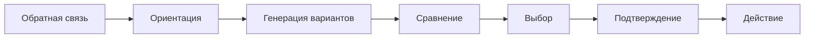
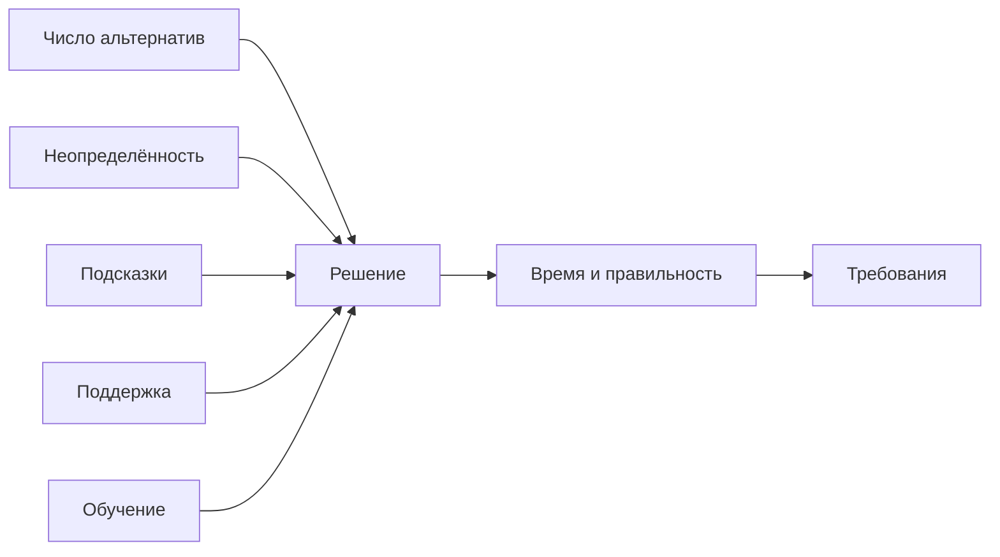

# Сужение темы: ускорение этапа принятия решения

**Дата:** 2026-10-25  
**Ветка:** `feat/publications`  
**Статус:** аналитическая записка по сужению текущей темы КР; основная линия — методы снижения времени реакции — сохраняется.  
**Связанные отчёты:** `2026-10-25_topic-narrowing.md`, `2026-10-25_concept.md`, `2026-10-25_motor-response-narrowing.md`.  
**Назначение:** разобрать этап «понял, что делать» — выбор решения — и определить, можно ли сделать его самостоятельной эргономической постановкой.

---

## Оглавление

1. [Резюме](#1-резюме)
2. [Место в общей теме](#2-место-в-общей-теме)
3. [Что такое этап решения](#3-что-такое-этап-решения)
4. [Модели решения](#4-модели-решения)
5. [Скорость и точность решения](#5-скорость-и-точность-решения)
6. [Варианты сужения](#6-варианты-сужения)
7. [Рекомендуемая постановка](#7-рекомендуемая-постановка)
8. [Объект и границы](#8-объект-и-границы)
9. [Эргономические характеристики](#9-эргономические-характеристики)
10. [Методы ускорения решения](#10-методы-ускорения-решения)
11. [Формальная модель](#11-формальная-модель)
12. [Источниковая стратегия](#12-источниковая-стратегия)
13. [Что усилить и где копать глубже](#13-что-усилить-и-где-копать-глубже)
14. [Структура возможной КР](#14-структура-возможной-кр)
15. [Дорожная карта](#15-дорожная-карта)
16. [Риски](#16-риски)
17. [Итоговый вывод](#17-итоговый-вывод)
18. [Связанные документы](#18-связанные-документы)

---

## 1. Резюме

Время реакции складывается из обнаружения, решения и двигательного ответа:

$$
T_R = T_{\text{обн}} + T_{\text{реш}} + T_{\text{мот}}
$$

Этот отчёт сужает фокус до **этапа решения** — момента, когда оператор уже понял, что произошло, и выбирает, что делать.

**Рекомендуемое сужение:**

> **«Эргономические требования к методам ускорения принятия решения оператором при высоком потоке информации».**

**Главная идея:** ускорить решение — не значит «быстрее нажать». Нужно сократить время выбора **без роста ошибок**, сохранив уверенность, контроль и устойчивость к неопределённости.

Главный компромисс — **скорость против правильности**:

$$
T_{\text{реш}} \le T_{\text{доп}}, \qquad P_{\text{correct}} \ge P_{\text{доп}}
$$

---

## 2. Место в общей теме

### 2.1. Три этапа реакции

| Этап | Что происходит | Что влияет |
|---|---|---|
| Обнаружение | Заметил сигнал | Яркость, контраст, поле, внимание |
| Решение | Понял, что делать | Число альтернатив, неопределённость, опыт, подсказки |
| Двигательный ответ | Выполнил действие | Геометрия, управление, обучение, помощь |

Текущая тема КР — **методы снижения времени реакции**. Этот отчёт — её **решениевая ветвь**.

### 2.2. Почему этап решения важен

Даже при быстром обнаружении оператор может:

- долго оценивать ситуацию;
- перебирать варианты;
- сомневаться;
- ждать дополнительной информации;
- выбирать неверный вариант;
- отменять решение.

В задачах с высокой ценой ошибки эти задержки критичны.

### 2.3. Что не входит

- обнаружение сигнала;
- двигательное выполнение;
- нейростимуляция как «ускорение мозга»;
- лечение заболеваний;
- хирургия;
- клинические рекомендации.

---

## 3. Что такое этап решения

### 3.1. Ориентация

Оператор оценивает ситуацию:

- что произошло;
- насколько это опасно;
- есть ли время;
- какие варианты доступны.

### 3.2. Генерация вариантов

Формируется набор возможных действий:

- продолжить;
- остановиться;
- изменить режим;
- запросить помощь;
- перепланировать.

### 3.3. Сравнение

Варианты сравниваются по:

- ожидаемому результату;
- риску;
- стоимости;
- времени;
- обратимости.

### 3.4. Выбор

Оператор выбирает один вариант и принимает его.

### 3.5. Подтверждение

Решение фиксируется:

- нажатие;
- команда;
- голосовое подтверждение;
- отмена/пауза.

### 3.6. Схема

---

## 4. Модели решения

### 4.1. Закон Хика

Для выбора из $N$ альтернатив:

$$
T_{\text{реш}} = a + b \log_2(N + 1)
$$

где:

- $N$ — число альтернатив;
- $a$, $b$ — эмпирические коэффициенты.

Чем больше вариантов, тем дольше выбор.

### 4.2. Энтропия

Если варианты имеют вероятности $p_i$:

$$
H = -\sum_{i=1}^{N} p_i \log_2 p_i
$$

Единицы: бит.

Чем выше неопределённость, тем сложнее выбор. В простой модели:

$$
T_{\text{реш}} = a + b H
$$

Это приближение; оно полезно для анализа, но не является универсальным законом.

### 4.3. Накопление свидетельств

В моделях накопления свидетельств решение принимается, когда накопленная информация достигает порога.

Упрощённо:

$$
T_{\text{реш}} \approx \frac{a}{v}
$$

где:

- $a$ — порог;
- $v$ — скорость накопления свидетельств.

Чем выше порог, тем больше времени и выше точность.

### 4.4. Вероятность правильного решения

Для симметричной диффузионной модели:

$$
P_{\text{correct}} = \frac{1}{1 + \exp\left(-\frac{2av}{\sigma^2}\right)}
$$

где $\sigma$ — шум.

Это показывает компромисс:

- больше $a$ → больше времени, выше точность;
- больше $v$ → быстрее и точнее;
- больше шум → хуже.

### 4.5. Уверенность

Уверенность — субъективная оценка правильности. Она может быть:

- калиброванной;
- сверхуверенной;
- недоуверенной.

Для КР важна не «уверенность вообще», а **соответствие уверенности и правильности**.

---

## 5. Скорость и точность решения

### 5.1. Компромисс

Нельзя одновременно минимизировать время и максимизировать правильность:

- быстрое решение → больше ошибок;
- медленное решение → больше время.

Поэтому критерий должен включать оба показателя.

### 5.2. Критерий

$$
T_{\text{реш}} \le T_{\text{доп}}
$$

$$
P_{\text{correct}} \ge P_{\text{доп}}
$$

### 5.3. Цена ошибки

Ошибка может быть:

- ложная тревога;
- пропуск;
- неверный режим;
- неверный выбор.

Цена ошибки задаёт допустимую границу, но не превращается в «вес» при выборе.

---

## 6. Варианты сужения

### 6.1. Вариант A. Общая тема «время реакции»

**Формулировка:** «Эргономические требования к методам снижения времени реакции оператора при высоком потоке информации».

**Плюсы:** широкий охват.

**Минусы:** этап решения растворяется среди других.

**Вердикт:** текущая основная линия.

### 6.2. Вариант B. Этап решения

**Формулировка:** «Эргономические требования к методам ускорения принятия решения оператором при высоком потоке информации».

**Плюсы:** ясный фокус, есть закон Хика и модели накопления свидетельств; можно сравнивать методы.

**Минусы:** нужно ограничить задачу и тип решения; меньше источников, чем по информационной эргономике в целом.

**Вердикт:** рекомендуется как сужение.

### 6.3. Вариант C. Только закон Хика

**Формулировка:** «Применение закона Хика к проектированию меню и органов управления».

**Плюсы:** много литературы, простая формула.

**Минусы:** слишком узко; не охватывает неопределённость и поддержку решения.

**Вердикт:** слишком узко.

### 6.4. Вариант D. Поддержка принятия решений

**Формулировка:** «Эргономическая оценка систем поддержки принятия решений оператором».

**Плюсы:** практично, много литературы по автоматизации.

**Минусы:** можно уйти в интерфейсы и алгоритмы; риск потери эргономического ядра.

**Вердикт:** возможен, но требует ограничения.

### 6.5. Сравнение

| Вариант | Источники | Ясность | Риск | Вердикт |
|---|---|---|---|---|
| A. Общая тема | Высокая | Высокая | Низкий | Текущая линия |
| B. Этап решения | Средняя/высокая | Высокая | Средний | Рекомендуется |
| C. Только Хик | Высокая | Высокая | Низкий | Слишком узко |
| D. Поддержка решений | Высокая | Средняя | Средний | Возможен |

---

## 7. Рекомендуемая постановка

### 7.1. Рабочее название

> **«Эргономические требования к методам ускорения принятия решения оператором при высоком потоке информации».**

### 7.2. Объект

Система:

> **оператор — информационный поток — набор альтернатив — задача — среда**

### 7.3. Эргономическое ядро

Не «быстрее выбрать», а **сокращение времени выбора при сохранении правильности и допустимой нагрузки**.

### 7.4. Что сравнивается

- число альтернатив;
- структура меню/выбора;
- подсказки и приоритеты;
- контекст и прогноз;
- поддержка решения;
- значения по умолчанию;
- обучение;
- временное давление;
- нейростимуляция как один из методов.

### 7.5. Результат

- матрица методов;
- требования к $T_{\text{реш}}$, $P_{\text{correct}}$, $K_{\text{load}}$;
- вывод, какие методы ускоряют решение без роста ошибок.

---

## 8. Объект и границы

### 8.1. Входит

- этап решения;
- набор альтернатив;
- неопределённость;
- поддержка решения;
- обучение;
- нагрузка.

### 8.2. Не входит

- обнаружение;
- двигательное выполнение;
- лечение;
- хирургия;
- «ускорение мозга»;
- персональные данные.

### 8.3. Задача

Нужно выбрать одну задачу:

- выбор режима;
- выбор действия при аварии;
- выбор объекта;
- выбор маршрута;
- подтверждение/отмена.

Рекомендация: **выбор действия при нештатной ситуации** — наиболее близко к безопасности и к лекциям.

---

## 9. Эргономические характеристики

### 9.1. Время решения

$$
T_{\text{реш}} \le T_{\text{доп}}
$$

Единицы: с.

Направление: меньше — лучше.

### 9.2. Правильность

$$
P_{\text{correct}} = \frac{N_{\text{correct}}}{N_{\text{trials}}}
$$

Единицы: безразм.

Направление: больше — лучше.

Критерий:

$$
P_{\text{correct}} \ge P_{\text{доп}}
$$

### 9.3. Число альтернатив

$$
N
$$

Единицы: шт.

Направление: меньше — лучше при прочих равных.

Критерий:

$$
N \le N_{\text{доп}}
$$

Но уменьшать число альтернатив можно только без потери полноты.

### 9.4. Энтропия выбора

$$
H = -\sum_{i=1}^{N} p_i \log_2 p_i
$$

Единицы: бит.

Направление: меньше — лучше.

Критерий:

$$
H \le H_{\text{доп}}
$$

Энтропия — характеристика неопределённости, а не «вес».

### 9.5. Загрузка

$$
K_{\text{load}} = \frac{T_{\text{busy}}}{T_{\text{total}}}
$$

Единицы: безразм.

Направление: меньше — лучше.

Критерий:

$$
K_{\text{load}} \le K_{\text{доп}}
$$

### 9.6. Сводная таблица

| Характеристика | Формула | Единицы | Направление | Критерий |
|---|---|---|---|---|
| Время решения | $T_{\text{реш}}$ | с | меньше | $T_{\text{реш}} \le T_{\text{доп}}$ |
| Правильность | $P_{\text{correct}} = N_{\text{correct}}/N_{\text{trials}}$ | безразм. | больше | $P_{\text{correct}} \ge P_{\text{доп}}$ |
| Число альтернатив | $N$ | шт. | меньше | $N \le N_{\text{доп}}$ |
| Энтропия | $H = -\sum p_i \log_2 p_i$ | бит | меньше | $H \le H_{\text{доп}}$ |
| Загрузка | $K_{\text{load}} = T_{\text{busy}}/T_{\text{total}}$ | безразм. | меньше | $K_{\text{load}} \le K_{\text{доп}}$ |

---

## 10. Методы ускорения решения

### 10.1. Сокращение числа альтернатив

Что делает:

- убирает лишние варианты;
- использует прогрессивное раскрытие;
- группирует choices.

Механизм: уменьшает $N$ и $H$ по закону Хика.

Доказательность: высокая.

Риск: низкий, если не теряется полнота.

### 10.2. Структура и приоритизация

Что делает:

- выстраивает варианты по важности;
- отделяет критичные действия;
- использует привычный порядок.

Механизм: сокращает поиск и сравнение.

Доказательность: высокая.

Риск: низкий.

### 10.3. Подсказки и контекст

Что делает:

- показывает последствия;
- даёт прогноз;
- выделяет вероятный вариант.

Механизм: снижает неопределённость и энтропию.

Доказательность: средняя/высокая.

Риск: средний: ошибка подсказки.

### 10.4. Поддержка решения

Что делает:

- предлагает готовый вариант;
- объясняет причину;
- показывает риск.

Механизм: сокращает сравнение и выбор.

Доказательность: средняя.

Риск: средний: автоматизационная зависимость.

### 10.5. Значения по умолчанию

Что делает:

- задаёт безопасный вариант;
- уменьшает число действий.

Механизм: сокращает выбор.

Доказательность: средняя.

Риск: средний: можно пропустить важный выбор.

### 10.6. Обучение

Что делает:

- формирует автоматические решения;
- учит распознавать ситуации.

Механизм: сокращает ориентацию и выбор.

Доказательность: высокая.

Риск: низкий.

### 10.7. Временное давление

Что делает:

- ограничивает время;
- заставляет выбрать быстрее.

Механизм: снижает порог, но повышает ошибки.

Доказательность: высокая, но эффект отрицательный для точности.

Риск: высокий.

### 10.8. Нейростимуляция

Что делает:

- может влиять на возбудимость и внимание.

Механизм: не «ускоряет решение» напрямую.

Доказательность: низкая/средняя.

Риск: высокий.

### 10.9. Сводная матрица

| Метод | Механизм | Доказательность | Риск | Применимость |
|---|---|---|---|---|
| Сокращение альтернатив | Меньше $N$ | Высокая | Низкий | Высокая |
| Структура | Меньше поиска | Высокая | Низкий | Высокая |
| Подсказки | Меньше $H$ | Средняя/высокая | Средний | Высокая |
| Поддержка решения | Готовый вариант | Средняя | Средний | Средняя |
| Значения по умолчанию | Меньше действий | Средняя | Средний | Средняя |
| Обучение | Автоматизм | Высокая | Низкий | Высокая |
| Временное давление | Ниже порог | Высокая | Высокий | Низкая |
| Нейростимуляция | Модуляция | Низкая/средняя | Высокий | Низкая/средняя |

---

## 11. Формальная модель

### 11.1. Общее время

$$
T_{\text{реш}} = T_{\text{ориент}} + T_{\text{ген}} + T_{\text{сравн}} + T_{\text{выбор}} + T_{\text{подтв}}
$$

### 11.2. Эффект метода

$$
\Delta T_{\text{реш}} = T_{\text{реш}}^{0} - T_{\text{реш}}^{m}
$$

$$
\Delta P_{\text{correct}} = P_{\text{correct}}^{m} - P_{\text{correct}}^{0}
$$

### 11.3. Критерий улучшения

Метод улучшает решение, если:

$$
\Delta T_{\text{реш}} \ge \Delta_{\text{min}}
$$

и при этом:

$$
P_{\text{correct}}^{m} \ge P_{\text{correct}}^{0} - \delta
$$

$$
K_{\text{load}}^{m} \le K_{\text{load}}^{0} + \delta_K
$$

где $\Delta_{\text{min}}$, $\delta$, $\delta_K$ — заранее заданные границы.

### 11.4. Правило выбора

1. Все ограничения выполняются.
2. Максимальный $\Delta T_{\text{реш}}$.
3. При равенстве — минимальный $\Delta P_{\text{correct}}$ (то есть лучше правильность).
4. При равенстве — минимальный $\Delta K_{\text{load}}$.

Без весов и Парето.

### 11.5. Схема

---

## 12. Источниковая стратегия

### 12.1. Где искать

| Направление | Что искать |
|---|---|
| Принятие решений | Хик, энтропия, накопление свидетельств |
| Эргономика | Нагрузка, ошибки, поддержка |
| HCI | Меню, выбор, подсказки |
| Автоматизация | Поддержка решений, автоматизационная зависимость |
| Обучение | Автоматизация навыка |
| Нейростимуляция | Влияние на решение, ограничения |

### 12.2. Поисковые ключи

- «Hick law choice reaction time»
- «decision time entropy»
- «evidence accumulation decision making»
- «decision support automation bias»
- «choice architecture defaults»
- «time pressure decision accuracy»
- «transcranial stimulation decision making»

### 12.3. Критерии включения

- есть задача и метрика $T_{\text{реш}}$ или $P_{\text{correct}}$;
- есть контроль/сравнение;
- указан размер выборки;
- описан метод;
- результат можно нормализовать.

### 12.4. Критерии исключения

- только маркетинг;
- нет числовых данных;
- смешаны задачи;
- нет контроля;
- невозможно нормализовать.

### 12.5. Сколько нужно

Для второго пути:

- 25–30 источников;
- 20+ ссылок;
- 5 источников не старше 5 лет;
- 2–5 авторов МГТУ;
- DOI приоритетно;
- не более 2 не на английском.

---

## 13. Что усилить и где копать глубже

### 13.1. Одна задача

Выбор режима, действия при аварии, объекта, маршрута или подтверждение. Не «решение вообще».

### 13.2. Число альтернатив

Хик даёт количественную связь; это сильная сторона темы.

### 13.3. Неопределённость

Энтропия и накопление свидетельств объясняют, почему решение задерживается.

### 13.4. Скорость—правильность

Нельзя ускорять решение без проверки ошибок.

### 13.5. Поддержка решения

Самый практичный метод, но с риском автоматизационной зависимости.

### 13.6. Обучение

Часто даёт больше, чем «умный» чип, и дешевле.

### 13.7. Нейростимуляция

Рассматривать как один из методов, с явными ограничениями.

### 13.8. Индивидуальные различия

Люди различаются по скорости и уверенности; нужны допуски.

### 13.9. Переносимость

Лабораторный эффект может не переноситься на реальную задачу.

### 13.10. Цена ошибки

Разные ошибки имеют разную цену; это ограничение, а не вес.

---

## 14. Структура возможной КР

### 14.1. Введение

- высокий поток;
- время реакции;
- этап решения;
- актуальность;
- границы.

### 14.2. Методы

- системный анализ;
- Хик;
- энтропия;
- накопление свидетельств;
- источниковая база.

### 14.3. Результаты

- обзор методов;
- матрица;
- доказательность;
- ограничения.

### 14.4. Обсуждение

- что ускоряет;
- что ухудшает правильность;
- что не проверено;
- что нельзя обещать.

### 14.5. Заключение

- требования;
- рекомендации;
- направления.

### 14.6. Статья

По требованиям второго пути.

---

## 15. Дорожная карта

| Этап | Действие | Критерий готовности |
|---|---|---|
| 1 | Выбрать задачу | Одна задача и один набор альтернатив |
| 2 | Определить методы | 5–8 методов |
| 3 | Собрать источники | 25–30 |
| 4 | Извлечь данные | $T_{\text{реш}}$, $P_{\text{correct}}$, $K_{\text{load}}$ |
| 5 | Нормализовать | Единые единицы |
| 6 | Оценить доказательность | Высокая/средняя/низкая |
| 7 | Написать РПЗ | 25–30 страниц |
| 8 | Статья | По требованиям |
| 9 | Защита | Вопросы и ответы |

---

## 16. Риски

| Риск | Вероятность | Влияние | Митигация |
|---|---|---|---|
| Слишком узко | Средняя | Среднее | Оставить общую тему как рамку |
| Мало данных по нейростимуляции | Высокая | Среднее | Не делать её единственным методом |
| Скорость без правильности | Высокая | Высокое | Обязательный критерий $P_{\text{correct}}$ |
| Смешение задач | Высокая | Высокое | Одна задача |
| Автоматизационная зависимость | Средняя | Высокое | Ограничения и обучение |
| Медицинское обещание | Средняя | Высокое | Язык требований |
| Мало авторов МГТУ | Средняя | Низкое | Искать профильные работы |

---

## 17. Итоговый вывод

**Этап решения** — хорошее сужение, потому что он:

- имеет количественную модель (Хик, энтропия);
- имеет ясный компромисс «скорость—правильность»;
- позволяет сравнивать методы;
- не требует медицинских обещаний.

**Рекомендуемая формулировка:**

> **«Эргономические требования к методам ускорения принятия решения оператором при высоком потоке информации».**

Если оставлять общую тему «время реакции», этот отчёт может быть её **решениевой главой**. Если делать отдельную КР — это самостоятельная тема второго пути.

Нейростимуляция здесь — один из методов, а не ядро. Главный акцент — на числе альтернатив, структуре, подсказках, поддержке решения, обучении и контроле ошибок.

---

## 18. Связанные документы

| Документ | Что даёт |
|---|---|
| `2026-10-25_topic-narrowing.md` | Общая тема «время реакции» |
| `2026-10-25_concept.md` | Концепция текущей темы |
| `2026-10-25_motor-response-narrowing.md` | Сужение до двигательного ответа |
| `../neurostimulation/2026-10-25_topic-narrowing.md` | Сужение до нейростимуляции |
| `../2026-10-25_topic-selection.md` | Резервная линия аномалий |
| `../AGENT_RU.md` | Правила работы |
| `../AGENTS.md` | Английская версия правил |
