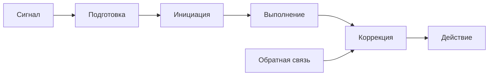
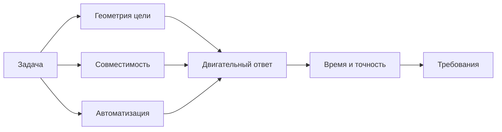

# Сужение темы: ускорение двигательного ответа оператора

**Дата:** 2026-10-25  
**Ветка:** `feat/publications`  
**Статус:** аналитическая записка по сужению текущей темы КР; основная линия — методы снижения времени реакции — сохраняется.  
**Связанные отчёты:** `2026-10-25_topic-narrowing.md`, `2026-10-25_concept.md`, `../neurostimulation/2026-10-25_topic-narrowing.md`.  
**Назначение:** разобрать отдельный этап «ускорить ответ — быстрее выполнить движение» и определить, можно ли сделать его самостоятельной эргономической постановкой.

---

## Оглавление

1. [Резюме](#1-резюме)
2. [Место в общей теме](#2-место-в-общей-теме)
3. [Что такое двигательный ответ](#3-что-такое-двигательный-ответ)
4. [Скорость и точность](#4-скорость-и-точность)
5. [Варианты сужения](#5-варианты-сужения)
6. [Рекомендуемая постановка](#6-рекомендуемая-постановка)
7. [Объект и границы](#7-объект-и-границы)
8. [Эргономические характеристики](#8-эргономические-характеристики)
9. [Методы ускорения двигательного ответа](#9-методы-ускорения-двигательного-ответа)
10. [Формальная модель](#10-формальная-модель)
11. [Источниковая стратегия](#11-источниковая-стратегия)
12. [Что усилить и где копать глубже](#12-что-усилить-и-где-копать-глубже)
13. [Структура возможной КР](#13-структура-возможной-кр)
14. [Дорожная карта](#14-дорожная-карта)
15. [Риски](#15-риски)
16. [Итоговый вывод](#16-итоговый-вывод)
17. [Связанные документы](#17-связанные-документы)

---

## 1. Резюме

Время реакции складывается из обнаружения, решения и **двигательного ответа**:

$$
T_R = T_{\text{обн}} + T_{\text{реш}} + T_{\text{мот}}
$$

Этот отчёт сужает фокус до последнего этапа:

$$
T_{\text{мот}} = T_{\text{подг}} + T_{\text{иниц}} + T_{\text{вып}} + T_{\text{кор}}
$$

где:

- $T_{\text{подг}}$ — подготовка/программирование движения;
- $T_{\text{иниц}}$ — запуск;
- $T_{\text{вып}}$ — выполнение;
- $T_{\text{кор}}$ — коррекция по обратной связи.

**Рекомендуемое сужение:**

> **«Эргономические требования к методам ускорения двигательного ответа оператора при высоком потоке информации».**

**Главная идея:** ускорять ответ — не значит «быстрее дёргать рукой». Нужно сокращать время подготовки, запуска, выполнения и коррекции, **не ухудшая точность**. Главный закон здесь — компромисс «скорость — точность» и закон Фиттса.

---

## 2. Место в общей теме

### 2.1. Три этапа реакции

| Этап | Что происходит | Что влияет |
|---|---|---|
| Обнаружение | Заметил сигнал | Яркость, контраст, поле, внимание |
| Решение | Понял, что делать | Число альтернатив, опыт, подсказки |
| Двигательный ответ | Выполнил действие | Геометрия, управление, обучение, помощь |

Текущая тема КР — **методы снижения времени реакции**. Этот отчёт — её **двигательная ветвь**.

### 2.2. Почему двигательный этап важен

Даже при быстром обнаружении и решении оператор может:

- долго выбирать орган управления;
- тянуться к нему;
- делать лишние движения;
- корректировать промах;
- останавливать движение.

В задачах с высокой ценой ошибки эти доли секунды критичны.

### 2.3. Что не входит

- обнаружение и распознавание сигнала;
- выбор стратегии;
- нейростимуляция как «ускорение мозга»;
- лечение двигательных нарушений;
- хирургия и реабилитация.

---

## 3. Что такое двигательный ответ

### 3.1. Подготовка

Оператор выбирает программу движения:

- какая рука/нога;
- какое направление;
- какая амплитуда;
- какая скорость;
- какая поза.

Подготовка может быть **предварительной** (до сигнала) и **срочной** (после сигнала).

### 3.2. Инициация

Запуск программы: момент, когда движение реально начинается.

На инициацию влияют:

- готовность;
- предупредительный сигнал;
- совместимость стимула и ответа;
- тревога/напряжение;
- усталость.

### 3.3. Выполнение

Перемещение органа управления или конечности:

- дистанция;
- размер цели;
- инерция;
- сопротивление;
- точность;
- зрительная/тактильная обратная связь.

### 3.4. Коррекция

После начала движения оператор может корректировать траекторию:

- по зрению;
- по силе;
- по положению;
- по конечной точке.

Коррекция может как улучшать точность, так и увеличивать время.

### 3.5. Схема

---

## 4. Скорость и точность

### 4.1. Закон Фиттса

Для движения к цели:

$$
MT = a + b \log_2\left(\frac{2D}{W}\right)
$$

где:

- $MT$ — время движения;
- $D$ — расстояние до цели;
- $W$ — ширина цели;
- $a$, $b$ — эмпирические коэффициенты.

Индекс сложности:

$$
ID = \log_2\left(\frac{2D}{W}\right)
$$

Чем больше расстояние и меньше цель, тем больше время.

### 4.2. Пропускная способность

$$
TP = \frac{ID}{MT}
$$

Единицы: бит/с.

Больше — лучше, но только при допустимой точности.

### 4.3. Компромисс

Нельзя одновременно максимизировать скорость и точность:

- быстрое движение → больше промахов;
- медленное движение → больше время.

Поэтому критерий должен включать **оба** показателя:

$$
MT \le MT_{\text{доп}}
$$

$$
P_{\text{hit}} \ge P_{\text{доп}}
$$

### 4.4. Ошибка попадания

$$
E = \lvert x_{\text{конечн}} - x_{\text{цели}} \rvert
$$

$$
P_{\text{hit}} = P\left(E \le \frac{W}{2}\right)
$$

Если цель маленькая, а движение быстрое, $P_{\text{hit}}$ падает.

---

## 5. Варианты сужения

### 5.1. Вариант A. Общая тема «время реакции»

**Формулировка:** «Эргономические требования к методам снижения времени реакции оператора при высоком потоке информации».

**Плюсы:** широкий охват, много источников.

**Минусы:** двигательный этап растворяется среди информационных методов.

**Вердикт:** текущая основная линия.

### 5.2. Вариант B. Двигательный ответ

**Формулировка:** «Эргономические требования к методам ускорения двигательного ответа оператора при высоком потоке информации».

**Плюсы:** чёткий фокус, есть закон Фиттса и измеримые характеристики.

**Минусы:** нужно ограничить задачу и тип управления; меньше источников, чем по информационной эргономике.

**Вердикт:** рекомендуется как сужение.

### 5.3. Вариант C. Только закон Фиттса

**Формулировка:** «Применение закона Фиттса к проектированию органов управления оператора».

**Плюсы:** много литературы, ясная формула.

**Минусы:** это скорее инженерная эргономика, чем анализ высокого потока информации.

**Вердикт:** слишком узко.

### 5.4. Вариант D. Нейростимуляция двигательного ответа

**Формулировка:** «Эргономическая оценка нейростимуляции как метода ускорения двигательного ответа».

**Плюсы:** связь с исходной идеей чипа.

**Минусы:** медицинские риски, мало источников, эффекты разнородны.

**Вердикт:** возможен как один из методов, не как ядро.

### 5.5. Сравнение

| Вариант | Источники | Ясность | Риск | Вердикт |
|---|---|---|---|---|
| A. Общая тема | Высокая | Высокая | Низкий | Текущая линия |
| B. Двигательный ответ | Средняя/высокая | Высокая | Средний | Рекомендуется |
| C. Только Фиттс | Высокая | Высокая | Низкий | Слишком узко |
| D. Нейростимуляция | Низкая/средняя | Средняя | Высокий | Один из методов |

---

## 6. Рекомендуемая постановка

### 6.1. Рабочее название

> **«Эргономические требования к методам ускорения двигательного ответа оператора при высоком потоке информации».**

### 6.2. Объект

Система:

> **оператор — орган управления — задача — среда**

### 6.3. Эргономическое ядро

Не «быстрее двигать рукой», а **сокращение времени двигательного ответа при сохранении точности и допустимой нагрузки**.

### 6.4. Что сравнивается

- геометрия цели и расстояния;
- совместимость «стимул — ответ»;
- тип органа управления;
- передаточное отношение;
- предварительная подготовка;
- помощь/автоматизация;
- обучение;
- силовая помощь;
- нейростимуляция как один из методов;
- BCI/EMG как альтернативные каналы.

### 6.5. Результат

- матрица методов;
- требования к $MT$, $P_{\text{hit}}$, $E$, $K_{\text{load}}$;
- вывод, какие методы ускоряют ответ без роста ошибок.

---

## 7. Объект и границы

### 7.1. Входит

- двигательный этап;
- органы управления;
- геометрия движения;
- точность;
- обучение;
- помощь;
- нагрузка.

### 7.2. Не входит

- обнаружение сигнала;
- выбор стратегии;
- лечение;
- хирургия;
- «ускорение мозга»;
- персональные данные.

### 7.3. Задача

Нужно выбрать одну задачу:

- наведение на цель;
- нажатие кнопки;
- перемещение джойстика;
- жест;
- ввод команды;
- торможение/остановка.

Рекомендация: **наведение на цель** или **торможение**, потому что они хорошо описываются законом Фиттса и временем реакции.

---

## 8. Эргономические характеристики

### 8.1. Время движения

$$
MT = a + b \log_2\left(\frac{2D}{W}\right)
$$

Единицы: с.

Направление: меньше — лучше.

Критерий:

$$
MT \le MT_{\text{доп}}
$$

### 8.2. Время инициации

$$
T_{\text{иниц}} = t_{\text{стимул}} - t_{\text{начало движения}}
$$

Единицы: с.

Направление: меньше — лучше.

Критерий:

$$
T_{\text{иниц}} \le T_{\text{иниц,доп}}
$$

### 8.3. Точность попадания

$$
P_{\text{hit}} = \frac{N_{\text{hit}}}{N_{\text{trials}}}
$$

Единицы: безразм.

Направление: больше — лучше.

Критерий:

$$
P_{\text{hit}} \ge P_{\text{hit,доп}}
$$

### 8.4. Ошибка конечной точки

$$
E = \lvert x_{\text{конечн}} - x_{\text{цели}} \rvert
$$

Единицы: мм или пиксели.

Направление: меньше — лучше.

Критерий:

$$
E \le E_{\text{доп}}
$$

### 8.5. Пропускная способность

$$
TP = \frac{ID}{MT}
$$

Единицы: бит/с.

Направление: больше — лучше.

Критерий:

$$
TP \ge TP_{\text{доп}}
$$

### 8.6. Загрузка

$$
K_{\text{load}} = \frac{T_{\text{busy}}}{T_{\text{total}}}
$$

Единицы: безразм.

Направление: меньше — лучше.

Критерий:

$$
K_{\text{load}} \le K_{\text{доп}}
$$

### 8.7. Сводная таблица

| Характеристика | Формула | Единицы | Направление | Критерий |
|---|---|---|---|---|
| Время движения | $MT = a + b\log_2(2D/W)$ | с | меньше | $MT \le MT_{\text{доп}}$ |
| Время инициации | $T_{\text{иниц}}$ | с | меньше | $T_{\text{иниц}} \le T_{\text{иниц,доп}}$ |
| Точность | $P_{\text{hit}} = N_{\text{hit}}/N_{\text{trials}}$ | безразм. | больше | $P_{\text{hit}} \ge P_{\text{hit,доп}}$ |
| Ошибка | $E = \lvert x_{\text{конечн}} - x_{\text{цели}} \rvert$ | мм | меньше | $E \le E_{\text{доп}}$ |
| Пропускная способность | $TP = ID/MT$ | бит/с | больше | $TP \ge TP_{\text{доп}}$ |
| Загрузка | $K_{\text{load}} = T_{\text{busy}}/T_{\text{total}}$ | безразм. | меньше | $K_{\text{load}} \le K_{\text{доп}}$ |

---

## 9. Методы ускорения двигательного ответа

### 9.1. Геометрия цели и расстояния

Что делает:

- увеличивает цель;
- сокращает расстояние;
- располагает органы управления в зоне досягаемости.

Механизм: уменьшает $ID$ и $MT$ по закону Фиттса.

Доказательность: высокая.

Риск: низкий.

### 9.2. Совместимость «стимул — ответ»

Что делает:

- располагает органы управления по направлению сигнала;
- использует привычные соответствия.

Механизм: сокращает выбор и подготовку.

Доказательность: высокая.

Риск: низкий.

### 9.3. Передаточное отношение

Что делает:

- меняет gain «движение руки — движение объекта»;
- адаптирует чувствительность.

Механизм: позволяет быстрее пересечь дистанцию, но требует точности.

Доказательность: средняя/высокая.

Риск: средний: можно потерять точность.

### 9.4. Предварительная подготовка

Что делает:

- предупреждает о сигнале;
- готовит позу и программу.

Механизм: сокращает $T_{\text{иниц}}$.

Доказательность: средняя.

Риск: низкий.

### 9.5. Автоматизация и совместное управление

Что делает:

- берёт часть движения на себя;
- ограничивает опасные зоны;
- предлагает траекторию.

Механизм: сокращает $MT$ и коррекцию.

Доказательность: средняя.

Риск: средний: потеря навыка, доверие.

### 9.6. Силовая помощь и экзоскелет

Что делает:

- увеличивает силу/скорость;
- снижает нагрузку.

Механизм: сокращает время выполнения.

Доказательность: средняя.

Риск: средний: безопасность, зависимость.

### 9.7. Нейростимуляция

Что делает:

- может облегчить запуск движения;
- может помочь при нарушениях.

Механизм: модуляция возбудимости, не «разгон аксонов».

Доказательность: низкая/средняя.

Риск: высокий, особенно для инвазивных устройств.

### 9.8. BCI/EMG

Что делает:

- обходит механический орган управления;
- считывает намерение.

Механизм: сокращает моторный этап, но добавляет декодирование.

Доказательность: средняя для реабилитации.

Риск: высокий.

### 9.9. Обучение

Что делает:

- доводит движение до автоматизма;
- уменьшает вариабельность.

Механизм: сокращает подготовку и коррекцию.

Доказательность: высокая.

Риск: низкий.

### 9.10. Сводная матрица

| Метод | Механизм | Доказательность | Риск | Применимость |
|---|---|---|---|---|
| Геометрия цели | Меньше $ID$ | Высокая | Низкий | Высокая |
| Совместимость | Меньше выбор | Высокая | Низкий | Высокая |
| Передаточное отношение | Быстрее дистанция | Средняя/высокая | Средний | Высокая |
| Подготовка | Меньше $T_{\text{иниц}}$ | Средняя | Низкий | Высокая |
| Автоматизация | Помощь в движении | Средняя | Средний | Средняя |
| Экзоскелет | Сила/скорость | Средняя | Средний | Средняя |
| Нейростимуляция | Модуляция | Низкая/средняя | Высокий | Низкая/средняя |
| BCI/EMG | Обход канала | Средняя | Высокий | Низкая/средняя |
| Обучение | Автоматизм | Высокая | Низкий | Высокая |

---

## 10. Формальная модель

### 10.1. Общее время двигательного ответа

$$
T_{\text{мот}} = T_{\text{подг}} + T_{\text{иниц}} + MT + T_{\text{кор}}
$$

### 10.2. Эффект метода

$$
\Delta MT = MT^{0} - MT^{m}
$$

$$
\Delta T_{\text{мот}} = T_{\text{мот}}^{0} - T_{\text{мот}}^{m}
$$

Если $\Delta T_{\text{мот}} > 0$, метод ускоряет ответ.

### 10.3. Критерий улучшения

Метод улучшает ответ, если:

$$
\Delta T_{\text{мот}} \ge \Delta_{\text{min}}
$$

и при этом:

$$
P_{\text{hit}}^{m} \ge P_{\text{hit}}^{0} - \delta
$$

$$
E^{m} \le E^{0} + \delta_E
$$

$$
K_{\text{load}}^{m} \le K_{\text{load}}^{0} + \delta_K
$$

где $\Delta_{\text{min}}$, $\delta$, $\delta_E$, $\delta_K$ — заранее заданные границы.

### 10.4. Правило выбора

1. Все ограничения выполняются.
2. Максимальный $\Delta T_{\text{мот}}$.
3. При равенстве — минимальный $\Delta E$.
4. При равенстве — минимальный $\Delta K_{\text{load}}$.

Без весов и Парето.

### 10.5. Схема

---

## 11. Источниковая стратегия

### 11.1. Где искать

| Направление | Что искать |
|---|---|
| Моторный контроль | Фиттс, скорость—точность, коррекция |
| HCI | Наведение, gain, input devices |
| Эргономика | Органы управления, совместимость, нагрузка |
| Реабилитация | FES/NMES, экзоскелеты |
| BCI | Декодирование, задержки, точность |
| Обучение | Автоматизация навыка |

### 11.2. Поисковые ключи

- «Fitts law movement time»
- «speed accuracy tradeoff aiming»
- «stimulus response compatibility»
- «control display gain»
- «exoskeleton response time»
- «functional electrical stimulation reaching»
- «brain computer interface movement time»

### 11.3. Критерии включения

- есть задача и метрика $MT$ или $T_{\text{мот}}$;
- есть контроль/сравнение;
- указан размер выборки;
- описан метод;
- результат можно нормализовать.

### 11.4. Критерии исключения

- только маркетинг;
- нет числовых данных;
- смешаны задачи;
- нет контроля;
- невозможно нормализовать.

### 11.5. Сколько нужно

Для второго пути:

- 25–30 источников;
- 20+ ссылок;
- 5 источников не старше 5 лет;
- 2–5 авторов МГТУ;
- DOI приоритетно;
- не более 2 не на английском.

---

## 12. Что усилить и где копать глубже

### 12.1. Одна задача

Наведение, кнопка, джойстик, жест или торможение. Не «движение вообще».

### 12.2. Fitts как основа

Он даёт количественную связь «расстояние — цель — время». Это сильная сторона темы.

### 12.3. Скорость—точность

Нельзя ускорять ответ без проверки ошибок. Это главный ограничитель.

### 12.4. Передаточное отношение

Один из самых практичных методов: gain меняет скорость и точность.

### 12.5. Совместимость

Привычные соответствия часто дают больший эффект, чем экзотические устройства.

### 12.6. Обучение

Эффект может быть больше, чем от «умного» чипа, и дешевле.

### 12.7. Нейростимуляция

Рассматривать как один из методов, с явными ограничениями и рисками.

### 12.8. BCI/EMG

Не «ускорение здорового», а альтернативный канал; иначе тема уйдёт в медицину.

### 12.9. Индивидуальные различия

Люди различаются по скорости и точности; нужны допуски.

### 12.10. Переносимость

Лабораторный эффект может не переноситься на реальную задачу.

---

## 13. Структура возможной КР

### 13.1. Введение

- высокий поток;
- время реакции;
- двигательный этап;
- актуальность;
- границы.

### 13.2. Методы

- системный анализ;
- Fitts;
- скорость—точность;
- источниковая база.

### 13.3. Результаты

- обзор методов;
- матрица;
- доказательность;
- ограничения.

### 13.4. Обсуждение

- что ускоряет;
- что ухудшает точность;
- что не проверено;
- что нельзя обещать.

### 13.5. Заключение

- требования;
- рекомендации;
- направления.

### 13.6. Статья

По требованиям второго пути.

---

## 14. Дорожная карта

| Этап | Действие | Критерий готовности |
|---|---|---|
| 1 | Выбрать задачу | Одна задача и один орган управления |
| 2 | Определить методы | 5–9 методов |
| 3 | Собрать источники | 25–30 |
| 4 | Извлечь данные | $MT$, $E$, $P_{\text{hit}}$, $K_{\text{load}}$ |
| 5 | Нормализовать | Единые единицы |
| 6 | Оценить доказательность | Высокая/средняя/низкая |
| 7 | Написать РПЗ | 25–30 страниц |
| 8 | Статья | По требованиям |
| 9 | Защита | Вопросы и ответы |

---

## 15. Риски

| Риск | Вероятность | Влияние | Митигация |
|---|---|---|---|
| Слишком узко | Средняя | Среднее | Оставить общую тему как рамку |
| Мало данных по нейростимуляции | Высокая | Среднее | Не делать её единственным методом |
| Скорость без точности | Высокая | Высокое | Обязательный критерий $P_{\text{hit}}$ |
| Смешение задач | Высокая | Высокое | Одна задача |
| Лабораторный эффект | Средняя | Среднее | Ограничения и переносимость |
| Медицинское обещание | Средняя | Высокое | Язык требований |
| Мало авторов МГТУ | Средняя | Низкое | Искать профильные работы |

---

## 16. Итоговый вывод

**Двигательный ответ** — хорошее сужение, потому что он:

- имеет количественную модель (Fitts);
- имеет ясный компромисс «скорость—точность»;
- позволяет сравнивать методы;
- не требует медицинских обещаний.

**Рекомендуемая формулировка:**

> **«Эргономические требования к методам ускорения двигательного ответа оператора при высоком потоке информации».**

Если оставлять общую тему «время реакции», этот отчёт может быть её **двигательной главой**. Если делать отдельную КР — это самостоятельная тема второго пути.

Нейростимуляция здесь — один из методов, а не ядро. Главный акцент — на геометрии, совместимости, передаточном отношении, подготовке, автоматизации и обучении.

---

## 17. Связанные документы

| Документ | Что даёт |
|---|---|
| `2026-10-25_topic-narrowing.md` | Общая тема «время реакции» |
| `2026-10-25_concept.md` | Концепция текущей темы |
| `../neurostimulation/2026-10-25_neuroprosthesis-topic.md` | Общий разбор нейропротеза |
| `../neurostimulation/2026-10-25_topic-narrowing.md` | Сужение до нейростимуляции |
| `../2026-10-25_topic-selection.md` | Резервная линия аномалий |
| `../AGENT_RU.md` | Правила работы |
| `../AGENTS.md` | Английская версия правил |
