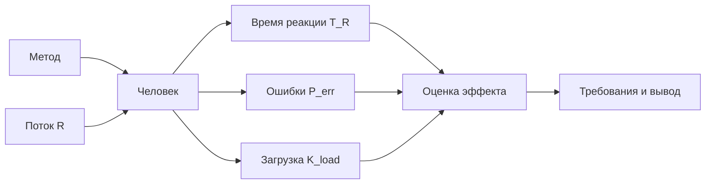

# Сужение темы: время реакции оператора при высоком потоке информации

**Дата:** 2026-10-25  
**Ветка:** `feat/publications`  
**Статус:** текущая рабочая тема КР; выбрана автономно; краткая концепция — `2026-10-25_concept.md`.  
**Связанные отчёты:** `../neurostimulation/2026-10-25_neuroprosthesis-topic.md`, `../neurostimulation/2026-10-25_topic-narrowing.md`, `../2026-10-25_topic-selection.md`.  
**Назначение:** перейти от идеи «чип ускоряет восприятие» к защищаемой эргономической постановке о сокращении времени реакции при высоком потоке информации.

---

## Оглавление

1. [Резюме](#1-резюме)
2. [Исходная проблема](#2-исходная-проблема)
3. [Почему чип — не лучшее ядро](#3-почему-чип--не-лучшее-ядро)
4. [Варианты сужения](#4-варианты-сужения)
5. [Рекомендуемая постановка](#5-рекомендуемая-постановка)
6. [Объект и границы](#6-объект-и-границы)
7. [Эргономические характеристики](#7-эргономические-характеристики)
8. [Методы сокращения времени реакции](#8-методы-сокращения-времени-реакции)
9. [Формальная модель](#9-формальная-модель)
10. [Источниковая стратегия](#10-источниковая-стратегия)
11. [Что усилить и где копать глубже](#11-что-усилить-и-где-копать-глубже)
12. [Структура возможной КР](#12-структура-возможной-кр)
13. [Дорожная карта](#13-дорожная-карта)
14. [Риски](#14-риски)
15. [Итоговый вывод](#15-итоговый-вывод)
16. [Связанные документы](#16-связанные-документы)

---

## 1. Резюме

Проблема сформулирована правильно: при большом потоке информации человек долго обнаруживает сигнал и реагирует. Но объяснение «сигнал долго идёт до мозга» — неточное. Основная задержка возникает не на пути к мозгу, а в **центральной обработке: опознание, поиск, выбор, решение и запуск ответа**.

**Рекомендуемое сужение:**

> **«Эргономические требования к методам сокращения времени реакции оператора при высоком потоке информации».**

Это шире, чем «нейростимуляторный чип», но именно поэтому лучше по источникам: можно рассматривать информационную эргономику, мультимодальные сигналы, предиктивные подсказки, автоматизацию, подготовку ответа, обучение, нейроэргономический мониторинг и нейростимуляцию как **конкурирующие методы**, а не ставить всё на один чип.

**Главная идея одной фразой:** сокращать время реакции нужно через снижение неопределённости и подготовку ответа, а не через попытку «разогнать нейроны».

---

## 2. Исходная проблема

### 2.1. Поток информации и возможности человека

Пусть:

- $R$ — темп поступления информации, бит/с или сигналов/с;
- $C$ — пропускная способность человека в задаче, бит/с или сигналов/с;
- $\rho = R/C$ — загрузка канала.

Если $\rho > 1$, человек не успевает обрабатывать поток: растут время реакции, ошибки и нагрузка.

Если $\rho \ll 1$, возникает другая проблема — потеря бдительности и сенсорный голод.

Задача эргономики — не «увеличить скорость мозга вообще», а **согласовать поток с возможностями человека** и сократить время реакции в конкретной задаче.

### 2.2. Из чего складывается время реакции

$$
T_R = T_{\text{сенс}} + T_{\text{пров}} + T_{\text{центр}} + T_{\text{мотор}}
$$

| Этап | Что происходит | Можно ли влиять |
|---|---|---|
| Сенсорный | Рецептор преобразует сигнал | Почти нет |
| Проведение | Сигнал идёт по нервам | Скорость фиксирована; чип не разгоняет здоровые аксоны |
| Центральный | Опознание, поиск, решение | Да: снизить неопределённость, упростить поиск |
| Моторный | Запуск и выполнение действия | Да: подготовить движение, изменить органы управления |

Основной вклад даёт **центральный этап**, а не «дорога до мозга». Поэтому методы, которые меняют информационную модель и подготовку ответа, часто сильнее, чем нейростимуляция.

### 2.3. Что значит «ускорить»

Нужно различать:

- **ускорить обнаружение** — быстрее заметить сигнал;
- **ускорить опознание** — быстрее понять, что это;
- **ускорить решение** — быстрее выбрать действие;
- **ускорить ответ** — быстрее выполнить движение;
- **увеличить пропускную способность** — больше сигналов в единицу времени без роста ошибок.

Это разные цели, и методы у них разные.

### 2.4. Что не является решением

- «Поставить чип» без задачи и критерия;
- «Ускорить мозг» без доказательств;
- «Увеличить скорость подачи» без проверки ошибок;
- «Добавить сигналов» без приоритизации;
- «Автоматизировать всё» без контроля бдительности.

---

## 3. Почему чип — не лучшее ядро

### 3.1. Что делает нейростимуляция

Нейростимуляция может менять возбудимость и синхронизацию нейронных ансамблей. Она не «ускоряет провода» и не гарантирует рост пропускной способности.

Эффекты:

- зависят от протокола, области и задачи;
- часто малы и разнородны;
- могут влиять на внимание и время реакции;
- имеют побочные эффекты;
- требуют медицинских ограничений.

### 3.2. Инвазивный чип

Имплантируемый чип — это в первую очередь реабилитационное устройство для восстановления утраченной функции, а не «ускоритель здорового человека».

Риски:

- хирургические осложнения;
- инфекции;
- повреждение ткани;
- нестабильность импланта;
- этические и регуляторные ограничения.

Для КР по эргономике это слишком тяжёлая и плохо проверяемая база, если нет доступа к клинике.

### 3.3. Неинвазивная стимуляция

Источников больше, но эффекты на время реакции обычно небольшие и не всегда воспроизводятся. Это может быть **один из методов** в обзоре, но не единственное ядро.

### 3.4. Что чип действительно может

- обходить повреждённый канал;
- восстанавливать грубое восприятие;
- давать сигнал в обход повреждённой структуры;
- модулировать возбудимость.

Но это не то же самое, что «ускорить восприятие потока информации у здорового оператора».

---

## 4. Варианты сужения

### 4.1. Вариант A. Чип, ускоряющий восприятие

**Формулировка:** «Нейростимуляторный чип для ускорения восприятия информационного потока».

**Проблема:** прямых источников мало, эффект легко переоценить, есть медицинские риски.

**Вердикт:** не рекомендуется как основная тема.

### 4.2. Вариант B. Нейростимуляция как метод

**Формулировка:** «Эргономическая оценка нейростимуляции как метода сокращения времени реакции оператора».

**Плюсы:** уже, есть литература по tDCS/tACS и времени реакции.

**Минусы:** эффекты малы и разнородны; «чип» может исчезнуть из темы; риск медицинского обещания.

**Вердикт:** возможен как узкий обзор, но рискован.

### 4.3. Вариант C. Методы сокращения времени реакции

**Формулировка:** «Эргономические требования к методам сокращения времени реакции оператора при высоком потоке информации».

**Плюсы:** источников больше; можно сравнить информационную эргономику, мультимодальные сигналы, автоматизацию, обучение и нейростимуляцию; тема остаётся эргономической.

**Минусы:** нужно чётко ограничить набор методов и задачу.

**Вердикт:** рекомендуется.

### 4.4. Вариант D. Только информационная эргономика

**Формулировка:** «Эргономические требования к информационной модели оператора при высоком потоке информации».

**Плюсы:** много источников и формул.

**Минусы:** это уже не про «ускорение реакции», а про проектирование ИМ; можно потерять исходную проблему.

**Вердикт:** возможен, но это другая тема.

### 4.5. Сравнение

| Вариант | Источники | Эргономическая ясность | Риск | Вердикт |
|---|---|---|---|---|
| A. Чип-ускоритель | Низкая | Низкая | Высокий | Не рекомендуется |
| B. Нейростимуляция как метод | Средняя | Средняя | Средний | Возможен |
| C. Методы сокращения времени реакции | Высокая | Высокая | Низкий/средний | Рекомендуется |
| D. Только ИМ | Высокая | Высокая | Низкий | Другая тема |

---

## 5. Рекомендуемая постановка

### 5.1. Рабочее название

> **«Эргономические требования к методам сокращения времени реакции оператора при высоком потоке информации».**

### 5.2. Объект

Система:

> **оператор — информационный поток — интерфейс — задача — среда**

### 5.3. Эргономическое ядро

Не «скорость чипа», а **согласование потока информации с возможностями человека** и сокращение времени реакции без роста ошибок и нагрузки.

### 5.4. Что сравнивается

Как минимум:

1. информационная эргономика;
2. мультимодальные сигналы;
3. предиктивные подсказки;
4. адаптивная автоматизация;
5. подготовка ответа;
6. обучение;
7. нейроэргономический мониторинг;
8. нейростимуляция;
9. BCI.

Не все методы равны по доказательности; это и есть предмет анализа.

### 5.5. Что является результатом

- матрица методов;
- критерии применимости;
- оценка доказательности;
- требования к времени реакции и ошибкам;
- вывод, какие методы действительно сокращают время, а какие только обещают.

---

## 6. Объект и границы

### 6.1. Входит

- деятельность оператора;
- поток информации;
- интерфейс и сигналы;
- время реакции;
- ошибки;
- нагрузка;
- методы поддержки;
- нейростимуляция как один из методов.

### 6.2. Не входит

- лечение заболеваний;
- хирургия;
- клинические рекомендации;
- персональные данные;
- «ускорение интеллекта»;
- сравнение медицинских устройств без задачи.

### 6.3. Задача

Нужно выбрать одну задачу:

- обнаружение сигнала в потоке;
- обнаружение препятствия;
- чтение и понимание сообщений;
- выбор из альтернатив;
- контроль нескольких объектов.

Рекомендация: **обнаружение сигнала/препятствия**, потому что есть связь с лекцией 7 и с безопасностью.

---

## 7. Эргономические характеристики

### 7.1. Время реакции

$$
T_R = T_{\text{сенс}} + T_{\text{пров}} + T_{\text{центр}} + T_{\text{мотор}}
$$

Единицы: с.

Направление: меньше — лучше.

Критерий:

$$
T_R \le T_{\text{доп}}
$$

Эффект: запаздывание снижает безопасность и увеличивает ошибки.

### 7.2. Вероятность ошибки

$$
P_{\text{err}} = \frac{N_{\text{err}}}{N_{\text{trials}}}
$$

Единицы: безразм.

Направление: меньше — лучше.

Критерий:

$$
P_{\text{err}} \le P_{\text{доп}}
$$

Ускорение без сохранения точности не считается улучшением.

### 7.3. Загрузка канала

$$
\rho = \frac{R}{C}
$$

Единицы: безразм.

Направление: меньше — лучше.

Критерий:

$$
\rho \le \rho_{\text{доп}}
$$

Эффект: перегрузка ведёт к пропуску сигналов и утомлению.

### 7.4. Пропускная способность

$$
C = \frac{H}{T}
$$

Единицы: бит/с.

Направление: больше — лучше при сохранении точности.

Критерий:

$$
C \ge C_{\text{треб}}
$$

### 7.5. Загрузка оператора

$$
K_{\text{load}} = \frac{T_{\text{busy}}}{T_{\text{total}}}
$$

Единицы: безразм.

Направление: меньше — лучше.

Критерий:

$$
K_{\text{load}} \le K_{\text{доп}}
$$

### 7.6. Сводная таблица

| Характеристика | Формула | Единицы | Направление | Критерий |
|---|---|---|---|---|
| Время реакции | $T_R = T_{\text{сенс}} + T_{\text{пров}} + T_{\text{центр}} + T_{\text{мотор}}$ | с | меньше | $T_R \le T_{\text{доп}}$ |
| Ошибки | $P_{\text{err}} = N_{\text{err}}/N_{\text{trials}}$ | безразм. | меньше | $P_{\text{err}} \le P_{\text{доп}}$ |
| Загрузка канала | $\rho = R/C$ | безразм. | меньше | $\rho \le \rho_{\text{доп}}$ |
| Пропускная способность | $C = H/T$ | бит/с | больше | $C \ge C_{\text{треб}}$ |
| Загрузка оператора | $K_{\text{load}} = T_{\text{busy}}/T_{\text{total}}$ | безразм. | меньше | $K_{\text{load}} \le K_{\text{доп}}$ |

---

## 8. Методы сокращения времени реакции

### 8.1. Информационная эргономика

Что делает:

- убирает лишние элементы;
- выстраивает иерархию;
- выделяет критичные сигналы;
- использует привычные коды;
- уменьшает неопределённость.

Механизм: меньше поиска и меньше вариантов — меньше время решения.

Доказательность: высокая.

Риск: низкий.

### 8.2. Мультимодальные сигналы

Что делает:

- дублирует зрение слухом;
- добавляет тактильные сигналы;
- использует пространственную локализацию.

Механизм: разные каналы обрабатываются быстрее и надёжнее; снижается риск пропуска.

Доказательность: средняя.

Риск: низкий, но возможна перегрузка и привыкание.

### 8.3. Предиктивные подсказки

Что делает:

- заранее указывает на вероятное событие;
- подсвечивает зону внимания;
- предлагает готовый вариант.

Механизм: снижает энтропию и время выбора.

Доказательность: средняя.

Риск: средний; при ошибке прогноза — ложная уверенность.

### 8.4. Адаптивная автоматизация

Что делает:

- берёт часть обнаружения на себя;
- предлагает действие;
- меняет уровень детализации.

Механизм: снижает нагрузку и время реакции.

Доказательность: средняя.

Риск: средний; возможна потеря бдительности и навыка.

### 8.5. Подготовка ответа

Что делает:

- заранее располагает органы управления;
- готовит моторную программу;
- использует предварительную установку.

Механизм: сокращает моторный этап.

Доказательность: средняя.

Риск: низкий.

### 8.6. Обучение и тренировка

Что делает:

- доводит навык до автоматизма;
- формирует устойчивые паттерны.

Механизм: сокращает центральный и моторный этапы.

Доказательность: высокая.

Риск: низкий, но эффект специфичен задаче.

### 8.7. Нейроэргономический мониторинг

Что делает:

- отслеживает нагрузку и внимание;
- адаптирует поток.

Механизм: не ускоряет напрямую, но предотвращает перегрузку.

Доказательность: средняя.

Риск: средний; нужны датчики и обработка.

### 8.8. Нейростимуляция

Что делает:

- модулирует возбудимость;
- может влиять на внимание и время реакции.

Механизм: не «разгоняет провода», а меняет состояние сети.

Доказательность: низкая/средняя, эффекты разнородны.

Риск: высокий, особенно для инвазивных устройств.

### 8.9. BCI

Что делает:

- обходит повреждённый канал;
- позволяет управлять без движения.

Механизм: полезен при реабилитации, не для ускорения здорового оператора.

Доказательность: средняя для реабилитации.

Риск: высокий.

### 8.10. Сводная матрица

| Метод | Механизм | Доказательность | Риск | Применимость |
|---|---|---|---|---|
| Информационная эргономика | Меньше неопределённости | Высокая | Низкий | Высокая |
| Мультимодальные сигналы | Дублирование каналов | Средняя | Низкий | Высокая |
| Предиктивные подсказки | Снижение энтропии | Средняя | Средний | Средняя |
| Адаптивная автоматизация | Перераспределение функций | Средняя | Средний | Средняя |
| Подготовка ответа | Моторная установка | Средняя | Низкий | Высокая |
| Обучение | Автоматизация навыка | Высокая | Низкий | Высокая |
| Нейроэргономический мониторинг | Адаптация потока | Средняя | Средний | Средняя |
| Нейростимуляция | Модуляция возбудимости | Низкая/средняя | Высокий | Низкая/средняя |
| BCI | Обход канала | Средняя | Высокий | Низкая |

---

## 9. Формальная модель

### 9.1. Эффект метода

Пусть $T_R^{0}$ — время реакции без метода, $T_R^{m}$ — с методом.

$$
\Delta T_R = T_R^{0} - T_R^{m}
$$

Если $\Delta T_R > 0$, метод сокращает время реакции.

Аналогично:

$$
\Delta C = C^{m} - C^{0}
$$

$$
\Delta P_{\text{err}} = P_{\text{err}}^{m} - P_{\text{err}}^{0}
$$

### 9.2. Критерий улучшения

Метод считается улучшающим, если:

$$
\Delta T_R \ge \Delta_{\text{min}}
$$

или

$$
\Delta C \ge \Delta_{\text{min}}
$$

и при этом:

$$
P_{\text{err}}^{m} \le P_{\text{err}}^{0} + \delta
$$

$$
K_{\text{load}}^{m} \le K_{\text{load}}^{0} + \delta_K
$$

где $\Delta_{\text{min}}$, $\delta$, $\delta_K$ — заранее заданные допустимые границы, а не веса.

### 9.3. Правило выбора

1. Все ограничения должны выполняться.
2. Среди допустимых методов — максимальный $\Delta T_R$.
3. При равенстве — минимальный $\Delta P_{\text{err}}$.
4. При равенстве — минимальный $\Delta K_{\text{load}}$.

Без весов, экспертных баллов и Парето.

### 9.4. Схема

---

## 10. Источниковая стратегия

### 10.1. Где искать

| Направление | Что искать |
|---|---|
| Информационная эргономика | Иерархия, кодирование, поиск, сигналы |
| Мультимодальные интерфейсы | Слух, осязание, дублирование |
| Автоматизация | Адаптивные и совместные режимы, бдительность |
| Нейроэргономика | Нагрузка, внимание, мониторинг |
| Нейростимуляция | tDCS/tACS, время реакции, внимание |
| BCI | Реабилитация, управление, ограничения |
| Методология | Время реакции, сигнальное обнаружение, надёжность |

### 10.2. Поисковые ключи

- «information overload operator response time»
- «multimodal alarms reaction time»
- «adaptive automation situation awareness»
- «predictive cueing visual search»
- «neuroergonomics workload monitoring»
- «transcranial stimulation reaction time»
- «brain-computer interface response time»

### 10.3. Критерии включения

- есть задача и метрика времени реакции;
- есть контроль/сравнение;
- указан размер выборки;
- описан метод;
- результат можно нормализовать.

### 10.4. Критерии исключения

- только маркетинг;
- нет числовых данных;
- смешаны задачи;
- нет контроля;
- невозможно нормализовать.

### 10.5. Сколько нужно

Для второго пути:

- 25–30 источников;
- 20+ ссылок в тексте;
- 5 источников не старше 5 лет;
- 2–5 авторов МГТУ;
- DOI приоритетно;
- не более 2 не на английском.

### 10.6. Реалистичность

Для информационной эргономики и мультимодальных сигналов источников больше, чем для «чипа». Для нейростимуляции — меньше и разнороднее. Поэтому широкий вариант C лучше по источникам.

---

## 11. Что усилить и где копать глубже

### 11.1. Выбрать одну задачу

Без задачи нельзя сравнивать методы. «Высокий поток» — не задача.

### 11.2. Разделить этапы реакции

Не «ускорить всё», а определить, какой этап узкое место.

### 11.3. Ввести $\rho$

Загрузка канала — сильная характеристика, которая связывает поток и возможности человека.

### 11.4. Разделить скорость и точность

Ускорение без сохранения ошибок не считается улучшением.

### 11.5. Оценить доказательность

Для каждого метода — уровень доказательности: высокий, средний, низкий.

### 11.6. Учесть побочные эффекты

Автоматизация — потеря бдительности; нейростимуляция — риск; BCI — хирургия.

### 11.7. Проверить переносимость

Эффект в лаборатории может не переноситься на реальную задачу.

### 11.8. Сравнить с нейростимуляцией

Нейростимуляция должна быть одним из методов, а не единственным.

### 11.9. Построить матрицу «метод — задача — эффект — риск»

Это основной результат обзора.

### 11.10. Сформулировать ограничения

Что нельзя утверждать: «чип ускоряет мозг», «метод работает всегда», «эффект универсален».

---

## 12. Структура возможной КР

### 12.1. Введение

- поток информации;
- перегрузка;
- время реакции;
- актуальность;
- границы.

### 12.2. Методы

- системный анализ;
- характеристики;
- источниковая база;
- критерии.

### 12.3. Результаты

- обзор методов;
- матрица;
- доказательность;
- ограничения.

### 12.4. Обсуждение

- что работает;
- что не работает;
- что не проверено;
- что нельзя обещать.

### 12.5. Заключение

- требования;
- рекомендации;
- направления.

### 12.6. Статья

По требованиям второго пути.

---

## 13. Дорожная карта

| Этап | Действие | Критерий готовности |
|---|---|---|
| 1 | Выбрать задачу | Одна задача и один поток |
| 2 | Определить методы | 5–9 методов |
| 3 | Собрать источники | 25–30 |
| 4 | Извлечь данные | `T_R`, `P_err`, `K_load` |
| 5 | Нормализовать | Единые единицы |
| 6 | Оценить доказательность | Высокая/средняя/низкая |
| 7 | Написать РПЗ | 25–30 страниц |
| 8 | Статья | По требованиям |
| 9 | Защита | Вопросы и ответы |

---

## 14. Риски

| Риск | Вероятность | Влияние | Митигация |
|---|---|---|---|
| Слишком широкий обзор | Высокая | Высокое | Ограничить 5–9 методами |
| Мало данных по нейростимуляции | Высокая | Среднее | Не делать её единственным методом |
| Смешение задач | Высокая | Высокое | Одна задача |
| Нет количественных данных | Средняя | Высокое | Использовать `T_R` и `P_err` |
| Медицинское обещание | Средняя | Высокое | Язык требований |
| Мало авторов МГТУ | Средняя | Низкое | Искать профильные работы |
| Срыв сроков | Средняя | Высокое | Сначала источники |

---

## 15. Итоговый вывод

**Вариант с чипом** интересен, но как основная тема рискован: источников мало, эффект легко переоценить, а формулировка «ускоряет восприятие» обещает больше, чем можно доказать.

**Рекомендуется** сузить тему до:

> **«Эргономические требования к методам сокращения времени реакции оператора при высоком потоке информации».**

В этой рамке нейростимуляция остаётся одним из методов, но не единственным. Основной акцент — на информационной эргономике, мультимодальных сигналах, подготовке ответа и автоматизации, где доказательность выше.

Основная тема КР — **снижение времени реакции оператора**. Обнаружение аномалий сохранено как резервная линия.

---

## 16. Связанные документы

| Документ | Что даёт |
|---|---|
| `../neurostimulation/2026-10-25_neuroprosthesis-topic.md` | Общий разбор нейропротеза |
| `../neurostimulation/2026-10-25_topic-narrowing.md` | Сужение до нейростимуляции |
| `../2026-10-25_topic-selection.md` | Основная тема КР |
| `../2026-10-25_formal-model.md` | Формальная модель аномалий |
| `../AGENT_RU.md` | Правила работы |
| `../AGENTS.md` | Английская версия правил |
