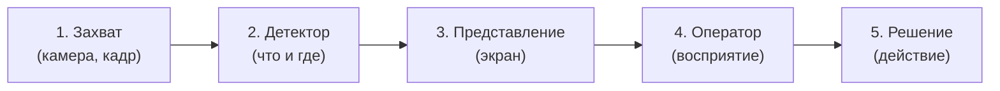
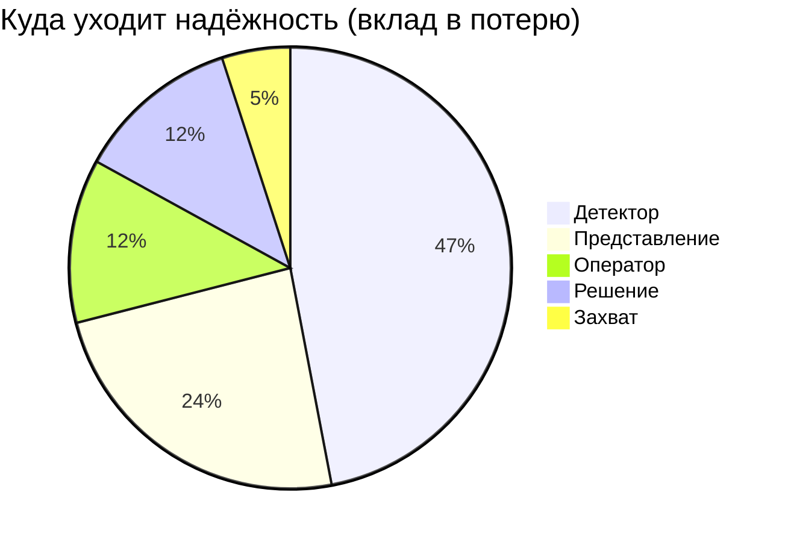
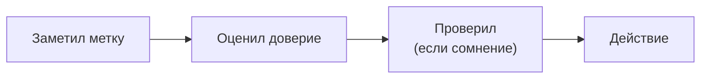

# Курсовая: как результат распознавания доходит до оператора

**Тема:** эргономическое обоснование представления результатов
распознавания объектов оператору мобильного робота
**Для:** Горячкин Б.С. · **Дата:** 2026-10-13

---

## Стр. 1 из 4

### 1. О чём работа — простыми словами

Робот видит мир камерой и **распознаёт объекты** (человек, стул, бутылка).
Дальше результат распознавания показывается **оператору на экран**, и
оператор принимает решение. Проблема: **показ важен** — если показать
неуверенное распознавание как уверенное, оператор ошибётся и доверится
неверному.

**Курсовая отвечает на вопрос:** как **показать** результат распознавания,
чтобы оператор работал **безошибочно**, — и **доказывает** это расчётом.

### 2. Зачем это нужно (проблема)

Распознавание никогда не бывает идеальным: часть объектов **пропущена**,
часть распознана **неверно**. Оператор должен это понимать. Но обычно на
экран выводят просто «рамка + название», **без честной уверенности** —
и оператор не знает, чему верить.

Три типовые ошибки:

| Ошибка | Что происходит |
| --- | --- |
| Ложное доверие | уверены в неверном ответе |
| Пропуск | объект не показан, оператор думает, что его нет |
| Перегрузка | слишком много меток сразу |

### 3. Как всё устроено: информационная цепочка

Результат идёт по цепочке из **5 звеньев**. На каждом звене теряется часть
надёжности.

Что делает каждое звено:

1. **Захват** — камера делает кадр. Потери: шум, смаз, частота кадров.
2. **Детектор** — находит объекты и даёт **класс + уверенность**.
   Потери: пропуски и ложные срабатывания.
3. **Представление** — как это нарисовано на экране (цвет, размер,
   уверенность). Потери: метку не заметили или неверно поняли.
4. **Оператор** — смотрит и считывает. Потери: ошибки считывания,
   усталость.
5. **Решение** — итоговое действие. Потери: неверное доверие.

**Ключевая мысль:** эргономика живёт на звене **«Представление →
Оператор»**, но её польза видна только в **общем расчёте** всей цепочки.

---

## Стр. 2 из 4

### 4. Как считается: пример на числах

Каждому звену даём число **aᵢ** — долю правильных результатов (от 0 до 1).
Итоговая надёжность всей цепочки:

**A = a₁ · a₂ · a₃ · a₄ · a₅**

Пример (реалистичные значения):

| Звено | aᵢ | Потеря (1−aᵢ) | Вклад в общую потерю |
| --- | --- | --- | --- |
| 1. Захват | 0.98 | 0.02 | 5% |
| 2. Детектор | 0.80 | 0.20 | **47%** |
| 3. Представление | 0.90 | 0.10 | **24%** |
| 4. Оператор | 0.95 | 0.05 | 12% |
| 5. Решение | 0.95 | 0.05 | 12% |

Итог: **A ≈ 0.64** — то есть надёжна примерно две трети случаев.

Вклад звеньев в потерю наглядно:

**Вывод:** потолок задаёт **детектор**, а второе узкое место —
**представление**. Значит, улучшая показ (звено 3), мы заметно поднимаем
итог; и наоборот, плохой показ «съедает» даже хороший детектор.

### 5. Как это считывает оператор

Оператор проходит короткую последовательность:

Если уверенность **не показана**, шаг «оценил доверие» оператор делает
**на глаз** — и ошибается. Наша задача — дать ему **честный сигнал**.

Пример кадра и детекций:

| № | Класс | Уверенность | Позиция |
| --- | --- | --- | --- |
| 1 | человек | 0.92 | центр |
| 2 | стул | 0.71 | слева |
| 3 | бутылка | 0.55 | внизу |
| 4 | (бутылка) | 0.48 | ниже порога → **не показано** |

Опасность: если 0.55 показать так же, как 0.92, оператор **ошибочно
доверится**. Значит, уверенность надо выразить **явно** (цветом/значком).

---

## Стр. 3 из 4

### 6. Какая метрика (и почему именно такая)

У каждого звена — своя метрика. Смешивать их нельзя.

| Звено | Метрика | Простыми словами |
| --- | --- | --- |
| 2. Детектор | F1, precision, recall | насколько хорошо находит объекты |
| **3. Представление** | **ECE + различимость** | **правдива ли уверенность и виден ли сигнал** |
| 4. Оператор | d′, время, нагрузка | как быстро и верно читает |
| 5. Решение | доля верных решений | итог |

> **Почему не F1 для представления?** F1 — про **детектор**. Для показа
> нужна **своя** метрика: **правдивость уверенности (ECE)** и
> **различимость**.

### 7. Главная метрика звена «Представление»

**(а) Правдивость уверенности (ECE).**
Если модель говорит «0.8», а права только в 60% случаев — она
**переуверена**, и оператор будет доверять ошибочно.

Пример (насколько уверенность «врёт»):

| Уверенность | Реально верно | Разрыв |
| --- | --- | --- |
| 0.65 | 0.58 | +0.07 |
| 0.75 | 0.66 | +0.09 |
| 0.85 | 0.78 | +0.07 |
| 0.95 | 0.93 | +0.02 |

Чем меньше разрыв — тем честнее показ. ECE = средний разрыв.

**(б) Различимость.**
Метка должна быть **заметна** и **различима**:

- цвет класса: **ΔE₀₀ ≥ 10** (иначе цвета сливаются);
- контраст текста: **≥ 4.5:1** (иначе не читается);
- размер метки: **≥ 20 угловых минут** (иначе мелко).

### 8. Как выглядит «правильное представление»

- **Цвет по уверенности:** зелёный — надёжно (≥ 0.8), жёлтый — средне
  (0.6–0.8), красный — ненадёжно (< 0.6).
- **«Не распознано» ≠ «нет объекта»:** пропуск показывается отдельно.
- **Ограничение числа меток** — не перегружать оператора.

---

## Стр. 4 из 4

### 9. Что получим в результате

1. **Числа по звеньям** — где и сколько теряется.
2. **Вклады звеньев** — что самое слабое.
3. **Рекомендации по экрану** — как показывать результат.

### 10. Как проверяем

Порядок строгий: **теория → модель → проверка**. Сначала расчёт, потом
**эксперимент в Gazebo** — он **только проверяет** расчёт (лог в CSV), а
не служит основанием.

### 11. Связь с ВКРМ

Робот **Go2**, симулятор **Gazebo**, детектор **YOLO**
(`quadropted_perception`). Курсовая — эргономическая часть: модель
цепочки + рекомендации по представлению.

### 12. Что прошу согласовать

1. Достаточно ли **5 звеньев**?
2. Нормально ли, что числа звеньев берём из **литературы/норм/датасета**
   (без экспертов и фокус-групп)?
3. Достаточно ли для звена «Представление» метрики **ECE + различимость**?
4. Какой **объём проверки** в Gazebo приемлем?

**Стр. 4 из 4**
