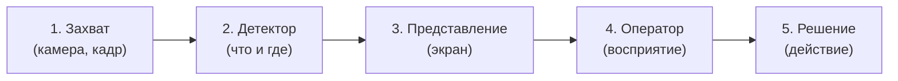
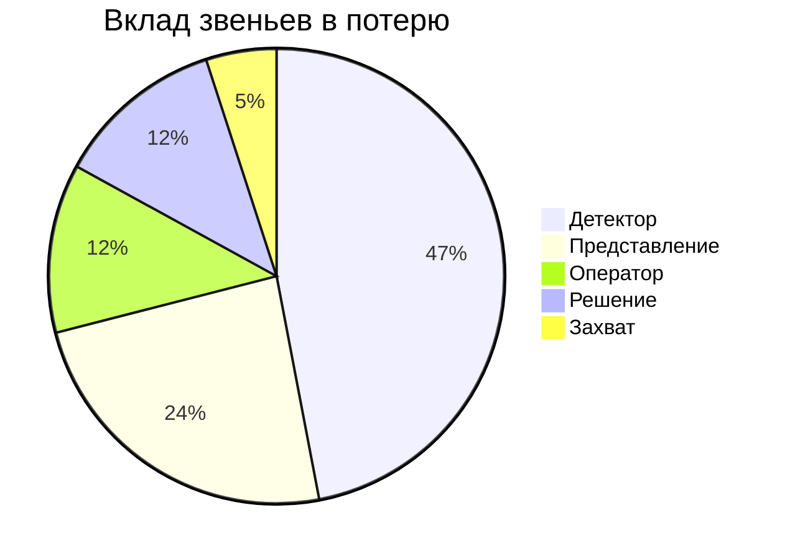
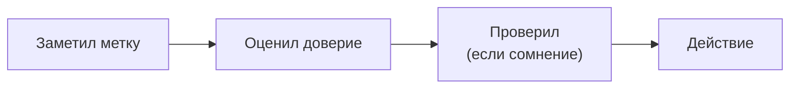
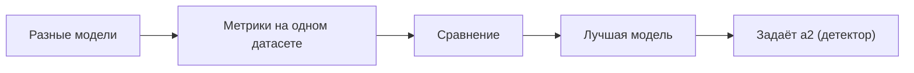

# Курсовая: как результат распознавания доходит до оператора

**Тема:** эргономическое обоснование представления результатов
распознавания объектов оператору мобильного робота
**Для:** Горячкин Б.С. · **Дата:** 2026-10-13

---

## 1. О чём работа

Робот распознаёт объекты (человек, стул, бутылка), результат показывается
**оператору на экран**, оператор принимает решение. Задача работы —
**обосновать**, как именно показывать результат распознавания, чтобы
оператор не ошибался, и **доказать** это расчётом информационной цепочки.

## 2. Ключевые решения

| № | Вопрос | Решение |
| --- | --- | --- |
| 1 | Какую часть цепочки берём | всю: кадр, камера, детектор, представление, оператор, решение |
| 2 | Откуда числа | литература / датасет |
| 3 | Формализация представления | % уверенности правильного ответа, F1-score и др. метрики |
| 4 | Связь с ВКРМ | прямая |
| 5 | Эксперимент | не предусмотрен (не входит в план курсовой) |
| 6 | Результат | расчёт/модель + рекомендации по представлению |

## 3. Что анализируем

1. **Объект анализа** — **представление результата распознавания**
   (звено «Представление → Оператор»): как результат показан оператору и
   как он его считывает.
2. **Для расчёта берём разные модели распознавания**, сравниваем их между
   собой и выбираем **лучшую** — она задаёт звено «Детектор» ($a_2$).
   Если одна модель лучше остальных, берём её и указываем, что по анализу
   (метрикам) она лучше.
3. **Оператора экспериментально не оцениваем** (нет выборки): коэффициент
   $a_4$ берётся из литературы.

## 4. Проблема

Распознавание не идеально: часть объектов **пропущена**, часть распознана
**неверно**. Если на экран выводить «рамка + название» без честной
уверенности, оператор не знает, чему верить. Типовые ошибки:

| Ошибка | Следствие |
| --- | --- |
| Ложное доверие | уверены в неверном ответе |
| Пропуск | объект не показан, оператор считает, что его нет |
| Перегрузка | слишком много меток сразу |

## 5. Информационная цепочка

Звенья: **захват → детектор → представление → оператор → решение**.
Каждому звену соответствует коэффициент $a_i$ — доля правильного
результата.

Итоговая надёжность цепочки (звенья независимы):

$$A = \prod_{i=1}^{5} a_i = a_1 \cdot a_2 \cdot a_3 \cdot a_4 \cdot a_5$$

Вклад звена в относительную потерю:

$$\ell_i = \frac{1 - a_i}{\sum_{j=1}^{5} (1 - a_j)}$$

Эргономика сосредоточена на звене **«Представление → Оператор»**, но её
вклад виден только в общем расчёте цепочки.

## 6. Пример расчёта

Примем $a_1=0.98$, $a_2=0.80$, $a_3=0.90$, $a_4=0.95$, $a_5=0.95$.

| Звено | $a_i$ | Потеря $1-a_i$ | Вклад $\ell_i$ |
| --- | --- | --- | --- |
| 1. Захват | 0.98 | 0.02 | 5% |
| 2. Детектор | 0.80 | 0.20 | 47% |
| 3. Представление | 0.90 | 0.10 | 24% |
| 4. Оператор | 0.95 | 0.05 | 12% |
| 5. Решение | 0.95 | 0.05 | 12% |

$A \approx 0.64$. Потолок задаёт **детектор**, второе узкое место —
**представление**; значит, улучшение показа заметно повышает итог, а
плохой показ «съедает» даже хороший детектор.

## 7. Как результат считывается оператором

Ниже — теоретическая схема считывания (экспериментально оператор не
оценивается).

Если уверенность не показана, шаг «оценил доверие» оператор выполняет
приблизительно. Пример кадра:

| № | Класс | Уверенность | Позиция |
| --- | --- | --- | --- |
| 1 | человек | 0.92 | центр |
| 2 | стул | 0.71 | слева |
| 3 | бутылка | 0.55 | внизу |
| 4 | (бутылка) | 0.48 | ниже порога → не показано |

Если 0.55 показать так же, как 0.92, оператор ошибочно доверится; значит,
уверенность нужно выражать явно.

## 8. Сравнение моделей распознавания

Для звена «Детектор» ($a_2$) берём несколько моделей и сравниваем на
**одном датасете** с одинаковыми классами и порогом.

| Модель | Тип | Что даёт |
| --- | --- | --- |
| YOLOv8 | детекция | рамки + класс + уверенность |
| YOLOv11 | детекция | то же, новее |
| RT-DETR | детекция | рамки + класс |
| YOLOv8-seg | сегментация | маски объектов |
| Mask R-CNN | сегментация | маски объектов |

Метрики сравнения: mAP@0.5, mAP@0.5:0.95, precision, recall, F1; для
сегментации — IoU, Dice, Pixel Accuracy; скорость (fps); отдельно — ECE.

Выбор — по балансу «точность/скорость» и при приемлемой калибровке. Если
одна модель лучше остальных, берём её (с числами), остальные отклоняем;
она задаёт $a_2$.

## 9. Метрики по звеньям

| Звено | Метрика | Что показывает |
| --- | --- | --- |
| 2. Детектор | F1, precision, recall | качество обнаружения объектов |
| 3. Представление | ECE + различимость | правдивость уверенности и заметность метки |
| 4. Оператор | не оценивается | $a_4$ берётся из литературы |
| 5. Решение | доля верных решений | итог |

F1 относится к **детектору**; для звена «Представление» используется своя
метрика — **ECE** и **различимость**.

## 10. Метрика звена «Представление»

### 10.1. Калибровка уверенности (ECE)

Калибровка — совпадение уверенности с фактической долей верных ответов.

$$\mathrm{ECE} = \sum_{m} \frac{|B_m|}{n}\,\big|\mathrm{acc}(B_m) - \mathrm{conf}(B_m)\big|$$

где $B_m$ — бин уверенности, $n$ — число объектов, $\mathrm{acc}$ —
фактическая точность в бине, $\mathrm{conf}$ — средняя уверенность в бине.

| Уверенность | Фактически верно | Разрыв |
| --- | --- | --- |
| 0.65 | 0.58 | +0.07 |
| 0.75 | 0.66 | +0.09 |
| 0.85 | 0.78 | +0.07 |
| 0.95 | 0.93 | +0.02 |

Если разрыв положителен — детектор переуверен, оператор доверяет
ошибочно. ECE — средневзвешенный разрыв.

### 10.2. Различимость

- цвет класса: $\Delta E_{00} \ge 10$;
- контраст текста: $\ge 4.5{:}1$ (WCAG);
- размер метки: $\ge 20$ угловых минут.

## 11. Рекомендации по представлению

- Цвет по уверенности: зелёный $\ge 0.8$, жёлтый $0.6$–$0.8$, красный
  $< 0.6$.
- «Не распознано» показывать отдельно от «нет объекта».
- Ограничивать число одновременно показанных меток.

## 12. Результат

1. Числа по звеньям и вклады.
2. Выбор лучшей модели распознавания с обоснованием по метрикам.
3. Рекомендации по представлению (экран).

## 13. Связь с ВКРМ

Робот **Go2**, детектор **YOLO** (`quadropted_perception`). Курсовая —
эргономическая часть: модель цепочки + сравнение моделей + рекомендации
по представлению.

## 14. Обоснование числа звеньев (5)

### 14.1. Варианты

| Вариант | Звенья | Плюсы | Минусы |
| --- | --- | --- | --- |
| 6 звеньев | кадр, камера, детектор, представление, оператор, решение | полное соответствие постановке | кадр и камера — одна стадия; трудно разделить числами |
| **5 звеньев** | захват, детектор, представление, оператор, решение | каждая стадия различима и обоснуема | «кадр + камера» объединены |
| 4 звена | захват, детектор, представление, оператор + решение | проще считать | теряется отдельный этап «решение» |

### 14.2. Рекомендация: 5 звеньев

- **Захват** (кадр + камера) — одна физическая стадия: сенсор →
  изображение; разделять «кадр» и «камеру» нечем — это один акт захвата;
- **Детектор** — метрики precision/recall/F1;
- **Представление** — ECE + различимость (ядро эргономики);
- **Оператор** — восприятие/понимание ($a_4$ из литературы);
- **Решение** — итог.

**Обоснование:**

1. **Считаемость:** у каждой стадии есть свой источник чисел (датасет,
   нормы, литература); для «кадра» и «камеры» отдельные числа взять
   негде.
2. **Прозрачность вклада:** 5 звеньев достаточно, чтобы показать, где
   теряется точность.
3. **Соответствие цели:** эргономика сосредоточена на «представление →
   оператор»; остальные звенья дают контекст и вклад.

Если потребуется **6 звеньев**, то просто разделим «захват» на «кадр» и
«камера» ($a_1$, $a_2$).
