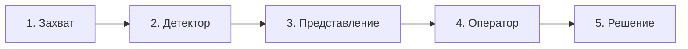

# Лист к консультации: что будет в курсовой и почему так

**Тема:** эргономическое обоснование представления результатов
распознавания объектов оператору мобильного робота
**Для:** Горячкин Б.С. · **Дата:** 2026-10-13 · **Стр. 1 из 1**

---

**1. Что будет в курсовой (коротко).**
Расчёт **информационной цепочки** от кадра до решения оператора и **доказательство**, что выбранное представление результата распознавания даёт нужное качество. Результат — числа (потери по звеньям) и рекомендации по экрану.

**2. Почему так.**
Эргономика здесь — на звене **«представление → оператор»**. Чтобы показать его роль, оно считается **в общем расчёте** цепочки: видно, где и сколько теряется.

**3. Как работает (информационная цепочка, 5 звеньев).**

Итоговая точность: **A = a1 · a2 · a3 · a4 · a5**.
Вклад звена в потерю: **ℓi = (1 − ai) / сумма(1 − aj)**.

**4. Как считывается.**
Детектор выдаёт **класс + уверенность**. Оператор видит метку и по ней решает, можно ли доверять. Если уверенность показана неправдиво — оператор ошибается (ложное доверие).

**5. Какая метрика (по звеньям).**

1. Захват — доля потерянных объектов.
2. **Детектор** — F1, precision, recall (это техника детектора).
3. **Представление** — **ECE** (правдивость уверенности) + **различимость** (цвет ΔE₀₀, контраст, угловой размер).
4. **Оператор** — d′ (различение сигнал/шум), время (Хик/Фиттс), нагрузка.
5. **Решение** — вероятность верного решения.

Главная метрика эргономики — **звено 3 (a3): ECE + различимость**, а не F1.

**6. Что на выходе.**
Расчёт по звеньям + **рекомендации по представлению** (показывать уверенность, различимость, ограничить число объектов).

**7. Проверка.**
Эксперимент в Gazebo — **только проверка** расчёта (теория → модель → проверка), лог в CSV.

**8. Связь с ВКРМ** — Go2, Gazebo, детектор YOLO (`quadropted_perception`).

---

**Вопрос:** достаточно ли 5 звеньев и метрики «ECE + различимость» для звена представления?
