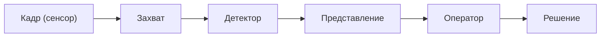
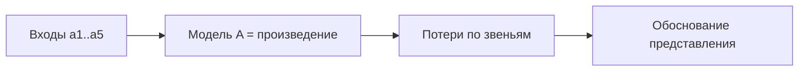

# План КР: материалы к консультации с Горячкиным Б.С.

**Тема:** Эргономическое обоснование представления результатов
распознавания объектов оператору мобильного робота
**Дата:** 2026-10-13
**Статус:** рабочая версия к консультации
**Консультант:** Горячкин Б.С. (к.т.н., доц. каф. ИУ5; ответственный
эксперт направления по кафедрам ИУ3, 5, 6, 7)
**Назначение:** показать, как выполнены требования к эргономическому
обоснованию, и согласовать оставшиеся вопросы.

Основание: требования, полученные ранее (вектор анализа, сужение
объекта, расчёт информационной цепочки по модели, «теория → модель →
проверка», связь с ВКРМ). Связанные материалы:

- `kr-brief.md` — краткая справка по теме;
- `kr-plan.md` — полный план и ответы на вопросы;
- `consultation-2026-10-06.md` — предыдущая консультация.

---

## 1. Что требуется и как отвечаем

**Таблица 1 — Требования и ответы.**

| Требование | Как выполняем |
| --- | --- |
| Дать **эргономическое обоснование** (доказать, на каком основании) | расчёт сквозной информационной цепочки по модели; вклад звена «представление» в общую потерю |
| Задать **вектор анализа** | информационно-перцептивный: представление результата → восприятие оператора |
| **Сузить объект** | звено «экран → оператор» в цепочке распознавания |
| **Считать цепочку по модели** | 5 звеньев, итог $A=\prod a_i$, вклады $\ell_i$ |
| **Экспертиза и фокус-группы исключены** | числа — из литературы, норм и датасетов |
| **Эксперимент — только проверка** | Gazebo-прогон сверяет расчёт с фактом, не является основанием |
| **Порядок «теория → модель → проверка»** | сначала модель и расчёт, затем эксперимент |
| **Связь с ВКРМ** | Go2, Gazebo, YOLO-детектор (`quadropted_perception`) |

---

## 2. Вектор анализа и сужение объекта

**Таблица 2 — Вектор анализа.**

| Что | Значение |
| --- | --- |
| Вектор | представление результата распознавания → восприятие оператора |
| Узкий выбор | звено «экран → оператор» |
| Что считаем | потери по звеньям, вклад, итоговую точность |
| Что НЕ смотрим | обучение модели, mAP (техника детектора) |

**Схема 1 — Информационная цепочка (5 звеньев).**

---

## 3. Модель цепочки

Звенья: **захват → детектор → представление → оператор → решение**.

Итоговая точность (звенья независимы):

$$A = \prod_{i=1}^{n} a_i = a_{1}\cdot a_{2}\cdot a_{3}\cdot a_{4}\cdot a_{5}$$

Вклад звена в относительную потерю:

$$\ell_i = \frac{1 - a_i}{\sum_j (1 - a_j)}$$

**Пример расчёта** ($a_1=0.98$, $a_2=0.80$, $a_3=0.90$, $a_4=0.95$,
$a_5=0.95$):

**Таблица 3 — Пример расчёта по звеньям.**

| Звено | $a_i$ | Потеря $1-a_i$ | Вклад $\ell_i$ |
| --- | --- | --- | --- |
| Захват | 0.98 | 0.02 | ≈ 5% |
| Детектор | 0.80 | 0.20 | ≈ 48% |
| Представление | 0.90 | 0.10 | ≈ 24% |
| Оператор | 0.95 | 0.05 | ≈ 12% |
| Решение | 0.95 | 0.05 | ≈ 12% |

Итог: $A \approx 0.64$. Потолок задаёт **детектор**, второе узкое
место — **представление**. Отсюда требование **показывать уверенность**,
чтобы оператор компенсировал слабое звено.

**Схема 2 — От модели к обоснованию представления.**

---

## 4. Эргономическое обоснование (на каком основании)

Обоснование строится как **доказательство**: выбранное представление
обеспечивает требуемое качество деятельности, потому что:

1. расчёт цепочки показывает, что звено «представление» — второе по
   вкладу в потерю;
2. эргономические метрики звена (калибровка уверенности, различимость)
   **измеримо** влияют на $a_3$;
3. повышение $a_3$ повышает итоговую $A$ и снижает ошибочное доверие
   оператора.

**Таблица 4 — Основание по каждому пункту.**

| Утверждение | Основание |
| --- | --- |
| представление значимо | вклад $\ell_3$ в модели |
| уверенность важна | калибровка ECE, риск ложного доверия |
| различимость важна | $\Delta E_{00}$, контраст WCAG, угловой размер |
| вклад измерим | метрики звеньев из литературы/норм/датасета |

---

## 5. Метрики звеньев

**Таблица 5 — Метрики по звеньям.**

| Звено | Коэф. | Метрика | Источник |
| --- | --- | --- | --- |
| Захват | $a_1$ | доля потерянных объектов | параметры сцены |
| Детектор | $a_2$ | F1, precision, recall, mAP | датасет |
| Представление | $a_3$ | ECE + различимость ($\Delta E_{00}$, контраст, угловой размер) | нормы + модель |
| Оператор | $a_4$ | $d'$ (SDT), время (Хик/Фиттс), нагрузка | литература |
| Решение | $a_5$ | вероятность верного решения | модель |

**Таблица 6 — Ключевые модели и формулы.**

| Модель | Формула | Что даёт |
| --- | --- | --- |
| Калибровка ECE | $\sum_m \frac{\lvert B_m \rvert}{n}\lvert \mathrm{acc}-\mathrm{conf}\rvert$ | правдивость уверенности |
| SDT | $d' = z(H) - z(F)$ | различение сигнал/шум |
| Хик–Хайман | $RT = a + b\log_2(n+1)$ | нагрузка выбора |
| Фиттс | $MT = a + b\log_2(A/W+1)$ | наведение |
| Вебер | $\Delta I / I = k$ | различимость |
| CIE | $\Delta E_{00}$ | цветовое различие |
| AoI | $\Delta(t) = t - u(t)$ | свежесть данных |

**Важно:** F1 — метрика **детектора**; для звена «представление» нужна
**своя** метрика (ECE + различимость) — их нельзя смешивать.

---

## 6. Порядок «теория → модель → проверка»

**Схема 3 — Шаги работ.**

Эксперимент — **верификация после аналитического расчёта**:
прогон в Gazebo, лог в CSV (класс, confidence, bbox/маска, timestamp,
поза), расчёт фактических метрик и $A_{факт}$, сравнение с $A_{расч}$.

---

## 7. Результат КР

- Расчёт (числа по звеньям и вклады) + **рекомендации по представлению**
  (показ уверенности, различимость, приоритизация, ограничение числа
  объектов).
- Связь с ВКРМ: Go2, Gazebo/Isaac, YOLO-детектор, `gazebo_sim`.

---

## 8. Вопросы к Горячкину Б.С. (на консультации)

1. Достаточно ли **5 звеньев**, или требуются 6 (разделить «кадр» и
   «камеру»)?
2. Устраивает ли, что числа звеньев берём из **литературы/норм/датасета**
   (без экспертизы и фокус-групп)?
3. Достаточно ли для звена «представление» метрики **ECE + различимость**?
4. Какой **объём эксперимента** в Gazebo считается приемлемым
   (число сценариев и прогонов)?
5. Достаточна ли формулировка **связи с ВКРМ**?
6. Нужны ли **рекомендации по представлению** в явном виде (перечень)?

---

## 9. Что показываем на консультации

**Таблица 7 — Артефакты к консультации.**

| Артефакт | Где |
| --- | --- |
| Справка по теме | `kr-brief.md` |
| Полный план и ответы | `kr-plan.md` |
| Схемы (цепочка, звено «Детектор») | `advisor/` |
| Расчёт примера (таблицы 3–5) | этот документ |
| План эксперимента в Gazebo | §6 |

---

## 10. Следующие шаги

1. Зафиксировать ответы Горячкина Б.С. по §8.
2. При необходимости разделить «захват» на «кадр» и «камеру».
3. Собрать итоговые числа звеньев (литература/нормы/датасет).
4. Подготовить варианты представления и их $a_3$.
5. Провести проверку в Gazebo и сравнить $A_{факт}$ с $A_{расч}$.
6. Сформировать раздел РПЗ с обоснованием и рекомендациями.
