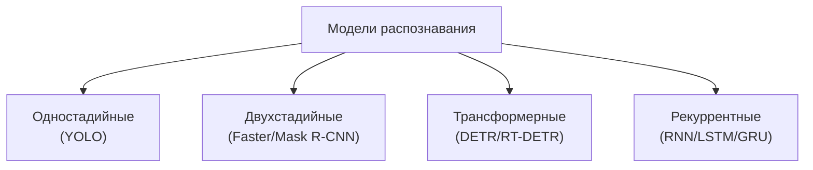

# Математические характеристики моделей МО по архитектурам

**Тема:** Обоснование выбора модели машинного обучения для распознавания
объектов оператору мобильного робота
**Дата:** 2026-10-13
**Связанные документы:** `mmo-decomposition.md`, `selection-algorithm.md`
**Статус:** черновик к согласованию

Цель — дать **много объективных характеристик с формулами** и охватить
разные **архитектуры**, чтобы сравнение было математически строгим.

---

## 1. Архитектурные семейства

| Семейство | Принцип | Постобработка |
| --- | --- | --- |
| Одностадийные | плотные предсказания по сетке | NMS |
| Двухстадийные | предложения (RPN) + головы RoI | NMS |
| Трансформерные | set-prediction (запросы) | сопоставление (Hungarian) |
| Рекуррентные | обработка во времени (трекинг) | сглаживание |

---

## 2. Формулы по архитектурам

### 2.1. Базовые слои

**Свёртка** ($k_h\times k_w$, $C_{in}$, $C_{out}$, выход $H\times W$):

$$P_{conv}=k_hk_wC_{in}C_{out}+C_{out},\qquad
F_{conv}=2k_hk_wC_{in}C_{out}HW$$

**Линейный слой:**

$$P_{fc}=IO+O,\qquad F_{fc}=2IO$$

### 2.2. Трансформерный блок ($d$, длина $n$)

$$P_{blk}=12d^2+4d,\qquad F_{blk}\approx 24\,nd^2+4\,n^2d$$

Кодировщик ($L_e$ блоков): $F_{enc}=L_eF_{blk}(n)$.
Декодер ($L_d$ блоков, $N_q$ запросов): cross-attention
$F_{dec}\approx L_d(8N_q d^2+4N_q n d)$.

### 2.3. Двухстадийная (RPN + RoI)

Анкерных предложений: $N_{anc}=A\sum_l H_lW_l$; после отбора —
$N_{prop}$.

$$F_{rpn}=F_{conv}(A\text{ предсказаний}),\qquad
F_{roi}=N_{prop}\cdot F_{head}$$

### 2.4. Рекуррентная (LSTM)

$$P_{lstm}=4(dh+h^2+h),\qquad F_{lstm}=8(dh+h^2)\ \text{на шаг}$$

за $T$ шагов: $F=TF_{lstm}$ (последовательно во времени).

### 2.5. Рецептивное поле (CNN)

$$R_{rf}=1+\sum_i (k_i-1)\prod_{j<i}s_j$$

---

## 3. Перечень характеристик (с формулами и единицами)

| № | Характеристика | Обозн. | Формула | Единицы |
| --- | --- | --- | --- | --- |
| 1 | Параметры | $P$ | $\sum P_i$ | шт. |
| 2 | FLOPs | $F$ | $\sum F_i$ | оп. |
| 3 | Память весов | $M_w$ | $4P$ (fp32) / $2P$ (fp16) | байт |
| 4 | Память активаций | $M_a$ | $\sum_l 4C_lH_lW_l$ | байт |
| 5 | Общая память | $M$ | $M_w+M_a$ | байт |
| 6 | Трафик памяти | $B$ | $\sum_l 4C_lH_lW_l$ | байт |
| 7 | Арифм. интенсивность | $AI$ | $F/B$ | оп./байт |
| 8 | Задержка | $T$ | $\max(F/\Pi_{op},\,B/BW)$ | с |
| 9 | Частота | $f$ | $1/T$ | Гц |
| 10 | Эффективность | $E$ | $1/F$ | 1/оп. |
| 11 | Энергия | $Q$ | $P_{pow}\cdot T$ | Дж |
| 12 | Глубина | $L$ | число слоёв | шт. |
| 13 | Рецептивное поле | $R_{rf}$ | формула §2.5 | px |
| 14 | Число стадий | $N_s$ | 1 / 2 / set | шт. |
| 15 | Число предсказаний | $N_{pred}$ | $A\sum_lH_lW_l$ | шт. |
| 16 | Число предложений | $N_{prop}$ | после RPN | шт. |
| 17 | Число запросов | $N_q$ | параметр декодера | шт. |
| 18 | Стоимость NMS | $C_{nms}$ | $O(N_{prop}\log N_{prop})$ | оп. |
| 19 | Стоимость сопоставления | $C_{match}$ | $O(N_q^3)$ | оп. |
| 20 | Число классов | $k$ | выход | шт. |
| 21 | Однозначность класса | $O_c$ | $1/k$ | безразм. |
| 22 | Наглядность | $H_v$ | $1/\log_2(k+1)$ | безразм. |
| 23 | Линейные области | $R$ | $\prod_i\sum_{j=1}^d\binom{n_i}{j}$ | шт. |
| 24 | VC-размерность | $\mathrm{VCdim}$ | $O(WL\log W)$ | шт. |
| 25 | Читаемость | $C$ | $\tfrac{1}{\log_2(P+1)}\tau$ | безразм. |
| 26 | Тип выхода | — | рамка/маска/точка | — |
| 27 | Детерминизм | — | нет ГСЧ | да/нет |
| 28 | Треб. трекинга | — | рекуррентный во времени | да/нет |

---

## 4. Матрица сравнения (представители семейств)

| Характеристика | YOLOv11n (1-stage) | Faster R-CNN (2-stage) | Mask R-CNN (2-stage) | RT-DETR-l (transformer) |
| --- | --- | --- | --- | --- |
| $P$, млн | 2.6 | ~41 | ~44 | 32 |
| $F$, ГFLOP | 6.5 | ~180 | ~200 | 103.5 |
| $M_w$ (fp32), МБ | 10.4 | 164 | 176 | 128 |
| $N_s$ | 1 | 2 | 2 | set |
| $N_{prop}/N_q$ | $N_{pred}$ | ~300 | ~1000 | 300 |
| NMS | да | да | да | нет |
| Сопоставление | нет | нет | нет | Hungarian |
| Тип выхода | рамка | рамка | маска | рамка |
| $f$ при $\Pi=100$ Гоп./с | 15.4 | ~0.6 | ~0.5 | 1.0 |
| $T$, с | 0.065 | ~1.8 | ~2.0 | 1.035 |
| $R_{rf}$, px | по §2.5 | большой | большой | глобальное ($n^2$) |
| $O_c$ | 1 (при $k$) | 1 | 1 | 1 |
| $H_v$ ($k=80$) | 0.16 | 0.16 | 0.16 | 0.16 |
| $C$ | высокая | ниже | ниже | средняя |
| Детерминизм | да | да | да | да |

> Числа по спецификациям (ориентир); подлежат проверке.

---

## 5. Что даёт анализ

1. **Одностадийные** — лучшая эффективность ($E$), минимальная задержка
   ($T$), подходят для борта.
2. **Двухстадийные** — высокая память и задержка ($M$, $T$), но точнее
   на мелких объектах (качественная характеристика, без формулы).
3. **Трансформерные** — глобальный контекст ($n^2$), но большие $F$, $T$;
   нет NMS (нет $C_{nms}$), но есть $C_{match}$.
4. **Рекуррентные** — нужны для трекинга во времени, но не
   параллелизуются, растёт $T$.

---

## 6. Правило выбора (наш алгоритм, без весов)

1. Отсев по **жёстким требованиям** ($T\le T_{\max}$, $M\le M_{\max}$,
   нужен ли тип выхода — маска).
2. Ранжирование оставшихся по каждой характеристике (1 — лучшая).
3. Выбор по **минимальной сумме рангов** $S=\sum\operatorname{rank}$.
4. Ничья — по характеристике из жёсткого требования.

---

## 7. Открытые вопросы к преподавателю

1. Какие характеристики включать в ранжирование (список §3)?
2. Жёсткие требования: частота, память, нужна ли маска.
3. Считать ли задержку по roofline ($\max(F/\Pi, B/BW)$)?
4. Нужны ли рекуррентные модели (трекинг) в сравнении.
