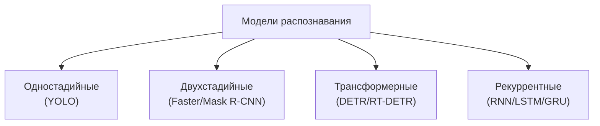

# Математические характеристики моделей МО по архитектурам

**Тема:** Обоснование выбора модели машинного обучения для распознавания
объектов оператору мобильного робота
**Дата:** 2026-10-13
**Связанные документы:** `mmo-decomposition.md`, `selection-algorithm.md`
**Статус:** черновик к согласованию

Цель — дать **много объективных характеристик с формулами** и охватить
разные **архитектуры**, чтобы сравнение было математически строгим.

Характеристики сгруппированы в **7 категорий** (всего ~63):
**A** вычислительные ресурсы, **B** архитектурные, **C** ёмкость и
выразительность, **D** точность без датасета, **E** робототехника и
надёжность, **F** вывод и эргономика, **G** готовые веса и обучение.

**Столбцы:** что означает · откуда/как берётся · зачем · **практическое
применение (куда/что/как)**.

---

## 1. Архитектурные семейства

| Семейство | Принцип | Постобработка |
| --- | --- | --- |
| Одностадийные | плотные предсказания по сетке | NMS |
| Двухстадийные | предложения (RPN) + головы RoI | NMS |
| Трансформерные | set-prediction (запросы) | сопоставление (Hungarian) |
| Рекуррентные | обработка во времени (трекинг) | сглаживание |

---

## 2. Формулы по архитектурам

$$P_{conv}=k_hk_wC_{in}C_{out}+C_{out},\qquad
F_{conv}=2k_hk_wC_{in}C_{out}HW$$

$$P_{fc}=IO+O,\qquad F_{fc}=2IO$$

$$P_{blk}=12d^2+4d,\qquad F_{blk}\approx 24\,nd^2+4\,n^2d$$

$$N_{anc}=A\sum_l H_lW_l,\qquad F_{roi}=N_{prop}\cdot F_{head}$$

$$P_{lstm}=4(dh+h^2+h),\qquad F_{lstm}=8(dh+h^2)\ \text{на шаг}$$

$$R_{rf}=1+\sum_i (k_i-1)\prod_{j<i}s_j$$

---

## 3. Перечень характеристик (по категориям)

### A. Вычислительные ресурсы

| № | Характеристика | Формула | Ед. | Что означает | Откуда/как | Зачем | Практическое применение |
| --- | --- | --- | --- | --- | --- | --- | --- |
| A1 | Параметры $P$ | $\sum P_i$ | шт. | объём весов | сумма по слоям | память, переобучение | сколько модель «весит» — влезет ли на борт робота |
| A2 | FLOPs $F$ | $\sum F_i$ | оп. | операций на кадр | формула слоёв | задержка, железо | хватит ли мощности для реального времени |
| A3 | MACs | $F/2$ | оп. | умножений-сложений | $F/2$ | совместимость с ТЗ | сверить с паспортом ускорителя |
| A4 | Память весов $M_w$ | $4P$/$2P$ | байт | память под веса | fp32/fp16 | уложиться в борт | сколько ОЗУ держать под модель |
| A5 | Рабочий набор $W_{set}$ | $\max_l4C_lH_lW_l$ | байт | пик активаций | максимум слоёв | скорость/кэш | будет ли «тормозить» из-за памяти |
| A6 | Трафик $B$ | $\sum_l4C_lH_lW_l$ | байт | обмен с памятью | сумма активаций | узкое место | найти, где данные гоняются зря |
| A7 | Интенсивность $AI$ | $F/B$ | оп./байт | операций на байт | $F/B$ | compute/memory | понять, что ограничивает скорость |
| A8 | Точка roofline $AI^*$ | $\Pi/BW$ | оп./байт | порог железа | паспорт железа | сравнение | сопоставить модель с платформой |
| A9 | Задержка $T$ | $\max(F/\Pi,B/BW)$ | с | время на кадр | roofline | реальное время | успеет ли за такт управления |
| A10 | Утилизация $U$ | $\min(1,AI/AI^*)$ | безр. | КПД железа | $AI$, $AI^*$ | эффективность | насколько полно используется GPU/CPU |
| A11 | Частота $f$ | $1/T$ | Гц | кадров в секунду | $1/T$ | сравнение с требованием | сколько FPS получит робот |
| A12 | Эффективность $E$ | $1/F$ | 1/оп. | «дешевизна» | $1/F$ | ранжирование | выбрать самую лёгкую при равных |
| A13 | Энергия $Q$ | $P_{pow}T$ | Дж | энергия на кадр | мощность×время | энергобюджет | сколько «ест» на кадр |
| A14 | Энергоэффективность | $1/Q$ | 1/Дж | кадров на джоуль | $1/Q$ | автономность | на сколько хватит батареи |

### B. Архитектурные

| № | Характеристика | Формула | Ед. | Что означает | Откуда/как | Зачем | Практическое применение |
| --- | --- | --- | --- | --- | --- | --- | --- |
| B1 | Глубина $L$ | число слоёв | шт. | «длина» сети | архитектура | ёмкость, градиенты | глубже — ёмче, но дороже |
| B2 | Стадии $N_s$ | 1/2/set | шт. | тип детектора | архитектура | классификация | понять, одно-/двухстадийная |
| B3 | Ширина $C_{max}$ | макс. каналов | шт. | пропускная способность | архитектура | ёмкость | сколько признаков несёт модель |
| B4 | Страйд $s_{max}$ | $\prod s_i$ | раз | прореживание | произведение | мин. объект | увидит ли мелкий объект |
| B5 | Рецептивное поле $R_{rf}$ | §2 | px | охват контекста | формула | видимость объекта | видит ли объект целиком |
| B6 | Доля поля $\rho_{rf}$ | $R_{rf}/R_{in}$ | безр. | покрытие кадра | отношение | глобальность | «оглядывает» ли весь кадр |
| B7 | Параметры backbone $P_b$ | $\sum$ | шт. | вес извлечения | сумма | где вес | где основная «тяжесть» |
| B8 | Параметры головы $P_h$ | $\sum$ | шт. | стоимость предсказаний | сумма | цена выхода | сколько стоит этап решений |
| B9 | Доля головы $\rho_h$ | $P_h/P$ | безр. | перекос сложности | отношение | баланс | сбалансирована ли модель |
| B10 | Ветви $N_{br}$ | архитектура | шт. | многозадачность | архитектура | масштабы | решает ли несколько задач сразу |
| B11 | Нелинейности $N_\sigma$ | $\sum C_lH_lW_l$ | шт. | «изломы» решений | формула | ёмкость | больше изломов — точнее потенциально |
| B12 | Residual $N_{res}$ | архитектура | шт. | пути градиента | архитектура | обучаемость | не «затухает» ли обучение |
| B13 | Эмбеддинг $d$ | архитектура | шт. | ширина внимания | архитектура | стоимость | «ширина мышления» трансформера |
| B14 | Головы внимания $h$ | архитектура | шт. | разнообразие | архитектура | качество | сколькими «взглядами» смотрит |
| B15 | Длина $n$ | токены | шт. | число элементов | патчи | $O(n^2)$ | влияет на квадрат стоимости |
| B16 | Доля внимания $\rho_{att}$ | $F_{att}/F_{blk}$ | безр. | где траты | отношение | профиль | где тратится время |

### C. Ёмкость и выразительность

| № | Характеристика | Формула | Ед. | Что означает | Откуда/как | Зачем | Практическое применение |
| --- | --- | --- | --- | --- | --- | --- | --- |
| C1 | Линейные области $R$ | $\prod\sum\binom{n_i}{j}$ | шт. | выразительность | формула | потенциал | сколько решений модель может выразить |
| C2 | VC-размерность | $O(WL\log W)$ | шт. | сложность класса | оценка | обобщаемость | не переобучится ли |
| C3 | Rademacher | оценка норм | безр. | граница переобучения | оценка | надёжность | оценить риск переобучения |
| C4 | Липшиц $\Lambda$ | $\prod\lVert W_l\rVert$ | безр. | чувствительность | нормы | устойчивость | устойчива ли к шуму входа |
| C5 | Плотность $P/L$ | $P/L$ | шт./слой | «густота» | отношение | сравнимость | сравнить модели разной структуры |

### D. Точность без датасета (архитектурные прокси)

| № | Характеристика | Формула | Ед. | Что означает | Откуда/как | Зачем | Практическое применение |
| --- | --- | --- | --- | --- | --- | --- | --- |
| D1 | Мин. объект $s_{min}$ | $R_{in}/s_{max}$ | px | различимый размер | отношение | мелкие объекты | увидит ли бутылку/мелкий объект |
| D2 | Плотность предсказаний | $N_{pred}/(HW)$ | шт./px | детализация | отношение | локализация | насколько точно укажет положение |
| D3 | Предсказаний $N_{pred}$ | $A\sum H_lW_l$ | шт. | кандидатов на кадр | сетка | постобработка | объём работы после сети |
| D4 | Предложений $N_{prop}$ | после RPN | шт. | кандидатов RoI | RPN | цена 2-stage | цена двухстадийной модели |
| D5 | Запросов $N_q$ | декодер | шт. | кандидатов трансформера | декодер | сопоставление | цена трансформера |
| D6 | Уровни пирамиды | архитектура | шт. | масштабная инвариантность | neck | разброс размеров | работает ли с объектами разных размеров |

### E. Робототехника и надёжность

| № | Характеристика | Формула | Ед. | Что означает | Откуда/как | Зачем | Практическое применение |
| --- | --- | --- | --- | --- | --- | --- | --- |
| E1 | Требование $f_{min}$ | задаётся | Гц | порог реального времени | ТЗ | отсев | быстрее порога — годится, медленнее — нет |
| E2 | Запас $\Delta$ | $1/f_{min}-T$ | с | допуск по времени | разность | устойчивость | есть ли запас на помехи/загрузку |
| E3 | Память $M$ | $M_w+M_a$ | байт | полная память | сумма | борт | влезет ли на бортовой модуль |
| E4 | Детерминизм | нет ГСЧ | да/нет | воспроизводимость | инференс | безопасность | одинаковый ответ на одинаковый кадр |
| E5 | Пороги $N_{th}$ | подсчёт | шт. | настроек | пороги/NMS | чувствительность | сколько крутить при внедрении |
| E6 | Квантуемость | fp16/int8 | да/нет | сжатие | операции | ускорение | можно ли ускорить без потерь |
| E7 | NMS $C_{nms}$ | $O(N\log N)$ | оп. | постобработка | оценка | узкое место | не станет ли тормозом |
| E8 | Hungarian $C_{match}$ | $O(N_q^3)$ | оп. | сопоставление | оценка | узкое место | не тормозит ли трансформер |
| E9 | Трекинг | рекуррентность | да/нет | временной контекст | архитектура | нужно ли | следить за объектом во времени |
| E10 | Worst-case | детермин. | — | гарантия | оценка | надёжность | не «зависнет» ли дольше лимита |

### F. Вывод и эргономика

| № | Характеристика | Формула | Ед. | Что означает | Откуда/как | Зачем | Практическое применение |
| --- | --- | --- | --- | --- | --- | --- | --- |
| F1 | Классы $k$ | выход | шт. | различающая способность | выход | круг задач | сколько классов робот различает |
| F2 | Однозначность $O_c$ | $1/k$ | безр. | одно решение | $1/k$ | снятие двусмысленности | одно понятное решение на объект |
| F3 | Наглядность $H_v$ | $1/\log_2(k+1)$ | безр. | понятность | Хик | восприятие | понятно ли оператору, что показано |
| F4 | Тип выхода | рамка/маска | — | форма результата | архитектура | нужна ли маска | достаточно рамки или нужна маска |
| F5 | Нагрузка $k_v$ | число объектов | шт. | сколько показывать | выход | внимание | не перегружать оператора |
| F6 | Калибруемость | есть вер-ть | да/нет | честность уверенности | выход | доверие | можно ли верить показанной уверенности |
| F7 | Читаемость $C$ | $\tfrac{1}{\log_2(P+1)}\tau$ | безр. | интерпретируемость | формула | объяснимость | легко ли объяснить решение |

### G. Готовые веса и обучение

| № | Характеристика | Значение | Ед. | Что означает | Откуда/как | Зачем | Практическое применение |
| --- | --- | --- | --- | --- | --- | --- | --- |
| G1 | Датасет | набор | — | на чём обучена | спецификация | близость | похожа ли задача на нашу |
| G2 | Классы предобучения $k_0$ | шт. | шт. | что уже умеет | спецификация | перенос | что модель уже распознаёт |
| G3 | Параметры дообучения $P_{ft}$ | шт. | шт. | что подстраивать | спецификация | стоимость | сколько дообучать под робота |
| G4 | Эпохи $E_p$ | шт. | шт. | объём обучения | спецификация | ресурс | сколько сил займёт дообучение |
| G5 | Функция потерь | тип | — | как обучается | спецификация | ошибки | как модель относится к ошибкам |

---

## 4. Матрица сравнения (представители семейств)

| Характеристика | YOLOv11n (1-stage) | Faster R-CNN (2-stage) | Mask R-CNN (2-stage) | RT-DETR-l (transformer) |
| --- | --- | --- | --- | --- |
| $P$, млн | 2.6 | ~41 | ~44 | 32 |
| $F$, ГFLOP | 6.5 | ~180 | ~200 | 103.5 |
| $M_w$ (fp32), МБ | 10.4 | 164 | 176 | 128 |
| $N_s$ | 1 | 2 | 2 | set |
| NMS | да | да | да | нет |
| Сопоставление | нет | нет | нет | Hungarian |
| Тип выхода | рамка | рамка | маска | рамка |
| $T$, с ($\Pi=100$ Гоп./с) | 0.065 | ~1.8 | ~2.0 | 1.035 |
| $f$, Гц | 15.4 | ~0.6 | ~0.5 | 1.0 |
| Читаемость $C$ | высокая | ниже | ниже | средняя |

> Числа — по спецификациям (ориентир); подлежат проверке.

---

## 5. Что даёт анализ

1. **Одностадийные** — лучшая эффективность ($E$) и задержка ($T$), для
   борта.
2. **Двухстадийные** — высокая память и задержка, но лучше на мелких
   объектах.
3. **Трансформерные** — глобальный контекст, но большие $F$, $T$.
4. **Рекуррентные** — для трекинга, не параллелизуются.

---

## 6. Правило выбора (наш алгоритм, без весов)

1. Отсев по **жёстким требованиям** ($T\le T_{\max}$, $M\le M_{\max}$,
   нужный тип выхода).
2. Ранжирование оставшихся по каждой характеристике (1 — лучшая).
3. Выбор по **минимальной сумме рангов** $S=\sum\operatorname{rank}$.
4. Ничья — по характеристике из жёсткого требования.

---

## 7. Открытые вопросы к преподавателю

1. Какие характеристики включать в ранжирование (список §3)?
2. Жёсткие требования: частота, память, нужна ли маска.
3. Считать ли задержку по roofline ($\max(F/\Pi, B/BW)$)?
4. Нужны ли рекуррентные модели (трекинг) в сравнении.
