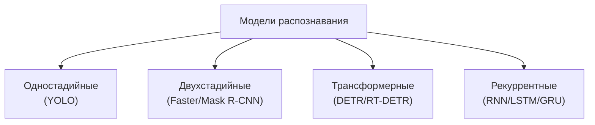

# Математические характеристики моделей МО по архитектурам

**Тема:** Обоснование выбора модели машинного обучения для распознавания
объектов оператору мобильного робота
**Дата:** 2026-10-13
**Связанные документы:** `mmo-decomposition.md`, `selection-algorithm.md`
**Статус:** черновик к согласованию

Цель — дать **много объективных характеристик с формулами** и охватить
разные **архитектуры**, чтобы сравнение было математически строгим.

Характеристики сгруппированы в **7 категорий** (всего ~63):
**A** вычислительные ресурсы, **B** архитектурные, **C** ёмкость и
выразительность, **D** точность без датасета, **E** робототехника и
надёжность, **F** вывод и эргономика, **G** готовые веса и обучение.

**Столбцы:** что означает · откуда/как берётся · зачем (для чего).

---

## 1. Архитектурные семейства

| Семейство | Принцип | Постобработка |
| --- | --- | --- |
| Одностадийные | плотные предсказания по сетке | NMS |
| Двухстадийные | предложения (RPN) + головы RoI | NMS |
| Трансформерные | set-prediction (запросы) | сопоставление (Hungarian) |
| Рекуррентные | обработка во времени (трекинг) | сглаживание |

---

## 2. Формулы по архитектурам

### 2.1. Базовые слои

$$P_{conv}=k_hk_wC_{in}C_{out}+C_{out},\qquad
F_{conv}=2k_hk_wC_{in}C_{out}HW$$

$$P_{fc}=IO+O,\qquad F_{fc}=2IO$$

### 2.2. Трансформерный блок ($d$, длина $n$)

$$P_{blk}=12d^2+4d,\qquad F_{blk}\approx 24\,nd^2+4\,n^2d$$

Кодировщик: $F_{enc}=L_eF_{blk}(n)$. Декодер: cross-attention
$F_{dec}\approx L_d(8N_q d^2+4N_q n d)$.

### 2.3. Двухстадийная (RPN + RoI)

$$N_{anc}=A\sum_l H_lW_l,\qquad F_{rpn}=F_{conv}(A),\qquad
F_{roi}=N_{prop}\cdot F_{head}$$

### 2.4. Рекуррентная (LSTM)

$$P_{lstm}=4(dh+h^2+h),\qquad F_{lstm}=8(dh+h^2)\ \text{на шаг}$$

### 2.5. Рецептивное поле (CNN)

$$R_{rf}=1+\sum_i (k_i-1)\prod_{j<i}s_j$$

---

## 3. Перечень характеристик (по категориям)

### A. Вычислительные ресурсы

| № | Характеристика | Обозн. | Формула | Ед. | Что означает | Откуда/как | Зачем |
| --- | --- | --- | --- | --- | --- | --- | --- |
| A1 | Параметры | $P$ | $\sum P_i$ | шт. | объём весов модели | сумма по слоям (спецификация) | память, риск переобучения |
| A2 | FLOPs | $F$ | $\sum F_i$ | оп. | операций на кадр | формула по слоям | задержка, энергия, выбор железа |
| A3 | MACs | $F_{mac}$ | $F/2$ | оп. | умножений-сложений | $F/2$ | совместимость с ТЗ железа |
| A4 | Память весов | $M_w$ | $4P$/$2P$ | байт | память под веса | $4P$ fp32, $2P$ fp16 | влезает ли на борт |
| A5 | Рабочий набор | $W_{set}$ | $\max_l 4C_lH_lW_l$ | байт | пик активаций | максимум по слоям | кэш-локальность, скорость |
| A6 | Трафик памяти | $B$ | $\sum_l 4C_lH_lW_l$ | байт | объём обмена с памятью | сумма активаций | memory-bound задержка |
| A7 | Арифм. интенсивность | $AI$ | $F/B$ | оп./байт | операций на байт | $F/B$ | compute- или memory-bound |
| A8 | Точка roofline | $AI^*$ | $\Pi_{op}/BW$ | оп./байт | порог железа | паспорт железа | сравнение с $AI$ |
| A9 | Задержка | $T$ | $\max(F/\Pi,B/BW)$ | с | время на кадр | roofline | реальное время |
| A10 | Утилизация | $U$ | $\min(1,AI/AI^*)$ | безразм. | КПД железа | $AI$ и $AI^*$ | эффективность использования |
| A11 | Частота | $f$ | $1/T$ | Гц | кадров в секунду | $1/T$ | сравнение с требованием |
| A12 | Эффективность | $E$ | $1/F$ | 1/оп. | «дешевизна» модели | $1/F$ | ранжирование |
| A13 | Энергия | $Q$ | $P_{pow}T$ | Дж | энергия на кадр | мощность × время | энергобюджет |
| A14 | Энергоэффективность | $Q_E$ | $1/Q$ | 1/Дж | кадров на джоуль | $1/Q$ | автономность |

### B. Архитектурные

| № | Характеристика | Обозн. | Формула | Ед. | Что означает | Откуда/как | Зачем |
| --- | --- | --- | --- | --- | --- | --- | --- |
| B1 | Глубина | $L$ | число слоёв | шт. | «длина» сети | архитектура | ёмкость, градиенты |
| B2 | Число стадий | $N_s$ | 1 / 2 / set | шт. | тип детектора | архитектура | классификация модели |
| B3 | Ширина | $C_{max}$ | макс. каналов | шт. | пропускная способность | архитектура | ёмкость признаков |
| B4 | Страйд | $s_{max}$ | $\prod s_i$ | раз | прореживание | произведение страйдов | мин. объект |
| B5 | Рецептивное поле | $R_{rf}$ | §2.5 | px | охват контекста | формула | видит ли объект целиком |
| B6 | Доля поля | $\rho_{rf}$ | $R_{rf}/R_{in}$ | безразм. | покрытие кадра | отношение | глобальность |
| B7 | Параметры backbone | $P_b$ | $\sum$ | шт. | «тяжесть» извлечения | сумма слоёв | где основной вес |
| B8 | Параметры головы | $P_h$ | $\sum$ | шт. | стоимость предсказаний | сумма слоёв | цена выхода |
| B9 | Доля головы | $\rho_h$ | $P_h/P$ | безразм. | перекос сложности | отношение | баланс сети |
| B10 | Число ветвей | $N_{br}$ | архитектура | шт. | многозадачность | архитектура | масштабы/задачи |
| B11 | Число нелинейностей | $N_\sigma$ | $\sum_l C_lH_lW_l$ | шт. | «изломы» решений | формула | связь с ёмкостью |
| B12 | Residual-связи | $N_{res}$ | архитектура | шт. | пути градиента | архитектура | обучаемость |
| B13 | Размер эмбеддинга | $d$ | архитектура | шт. | ширина внимания | архитектура | стоимость внимания |
| B14 | Головы внимания | $h$ | архитектура | шт. | разнообразие признаков | архитектура | качество контекста |
| B15 | Длина последовательности | $n$ | токены | шт. | число элементов | патчи/признаки | стоимость $O(n^2)$ |
| B16 | Доля FLOPs внимания | $\rho_{att}$ | $F_{att}/F_{blk}$ | безразм. | где траты | отношение | профиль стоимости |

### C. Ёмкость и выразительность

| № | Характеристика | Обозн. | Формула | Ед. | Что означает | Откуда/как | Зачем |
| --- | --- | --- | --- | --- | --- | --- | --- |
| C1 | Линейные области | $R$ | $\prod_i\sum_{j=1}^d\binom{n_i}{j}$ | шт. | выразительность | формула | потенциал точности |
| C2 | VC-размерность | $\mathrm{VCdim}$ | $O(WL\log W)$ | шт. | сложность класса | оценка | обобщаемость |
| C3 | Rademacher | $\mathfrak{R}$ | оценка норм | безразм. | граница переобучения | оценка | надёжность |
| C4 | Липшиц | $\Lambda$ | $\prod_l\lVert W_l\rVert_2$ | безразм. | чувствительность входа | произведение норм | устойчивость |
| C5 | Плотность параметров | $\delta_P$ | $P/L$ | шт./слой | «густота» сети | отношение | сравнимость |

### D. Точность без датасета (архитектурные прокси)

| № | Характеристика | Обозн. | Формула | Ед. | Что означает | Откуда/как | Зачем |
| --- | --- | --- | --- | --- | --- | --- | --- |
| D1 | Мин. объект | $s_{min}$ | $R_{in}/s_{max}$ | px | различимый размер | отношение | мелкие объекты |
| D2 | Плотность предсказаний | $\delta_p$ | $N_{pred}/(HW)$ | шт./px | детализация позиции | отношение | точность локализации |
| D3 | Число предсказаний | $N_{pred}$ | $A\sum_lH_lW_l$ | шт. | кандидатов на кадр | сетка | объём постобработки |
| D4 | Число предложений | $N_{prop}$ | после RPN | шт. | кандидатов RoI | RPN | стоимость двухстадийной |
| D5 | Число запросов | $N_q$ | декодер | шт. | кандидатов трансформера | декодер | стоимость сопоставления |
| D6 | Уровни пирамиды | $s_{oct}$ | архитектура | шт. | масштабная инвариантность | neck | разброс размеров |

### E. Робототехника и надёжность

| № | Характеристика | Обозн. | Формула | Ед. | Что означает | Откуда/как | Зачем |
| --- | --- | --- | --- | --- | --- | --- | --- |
| E1 | Требование времени | $f_{min}$ | задаётся | Гц | порог реального времени | ТЗ управления | порог отсева |
| E2 | Запас по задержке | $\Delta$ | $1/f_{min}-T$ | с | допуск по времени | разность | устойчивость контура |
| E3 | Память | $M$ | $M_w+M_a$ | байт | полная память | сумма | влезает ли на борт |
| E4 | Детерминизм | — | нет ГСЧ | да/нет | воспроизводимость | инференс | безопасность |
| E5 | Число порогов | $N_{th}$ | подсчёт | шт. | настроек модели | пороги/NMS | чувствительность |
| E6 | Квантуемость | — | fp16/int8 | да/нет | сжатие | операции модели | ускорение на борту |
| E7 | Стоимость NMS | $C_{nms}$ | $O(N_{prop}\log N_{prop})$ | оп. | постобработка | оценка | реальное время |
| E8 | Стоимость сопоставления | $C_{match}$ | $O(N_q^3)$ | оп. | Hungarian | оценка | стоимость трансформера |
| E9 | Треб. трекинга | — | рекуррентность | да/нет | временной контекст | архитектура | нужен ли RNN |
| E10 | Ошибка worst-case | — | детермин. оценка | — | гарантия | оценка | надёжность |

### F. Вывод и эргономика

| № | Характеристика | Обозн. | Формула | Ед. | Что означает | Откуда/как | Зачем |
| --- | --- | --- | --- | --- | --- | --- | --- |
| F1 | Число классов | $k$ | выход | шт. | различающая способность | выход | круг задач |
| F2 | Однозначность класса | $O_c$ | $1/k$ | безразм. | одно решение | $1/k$ | снятие неоднозначности |
| F3 | Наглядность | $H_v$ | $1/\log_2(k+1)$ | безразм. | понятность оператору | Хик | удобство восприятия |
| F4 | Тип выхода | — | рамка/маска/точка | — | форма результата | архитектура | нужна ли маска |
| F5 | Нагрузка внимания | $k_v$ | число объектов | шт. | сколько показывать | выход | не перегружать |
| F6 | Калибруемость | — | есть вероятность | да/нет | честность уверенности | выход | доверие оператора |
| F7 | Читаемость | $C$ | $\tfrac{1}{\log_2(P+1)}\tau$ | безразм. | интерпретируемость | формула | объяснимость |

### G. Готовые веса и обучение

| № | Характеристика | Обозн. | Значение | Ед. | Что означает | Откуда/как | Зачем |
| --- | --- | --- | --- | --- | --- | --- | --- |
| G1 | Датасет предобучения | — | набор | — | на чём обучена | спецификация | близость к задаче |
| G2 | Классы предобучения | $k_0$ | шт. | шт. | что уже умеет | спецификация | перенос классов |
| G3 | Параметры дообучения | $P_{ft}$ | шт. | шт. | что подстраивать | спецификация | стоимость адаптации |
| G4 | Число эпох | $E_p$ | шт. | шт. | объём обучения | спецификация | требуемый ресурс |
| G5 | Функция потерь | — | тип | — | как обучается | спецификация | характер ошибок |

---

## 4. Матрица сравнения (представители семейств)

| Характеристика | YOLOv11n (1-stage) | Faster R-CNN (2-stage) | Mask R-CNN (2-stage) | RT-DETR-l (transformer) |
| --- | --- | --- | --- | --- |
| $P$, млн | 2.6 | ~41 | ~44 | 32 |
| $F$, ГFLOP | 6.5 | ~180 | ~200 | 103.5 |
| $M_w$ (fp32), МБ | 10.4 | 164 | 176 | 128 |
| $N_s$ | 1 | 2 | 2 | set |
| $N_{prop}/N_q$ | $N_{pred}$ | ~300 | ~1000 | 300 |
| NMS | да | да | да | нет |
| Сопоставление | нет | нет | нет | Hungarian |
| Тип выхода | рамка | рамка | маска | рамка |
| $T$, с ($\Pi=100$ Гоп./с) | 0.065 | ~1.8 | ~2.0 | 1.035 |
| $f$, Гц | 15.4 | ~0.6 | ~0.5 | 1.0 |
| $R_{rf}$, px | по §2.5 | большой | большой | глобальное |
| $O_c$ | 1 | 1 | 1 | 1 |
| $H_v$ ($k=80$) | 0.16 | 0.16 | 0.16 | 0.16 |
| Читаемость $C$ | высокая | ниже | ниже | средняя |
| Детерминизм | да | да | да | да |

> Числа — по спецификациям (ориентир); подлежат проверке.

---

## 5. Что даёт анализ

1. **Одностадийные** — лучшая эффективность ($E$) и задержка ($T$), для
   борта.
2. **Двухстадийные** — высокая память и задержка, но лучше на мелких
   объектах.
3. **Трансформерные** — глобальный контекст, но большие $F$, $T$; нет
   NMS, но есть $C_{match}$.
4. **Рекуррентные** — для трекинга, не параллелизуются.

---

## 6. Правило выбора (наш алгоритм, без весов)

1. Отсев по **жёстким требованиям** ($T\le T_{\max}$, $M\le M_{\max}$,
   нужный тип выхода).
2. Ранжирование оставшихся по каждой характеристике (1 — лучшая).
3. Выбор по **минимальной сумме рангов** $S=\sum\operatorname{rank}$.
4. Ничья — по характеристике из жёсткого требования.

---

## 7. Открытые вопросы к преподавателю

1. Какие характеристики включать в ранжирование (список §3)?
2. Жёсткие требования: частота, память, нужна ли маска.
3. Считать ли задержку по roofline ($\max(F/\Pi, B/BW)$)?
4. Нужны ли рекуррентные модели (трекинг) в сравнении.
