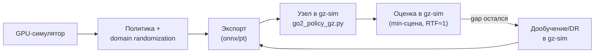
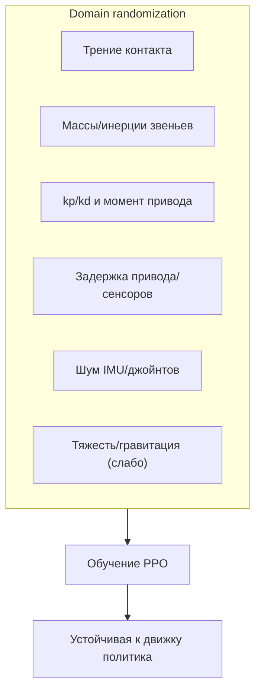

# План: обучение RL-политики Go2 на GPU и перенос в gz-sim

**Дата:** 2026-10-11
**Ветка:** `feat/rl-sar`
**Цель:** получить устойчивую походку Go2 **в нашем gz-sim** путём
обучения политики с **domain randomization** в GPU-симуляторе и
переноса результата в наш стек.

---

## 1. Контекст и проблема

Что установлено ранее (см. `docs/gazebo-rl-vs-ik/`,
`reports/gazebo-rl/2026-10-09_gazebo-rl-sim2sim.md`):

- Предобученная политика NVIDIA (обучена в **PhysX/Isaac**) в нашем
  **gz-sim** даёт **нулевой перенос**: база оседает, робот не идёт.
- Порт методологически верен (сверены наблюдения, порядок суставов,
  масштабы, PD), но физика движков разная (**PhysX** vs **DART**
  в gz-sim).
- **Rust-TROT** в этой же сцене работает стабильно → окружение исправно,
  проблема именно в связке «политика ↔ физика gz-sim».

Подтверждение на 2026-10-11 (наш стек, минимальная сцена, `vx = 0.3`):

| Показатель | Значение | Норма |
|---|---|---|
| высота базы `z` | mean **0.10** м (max 0.14) | ~0.30 м |
| `dx` за 8 с | +0.035 м | растёт |
| `dy` за 8 с | **+0.41 м** (дрейф боком) | ≈0 |
| roll / pitch | −1.3° / −4.9° | ~0 |

Вывод: **нулевой перенос не работает**; нужна адаптация политики.

## 2. Стратегия

Развилка (см. `docs/gazebo-rl-vs-ik/gpu-options.md`):

- обучать **в gz-sim** — физика на CPU, медленно;
- обучать **в GPU-симуляторе** и **переносить** (sim-to-sim) — выбранный
  путь; перенос укрепляем **domain randomization**.



## 3. Выбор GPU-фреймворка

Ключевой факт: **любой** GPU-симулятор — это **не gz-sim**, поэтому
перенос всё равно sim-to-sim. Отсюда — приоритет **domain
randomization** и легкости развёртывания.

| Фреймворк | Движок | Go2 «из коробки» | DR | Плюсы | Минусы |
|---|---|---|---|---|---|
| **MuJoCo Playground (MJWarp)** | MuJoCo (GPU) | да | есть | лёгкий старт (`uv`), быстрый экспорт | движок ≠ gz-sim |
| **Isaac Lab** | PhysX GPU | да | богатая | лучший тулинг, ближе к исходной политике (тоже PhysX) | тяжёлая установка, ограничения Blackwell |
| **Genesis World** | свой GPU | частично | есть | PyTorch-экосистема | молодой проект |
| **Newton** | Warp | в работе | есть | самый новый GPU-путь | ранняя зрелость |

**Рекомендация:** начать с **MuJoCo Playground (MJWarp)** — быстрее
поднять окружение и получить первую переносимую политику; при
недостаточном качестве переноса — перейти на **Isaac Lab** (совпадает
с движком исходной политики).

## 4. Метод

1. **Окружение Go2** (локомоция по `cmd_vel`), награды и
   терминации — как в стандартных locomotion-тасках.
2. **Domain randomization** (критично для переноса в gz-sim):



3. **Экспорт** политики в `onnx`/`pt` (TorchScript).
4. **Интеграция** в `src/gazebo_sim/scripts/go2_policy_gz.py`
   (48 наблюдений → 12 действий, `action_scale = 0.25`, `kp/kd`,
   effort-интерфейс, sim-time, сопоставление суставов).
5. **Верификация** в минимальной сцене (`sim_minimal.launch.py`,
   RTF ≈ 1.0).
6. При остаточном gap — **дообучение** прямо в gz-sim (короткий
   PPO-прогон, CPU).

## 5. Этапы

1. ✅ Зафиксировать проблему и решение (этот документ).
2. ⏳ Развернуть GPU-фреймворк, проверить `sm_120`/CUDA (см.
   `environment.md`).
3. ⏳ Собрать окружение Go2 с DR.
4. ⏳ Обучить политику, экспортировать.
5. ⏳ Интегрировать в gz-sim, прогнать в минимальной сцене.
6. ⏳ Оценить и сравнить с Rust-TROT.
7. ⏳ Задокументировать (docs + отчёт).

## 6. Метрики (единые с RL vs IK/TROT)

- Средняя скорость и путь при заданной `v_x`.
- Высота `z` (mean/std), max roll/pitch, дрейф `|Y|`.
- Падения, время до устойчивой походки.
- Сравнение с **Rust-TROT** и с **rl_sar-RL** (Gazebo Classic).

## 7. Риски и митигации

| Риск | Митигация |
|---|---|
| `sm_120` не поддержан сборкой | брать свежие cu128+/JAX; проверять ядро на старте |
| Тяжёлая установка Isaac Lab | начать с MuJoCo Playground (MJWarp) |
| Sim-to-sim gap сохраняется | усилить DR + дообучить в gz-sim |
| Время обучения | батч сред на GPU; укоротить горизонт, итерации |
| Расхождение URDF (Go2) | свести массы/инерции/точки крепления к нашему URDF |

## 8. Ограничения

- Целевая среда — **наш gz-sim** (физика DART/CPU).
- Обучение — в **отдельном** GPU-симуляторе (не gz-sim) → перенос
  всегда sim-to-sim.
- Кинематику Rust-TROT оставляем как рабочее решение и эталон сравнения.

## 9. Команды (черновик, уточняется под выбранный фреймворк)

```bash
# проверка GPU
nvidia-smi --query-gpu=name,driver_version,compute_cap --format=csv

# окружение Python через uv (пример)
uv venv --python 3.11 .venv-gpu-rl
uv pip install --python .venv-gpu-rl <framework>

# далее — train/export по документации фреймворка
```
