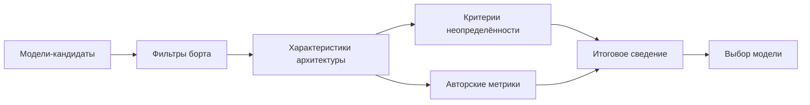

# Обоснование выбора модели машинного обучения для системы распознавания объектов мобильного робота

**УДК 004.93**

**Папин Алексей Владимирович¹**  papin.alexei2011@yandex.ru
SPIN-код: ____-____ (будет присвоен)

**Канев Антон Игоревич¹(\*)**  kanev@bmstu.ru

¹ МГТУ им. Н. Э. Баумана, кафедра ИУ-5 «Системы обработки информации
и управления», Москва, Россия

**Аннотация.** Работа посвящена выбору модели машинного обучения для
системы распознавания объектов мобильного робота. Модели берутся
готовыми, поэтому сравнение опирается на архитектурные характеристики —
параметры, FLOPs, память, задержку, — а не на результаты прогонов.
Предложена процедура, в которой модели отсеиваются по требованиям борта,
сравниваются по критериям принятия решений в условиях неопределённости и
сводятся в один показатель без весов. Дополнительно вводятся метрики
«точность на ресурс». Итоговый выбор проверяется на устойчивость тремя
свёртками. На семи моделях все критерии и варианты свёртки дают один
результат — YOLO11n; он устойчив; прогон в Gazebo подтвердил ограничение по задержке. Обсуждаются ограничения подхода.

**Ключевые слова:** выбор модели машинного обучения; распознавание
объектов; характеристики архитектуры; многокритериальный выбор; условия
неопределённости; бортовая система.

## Justification of the Choice of a Machine Learning Model for an Object Recognition System of a Mobile Robot

**Papin Alexey Vladimirovich¹**  papin.alexei2011@yandex.ru
**Kanev Anton Igorevich¹(\*)**  kanev@bmstu.ru

¹ Bauman Moscow State Technical University, Department of Information
Processing and Control Systems (IU-5), Moscow, Russia

**Abstract.** The paper addresses the choice of a machine learning model
for an object recognition system of a mobile robot. The models are taken
as ready-made, so the comparison relies on architectural characteristics
— parameters, FLOPs, memory, latency — rather than on run results. A
procedure is proposed in which models are filtered by onboard
requirements, compared using decision criteria under uncertainty, and
aggregated into a single score without weights. In addition, "accuracy
per resource" metrics are introduced. The final choice is checked for
stability with three aggregations. On seven models, all criteria and
aggregation variants yield the same result — YOLO11n; it is stable and
confirmed in simulation. The limitations of the approach are discussed.

**Keywords:** machine learning model selection; object recognition;
architecture characteristics; multi-criteria selection; uncertainty;
onboard system.

**Введение.** Распознавание объектов — одно из ключевых звеньев
бортовой системы мобильного робота. По результатам детекции оператор
принимает решения о движении и взаимодействии с объектами, поэтому от
выбранной модели зависит и качество, и своевременность этих решений. На
практике модели поставляются готовыми, предобученными на общих датасетах;
дообучение под конкретную задачу на этапе выбора обычно не выполняется.
Возникает вопрос: какую из нескольких доступных моделей выбрать и как
обосновать этот выбор, не проводя собственных экспериментов.

Стандартный путь — сравнить модели по метрикам вроде mAP или F1 —
требует размеченного датасета и прогонов, а ограничения борта (задержка,
память, вычислительная стоимость) при таком сравнении часто остаются в
стороне. Методы многокритериального выбора (MCDM, TOPSIS) позволяют
учесть несколько критериев, но опираются на веса, которые задаёт эксперт.
Нейронный архитектурный поиск (NAS) решает другую задачу: он проектирует
новые архитектуры и использует критерий Парето. Для выбора среди готовых
моделей при известных ограничениях борта нужна процедура, которая не
требует ни прогонов, ни экспертных весов.

Цель работы — предложить такую процедуру и проверить её на наборе готовых
детекторов. Отличие предлагаемого подхода состоит в том, что оценка
извлекается из архитектуры модели (числовые характеристики с формулами и
единицами), сравнение ведётся без весов и без критерия Парето, а для
учёта неизвестной сцены применяются критерии принятия решений в условиях
неопределённости. Дополнительно вводятся авторские метрики, связывающие
точность модели с её вычислительной и временной стоимостью. Практическая
ценность подхода — возможность выбрать модель до экспериментов, на этапе
проектирования бортовой системы.

**Материалы и методы.** В работе рассматриваются семь готовых моделей.
Четыре из них — одностадийные детекторы семейств YOLO11 и YOLOv8
(YOLO11n, YOLO11s, YOLOv8n, YOLOv8s) [1, 2]; ещё три — трансформерный
RT-DETR-l [3], двухстадийный Faster R-CNN [4] и CNN+LSTM, представляющий
собой YOLO11n с рекуррентным модулем для трекинга [5]. Точность моделей
характеризуется метрикой mAP (mean Average Precision), вычислительная
стоимость — числом операций с плавающей точкой (FLOPs).

К моделям предъявляются требования, связанные с работой на борту:
задержка на кадр не должна превышать 0,1 с, память под веса — 64 МБ;
выход должен быть в виде рамки, модель должна быть детерминированной,
допускать квантование и поддерживать трекинг. Модели, не прошедшие хотя
бы одно из этих требований, из дальнейшего рассмотрения исключаются.
Формально допустимое множество имеет вид

$$\mathcal{A}=\{A_i:\ T_i\le T_{max},\ M_i\le M_{max}\},$$

и задача состоит в выборе $A^\ast\in\mathcal{A}$, лучшей по совокупности
критериев без весов и без критерия Парето.

Для каждой модели по её архитектуре вычисляются число параметров $P$,
стоимость $F$ (FLOPs на кадр) и число слоёв $L$, а также производные
величины: память под веса $M=4P$, задержка $T=F/\Pi$, частота $f=1/T$ и
энергия на кадр $Q=P_{pow}T$. Здесь $\Pi$ — производительность
вычислителя (в расчётах принята 100 Гоп./с), $P_{pow}$ — мощность
(10 Вт). Значения $P$ и $F$ берутся из спецификаций моделей [1–3]; каждая
характеристика имеет формулу и единицы измерения, что позволяет
сравнивать модели без прогонов.

Сцена, в которой будет работать робот, заранее неизвестна, поэтому
вводятся состояния природы $\theta_j$ — сцены с числом объектов $N=5$,
20 и 50. Частота модели $i$ в сцене $j$ с учётом стоимости постобработки
(подавления дублирующих рамок, NMS) определяется формулой

$$f_{ij}=\frac{\Pi}{F_i+\alpha N_j^{2}},\qquad \alpha=10^{-3}\ \text{Г},\tag{1}$$

где $\alpha$ — коэффициент стоимости постобработки. По матрице выигрышей
$a_{ij}=f_{ij}$ применяются пять классических критериев. Критерий Лапласа
использует среднее значение по сценам, критерий оптимизма — максимальное,
критерий Вальда — минимальное; критерий Сэвиджа минимизирует максимальное
сожаление, а критерий Гурвица — взвешенную комбинацию максимума и
минимума:

$$\bar a_i=\frac1m\sum_j a_{ij},\quad
M_i=\max_j a_{ij},\quad
W_i=\min_j a_{ij},\quad
r_{ij}=\max_i a_{ij}-a_{ij},\quad
H_i(\alpha)=\alpha\max_j a_{ij}+(1-\alpha)\min_j a_{ij}.$$

Критерии не требуют вероятностей сцен и дают разные взгляды на выбор —
нейтральный, оптимистичный, пессимистичный и страховочный. Пример расчёта
по формуле (1): для YOLO11n в сцене $\theta_1$ ($N=5$) частота равна
$100/(6{,}6+0{,}001\cdot25)=15{,}09$ Гц, а в сцене $\theta_3$ ($N=50$) —
$100/(6{,}6+2{,}5)=10{,}99$ Гц. Критерий Вальда для этой модели равен
10,99 Гц.

Помимо классических критериев, в работе используются метрики, связывающие
точность модели с её ресурсами. Точность на вычисления $Q_4$ определяется
как $\text{mAP}\cdot f/F$, пригодность к борту BF — как
$\dfrac{f}{Q}\cdot\dfrac{\Delta M}{M_{max}}$, где $\Delta M=M_{max}-M$ —
свободная память. Свежесть решения $\mathrm{DF}=e^{-T/\tau}$ показывает,
успевает ли результат к моменту действия; здесь $\tau$ — такт робота (в
расчётах 0,1 с). На её основе строится готовность к действию
$\mathrm{AR}=\text{mAP}\cdot\mathrm{DF}$. Удельная точность на память
$\mathrm{APM}=\text{mAP}/M$, частота на гигафлоп $\mathrm{FPG}=f/F$,
масштабная устойчивость
$\mathrm{SR}=\dfrac{\text{mAP}_s/\text{mAP}_n}{F_s/F_n}$ и плотность
решений $\mathrm{IDD}=\text{mAP}\cdot f$ дополняют набор.

Метрики $Q_4$, BF, DF, AR, APM, FPG, SR и IDD предложены в данной работе;
величины $\eta$, EDP, $\rho$ и $Q_1$–$Q_3$ заимствованы из литературы и
используются как вспомогательные. Пример расчёта: для YOLO11n
$\mathrm{DF}=e^{-0{,}066/0{,}1}=0{,}517$, а
$Q_4=39{,}5\cdot15{,}15/6{,}6=90{,}68$.

Чтобы свести все способы к одному числу, значения каждой метрики
нормируются к отрезку $[0,1]$ по min–max (для показателей «меньше —
лучше» берётся $1-z$) и усредняются без весов:

$$\Psi_i=\frac1K\sum_{k=1}^{K}z_i^{(k)}.\tag{2}$$

Дополнительно вычисляются число Борда
$B_i=\sum_k\bigl(n-r_i^{(k)}+1\bigr)$ и средний ранг
$\bar r_i=\frac1K\sum_k r_i^{(k)}$; совпадение всех трёх свёрток говорит
об устойчивости результата. Расчёт реализован в виде скрипта на Python,
что обеспечивает воспроизводимость результатов.

**Рис. 1.** Схема методики выбора модели

**Результаты.** Требования борта прошли три модели — YOLO11n, CNN+LSTM и
YOLOv8n. Модели YOLO11s и YOLOv8s отсеяны из-за задержки (0,217 и
0,288 с), RT-DETR-l и Faster R-CNN — из-за задержки и памяти.
Характеристики всех семи моделей приведены в табл. 1.

| Модель | $P$, млн | $F$, Г | mAP | $M$, МБ | $T$, с | $f$, Гц |
| --- | --- | --- | --- | --- | --- | --- |
| YOLO11n | 2.62 | 6.6 | 39.5 | 10.48 | 0.066 | 15.15 |
| YOLOv8n | 3.16 | 8.9 | 37.3 | 12.64 | 0.089 | 11.24 |
| YOLO11s | 9.46 | 21.7 | 47.0 | 37.84 | 0.217 | 4.61 |
| YOLOv8s | 11.17 | 28.8 | 44.9 | 44.68 | 0.288 | 3.47 |
| RT-DETR-l | 32.0 | 103.5 | 53.0 | 128.00 | 1.035 | 0.97 |
| Faster R-CNN | 41.5 | 180.0 | 37.4 | 166.00 | 1.800 | 0.56 |
| CNN+LSTM | 3.15 | 6.61 | 39.5 | 12.60 | 0.070 | 14.29 |

Для трёх допустимых моделей частота по сценам составила: YOLO11n —
15,09 / 14,29 / 10,99 Гц; CNN+LSTM — 14,23 / 13,51 / 10,53 Гц;
YOLOv8n — 11,20 / 10,75 / 8,77 Гц. Значения критериев (Лаплас, оптимизм,
Вальд, Сэвидж, Гурвиц) равны соответственно 13,46 / 15,09 / 10,99 / 0,00 /
13,04 для YOLO11n, 12,76 / 14,23 / 10,53 / 0,86 / 12,38 для CNN+LSTM и
10,24 / 11,20 / 8,77 / 3,89 / 9,99 для YOLOv8n. Во всех случаях лучшей
оказывается YOLO11n; при подсчёте баллов модели получают 15, 10 и 5.

Результат сведения по 22 способам приведён в табл. 2.

| Модель | $\Psi$ | Число Борда | Средний ранг |
| --- | --- | --- | --- |
| YOLO11n | 0.955 | 64 | 1.045 |
| CNN+LSTM | 0.735 | 42 | 2.000 |
| YOLOv8n | 0.045 | 23 | 2.909 |

Итоговое сведение даёт YOLO11n; этот результат совпадает с выводами всех
отдельных критериев и метрик. Причина в том, что YOLO11n имеет наименьшие
параметры, FLOPs, память и задержку среди допустимых моделей, поэтому
выигрывает по всем критериям. Характеристики выбранной модели: $P=2{,}62$
млн, $F=6{,}6$ Г, $M=10{,}48$ МБ, $T=0{,}066$ с, $f=15{,}15$ Гц,
$Q=0{,}66$ Дж; в сложной сцене (50 объектов) частота не опускается ниже
10,99 Гц.

**Обсуждение.** Полученный результат согласуется с литературой по
многокритериальному выбору [9], однако традиционные методы — анализ
иерархий (AHP) и TOPSIS — требуют весов критериев. Нейронный
архитектурный поиск [10] проектирует новые архитектуры и опирается на
Парето-оптимальность, а исследования в области TinyML [11] сосредоточены
на бенчмарках, а не на процедуре выбора среди готовых моделей.
Предлагаемый подход отличается тем, что выбирает среди готовых моделей,
использует только архитектурные характеристики, не требует весов,
применяет критерии неопределённости по сценам и предусматривает
проверку в симуляции.

Совпадение пяти критериев, балльного подсчёта и трёх свёрток ($\Psi$,
число Борда, средний ранг) означает, что выбор не зависит от метода
агрегации. Нормировка min–max, число Борда и средний ранг — стандартные
приёмы ранговой агрегации; новизна работы не в них, а в безвесовом
выборе по архитектурным характеристикам и в критериях неопределённости.

Следует учитывать ограничения. Значения mAP взяты из спецификаций
(датасет COCO) и на синтетических сценах отличаются, поэтому
проверка в симуляции даёт относительное сравнение моделей, а не
абсолютную точность. Часть авторских метрик, зависящих от энергии (BF),
в симуляции проверяется частично. Равное усреднение после нормировки
представляет собой неявные равные веса, что является осознанным
компромиссом.

Проверка выполнена в Gazebo Sim 8.15 на сцене из 16 объектов девяти
классов COCO (стулья, столы, кровать, диваны, вазы, телевизор,
холодильник, бутылки, мячи), 48 ракурсов, 88 объектов ground truth.
На CPU (16 ядер) медианное время инференса: 20,4 мс у YOLOv8n,
19,7 мс у YOLO11n, 19,5 мс у YOLOv10n, 29,7 мс у YOLOv9t и 51,4 мс
у YOLOv8s — все модели укладываются в ограничение $T \le 0{,}1$ с
запасом около двух раз. mAP@0,5 по девяти классам: 0,403 / 0,551 /
0,427 / 0,408 / 0,499; mAP@0,5:0,95: 0,260 / 0,322 / 0,278 / 0,236 /
0,294; лучший F1 при подборе порога: 0,479 / 0,597 / 0,345 / 0,458 /
0,439. У YOLO11n лучшие mAP@0,5 (0,551), mAP@0,5:0,95 (0,322) и F1
(0,597) при более чем вдвое меньшем времени, чем у YOLOv8s, и вчетверо
меньшем размере. Сквозной прогон ROS-узла дал 36 Гц при камере 60 Гц;
ограничение — рендеринг Gazebo, а не инференс. Абсолютные значения
ниже, чем на COCO: нетекстурированные синтетические модели дают
доменный сдвиг — диваны и кровати классифицируются как airplane, вазы
как bird. На текстурированной сцене кафе те же модели дают chair 0,90
и car 0,90, то есть низкие значения связаны со сценой, а не с
процедурой оценки. CNN+LSTM в прогоне не участвовала: готовых весов
детектора для неё нет.

Практическая ценность подхода состоит в возможности выбрать модель до
прогонов — при проектировании бортовой системы, когда известны
ограничения по задержке и памяти, но ещё нет размеченного датасета.
Дальнейшая работа связана с проверкой методики на реальных сценах и
расширением набора моделей; в симуляции остаётся измерить энергию и
память на полном наборе сцен.

**Заключение.** Предложена методика объективного выбора модели машинного
обучения для системы распознавания объектов мобильного робота. Оценка
извлекается из архитектуры модели по числовым характеристикам с формулами
и единицами; сравнение ведётся без весов, с применением критериев
принятия решений в условиях неопределённости и авторских метрик «точность
на ресурс». На наборе из семи моделей после отсева по требованиям борта
рассмотрены три модели; все критерии и варианты свёртки устойчиво указали
на YOLO11n, которая обеспечивает не менее 10,99 Гц даже в сложной сцене
при памяти 10,48 МБ. Прогон в Gazebo подтвердил ограничение по задержке.
Дальнейшая работа направлена на расширение набора моделей и проверку
методики на реальных сценах.

**Список источников**

[1] Ultralytics YOLO11: документация и конфигурации [Электронный
ресурс]. — URL: https://docs.ultralytics.com/models/yolo11/ (дата
обращения: 10.10.2026).

[2] Ultralytics YOLOv8: документация и конфигурации [Электронный
ресурс]. — URL: https://docs.ultralytics.com/models/yolov8/ (дата
обращения: 10.10.2026).

[3] Ultralytics RT-DETR: документация [Электронный ресурс]. — URL:
https://docs.ultralytics.com/models/rtdetr/ (дата обращения: 10.10.2026).

[4] Ren S., He K., Girshick R., Sun J. Faster R-CNN: Towards Real-Time
Object Detection with Region Proposal Networks // IEEE Transactions on
Pattern Analysis and Machine Intelligence. — 2017. — Vol. 39, No. 6. —
P. 1137–1149.

[5] Hochreiter S., Schmidhuber J. Long Short-Term Memory // Neural
Computation. — 1997. — Vol. 9, No. 8. — P. 1735–1780.

[6] Wald A. Statistical Decision Functions. — New York: Wiley, 1950. —
179 p.

[7] Savage L. J. The Theory of Statistical Decision // Journal of the
American Statistical Association. — 1951. — Vol. 46, No. 253. — P. 55–67.

[8] Hurwicz L. Optimality Criteria for Decision Making under Ignorance //
Cowles Commission Discussion Paper. — 1951. — No. 370.

[9] Hwang C.-L., Yoon K. Multiple Attribute Decision Making: Methods and
Applications. — Berlin: Springer, 1981. — 259 p.

[10] Benmeziane H., Maghraoui K. E., Ouarnoughi H., Niar S., Wistuba M.,
Wang N. A Comprehensive Survey on Hardware-Aware Neural Architecture
Search // Proceedings of the Thirtieth International Joint Conference on
Artificial Intelligence (IJCAI). — 2021. — P. 2762–2769.

[11] Banbury C., Reddi V. J., Torelli P., Holleman J., Jeffries N.,
Kiraly C., Montino P., Kanter D., Ahmed S., Pau D., Thakker U.,
Fedorov I., Zhou L., Arcas B., Nepal R., Borthakur S., Bhattacharya T.,
Bangalore S., Sripathi S., ... Benchmarking TinyML Systems: Challenges
and Direction [Электронный ресурс] // arXiv. — 2020. — URL:
https://arxiv.org/abs/2003.04821 (дата обращения: 10.10.2026).

---

> **Служебный блок (не входит в статью).** Черновик для вёрстки под
> ИИАСУ-2026, секция 2. Перед подачей: вставить УДК по классификатору;
> проверить e-mail и SPIN; собрать `.docx` по шаблону (A4, поля 2 см,
> TNR 12, полуторный; разделы — внутриабзацные жирные заголовки);
> вставить рис. 1 (схема методики); проверить объём (4–6 стр., ≥6000
> знаков) и заимствование (≤20%); формулы — редактором Word; ссылки — по
> ГОСТ, по порядку упоминания.
