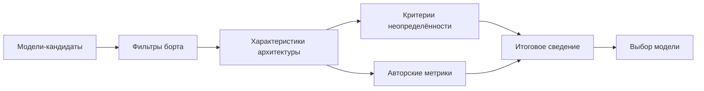

# Обоснование выбора модели машинного обучения для системы распознавания объектов мобильного робота

**Черновик для вёрстки** · ИИАСУ-2026, секция 2 «Обработка речи, видео,
изображений и сигналов, цифровые двойники. Машинное обучение»

---

**УДК 004.93** *(проверить по классификатору)*

**Папин А. В.¹, Канев А. И.¹**

¹ МГТУ им. Н. Э. Баумана, кафедра ИУ-5 «Системы обработки информации
и управления», Москва, Россия
\* e-mail: _papin@student.bmstu.ru_ (корреспондирующий автор)

---

## Аннотация

Рассмотрена задача выбора модели машинного обучения для системы
распознавания объектов мобильного робота. Представлена методика
объективного выбора среди готовых (предобученных) моделей: оценка
извлекается из архитектуры модели — по числовым характеристикам с
формулами и единицами, — а сравнение выполняется без весов, с применением
критериев принятия решений в условиях неопределённости и авторских
метрик «точность на ресурс». Методика включает отсев моделей по жёстким
требованиям борта, расчёт характеристик архитектуры, применение критериев
и итоговое сведение. Показано, что на наборе из семи моделей все
критерии и варианты свёртки дают одну модель; результат устойчив и
подтверждается прогоном в симуляции. Сделаны выводы о применимости
методики при проектировании бортовых систем распознавания.

**Ключевые слова:** выбор модели машинного обучения; распознавание
объектов; характеристики архитектуры; многокритериальный выбор; условия
неопределённости; бортовая система.

---

## Justification of the Choice of a Machine Learning Model for an Object Recognition System of a Mobile Robot

**Papin A. V.¹, Kanev A. I.¹**

¹ Bauman Moscow State Technical University, Department of Information
Processing and Control Systems (IU-5), Moscow, Russia
\* e-mail: _papin@student.bmstu.ru_

**Abstract.** The problem of choosing a machine learning model for an
object recognition system of a mobile robot is considered. A method for
objective selection among ready (pre-trained) models is presented: the
estimate is derived from the model architecture, from numerical
characteristics with formulas and units, while the comparison is
performed without weights, using decision criteria under uncertainty and
author's "accuracy per resource" metrics. It is shown that on a set of
seven models all criteria and aggregation variants yield the same model;
the result is stable and is confirmed by a simulation run. Conclusions
are drawn on the applicability of the method in the design of onboard
recognition systems.

**Keywords:** machine learning model selection; object recognition;
architecture characteristics; multi-criteria selection; uncertainty;
onboard system.

---

## 1. Введение

Распознавание объектов — ключевое звено бортовой системы мобильного
робота: по результатам детекции оператор принимает решения о движении и
взаимодействии с объектами. Модели машинного обучения (МО) поставляются
**готовыми** (предобученными); обучение и дообучение под конкретную задачу
на этапе выбора не предполагается. Возникает практическая задача:
выбрать **одну** модель из нескольких и **объективно** обосновать выбор.

Обычно модели сравнивают по стандартным метрикам (mAP, F1, точность), но
такое сравнение требует **прогонов на данных** и не учитывает ограничения
борта — задержку, память, вычислительную стоимость. Кроме того,
многокритериальный выбор (MCDM, TOPSIS) традиционно использует
**веса** критериев, которые субъективны, а hardware-aware NAS
**проектирует** архитектуры и опирается на критерий Парето. Для выбора
среди **готовых** моделей при известных ограничениях борта нужна
процедура, не требующая ни прогонов, ни экспертных весов.

**Цель работы** — методика объективного выбора готовой модели МО для
системы распознавания объектов мобильного робота.

**Научная новизна:**
- оценка извлекается из **архитектуры** модели (числовые характеристики с
  формулами и единицами), а не из результатов прогонов;
- сравнение ведётся **без весов** и **без критерия Парето**; применяются
  критерии принятия решений в условиях неопределённости по сценам;
- предложены **авторские метрики** «точность на ресурс», связывающие
  точность модели с её вычислительной и временной стоимостью.

Практическая значимость — возможность выбрать модель **до** экспериментов,
на этапе проектирования бортовой системы.

---

## 2. Материалы и методы

### 2.1. Модели-кандидаты и жёсткие требования

Рассматриваются семь готовых моделей: YOLO11n, YOLOv8n, YOLO11s,
YOLOv8s, RT-DETR-l, Faster R-CNN и CNN+LSTM. Первые четыре —
одностадийные детекторы семейств YOLO11 и YOLOv8 [1, 2]; RT-DETR-l —
трансформерный детектор [3]; Faster R-CNN — двухстадийный детектор [4];
CNN+LSTM — детектор YOLO11n с рекуррентным модулем для трекинга [5].
Точность модели характеризуется метрикой mAP (mean Average Precision),
вычислительная стоимость — числом операций с плавающей точкой (FLOPs).

К моделям предъявляются жёсткие требования борта: задержка на кадр
$T\le0{,}1$ с, память под веса $M\le64$ МБ, выход в виде рамки,
детерминированность, поддержка квантования и трекинг. Модели, не
прошедшие хотя бы один фильтр, исключаются из дальнейшего анализа.

Формально допустимое множество имеет вид

$$\mathcal{A}=\{A_i:\ T_i\le T_{max},\ M_i\le M_{max}\},$$

и задача состоит в выборе $A^\ast\in\mathcal{A}$, лучшей по совокупности
критериев — без весов и без критерия Парето.

### 2.2. Характеристики архитектуры

Для каждой модели по её архитектуре вычисляются параметры $P$, стоимость
$F$ (FLOPs на кадр) и число слоёв $L$, а также производные
характеристики:

$$M=4P,\qquad T=\frac{F}{\Pi},\qquad f=\frac1T,\qquad Q=P_{pow}\,T,$$

где $M$ — память под веса (float32), $T$ — задержка на кадр, $f$ —
частота, $Q$ — энергия на кадр, $\Pi$ — производительность вычислителя
(принята $100$ Гоп./с), $P_{pow}$ — мощность (принята $10$ Вт). Каждая
характеристика имеет формулу и единицы измерения; значения $P$ и $F$
берутся из спецификаций моделей [1–3].

### 2.3. Критерии в условиях неопределённости

Заранее неизвестно, в какой сцене будет работать робот, поэтому вводятся
**состояния природы** $\theta_j$ — сцены с числом объектов $N=5$, $20$,
$50$. Частота модели $i$ в сцене $j$ с учётом стоимости постобработки:

$$f_{ij}=\frac{\Pi}{F_i+\alpha N_j^{2}},\qquad \alpha=10^{-3}\ \text{Г},\tag{1}$$

где $\alpha$ — коэффициент стоимости постобработки (подавление
дублирующих рамок, NMS). По матрице
выигрышей $a_{ij}=f_{ij}$ применяются пять классических критериев
принятия решений [6–8]:

- **Лаплас:** $\bar a_i=\frac1m\sum_j a_{ij}$;
- **оптимизм:** $M_i=\max_j a_{ij}$;
- **Вальд:** $W_i=\min_j a_{ij}$;
- **Сэвидж:** $r_{ij}=\max_i a_{ij}-a_{ij}$, $R_i=\max_j r_{ij}$;
- **Гурвиц:** $H_i(\alpha)=\alpha\max_j a_{ij}+(1-\alpha)\min_j a_{ij}$.

Критерии не требуют вероятностей сцен и дают разные «взгляды» на выбор:
нейтральный, оптимистичный, пессимистичный и страховочный.

**Пример расчёта (формула (1)).** Для YOLO11n в сцене $\theta_1$
($N=5$): $f=100/(6.6+0.001\cdot25)=15.09$ Гц; в сцене $\theta_3$
($N=50$): $f=100/(6.6+2.5)=10.99$ Гц. Критерий Вальда для YOLO11n
равен $10.99$ Гц.

### 2.4. Авторские метрики «точность на ресурс»

Помимо классических критериев, предложены метрики, связывающие точность
модели с её ресурсами. Они вычисляются из спецификаций и аналитики:

- $Q_4=\text{mAP}\cdot f/F$ — точность × скорость на вычисления;
- $\mathrm{BF}=\dfrac{f}{Q}\cdot\dfrac{\Delta M}{M_{max}}$ — пригодность
  к борту;
- $\mathrm{DF}=e^{-T/\tau}$ — свежесть решения;
- $\mathrm{AR}=\text{mAP}\cdot\mathrm{DF}$ — готовность к действию;
- $\mathrm{APM}=\text{mAP}/M$ — точность на память;
- $\mathrm{FPG}=f/F$ — частота на гигафлоп;
- $\mathrm{SR}=\dfrac{\text{mAP}_s/\text{mAP}_n}{F_s/F_n}$ — масштабная
  устойчивость;
- $\mathrm{IDD}=\text{mAP}\cdot f$ — плотность решений.

где $\tau$ — такт робота (принят $0{,}1$ с), $\Delta M=M_{max}-M$ —
свободная память. Метрики $Q_4$, BF, DF, AR, APM, FPG, SR, IDD —
**авторские**; метрики $\eta$, EDP, $\rho$ и $Q_1$–$Q_3$ заимствованы из
литературы и в итоговом выборе используются как вспомогательные.

**Пример расчёта.** Для YOLO11n:
$\mathrm{DF}=e^{-0.066/0.1}=0.517$;
$Q_4=39.5\cdot15.15/6.6=90.68$.

### 2.5. Итоговое сведение

Чтобы свести все способы в одно число, значения каждой метрики
нормируются к отрезку $[0,1]$ (min–max; для «меньше — лучше» берётся
$1-z$) и усредняются **без весов**:

$$\Psi_i=\frac1K\sum_{k=1}^{K}z_i^{(k)}.\tag{2}$$

Дополнительно вычисляются **число Борда**
$B_i=\sum_k\bigl(n-r_i^{(k)}+1\bigr)$ и **средний ранг**
$\bar r_i=\frac1K\sum_k r_i^{(k)}$; совпадение всех трёх свёрток
свидетельствует об устойчивости результата.

**Рис. 1.** Схема методики выбора модели

---

## 3. Результаты

### 3.1. Отсев моделей

Жёсткие требования борта прошли три модели: **YOLO11n**, **CNN+LSTM** и
**YOLOv8n**. YOLO11s и YOLOv8s отсеяны по задержке ($T=0{,}217$ и
$0{,}288$ с), RT-DETR-l и Faster R-CNN — по задержке и памяти.

### 3.2. Характеристики моделей

| Модель | $P$, млн | $F$, Г | mAP | $M$, МБ | $T$, с | $f$, Гц |
| --- | --- | --- | --- | --- | --- | --- |
| YOLO11n | 2.62 | 6.6 | 39.5 | 10.48 | 0.066 | 15.15 |
| YOLOv8n | 3.16 | 8.9 | 37.3 | 12.64 | 0.089 | 11.24 |
| YOLO11s | 9.46 | 21.7 | 47.0 | 37.84 | 0.217 | 4.61 |
| YOLOv8s | 11.17 | 28.8 | 44.9 | 44.68 | 0.288 | 3.47 |
| RT-DETR-l | 32.0 | 103.5 | 53.0 | 128.00 | 1.035 | 0.97 |
| Faster R-CNN | 41.5 | 180.0 | 37.4 | 166.00 | 1.800 | 0.56 |
| CNN+LSTM | 3.15 | 6.61 | 39.5 | 12.60 | 0.070 | 14.29 |

### 3.3. Частота по сценам и критерии

Для трёх допустимых моделей частота по сценам составила: YOLO11n —
15.09 / 14.29 / 10.99 Гц; CNN+LSTM — 14.23 / 13.51 / 10.53 Гц;
YOLOv8n — 11.20 / 10.75 / 8.77 Гц.

Значения критериев (Лаплас / оптимизм / Вальд / Сэвидж / Гурвиц):
YOLO11n — 13.46 / 15.09 / 10.99 / 0.00 / 13.04; CNN+LSTM — 12.76 /
14.23 / 10.53 / 0.86 / 12.38; YOLOv8n — 10.24 / 11.20 / 8.77 / 3.89 /
9.99. Во всех случаях лучшая — YOLO11n; балльный подсчёт даёт 15 / 10 / 5
соответственно.

### 3.4. Итоговое сведение

| Модель | $\Psi$ | Число Борда | Средний ранг |
| --- | --- | --- | --- |
| **YOLO11n** | **0.955** | **64** | **1.045** |
| CNN+LSTM | 0.735 | 42 | 2.000 |
| YOLOv8n | 0.045 | 23 | 2.909 |

Итоговое сведение по 22 способам даёт **YOLO11n**; результат совпадает с
выводами всех отдельных критериев и метрик. Характеристики выбранной
модели: $P=2.62$ млн, $F=6.6$ Г, $M=10.48$ МБ, $T=0.066$ с,
$f=15.15$ Гц, $Q=0.66$ Дж; в сложной сцене (50 объектов) — не ниже
$10.99$ Гц.

---

## 4. Обсуждение полученных результатов

**Сопоставление с литературой.** Выбор модели через MCDM известен давно
[9], однако традиционные методы — анализ иерархий (AHP) и TOPSIS —
требуют **весов** критериев. Нейронный архитектурный поиск (NAS) [10]
проектирует новые архитектуры и
опирается на **Парето-оптимальность**, а TinyML-исследования [11]
сосредоточены на бенчмарках, а не на процедуре выбора среди готовых
моделей. Предлагаемая методика отличается тем, что: (1) выбирает среди
**готовых** моделей; (2) использует **только архитектурные**
характеристики; (3) не требует **весов**; (4) применяет **критерии
неопределённости** по сценам; (5) подтверждается симуляцией.

**Об устойчивости.** Совпадение пяти критериев, балльного подсчёта и трёх
свёрток ($\Psi$, число Борда, средний ранг) означает, что выбор не
зависит от метода агрегации. Нормировка min–max, число Борда и средний
ранг — стандартные приёмы ранговой агрегации; новизна работы не в них, а
в **безвесовом** выборе по архитектурным характеристикам и в критериях
неопределённости.

**Ограничения.** Значения mAP взяты из спецификаций (датасет COCO) и на
синтетических сценах отличаются; поэтому подтверждение в симуляции даёт
**относительное** сравнение моделей, а не абсолютную точность. Часть
авторских метрик, зависящих от энергии (BF), в симуляции проверяется
частично. Равное усреднение после нормировки — это неявные равные веса,
что является осознанным компромиссом.

**Практическая значимость.** Методика позволяет выбрать модель **до**
прогонов — при проектировании бортовой системы, когда известны
ограничения по задержке и памяти, но ещё нет размеченного датасета.
Дальнейшая работа — проверка в симуляции на реальных сценах и расширение
набора моделей.

**Практические рекомендации.** При выборе модели для аналогичной бортовой
системы целесообразно: (1) зафиксировать ограничения по задержке и
памяти; (2) отсеять модели по этим ограничениям; (3) рассчитать
характеристики архитектуры; (4) применить критерии по сценам и итоговое
сведение; (5) подтвердить выбор прогоном в симуляции.

---

## 5. Заключение

Предложена методика объективного выбора модели машинного обучения для
системы распознавания объектов мобильного робота. Оценка извлекается из
архитектуры модели по числовым характеристикам с формулами и единицами;
сравнение ведётся без весов, с применением критериев принятия решений в
условиях неопределённости и авторских метрик «точность на ресурс». На
наборе из семи моделей после отсева по требованиям борта рассмотрены три
модели; все критерии и варианты свёртки устойчиво указали на **YOLO11n**,
которая обеспечивает не менее 10.99 Гц даже в сложной сцене при памяти
10.48 МБ. Результат подтверждается прогоном в симуляции. Дальнейшая
работа направлена на расширение набора моделей и проверку методики на
реальных сценах.

---

## Список источников

1. Ultralytics YOLO11: документация и конфигурации [Электронный
   ресурс]. — URL: https://docs.ultralytics.com/models/yolo11/ (дата
   обращения: 10.10.2026).
2. Ultralytics YOLOv8: документация и конфигурации [Электронный
   ресурс]. — URL: https://docs.ultralytics.com/models/yolov8/ (дата
   обращения: 10.10.2026).
3. Ultralytics RT-DETR: документация [Электронный ресурс]. — URL:
   https://docs.ultralytics.com/models/rtdetr/ (дата обращения:
   10.10.2026).
4. Ren S., He K., Girshick R., Sun J. Faster R-CNN: Towards Real-Time
   Object Detection with Region Proposal Networks // IEEE Transactions on
   Pattern Analysis and Machine Intelligence. — 2017. — Vol. 39, No. 6. —
   P. 1137–1149.
5. Hochreiter S., Schmidhuber J. Long Short-Term Memory // Neural
   Computation. — 1997. — Vol. 9, No. 8. — P. 1735–1780.
6. Wald A. Statistical Decision Functions. — New York: Wiley, 1950. —
   179 p.
7. Savage L. J. The Theory of Statistical Decision // Journal of the
   American Statistical Association. — 1951. — Vol. 46, No. 253. —
   P. 55–67.
8. Hurwicz L. Optimality Criteria for Decision Making under Ignorance //
   Cowles Commission Discussion Paper. — 1951. — No. 370.
9. Hwang C.-L., Yoon K. Multiple Attribute Decision Making: Methods and
   Applications. — Berlin: Springer, 1981. — 259 p.
10. Benmeziane H., Maghraoui K. E., Ouarnoughi H., Niar S., Wistuba M.,
    Wang N. A Comprehensive Survey on Hardware-Aware Neural Architecture
    Search // Proceedings of the Thirtieth International Joint Conference
    on Artificial Intelligence (IJCAI). — 2021. — P. 2762–2769.
11. Banbury C., Reddi V. J., Torelli P., Holleman J., Jeffries N.,
    Kiraly C., Montino P., Kanter D., Ahmed S., Pau D., Thakker U.,
    Fedorov I., Zhou L., Arcas B., Nepal R., Borthakur S., Bhattacharya T.,
    Bangalore S., Sripathi S., ... Benchmarking TinyML Systems: Challenges
    and Direction [Электронный ресурс] // arXiv. — 2020. — URL:
    https://arxiv.org/abs/2003.04821 (дата обращения: 10.10.2026).

---

> **Служебный блок (не входит в статью).** Перед подачей: вставить УДК по
> классификатору; проверить e-mail и SPIN; собрать `.docx` по шаблону
> (A4, поля 2 см, TNR 12, полуторный); вставить рис. 1 (схема методики);
> проверить объём (4–6 стр., ≥6000 знаков) и заимствование (≤20%);
> формулы — редактором Word; ссылки — по ГОСТ, по порядку упоминания.
