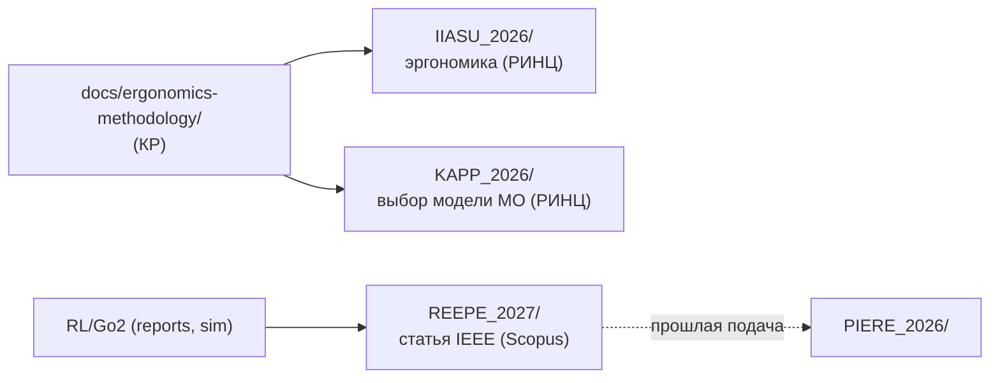

# Публикации — структура (по конференциям)

**Обновлено:** 2026-10-14

Все материалы статей разложены по папкам **с названием конференции**.

| Папка | Конференция | Индексация | Язык | Тема | Статус |
| --- | --- | --- | --- | --- | --- |
| `IIASU_2026/` | ИИАСУ-2026 | РИНЦ | рус. | Эргономика: представление результатов распознавания | в работе |
| `PIERE_2026/` | PIERE 2026 | IEEE / Scopus | англ. | (прошлая подача статьи Go2) | архив |
| `REEPE_2027/` | REEPE 2027 | IEEE / Scopus | англ. | RL vs IK/TROT (Go2, Isaac Sim) | в работе |
| `KAPP_2026/` | КАПП-2026 | РИНЦ | рус. | Выбор модели МО (оптимизация проектного решения) | черновик |

**Общие файлы:**
- `plan.md` — общий план публикаций (треки и календарь).
- `export-control-process.md` — порядок заключений о возможности открытого опубликования (ЦПР / НУК ИУ).
- `Краткая инструкция авторам.pdf` — инструкция ЦПР.

**Вне папки** (источники):
- `docs/ergonomics-methodology/` — КР по эргономике/выбору модели (источник по теме).
- `docs/gazebo-rl-vs-ik/`, `docs/gpu-rl-training/`, `docs/rl-sar/` — RL/Go2.
- `reports/` — отчёты и данные экспериментов.

## Соответствие конференции ↔ тема

