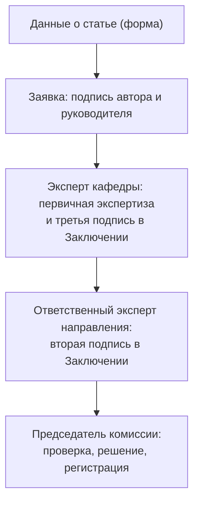

# Заключение о возможности открытого опубликования (НУК ИУ, МГТУ)

**Источник:** PDF «Краткая инструкция авторам» (в этой папке)
**Актуальность:** правила изменены с **июля 2025**
**Комиссия:** экспертно-консультационная комиссия **НУК ИУ** МГТУ им. Н.Э. Баумана
**Назначение:** обязательный документ для рассмотрения статьи/материала
(без него публикация не принимается)

> Относится к обеим нашим публикациям: ИИАСУ-2026 (заключение — до
> **31.10.2026**) и REEPE-2027 (экспертное и экспортное заключения — до
> **16.11.2026**).

---

## 1. Что требуется

1. **Заполнить данные о статье и авторах** по анкете (форма):
   `https://forms.gle/CV6QXw3xKy49HLhW7`
2. **Заявка** на прохождение экспертизы о возможности открытого
   опубликования материала и/или работы (по бланку) — **1 экземпляр**;
   подписывают **сам автор и руководитель** (заведующий кафедрой либо
   декан).
3. **Заключение** о возможности открытого опубликования (по бланку) —
   **2 или более экземпляров** (один остаётся в архиве комиссии).

## 2. Порядок подписания

| Шаг | Кто подписывает | Где ставится |
|---|---|---|
| 1 | автор и руководитель (зав. кафедрой / декан) | Заявка |
| 2 | эксперт кафедры | Заключение (третья подпись, внизу) |
| 3 | ответственный эксперт направления | Заключение (вторая подпись) |

> Ответственный эксперт может **внести комментарии в Заявку**.

## 3. Ответственные эксперты по кафедрам

| Кафедры | Ответственный эксперт |
|---|---|
| ИУ1, ИУ2, ИУ4, ИУ8, ИУ9 | к.т.н., доцент каф. ИУ2 **Шевцова Е.В.** |
| ИУ3, ИУ5, ИУ6, ИУ7 | к.т.н., доцент каф. ИУ5 **Горячкин Б.С.** |

## 4. Итоговая подача

После подписания экспертами представляются **председателю комиссии**:

- **2 или более** подписанных экземпляра **Заключения**;
- **Заявка** — 1 экз.;
- **статья (материал)** — 1 экз. (+ **английская версия**, если
  необходимо).

Председатель проверяет документы, принимает окончательное решение и
**регистрирует Заключение**.

## 5. Организационные правила

- Все документы заполняются **СТРОГО НА РУССКОМ ЯЗЫКЕ**.
- Документы подаются **в БУМАЖНОМ виде**.
- Время приёма членами комиссии указано на их рабочих местах.

---

## 6. Применение к нашим публикациям

| Публикация | Срок заключения | Комментарий |
|---|---|---|
| ИИАСУ-2026 (РИНЦ) | до **31.10.2026** | заключение о возможности открытого опубликования |
| REEPE-2027 (IEEE) | до **16.11.2026** | экспертное и экспортное заключения |

### 6.1. Подготовить заранее

- **Название статьи на русском и английском** — зафиксировать до
  заполнения Заявки и Заключения (должно совпадать с названием в статье
  и не меняться).
- **Данные авторов** (ФИО, аффилиация, SPIN, контакт) — как в статье.
- **Бланки** Заявки и Заключения (прилагаются к инструкции).
- **Экземпляры**: Заключение — 2+; Заявка — 1; статья — 1 (+ англ. при
  необходимости).

### 6.2. Последовательность действий

1. Определить свою кафедру → ответственного эксперта (см. §3).
2. Заполнить форму с данными о статье и авторах.
3. Подготовить Заявку и Заключение по бланкам.
4. Подписать у руководителя (зав. кафедрой / декан).
5. Первичная экспертиза у эксперта кафедры → третья подпись.
6. Вторая подпись у ответственного эксперта направления.
7. Подать пакет председателю комиссии; получить регистрацию Заключения.

---

## 7. Связь с планами

- `docs/publications/plan.md` — общий план публикаций и сроки.
- `docs/AI_ASU_2026/` — трек ИИАСУ-2026 (эргономика), §заключение.
- `docs/ieee-article/plan-reepe-2027.md` — трек REEPE-2027.
