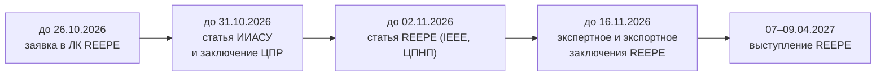

# План публикаций (по конференциям)

**Дата:** 2026-10-14
**Ветка:** `feat/publications`
**Цель:** публикации по нескольким площадкам — российские (РИНЦ) и
международные (Scopus/IEEE). Материалы разложены по папкам с названием
конференции (см. `README.md`).

---

## 1. Распределение тем

| Площадка | Индексация | Язык | Тема | Папка |
|---|---|---|---|---|
| **ИИАСУ-2026** | РИНЦ | русский | **Выбор модели МО** (секция 2) | `IIASU_2026/` |
| **PIERE-2026** | IEEE / Scopus | английский | Статья Go2 (прошлая подача) | `PIERE_2026_DRAFT/` |
| **REEPE-2027** | IEEE / Scopus | английский | RL-политика vs модельный IK/TROT (Go2, Isaac Sim) | `REEPE_2027/` |
| ~~**КАПП-2026**~~ | РИНЦ | русский | та же работа «выбор модели» | `KAPP_2026_DRAFT/` (**отменён**) |

Источники: `docs/ergonomics-methodology/` (КР), `reports/`,
`docs/gazebo-rl-vs-ik/`, `docs/gpu-rl-training/`.

> **Важно:** работы **разные**; одну и ту же статью в две площадки подавать
> нельзя (нарушение оригинальности).

---

## 2. Календарь

Сегодня — **2026-10-13**.

| Дата | Событие | Кто |
|---|---|---|
| до 26.10.2026 | заявка через личный кабинет REEPE | вы |
| **до 31.10.2026** | подача статьи ИИАСУ-2026 | вы + я |
| до 31.10.2026 | заключение об открытом опубликовании (ИИАСУ, ЦПР) | научрук + ЦПР |
| до 02.11.2026 | статья REEPE по шаблону IEEE (ЦПНП) | я + вы |
| до 16.11.2026 | экспертное и экспортное заключения REEPE | научрук + ЦПР |
| 07–09.04.2027 | выступление на REEPE | вы |

> **Уточнено (2026-10-13) по личному кабинету.** Срок подачи статьи
> ИИАСУ — **31.10.2026**; срок заключения о возможности открытого
> опубликования — тоже **31.10.2026**. Приём тезисов завершён (подаётся
> статья, не тезисы).

---

## 3. Трек A — ИИАСУ-2026 (выбор модели МО)

### 3.1. Итог трека

Русская статья в сборник РИНЦ, **секция 2 «Машинное обучение»**, на тему
**обоснования выбора модели МО** для системы распознавания объектов
мобильного робота.

### 3.2. Что уже есть

| Материал | Где |
|---|---|
| Полный отчёт по выбору модели | `docs/ergonomics-methodology/2026-10-13_model-selection.md` |
| Выжимка | `docs/ergonomics-methodology/2026-10-14_model-selection-summary.md` |
| Расчёт | `docs/ergonomics-methodology/model-selection/model-selection.py` |
| План статьи | `docs/publications/IIASU_2026/plan.md` |
| Новизна и разведка | `docs/publications/IIASU_2026/novelty.md`, `novelty-evidence.md` |
| Требования и шаблон | `docs/publications/IIASU_2026/requirements.md`, `template/` |
| Черновик статьи | `docs/publications/IIASU_2026/draft-article.md` |

### 3.3. Задачи

| № | Задача | Кто | Готово |
|---|---|---|---|
| A1 | Зафиксировать название (рус/англ) | вы + научрук | ☐ |
| A2 | Собрать структуру статьи по разделам | я | ☐ |
| A3 | Текст: Введение, Методы, Результаты, Обсуждение, Заключение | я | ☐ |
| A4 | Характеристики, критерии, авторские метрики | я | ☐ |
| A5 | Таблицы (≤2) и рисунки (≤5) | я | ☐ |
| A6 | Аннотация 650–1000 знаков, ключевые слова 5–7, EN-блок | я | ☐ |
| A7 | Список источников ≥5, ГОСТ | я | ☐ |
| A8 | .docx по шаблону, 4–6 стр., ≥6000 знаков | я | ☐ |
| A9 | Проверка заимствования ≤20% | вы | ☐ |
| A10 | Заключение ЦПР | научрук/ЦПР | ☐ |
| A11 | Подача в личный кабинет | вы | ☐ |

### 3.4. Чек-лист трека A

- [ ] `.docx`, не PDF; A4; поля 2 см; TNR 12; полуторный
- [ ] 4–6 страниц; ≥6000 знаков
- [ ] УДК; заголовок 6–15 слов; авторы ≤6 (+SPIN, контактный)
- [ ] Аннотация 650–1000 знаков; ключевые слова 5–7; EN-блок
- [ ] Разделы: Введение, Материалы и методы, Результаты, Обсуждение, Заключение
- [ ] Таблиц ≤2; рисунков ≤5; подписи
- [ ] Список источников ≥5, по порядку, ГОСТ
- [ ] Заимствование ≤20%
- [ ] Заключение об открытом опубликовании (ЦПР)

---

## 4. Трек B — REEPE-2027 (RL vs TROT)

### 4.1. Итог трека

Английская статья по шаблону IEEE о сравнении RL-политики и модельного
TROT-контроллера для Go2 в Gazebo, с переносом и метриками.

### 4.2. Что уже есть

| Материал | Где |
|---|---|
| Требования IEEE/шаблон | `docs/publications/REEPE_2027/` |
| План подачи REEPE | `docs/publications/REEPE_2027/plan-reepe-2027.md` |
| Черновики EN/RU | `docs/publications/REEPE_2027/draft-article-en.md`, `draft-article-ru.md` |
| Отчёты по переносу | `reports/gazebo-rl/`, `reports/rl-sar/` |
| Данные RL vs TROT | `reports/rl-sar/data/`, `sim/mjrl_go2/results/` |
| План GPU-обучения | `docs/gpu-rl-training/` |

### 4.3. Задачи

| № | Задача | Кто | Готово |
|---|---|---|---|
| B1 | Зафиксировать название (англ) | вы + научрук | ☐ |
| B2 | Довести эксперимент RL vs TROT (данные) | я | ☐ |
| B3 | Пересобрать текст под IEEE | я | ☐ |
| B4 | Abstract 75–150 слов; источников 20–30 | я | ☐ |
| B5 | Рисунки/таблицы (bw, читаемые в ч/б) | я | ☐ |
| B6 | Шаблон IEEE, 5–6 страниц | я | ☐ |
| B7 | Заявка в личный кабинет (до 26.10) | вы | ☐ |
| B8 | Экспертное и экспортное заключения (до 16.11) | научрук/ЦПР | ☐ |
| B9 | Подача статьи (до 02.11, ЦПНП) | вы | ☐ |

### 4.4. Чек-лист трека B

- [ ] Язык — английский
- [ ] Abstract 75–150 слов, без формул; ключевые слова 3–7
- [ ] 5–6 страниц; шаблон IEEE
- [ ] Источников 20–30 позиций; самоцитирований ≤3
- [ ] Названия (рус/англ) совпадают в заключениях и статье
- [ ] Экспертное и экспортное заключения
- [ ] Заявка (26.10) и статья (02.11) поданы

---

## 5. Организационные шаги

| Шаг | Что | Кто |
|---|---|---|
| O1 | Регистрация бейджа (сайт конгресса) | вы |
| O2 | Регистрация на конференцию (rusengineer) | вы |
| O3 | Личный кабинет REEPE (заявка) | вы |
| O4 | Заключения (экспертное, экспортное) | научрук/ЦПР |
| O5 | Фиксация названий рус/англ | вы + научрук |

---

## 6. Риски и меры

| Риск | Мера |
|---|---|
| Дедлайн ИИАСУ 31.10 | успеть с текстом и заключением ЦПР |
| Заключения не успевают | запрашивать заранее у ЦПР |
| Названия не совпадут в заключениях | зафиксировать до запроса заключений |
| Объём не влезает в лимиты | сокращать второстепенное, объединять таблицы |

---

## 7. Связанные материалы

- `docs/publications/IIASU_2026/` — рабочая папка статьи ИИАСУ (выбор модели МО).
- `docs/publications/IIASU_2026/plan.md` — план написания статьи по выбору модели.
- `docs/publications/IIASU_2026_DRAFT/` — архив (эргономика, отложена).
- `docs/publications/KAPP_2026_DRAFT/` — отменённая подача (та же работа).
- `docs/publications/REEPE_2027/plan-reepe-2027.md` — план подачи статьи в REEPE-2027.
- `docs/publications/export-control-process.md` — порядок получения
  заключения о возможности открытого опубликования (НУК ИУ, бумажный).
- `docs/ergonomics-methodology/recognition-objects/` — источник по эргономике.
- `docs/publications/REEPE_2027/` — источник и шаблон для REEPE.
- `reports/gpu-rl-training/` — отчёты по RL и переносу.
