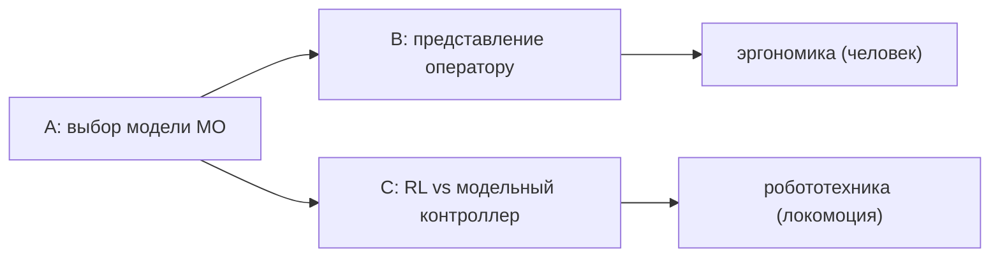

# Научная новизна (по всем публикациям)

**Дата:** 2026-10-14
**Ветка:** `feat/publications`
**Назначение:** единый документ с формулировками научной новизны по всем
статьям (для научрука, статей и защиты).
**Связанные:** `README.md`, `plan.md`, папки `IIASU_2026/`, `KAPP_2026/`,
`REEPE_2027/`, `PIERE_2026/`.

---

## 0. Обзор работ

| Код | Работа | Площадка | Папка | Статус |
| --- | --- | --- | --- | --- |
| **A** | Обоснование выбора модели машинного обучения | КАПП-2026 (РИНЦ) | `KAPP_2026/` | черновик |
| **B** | Эргономика: представление результатов распознавания оператору | ИИАСУ-2026 (РИНЦ) | `IIASU_2026/` | в работе |
| **C** | RL-политика vs модельный IK/TROT-контроллер (Go2, Isaac Sim) | REEPE-2027 (IEEE/Scopus) | `REEPE_2027/` | в работе |
| — | (C) прошлая подача | PIERE-2026 (IEEE/Scopus) | `PIERE_2026/` | архив |

> Новизна у всех работ — **методологическая / инженерная** (не новый
> алгоритм машинного обучения). Формулировки даны так, чтобы это было
> видно и защищаемо.
>
> **Разведка литературы и прямые конкуренты** — `novelty-evidence.md`.

---

## A. Обоснование выбора модели машинного обучения

> **Подробный разбор (литература, пробел, формулировки)** — `KAPP_2026/novelty.md`.

### A.1. Состояние вопроса (пробел)

Выбор модели обычно делают либо по **бенчмаркам** (mAP/латентность на
датасете), либо через **взвешенный многокритериальный выбор (MCDM)** с
экспертом:

- **HugSelect** (arXiv:2608.08069, 2026) — *weighted additive model*;
- **ModelSelect** (arXiv:2512.11984, 2025) — MCDM-фреймворк для AI-моделей;
- **Farias et al.** (arXiv:2207.06651) — выбор модели через **TOPSIS**;
- **MCDM-традиция** для выбора модели ПО/ЖЦ:
  10.1109/seaa.2012.71; 10.5267/j.msl.2017.3.003.

Во всех случаях нужны **веса** (субъективность) **или** прогоны/данные.

### A.2. Новизна

1. **Безвесовой** выбор: характеристики извлекаются из **архитектуры**
   (формула + единицы), без экспертных весов и **без критерия Парето**.
2. **Критерии в условиях неопределённости** (Лаплас, оптимизм, Вальд,
   Сэвидж, Гурвиц) по **сценам** (5/20/50 объектов) — в применении к выбору
   модели МО не встречается.
3. **Авторские композитные метрики «точность на ресурс»**: $Q_4$,
   $\mathrm{DF}$, $\mathrm{AR}$, $\mathrm{APM}$, $\mathrm{FPG}$,
   $\mathrm{SR}$, $\mathrm{IDD}$, BF — считаются из спецификаций и
   аналитики, без прогонов.
4. **Подтверждение в симуляции** (Gazebo) как **второй шаг**, а не основание:
   18 из 22 способов проверяемы по CSV-телеметрии.
5. Эргономические характеристики (**однозначность, наглядность,
   читаемость**) переведены в **вычислимые формулы**.

### A.3. Чем подтверждается

- Набор из **7 готовых моделей**, отсев до 3; все пять критериев и
  свёртки дают **YOLO11n** ($\Psi=0.955$, Борда 64, ср. ранг 1.045).
- Скрипт расчёта: `../ergonomics-methodology/model-selection/model-selection.py`.
- Отчёты: `../ergonomics-methodology/2026-10-13_model-selection.md`,
  `...-summary.md`.

### A.4. Границы

- «Безвесовость» = равное усреднение после нормировки (неявные равные веса).
- Свёртка (§11: нормировка, Борда, средний ранг) — **стандартный приём**
  (rank aggregation), не новизна; новизна — в *безвесовом* выборе по
  архитектурным характеристикам и критериях неопределённости.
- mAP на синтетике ≠ COCO mAP; сравнение — относительное.

### A.5. Формулировка одной строкой

> **Методика объективного выбора модели МО без весов и экспертных оценок —
> по вычислимым характеристикам архитектуры, с авторскими метриками и
> подтверждением в симуляции.**

---

## B. Эргономика: представление результатов распознавания оператору

> **Подробный разбор (литература, пробел, формулировки)** — `IIASU_2026/novelty.md`.

### B.1. Состояние вопроса (пробел)

Эргономику интерфейсов обычно оценивают **на людях** (юзабилити-тесты,
опросники, время реакции). Это дорого и плохо воспроизводимо.

### B.2. Новизна

1. Модель **информационной цепочки** «детектор → представление →
   оператор» с **вычислимыми характеристиками** на каждом звене.
2. Эргономические характеристики — **формулами**: однозначность
   $O_c=1/k$, наглядность $H_v=1/\log_2(k+1)$ (закон Хика), читаемость
   $C=\frac{1}{\log_2(P+1)}\tau$, нагрузка $k_v$.
3. **Своевременность** решения $\mathrm{DF}=e^{-T/\tau}$ — успевает ли
   оператор/робот к моменту действия.
4. **Калибровка** (ECE) и **запас решения** $\gamma$ как эргономические
   характеристики доверия, а не только метрики модели.

### B.3. Границы

- Требуется явная **часть про оператора** (иначе тема «не эргономика»).
- Часть характеристик — **прокси**, проверяемые в симуляции, но не с людьми.

### B.4. Формулировка одной строкой

> **Вычислимая (без экспериментов с людьми) модель эргономики звена
> «распознавание → представление оператору»: характеристики-формулы и их
> проверка в симуляции.**

---

## C. RL-политика vs модельный IK/TROT-контроллер (Unitree Go2, Isaac Sim)

> **Подробный разбор (литература, пробел, формулировки)** — `REEPE_2027/novelty.md`.

### C.1. Состояние вопроса (пробел)

Поле ушло в **гибриды** RL + модельное управление и в **чистый RL**:

- RAMBO (arXiv:2504.06662) — RL + модельное whole-body управление;
- IFM (arXiv:2311.02304) — имитация и дообучение MPC;
- RL + Model-based Control (arXiv:2305.17842);
- PointWalker (arXiv:2610.15548) — end-to-end RL из LiDAR;
- Energy-Efficient Gait Adaptation via HRL (arXiv:2610.10297) — минимизация CoT.

**Прямое сравнение уже опубликовано:** «Benchmarking Model Predictive
Control and Reinforcement Learning for Legged Robot Locomotion»
(10.37099/mtu.dc.etdr/1677); гибриды MPC+RL — активное поле
(10.1109/icrom64545.2024.10903592). Поэтому «первое сравнение» не
заявляем; наша ниша — платформа Go2/Isaac Sim, открытый baseline и
**таксономия дефектов** (подробно — `novelty-evidence.md`, §1).

### C.2. Новизна

1. **Воспроизводимый протокол сравнения** одной платформы: Unitree Go2,
   Isaac Sim, n=3, телеметрия **125 колонок**.
2. **Количественная карта компромиссов**: RL — roll 2.3°, дрейф 0.37 м;
   IK — roll 27.8°, дрейф 1.09 м; рабочая область RL 0.1–0.4 м/с против
   IK ~0.3 м/с; CoT 2.84 vs 2.83.
3. **Анализ отказов:** 5 дефектов интеграции + **архитектурный крен через
   hip (roll 50°→8°)** — инженерная находка.
4. **Открытый модельный baseline** (IK/TROT на Rust) — переиспользуемый.

### C.3. Чем подтверждается

- `REEPE_2027/draft-article-en.md`, `data-collection.md`,
  `REEPE_2027/figures/`, `REEPE_2027/telemetry/`,
  `reports/isaam/2026-09-13_trot-gait-debug-walking-result.md`.

### C.4. Границы

- Только **симуляция** (нет sim-to-real), одна платформа.
- Сравнение **инженерное**, не SOTA-гонка.

### C.5. Формулировка одной строкой

> **Количественное сравнение обученной политики и модельного
> IK/TROT-контроллера для Unitree Go2 в едином протоколе: карта
> компромиссов и анализ дефектов.**

---

## 4. Сводка

| Код | Новизна одной строкой | Площадка |
| --- | --- | --- |
| **A** | Безвесовой объективный выбор модели МО по характеристикам архитектуры + авторские метрики + проверка в симуляции | КАПП-2026 |
| **B** | Вычислимая модель эргономики «распознавание → представление оператору» | ИИАСУ-2026 |
| **C** | Единый протокол сравнения RL и модельного контроллера для Go2: компромиссы и дефекты | REEPE-2027 |

Связь работ:

---

## 5. Источники состояния вопроса (недавние работы)

| Работа | arXiv | О чём |
| --- | --- | --- |
| HugSelect | 2608.08069 | выбор модели через weighted additive model |
| ModelSelect | 2512.11984 | MCDM-выбор AI-моделей |
| Farias et al. | 2207.06651 | выбор модели через TOPSIS |
| RAMBO | 2504.06662 | RL + модельное whole-body управление |
| IFM | 2311.02304 | имитация и дообучение MPC |
| RL + Model-based | 2305.17842 | гибрид RL и оптимального управления |
| PointWalker | 2610.15548 | end-to-end RL из LiDAR для квадруподов |
| HRL + CoT | 2610.10297 | иерархический RL с минимизацией CoT |
| SAC-MoE | 2511.12361 | RL для гибридных систем (в т. ч. legged) |
| Higher-Order Morphology Priors | 2610.10934 | морфология как inductive bias |

> Ссылки приведены как «состояние вопроса»; в статьях оформлять по
> требованиям площадки (IEEE / ГОСТ).
