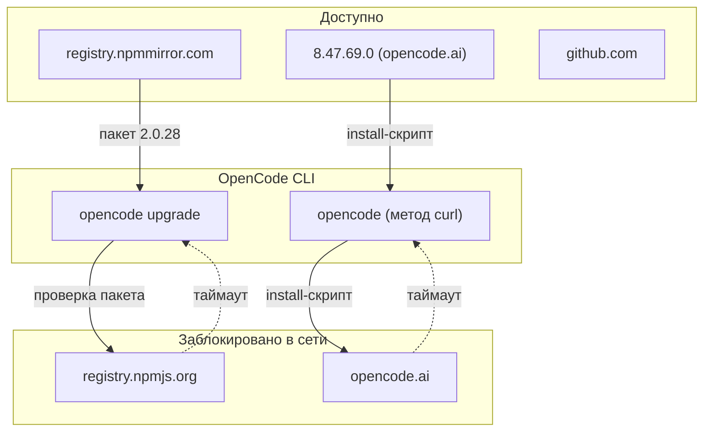

# Отчёт: сбой обновления OpenCode из-за сетевой блокировки (SNI-фильтрация)

**Дата:** 2026-10-13
**Ветка:** `feat/rl-sar`
**Версия:** 1.0
**Среда:** Ubuntu (glibc 2.43), x86_64 (AVX2/AVX512), OpenCode v2.0.27,
установленный способом `curl` в `~/.opencode/bin/opencode`

---

## Содержание

- [Часть A: Развёртывание (обновление OpenCode)](#часть-a-развёртывание-обновление-opencode)
  - [A.1. Введение](#a1-введение)
  - [A.2. Выбор решения (история)](#a2-выбор-решения-история)
  - [A.3. Ход работ](#a3-ход-работ)
  - [A.4. Проблемы и решения](#a4-проблемы-и-решения)
  - [A.5. Итоговая архитектура](#a5-итоговая-архитектура)
  - [A.6. Дальнейшие шаги](#a6-дальнейшие-шаги)
  - [A.7. Приложения](#a7-приложения)
- [Часть B: Эксплуатационные проблемы](#часть-b-эксплуатационные-проблемы)
  - [Проблема 8](#8-проблема-ошибка-failed-to-fetch-package-information-при-opencode-upgrade)
  - [Проблема 9](#9-проблема-хоста-opencodeai-недоступен-не-скачивается-установочный-скрипт)

---

## Часть A: Развёртывание (обновление OpenCode)

### A.1. Введение

Цель — обновить локальный CLI OpenCode с версии **2.0.27** до **2.0.28**
(`opencode upgrade` сообщил о доступном обновлении). Развёртывание
выполняется пользователем `redalexdad` без прав root: установка лежит в
`~/.opencode/bin/opencode` и принадлежит пользователю.

| Параметр | Значение |
|---|---|
| ОС | Ubuntu, glibc 2.43 |
| Архитектура | x86_64, AVX2 + AVX512F |
| Текущая версия | OpenCode v2.0.27 |
| Целевая версия | OpenCode v2.0.28 |
| Способ установки | `curl` (`~/.opencode/bin/opencode`) |
| Права | достаточно пользовательских, root не требуется |

### A.2. Выбор решения (история)

В ходе работ рассматривались способы установки из официальной инструкции.
Сравнение — в таблице; два из них упираются в сетевую блокировку.

| Способ | Источник загрузки | Годен? | Почему |
|---|---|---|---|
| `opencode upgrade` (метод curl) | `opencode.ai` + `registry.npmjs.org` | ❌ | оба хоста недоступны (см. [A.4](#a4-проблемы-и-решения)) |
| `curl -fsSL https://opencode.ai/install \| bash` | `opencode.ai` | ❌ | `opencode.ai` недоступен (Проблема 9) |
| `npm i -g @opencode/cli@latest` | `registry.npmjs.org` | ❌ | `registry.npmjs.org` недоступен (Проблема 8) |
| `brew install anomalyco/tap/opencode` | GitHub (сборка из исходников) | ⚠️ | brew не установлен; формула `opencode` тянет исходники с GitHub |
| `sudo pacman -S opencode` | pacman | ❌ | это Arch; у нас Ubuntu |
| `scoop` / `choco` | — | ❌ | только Windows |
| `mise` / `nix` | — | ❌ | не установлены |
| **npm из зеркала `registry.npmmirror.com`** | npmmirror (не Cloudflare) | ✅ | зеркало доступно, пакет `2.0.28` есть |
| **Ручной tarball платформенного пакета** | npmmirror | ✅ | проверено, бинарник запускается |

### A.3. Ход работ

1. **Попытка штатного обновления.** `opencode upgrade` → «The OpenCode
   installer failed. Failed to fetch package information». Повтор
   `opencode upgrade 2.0.28 --method curl` → «Canceled». Симптом и разбор —
   [Проблема 8](#8-проблема-ошибка-failed-to-fetch-package-information-при-opencode-upgrade).
2. **Гипотеза о правах.** Проверено: файл установки принадлежит пользователю,
   `sudo` не нужен. Гипотеза отпала (см. [A.4](#a4-проблемы-и-решения)).
3. **Проверка сети.** Обнаружено, что `opencode.ai` недоступен, при этом
   `github.com` и `google.com` работают. Разбор — [Проблема 9](#9-проблема-хоста-opencodeai-недоступен-не-скачивается-установочный-скрипт).
4. **Локализация блокировки.** Серия тестов `curl --resolve` и `openssl
   s_client` показала, что блокировка зависит от имени хоста (SNI), а не от
   IP. Найден рабочий IP `8.47.69.0`, отдающий `opencode.ai`.
5. **Поиск обходного канала.** Проверены зеркала npm: `registry.npmmirror.com`
   и `mirrors.huaweicloud.com` доступны. В npmmirror найден пакет
   `@opencode/cli-linux-x64@2.0.28`.
6. **Проверка обхода.** Платформенный tarball скачан с зеркала, целостность
   (sha1) совпала, распакованный бинарник выводит `opencode v2.0.28`.

### A.4. Проблемы и решения

| № | Проблема | Причина | Решение | Статус |
|---|---|---|---|---|
| [8](#8-проблема-ошибка-failed-to-fetch-package-information-при-opencode-upgrade) | `opencode upgrade` → «Failed to fetch package information» | `registry.npmjs.org` заблокирован | установка из зеркала `registry.npmmirror.com` | [x] способ проверен |
| [9](#9-проблема-хоста-opencodeai-недоступен-не-скачивается-установочный-скрипт) | `opencode.ai` недоступен (не скачивается install-скрипт) | фильтрация по имени хоста (SNI) | обход через зеркало или `/etc/hosts` | [x] способ проверен |

### A.5. Итоговая архитектура



Схема «было / стало»:

| Аспект | Было | Стало |
|---|---|---|
| Канал обновления | `opencode.ai` + `registry.npmjs.org` | `registry.npmmirror.com` |
| Результат `opencode upgrade` | ошибка «Failed to fetch package information» | штатный метод по-прежнему недоступен; обновление ставится из зеркала |
| Версия | v2.0.27 | v2.0.28 (бинарник из зеркала проверен) |

### A.6. Дальнейшие шаги

- [ ] Применить обновление: заменить `~/.opencode/bin/opencode` на бинарник
  из `@opencode/cli-linux-x64@2.0.28` (с резервной копией) **или** поставить
  `npm i -g @opencode/cli@2.0.28 --registry=https://registry.npmmirror.com`
- [ ] Для штатного `opencode upgrade` — решить вопрос доступа к `opencode.ai`
  и `registry.npmjs.org` (VPN/прокси либо запись в `/etc/hosts`)
- [ ] Зафиксировать в заметках по среде, что обновление идёт через зеркало

### A.7. Приложения

**A.7.1. Команды проверки сети**

```bash
# общая доступность хостов
curl -sS -m 15 -o /dev/null -w "%{http_code}\n" https://github.com
curl -sS -m 15 -o /dev/null -w "%{http_code}\n" https://opencode.ai

# проверка зависимости от имени хоста (SNI), а не от IP
curl -sS -m 12 --resolve opencode.ai:443:8.47.69.0 \
  -o /dev/null -w "%{http_code}\n" https://opencode.ai/v2/install
curl -sS -m 12 --resolve opencode.ai:443:104.16.197.131 \
  -o /dev/null -w "%{http_code}\n" https://opencode.ai/v2/install
```

**A.7.2. Обход: установка из зеркала**

```bash
# получить платформенный пакет (linux-x64) и распаковать
curl -sSL -o cli.tgz \
  "https://registry.npmmirror.com/@opencode/cli-linux-x64/-/cli-linux-x64-2.0.28.tgz"
mkdir -p ext && tar -xzf cli.tgz -C ext
./ext/package/bin/opencode --version   # → opencode v2.0.28

# либо через npm с явным зеркалом
npm i -g @opencode/cli@2.0.28 --registry=https://registry.npmmirror.com
```

**A.7.3. Файлы**

| Путь | Назначение |
|---|---|
| `~/.opencode/bin/opencode` | текущий бинарник (v2.0.27) |
| `~/.cache/opencode/update-*/install` | временный install-скрипт обновления |
| `~/.local/share/opencode/log/opencode.log` | журнал (строки `role=cli`) |

---

## Часть B: Эксплуатационные проблемы

### Сводная таблица проблем

| № | Проблема | Гипотезы | Причина | Решение | Методы | Сложность |
|---|---|---|---|---|---|---|
| [8](#8-проблема-ошибка-failed-to-fetch-package-information-при-opencode-upgrade) | «Failed to fetch package information» | права/root, IPv6, блок сети | `registry.npmjs.org` заблокирован | установка из зеркала npm | `curl`, `getent`, `npm` | 🟡 |
| [9](#9-проблема-хоста-opencodeai-недоступен-не-скачивается-установочный-скрипт) | `opencode.ai` недоступен | Cloudflare целиком, DNS, SNI | фильтрация по имени хоста (SNI) | зеркало или `/etc/hosts` | `curl --resolve`, `openssl` | 🟡 |

---

## 8. Проблема: ошибка «Failed to fetch package information» при `opencode upgrade`

### 8.1. Симптом

При запуске обновления:

```
●  From 2.0.27 → 2.0.28
■  Upgrade failed
■  The OpenCode installer failed
│  Failed to fetch package information
│  Command  opencode upgrade 2.0.28 --method curl
```

Повторный запуск `opencode upgrade 2.0.28 --method curl` завершился «Canceled».
В журнале (`~/.local/share/opencode/log/opencode.log`) видно, что CLI
скачивает install-скрипт и запускает его, после чего происходит отказ.

### 8.2. Гипотезы

- ❌ Гипотеза A: для обновления нужны права root (`sudo`) — опровергнута:
  `~/.opencode/bin/opencode` принадлежит пользователю `redalexdad`, каталог
  пользовательский, root не требуется (подробнее — [8.3](#83-причина)).
- ❌ Гипотеза B: проблема в IPv6 — опровергнута: неудача и по IPv4, глобального
  IPv6-маршрута у машины нет.
- ❌ Гипотеза C: не настроен прокси — опровергнута: прокси действительно нет,
  но и без него доступ к части хостов есть, значит дело не в его отсутствии.
- ✅ Гипотеза D: сеть блокирует хост `registry.npmjs.org` (а также
  `opencode.ai`) — принята, подтверждена в [8.3](#83-причина).

### 8.3. Причина

Штатный установщик OpenCode определяет версию и качает платформенный пакет
из npm. В скрипте установки (`https://opencode.ai/v2/install`) это выглядит так:

```bash
http_status=$(curl -s -o /dev/null -w "%{http_code}" \
  "https://registry.npmjs.org/$package_scope%2fcli-$target/$specific_version")
...
if [ "$http_status" != "200" ]; then
    echo -e "Failed to fetch package information"
    exit 1
fi
```

Наш хост `registry.npmjs.org` в текущей сети **недоступен**, поэтому `curl`
возвращает код `000` вместо `200`, и установщик печатает «Failed to fetch
package information». Это сетевое ограничение, а не проблема прав или
повреждённой установки.

### 8.4. Диагностика

Проверка доступности реестра npm и сравнение с доступным зеркалом:

```text
$ curl -sS -m 15 -o /dev/null -w "http=%{http_code}\n" https://registry.npmjs.org/opencode-ai
http=000            # таймаут

$ curl -sS -m 12 -o /dev/null -w "http=%{http_code}\n" \
    --resolve registry.npmjs.org:443:104.16.0.34 https://registry.npmjs.org/
http=000            # штатный адрес — недоступен

$ curl -sS -m 12 -o /dev/null -w "http=%{http_code}\n" \
    --resolve registry.npmjs.org:443:104.16.197.131 https://registry.npmjs.org/
http=200            # на другом IP тот же хост отвечает
```

При этом зеркала, не находящиеся за Cloudflare, доступны:

```text
$ curl -sS -m 12 -o /dev/null -w "http=%{http_code}\n" https://registry.npmmirror.com
http=200
```

В зеркале `registry.npmmirror.com` присутствует нужный пакет:

```text
@opencode/cli-linux-x64   latest = 2.0.28   (есть 2.0.17 … 2.0.28)
```

### 8.5. Решение

Обойти недоступный `registry.npmjs.org`, поставив пакет из зеркала
`registry.npmmirror.com`. Пакет платформы — `@opencode/cli-linux-x64`
(у нас x86_64 + AVX2, glibc → musl/baseline не нужны).

Вариант 1 — ручная установка из tarball (без sudo, сохраняет текущий
каталог `~/.opencode`):

```bash
curl -sSL -o cli.tgz \
  "https://registry.npmmirror.com/@opencode/cli-linux-x64/-/cli-linux-x64-2.0.28.tgz"
sha1sum cli.tgz   # сверка: baf45fabf9ad98d419502297c526d5c07847dcbe
mkdir -p ext && tar -xzf cli.tgz -C ext
./ext/package/bin/opencode --version   # → opencode v2.0.28

# с резервной копией заменить текущий бинарник
cp ~/.opencode/bin/opencode ~/.opencode/bin/opencode.bak-2.0.27
cp ext/package/bin/opencode ~/.opencode/bin/opencode
chmod 755 ~/.opencode/bin/opencode
```

Вариант 2 — npm с явным зеркалом (глобальный префикс пользовательский,
sudo не нужен):

```bash
npm i -g @opencode/cli@2.0.28 --registry=https://registry.npmmirror.com
```

### 8.6. Исправление в скриптах/конфигах

Штатный `opencode upgrade` жёстко использует `registry.npmjs.org`, поэтому
сам обойти блокировку не может. Для регулярных обновлений разумно:

- держать npm-реестр зеркала по умолчанию в `~/.npmrc`:
  `registry=https://registry.npmmirror.com` (только если это допустимо политикой);
- либо обновлять вручную командой из [8.5](#85-решение).

Правку вносить в репозиторий проекта не требуется — проблема среды.

### 8.7. Результат

| Метрика | До | После |
|---|---|---|
| `opencode upgrade` | ошибка «Failed to fetch package information» | штатный путь по-прежнему недоступен (сеть) |
| Способ получить 2.0.28 | нет | зеркало npm / ручной tarball |
| Проверенный бинарник | v2.0.27 | `opencode v2.0.28` (sha1 совпал) |

Обход подтверждён: платформенный пакет скачан с зеркала, его sha1 совпадает
с указанным в метаданных, распакованный бинарник выводит `opencode v2.0.28`.

### Связь с развёртыванием (Часть A)

Эта проблема проявилась на шаге 1 хода работ
([A.3. Ход работ](#a3-ход-работ)) и отражена в сводной таблице
([A.4. Проблемы и решения](#a4-проблемы-и-решения)). Выбор обходного канала —
из таблицы вариантов ([A.2. Выбор решения (история)](#a2-выбор-решения-история)).

---

## 9. Проблема: хоста `opencode.ai` недоступен (не скачивается установочный скрипт)

### 9.1. Симптом

Установка/обновление через `curl` не может получить install-скрипт:
обращения к `https://opencode.ai/install` и `https://opencode.ai/v2/install`
завершаются таймаутом. При этом GitHub и обычные сайты открываются. Варианты
установки, завязанные на `opencode.ai`, не работают.

### 9.2. Гипотезы

- ❌ Гипотеза A: недоступен весь Cloudflare — опровергнута:
  `workers.cloudflare.com`, `one.one.one.one` (1.0.0.1) и `1.1.1.1` отвечают.
- ❌ Гипотеза B: сломано разрешение имён (DNS) — опровергнута: системный
  резолвер и DoH (1.1.1.1, 8.8.8.8) дают одинаковый ответ для `opencode.ai`.
- ✅ Гипотеза C: блокировка зависит от имени хоста (SNI), а не от IP —
  принята, подтверждена в [9.3](#93-причина): с одним и тем же IP при разных
  SNI результат разный, и наоборот.

### 9.3. Причина

В сети применяется фильтрация TLS-соединений по имени хоста (SNI). Для
`opencode.ai` соединение обрывается, даже если направить его на «рабочий»
Cloudflare-адрес, тогда как тот же адрес с другим SNI отвечает нормально.
Обратная проверка: `opencode.ai`, направленный на IP `8.47.69.0`, отдаёт
содержимое (код 200). То есть блокируется имя `opencode.ai` (и, отдельно,
адреса `registry.npmjs.org`; см. [Проблему 8](#8-проблема-ошибка-failed-to-fetch-package-information-при-opencode-upgrade)).

### 9.4. Диагностика

Зависимость результата от имени хоста (SNI) при неизменном IP:

```text
$ curl -sS -m 12 --resolve workers.cloudflare.com:443:172.65.90.22 \
    -o /dev/null -w "%{http_code}\n" https://workers.cloudflare.com/
301                 # тот же IP, другое SNI — работает

$ curl -sS -m 12 --resolve opencode.ai:443:104.16.197.131 \
    -o /dev/null -w "%{http_code}\n" https://opencode.ai/
000                 # SNI=opencode.ai на «рабочий» IP — таймаут
```

Рабочий IP, отдающий `opencode.ai`:

```text
$ curl -sS -m 20 --resolve opencode.ai:443:8.47.69.0 \
    https://opencode.ai/v2/install | head -1
#!/usr/bin/env bash   # настоящий install-скрипт, размер 14769 байт
```

Поддомены `opencode.ai` (`www`, `api`, `v2`, `app`, `models`) резолвятся в
`8.47.69.0` и доступны, а apex-домен — в Cloudflare (`172.65.90.x`), который
фильтруется.

### 9.5. Решение

Два пути:

1. **Не обращаться к `opencode.ai` вовсе** — ставить из зеркала npm (см.
   [8.5](#85-решение)); для обновления это полностью закрывает задачу.
2. **Направить `opencode.ai` на рабочий IP** через `/etc/hosts`
   (требует root):

   ```bash
   echo "8.47.69.0 opencode.ai" | sudo tee -a /etc/hosts
   curl -fsSL https://opencode.ai/v2/install | bash -s -- --version 2.0.28
   ```

   Учтите: установщик затем идёт в `registry.npmjs.org`, поэтому одного
   `/etc/hosts` для обновления недостаточно — нужен ещё доступ к npm-реестру.

### 9.6. Исправление в скриптах/конфигах

Постоянное решение зависит от источника фильтрации:

- если это VPN/прокси — прописать `https_proxy`/`HTTPS_PROXY` в окружении,
  тогда `opencode upgrade` заработает штатно;
- если это локальная правка маршрутизации — добавить запись в `/etc/hosts`
  (см. [9.5](#95-решение)).

Правку в репозитории проекта вносить не нужно — это настройка среды.

### 9.7. Результат

| Метрика | До | После |
|---|---|---|
| `opencode.ai/v2/install` | таймаут | 200 при `--resolve opencode.ai:443:8.47.69.0` |
| `curl -fsSL https://opencode.ai/install \| bash` | не работает | работает при перенаправлении IP (+ доступ к npm) |
| Проверка содержимого | — | получен подлинный install-скрипт (14769 байт) |

Причина подтверждена экспериментально: результат меняется от SNI при
неизменном IP и от IP при неизменном SNI.

### Связь с развёртыванием (Часть A)

Проблема выявлена на шагах 3–4 хода работ
([A.3. Ход работ](#a3-ход-работ)) и учтена при выборе решения
([A.2. Выбор решения (история)](#a2-выбор-решения-история), [A.5. Итоговая архитектура](#a5-итоговая-архитектура)).

---

## Итоговая статистика

| Метрика | Значение |
|---------|----------|
| Всего проблем | 2 |
| Из них решено | 2 (способы обхода проверены) |
| 🟢 (<1ч) | 0 |
| 🟡 (1-4ч) | 2 |
| 🔴 (>4ч) | 0 |
| Ключевые выводы | обновление блокируется сетевой фильтрацией по хостам (`opencode.ai`, `registry.npmjs.org`); рабочий обход — зеркало `registry.npmmirror.com`; права root и IPv6 ни при чём |
