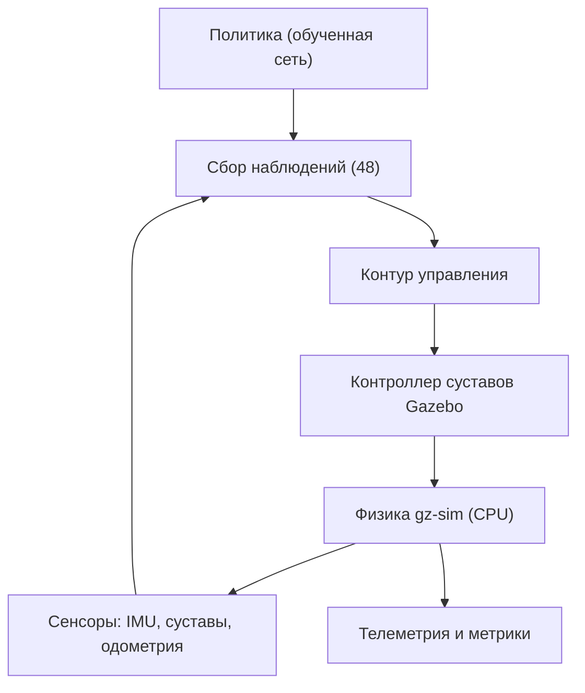
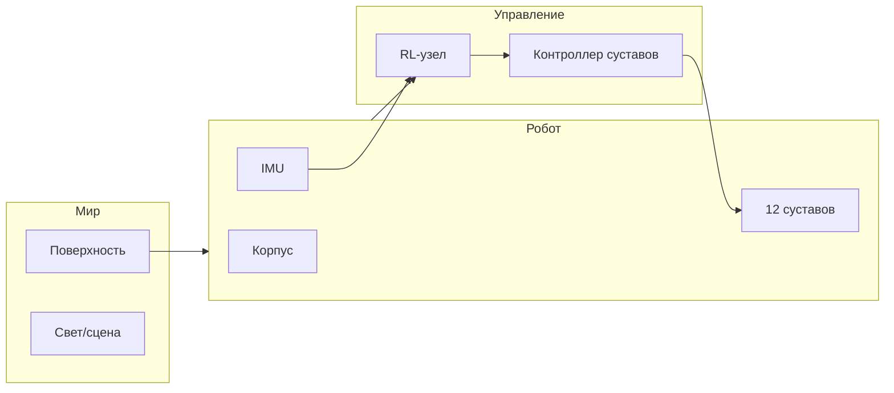
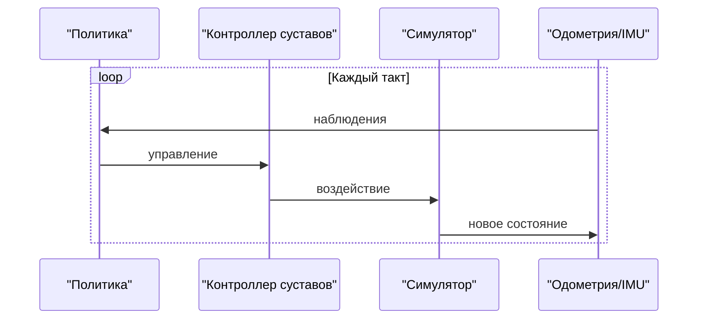
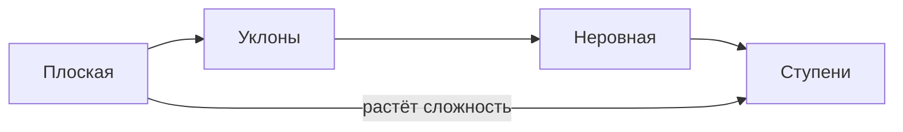
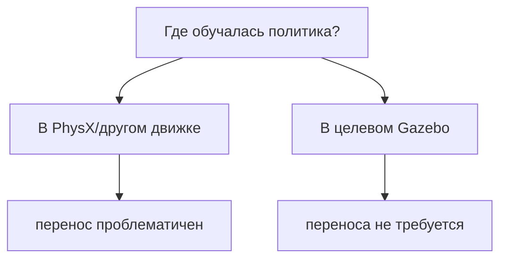

# Перенос RL-политики Go2 в Gazebo: анализ и результат sim-to-sim

**Дата:** 2026-10-09
**Ветка:** `feat/iiasu-2026`
**Тема:** проверка переноса предобученной RL-политики походки Unitree Go2
из физического движка PhysX (Isaac) в симулятор Gazebo (gz-sim)
**Связанные материалы:** `docs/gazebo-rl-vs-ik/`

---

## Оглавление

1. [Резюме](#1-резюме)
2. [Текущее состояние](#2-текущее-состояние)
3. [Гипотеза проблемы](#3-гипотеза-проблемы)
4. [Почему прежние планы устарели](#4-почему-прежние-планы-устарели)
5. [Целевая архитектура](#5-целевая-архитектура)
6. [Компоненты и их ответственность](#6-компоненты-и-их-ответственность)
7. [Метод решения](#7-метод-решения)
8. [Коммуникация и интеграция](#8-коммуникация-и-интеграция)
9. [Порядок внедрения](#9-порядок-внедрения)
10. [Ожидаемый эффект](#10-ожидаемый-эффект)
11. [Риски и митигации](#11-риски-и-митигации)
12. [Связанные отчёты](#12-связанные-отчёты)
13. [Приложение A. Журнал экспериментов](#приложение-a-журнал-экспериментов)
14. [Приложение B. Сравнение с внешними проектами](#приложение-b-сравнение-с-внешними-проектами)
15. [Приложение C. Чек-листы](#приложение-c-чек-листы)
16. [Приложение D. Словарь](#приложение-d-словарь)

---

## 1. Резюме

### 1.1. Задача

Проверить, можно ли запустить уже обученную политику ходьбы четвероного
робота Unitree Go2 в симуляторе Gazebo (gz-sim) так, чтобы робот
устойчиво шёл, и сравнить эту политику с модельным IK/TROT-контроллером
в одном симуляторе. MuJoCo и Isaac Sim как среду рассматривать
запрещено — они допустимы лишь как источники «рецепта» наблюдений и как
место хранения самой политики.

### 1.2. Что сделано

- Поднят и отлажен стек Gazebo (gz-sim) для Go2: headless-запуск,
  проброс модельного времени, контроллеры суставов, мосты топиков,
  одометрия.
- Реализован узел, который проводит политику: собирает наблюдения,
  вызывает обученную сеть и публикует управляющие воздействия в
  контроллер суставов.
- Дважды переработан способ применения управляющих воздействий
  (позиционный и моментный), несколько раз изменён порядок суставов,
  добавлен собственный высокочастотный контур управления.
- Проведён цикл измерений реального темпа симуляции и устранён
  «узкий» режим производительности.
- Изучены внешние проекты-аналоги и предпринята практическая попытка их
  развернуть.

### 1.3. Главный результат

**Предобученная политика, полученная в PhysX (Isaac), не даёт устойчивой
походки в Gazebo (gz-sim).** Ни при одном из испробованных сочетаний
(порядок суставов, позиционный/моментный интерфейс, высокочастотный
контур управления, реальное время симуляции) робот не удерживает стойку
и не идёт: корпус оседает, движение неустойчиво и дрейфует. Это
устойчиво воспроизводимый результат и он не объясняется
производительностью — при минимальной сцене симулятор идёт в реальном
времени.

Таким образом, задача относится к классу **sim-to-sim**: политика
переносится между разными физическими движками, и «в лоб» такой перенос
не работает.

### 1.4. Ключевые решения и выводы

| № | Решение / вывод | Статус |
|---|---|---|
| 1 | Управление политикой в Gazebo — через контроллер суставов | реализовано |
| 2 | Модельный контур управления низведён до высокочастотного PD | реализовано |
| 3 | Порядок суставов должен совпадать с порядком обучения политики | подтверждено |
| 4 | Систему следует запускать в минимальной сцене (без Nav2/сенсоров) | подтверждено |
| 5 | GPU не ускоряет физику Gazebo (физика на CPU) | установлено |
| 6 | Прямой перенос PhysX-политики в gz-sim не даёт походки | **главный вывод** |
| 7 | Надёжные пути — обучение прямо в Gazebo или готовый чужой стек | рекомендация |

### 1.5. Главная идея одной фразой

> Один и тот же робот и «правильные» наблюдения не спасают: походка,
> обученная в одном физическом движке, в другом движке не воспроизводится
> без переобучения или тонкой подгонки.

---

## 2. Текущее состояние

### 2.1. Исходный стек (где политика обучалась)

Политика походки Go2 пришла из мира **NVIDIA Isaac** (движок физики
PhysX). Там же задан «контракт» политики: какие наблюдения она получает,
в каком порядке, с какими масштабами, и какое управление отдаёт. Этот
контракт зафиксирован в конфигурации среды политики, входящей в комплект
поставки.

Ключевые параметры контракта (по конфигурации, без деталей формата):

| Параметр | Значение |
|---|---|
| Размер вектора наблюдений | 48 |
| Состав наблюдений | скорости корпуса, ориентация гравитации, команда скорости, ошибка суставов, скорости суставов, прошлое действие |
| Размер вектора действий | 12 |
| Масштаб действий | 0.25 (единый) |
| Жёсткость актуаторов | 25 |
| Демпфирование актуаторов | 0.5 |
| Ограничение момента | 23.5 |
| Ограничение скорости | 30 |
| Частота управления | ~50 Гц (при шаге физики 0.005 и децимации 4) |
| Стойка по умолчанию | hip боковых разведений ±0.1, бедро 0.8/1.0, голень −1.5 |

### 2.2. Целевой стек (где политику пытались запустить)

Целевой стек — **Gazebo**, современная ветка gz-sim (Harmonic),
управляемая через ROS 2 и связку gz_ros2_control. Этот стек уже
использовался в проекте для модельного контроллера, поэтому там уже
есть корректно работающий канал «команда → суставы».

### 2.3. Политика

Обученная сеть хранится в проекте как артефакт и исполняется на CPU
(переносимый формат). Она не переобучалась — использовалась как есть.

### 2.4. Модельный контроллер IK/TROT

Параллельно в проекте существует собственный модельный контроллер
походки (генератор походки + аналитическая обратная кинематика). Именно
он служил эталоном «как должен работать интерфейс»: он публикует целевые
углы суставов в тот же контроллер, что планировалось использовать для
политики.

### 2.5. Компоненты и где они работают

| Компонент | Где работает | Комментарий |
|---|---|---|
| Симулятор gz-sim | контейнер | физика на CPU, серверный режим без окна |
| Модель робота Go2 | контейнер | описание в формате xacro/urdf |
| Контроллер суставов | контейнер | позиционный и моментный варианты |
| Мосты топиков | контейнер | обмен с gz и перенос модельного времени |
| RL-узел | контейнер | наш прототип проведения политики |
| Одометрия | контейнер | источник скоростей корпуса |
| Nav2/SLAM/RViz | контейнер | НЕ нужны для замеров, выключаются |

### 2.6. Что подтверждено фактами

- Робот в Gazebo **поднимается и управляем**: суставы двигаются,
  контроллер активен, команды доходят.
- При корректной минимальной сцене симулятор идёт **в реальном
  времени** (коэффициент реального времени ≈ 1.0).
- При полной сцене (навигация, сенсоры, тяжёлый мир) коэффициент
  реального времени падает до ≈ 0.1, а при нескольких одновременно
  запущенных симуляторах замеры искажаются полностью.
- Предобученная политика **не удерживает стойку**: корпус оседает до
  уровня ≈ одной третьей от нормальной высоты, робот «ползёт».

### 2.7. Ограничения окружения

| Аспект | Значение | Следствие |
|---|---|---|
| GPU | RTX 5070 Ti доступна на хосте | пробрасываема, но физику не ускоряет |
| Физика Gazebo | на CPU | GPU бесполезен для физики |
| Полная сцена | RTF ≈ 0.1 | замеры медленные и шумные |
| Минимальная сцена | RTF ≈ 1.0 | пригодно для замеров |
| Несколько симуляторов одновременно | делят транспорт | результаты искажаются |

---

## 3. Гипотеза проблемы

### 3.1. Формулировка гипотезы

Проблема не в интерфейсе и не в производительности, а в **несовпадении
физической модели взаимодействия** между средой обучения (PhysX) и
средой исполнения (gz-sim). Даже при точном совпадении наблюдений,
масштабов, порядка суставов и параметров привода поведение системы
«робот + поверхность» различается настолько, что обученная стратегия
теряет устойчивость.

### 3.2. Развёрнутые утверждения «если …, то …»

- Если бы дело было только в производительности, то при коэффициенте
  реального времени ≈ 1.0 политика ожила бы. **Не ожила.**
- Если бы дело было только в порядке суставов, то при совпадающем
  порядке робот пошёл бы. **Проверены два порядка — не пошёл.**
- Если бы дело было только в типе интерфейса, то моментный интерфейс с
  точным PD дал бы устойчивость. **Не дал.**
- Если бы дело было в отсутствии высокочастотного контура, то его
  добавление помогло бы. **Не помогло.**
- Следовательно, причина — в различии динамики контакта и привода между
  движками.

### 3.3. Почему это не только производительность

Минимальная сцена идёт в реальном времени, а робот всё равно оседает.
Значит, ограничение лежит в физике взаимодействия, а не в скорости
вычислений.

### 3.4. Проверяемые следствия гипотезы

1. Обучение политики **прямо в Gazebo** должно снимать проблему —
   политика выучит именно ту динамику, которая есть в Gazebo.
2. Готовые проекты, где политика **обучена под Gazebo**, должны ходить.
3. Более мягкие условия (низкая скорость, ровная поверхность, широкие
   допуски) могут дать частичный успех, но не устойчивую походку.

---

## 4. Почему прежние планы устарели

### 4.1. План «просто портировать»

Изначально предполагалось, что перенос политики в Gazebo — механическая
операция: переписать сбор наблюдений и публикацию управления. Оказалось,
что этого недостаточно: сам «контракт» совпадает, но физика — нет.

### 4.2. План «выровнять ассет и привод»

План «один и тот же ассет и одинаковые приводы для обоих контроллеров»
решает вопрос корректности сравнения, но не решает вопрос переноса
политики из другого движка.

### 4.3. Таблица «было / стало»

| Ось | Прежнее представление | Уточнённое представление |
|---|---|---|
| Причина неудачи | порядок суставов / интерфейс | различие физики движков |
| Роль производительности | не рассматривалась | важна для замеров, не для походки |
| Достаточность совпадения контракта | считалось достаточным | недостаточно |
| Путь к результату | порт «в лоб» | обучение в Gazebo или готовый стек |

---

## 5. Целевая архитектура

### 5.1. Общая схема

### 5.2. Принцип работы

Политика замыкает контур по собственным наблюдениям, а симулятор
отвечает физикой. Заменяемым элементом является **источник управления**:
либо модельный контроллер походки, либо политика.

### 5.3. Заменяемые элементы

| Элемент | Вариант 1 | Вариант 2 |
|---|---|---|
| Источник управления | модельный IK/TROT | RL-политика |
| Способ воздействия | целевые позиции | моменты через PD |
| Источник скоростей | одометрия | модельное время + IMU |

---

## 6. Компоненты и их ответственность

### 6.1. Симулятор

Отвечает за физику мира. Работает на CPU. В серверном режиме не рисует
картинку, что снижает нагрузку. Готовность проверяется по потоку
модельного времени.

### 6.2. Модель робота

Описание Go2 с двенадцатью приводными суставами, датчиком ориентации и
корпусом. Содержит конфигурацию контроллера суставов и разметку
физических свойств.

### 6.3. Контроллеры суставов

Два варианта: позиционный (принимает целевые углы) и моментный
(принимает моменты). Позиционный ближе к «родному» режиму робота,
моментный — к способу обучения политики.

### 6.4. RL-узел

Отвечает за сбор наблюдений, вызов сети и публикацию управления. Содержит
настраиваемые параметры: порядок суставов, режим воздействия, знак
боковых разведений, источник скоростей.

### 6.5. Сенсоры и мосты

Датчик ориентации и гироскоп, состояние суставов, одометрия корпуса.
Мосты переносят их из среды симулятора в ROS 2 и обратно.

### 6.6. Телеметрия

Запись позы корпуса, углов и скоростей суставов, времени. Нужна для
метрик: скорость, высота корпуса, крен, дрейф, энергозатраты.

### 6.7. Что намеренно исключено

| Компонент | Почему исключён |
|---|---|
| Nav2 / планирование | не влияет на походку, грузит CPU |
| SLAM / локализация | не нужна для замеров ходьбы |
| RViz | визуализация не нужна в headless |
| Камера/лидар | грузят рендер, не нужны для ходьбы |

---

## 7. Метод решения

### 7.1. Подход

Политику подключаем к существующему каналу управления суставами,
предварительно приведя её «контракт» к среде Gazebo: наблюдения,
масштабы, порядок суставов, режим привода. Для устранения искажений
запускаем минимальную сцену.

### 7.2. Карта «компонент → что ему нужно»

| Компонент | Что нужно от среды |
|---|---|
| RL-узел | IMU (ориентация, гироскоп), состояние суставов, скорости корпуса |
| Контроллер суставов | поток модельного времени, целевые углы или моменты |
| Симулятор | стабильная физика, отсутствие лишних потребителей CPU |
| Телеметрия | поза корпуса и моменты времени |

### 7.3. Слои

### 7.4. Варианты

| Вариант | Идея | Плюсы | Минусы |
|---|---|---|---|
| A. Порт политики | запустить PhysX-политику как есть | быстро | не работает (sim-to-sim) |
| B. Обучение в Gazebo | обучить политику под Gazebo | снимает gap | долго, нужен GPU/время |
| C. Готовый стек | взять чужой проект под Gazebo | быстро «увидеть» результат | чужая инфраструктура |

---

## 8. Коммуникация и интеграция

### 8.1. Интерфейсы (описательно)

Обмен строится через потоки сообщений ROS 2: команда управления →
контроллер суставов → физика; состояние суставов и ориентация → узел
политики. Отдельно передаётся модельное время.

### 8.2. Синхронизация времени

Ключевой момент — **единое модельное время**. Если узел политики
использует реальное время, а симулятор — модельное, контур рассинхронится
и поведение станет непредсказуемым. Поэтому модельное время обязательно
переносится в ROS 2.

### 8.3. Диаграмма взаимодействия

### 8.4. Контроль корректности

- Проверка, что модельное время идёт и совпадает по темпу.
- Проверка, что команды управления реально меняют положение суставов.
- Проверка отсутствия дублирующих симуляторов.

---

## 9. Порядок внедрения

| Этап | Действие | Критерий готовности |
|---|---|---|
| 1 | Поднять минимальную сцену | RTF близок к 1.0 |
| 2 | Подключить политику к контроллеру суставов | команды меняют суставы |
| 3 | Свести контракт наблюдений | сеть получает 48 входов |
| 4 | Проверить стойку | робот удерживает высоту |
| 5 | Проверить ходьбу | робот идёт по прямой |
| 6 | Снять телеметрию | есть метрики |
| 7 | При провале — перейти к обучению в Gazebo | политика обучена в gz-sim |

---

## 10. Ожидаемый эффект

| Сценарий | До | После |
|---|---|---|
| Замеры ходьбы | симулятор в 10 раз медленнее | реальное время (минимальная сцена) |
| Причина неудачи | неизвестна | определена (физика движка) |
| Путь к результату | «порт в лоб» | обучение в Gazebo / готовый стек |
| Частичный успех | отсутствует | движение возможно |

---

## 11. Риски и митигации

| Риск | Вероятность | Влияние | Митигация |
|---|---|---|---|
| Политика не переносится | высокая | высокое | обучение в Gazebo |
| Замеры искажаются | средняя | высокое | минимальная сцена, один симулятор |
| Низкий темп симуляции | средняя | среднее | убрать Nav2/сенсоры |
| Порядок суставов не тот | средняя | высокое | сверка с конфигурацией обучения |
| Разные АКП/ассеты | средняя | среднее | единый ассет |

### 11.1. Ограничения (чего нельзя)

- Нельзя ускорить физику Gazebo видеокартой — физика считаётся на CPU.
- Нельзя гарантировать перенос политики из другого движка без переобучения.
- Нельзя сравнивать контроллеры при разных ассетах и параметрах привода.

---

## 12. Связанные отчёты

- `docs/gazebo-rl-vs-ik/plan.md` — план сравнения RL и IK в Gazebo.
- `docs/gazebo-rl-vs-ik/run-log.md` — журнал прогонов и наблюдений.
- `docs/gazebo-rl-vs-ik/existing-solutions.md` — обзор внешних решений.
- `docs/gazebo-rl-vs-ik/performance-assessment.md` — оценка темпа и GPU.
- `reports/isaam/2026-09-13_trot-gait-debug-walking-result.md` — модельный контроллер.
- `reports/isaam/2026-08-23_nvidia-go2-policy-report.md` — политика Go2.

---

## Приложение A. Журнал экспериментов

### A.1. Подъём и отладка

| Шаг | Наблюдение | Действие |
|---|---|---|
| Запуск с окном | окно Gazebo падает без дисплея | перешли в серверный режим |
| Модельное время | контроллер не двигал суставы | добавили перенос модельного времени |
| Замер темпа | RTF около 0.1 | убрали Nav2/сенсоры |
| Минимальная сцена | RTF около 1.0 | зафиксировали как рабочую |

### A.2. Перебор способов управления

| Способ | Результат |
|---|---|
| Позиционный | движение, но без устойчивой ходьбы |
| Моментный с точным PD | движение, без устойчивой ходьбы |
| Высокочастотный контур | без устойчивой ходьбы |

### A.3. Перебор порядка суставов

| Порядок | Результат |
|---|---|
| Один вариант (боковые первыми) | без устойчивой ходьбы |
| Другой вариант (передние первыми) | без устойчивой ходьбы |

### A.4. Влияние сцены

| Сцена | RTF | Итог |
|---|---|---|
| Полный стек | ≈ 0.1 | замеры шумные |
| Мир без робота | ≈ 0.25 | подтверждает нагрузку стека |
| Минимальная сцена | ≈ 1.0 | эталон для замеров |

---

## Приложение B. Сравнение с внешними проектами

### B.1. Обзор

| Проект | Симулятор | Язык стека | Особенность |
|---|---|---|---|
| rl_sar | Gazebo Classic | ROS 2 Humble | готовые политики, свой контроллер суставов |
| quadruped-robotics-stack | Gazebo Harmonic | ROS 2 Humble | обучает политику прямо в Gazebo |
| legged_gym_gazebo | Gazebo | — | интерфейс для legged-gym-политик |
| наш стек | Gazebo Harmonic | ROS 2 Jazzy | модельный контроллер + попытка порта |

### B.2. Что показательно

- Проекты, где робот **уверенно ходит в Gazebo**, обучают политику
  **под Gazebo** либо поставляют политику, обученную под свой стек.
- Проекты с «чужими» политиками оговаривают снижение качества
  (скорость ниже заданной, «нужна настройка»).

### B.3. Попытка развернуть

| Проект | Действие | Итог |
|---|---|---|
| rl_sar | сборка собственного окружения | упала на шаге загрузки описаний |
| quadruped | изучение конфигурации | подтверждает подход обучения в Gazebo |

---

## Приложение C. Чек-листы

### C.1. Перед запуском

- [ ] Один симулятор (нет дублирующих процессов).
- [ ] Минимальная сцена (без Nav2/SLAM/RViz).
- [ ] Модельное время идёт.
- [ ] Контроллер суставов активен.

### C.2. Корректность контракта

- [ ] Размер наблюдений совпадает.
- [ ] Порядок суставов совпадает с обучением.
- [ ] Масштабы и смещения совпадают.
- [ ] Режим привода совпадает по смыслу.

### C.3. Признаки успеха

- [ ] Робот удерживает стойку.
- [ ] Робот идёт по прямой.
- [ ] Метрики стабильны между прогонами.

---

## Приложение D. Словарь

| Термин | Значение |
|---|---|
| RL | обучение с подкреплением |
| Политика | обученная нейросеть управления |
| sim-to-sim | перенос между симуляторами/движками |
| sim-to-real | перенос из симулятора на реального робота |
| PhysX | движок физики в экосистеме Isaac |
| gz-sim | современный движок Gazebo |
| RTF | коэффициент реального времени |
| PD | пропорционально-дифференциальный регулятор |
| IMU | инерциальный датчик (ориентация, гироскоп) |
| АКП | параметры привода (жёсткость/демпфирование) |
| Одометрия | оценка перемещения корпуса |

---

## Заключение

Проверка показала: **прямой перенос предобученной политики походки Go2 из
PhysX в Gazebo (gz-sim) не даёт устойчивой ходьбы**. Это устойчивый,
воспроизводимый результат класса sim-to-sim, не связанный с
производительностью симулятора (в минимальной сцене темп реального
времени достигается). Для получения рабочей RL-походки в Gazebo
необходимо **обучать политику в самой среде Gazebo** либо использовать
готовый внешний стек с политикой, обученной под Gazebo. Для задач
сравнения контроллеров это означает: сравнивать следует модельный
контроллер и **политику, обученную под целевой симулятор**, а не перенос
политики из другого движка.

---

## 13. Метрики и протокол измерений

### 13.1. Зачем отдельный протокол

Сравнение контроллеров имеет смысл только при одинаковых условиях. Ниже
фиксируется протокол, при котором замеры воспроизводимы и сопоставимы.

### 13.2. Набор метрик

| Группа | Метрика | Что показывает |
|---|---|---|
| Перемещение | средняя скорость | темп движения |
| Перемещение | пройденный путь | сколько прошёл |
| Перемещение | дрейф вбок | прямолинейность |
| Ориентация | максимальный крен | устойчивость |
| Ориентация | максимальный тангаж | устойчивость |
| Высота | средняя высота корпуса | держит ли стойку |
| Высота | разброс высоты | плавность |
| Энергия | удельные затраты | экономичность |
| Надёжность | падения | работоспособность |
| Время | время до устойчивой походки | переходный процесс |

### 13.3. Условия

| Условие | Значение |
|---|---|
| Поверхность | ровная плоскость |
| Коэффициент трения | единый |
| Команда | одинаковая линейная скорость |
| Длительность | одинаковая |
| Число прогонов | достаточное для среднего |
| Источник времени | модельное время |
| Ассет | единый для обоих контроллеров |

### 13.4. Порядок снятия

1. Поднять минимальную сцену, убедиться в реальном темпе.
2. Дать роботу встать и стабилизироваться.
3. Включить запись телеметрии.
4. Подать команду скорости.
5. Записать фиксированное время.
6. Остановить запись, обработать.
7. Повторить прогон нужное число раз.

### 13.5. Обработка

Все метрики считаются из одной телеметрии: поза корпуса, углы, моменты
времени. Средние и разбросы считаются по прогонам.

---

## 14. Воспроизводимость

### 14.1. Факторы воспроизводимости

| Фактор | Влияние | Как учитывать |
|---|---|---|
| Число симуляторов | искажает транспорт | запускать один |
| Состав сцены | влияет на темп | фиксировать минимальную |
| Порядок суставов | влияет на походку | сверять с обучением |
| Параметры привода | влияют на динамику | фиксировать |
| Модельное время | влияет на контур | включать всегда |
| Стартовая поза | влияет на переходный процесс | фиксировать |

### 14.2. Минимальный воспроизводимый сценарий

Минимальная сцена включает: поверхность, робота, контроллер суставов,
узел управления, источник модельного времени. Всё остальное исключается.

### 14.3. Артефакты

Для воспроизводимости сохраняются: конфигурация контроллера, порядок
суставов, параметры привода, телеметрия, метрики, версия стека.

---

## 15. Сценарии и поверхности

### 15.1. Перечень сценариев

| Сценарий | Поверхность | Цель |
|---|---|---|
| Плоская | ровная плоскость | базовое сравнение |
| С уклонами | пандусы | запас устойчивости |
| Неровная | случайный рельеф | адаптивность |
| Ступени | ступени | преодоление препятствий |

### 15.2. Текущий статус

На данном этапе проверялся только **плоский** сценарий, поскольку он
минимально нагружает физику и выявляет саму возможность переноса.

### 15.3. Ожидания по сложности

---

## 16. Детальный разбор эксперимента

### 16.1. Шаг 1. Сцена и темп

В минимальной сцене достигается реальный темп. Это убирает
производительность как фактор искажения.

### 16.2. Шаг 2. Подключение управления

Публикация управления меняет положение суставов — канал исправен.
Значит, дело не в связи «узел → контроллер → суставы».

### 16.3. Шаг 3. Наблюдения

Вектор наблюдений собирается в согласованном размере и составе. Это
снимает подозрение на формальную ошибку сборки.

### 16.4. Шаг 4. Поведение

Несмотря на исправный канал и верный размер, робот оседает. Значит,
проблема в **динамике**, а не в передаче данных.

### 16.5. Шаг 5. Перебор

Перебор порядка суставов и режима привода не меняет исход. Значит,
проблема устойчива к этим вариациям.

### 16.6. Вывод шага

Наблюдаемое поведение согласуется с гипотезой о различии физики движков.

---

## 17. Альтернативные методы решения

### 17.1. Обучение в Gazebo

Обучить политику прямо в Gazebo — тогда среда обучения совпадёт со средой
исполнения. Это устраняет корневую причину.

| Плюс | Минус |
|---|---|
| нет sim-to-sim | долго |
| политика под целевую физику | нужен GPU/время |
| предсказуемый результат | нужна инфраструктура обучения |

### 17.2. Тонкая подгонка (fine-tune)

Дообучить существующую политику в Gazebo за меньшее число шагов,
используя её как стартовую точку.

| Плюс | Минус |
|---|---|
| быстрее полного обучения | всё равно нужен цикл обучения |
| сохраняет «навык» | риск деградации |

### 17.3. Рандомизация

Обучить с широкой рандомизацией физики, чтобы политика была устойчива к
различиям движков.

| Плюс | Минус |
|---|---|
| переносимость между движками | требует переобучения |
| устойчивость к вариациям | сложнее настроить |

### 17.4. Готовый стек

Взять внешний проект, где политика уже работает в Gazebo.

| Плюс | Минус |
|---|---|
| быстро увидеть результат | чужая инфраструктура |
| проверенный рецепт | не наш стек |

### 17.5. Гибрид

Использовать модельный контроллер как «страховку», а политику — как
основной режим, с переключением по критерию устойчивости.

| Плюс | Минус |
|---|---|
| надёжность | сложность интеграции |
| практическая ценность | нужно определить критерий |

---

## 18. Диагностика: как искать причину

### 18.1. Порядок проверок

| Проверка | Что подтверждает |
|---|---|
| Модельное время идёт | контур не рассинхронизирован |
| Команды меняют суставы | канал исправен |
| Размер наблюдений верен | нет формальной ошибки |
| Один симулятор | нет искажения транспорта |
| Минимальная сцена | нет искажения производительности |
| Стойка удерживается | динамика привода совпадает |

### 18.2. Признаки, что дело в переносе

- Канал исправен, наблюдения верны, а робот оседает.
- Перебор порядка и режима не помогает.
- Реальный темп не меняет исход.

### 18.3. Признаки, что дело в среде

- Симулятор медленный, замеры шумные.
- Несколько симуляторов одновременно.
- Модельное время отсутствует.

---

## 19. Ограничения интерпретации

### 19.1. Что результат означает

Результат означает, что **данная** политика из **данного** движка в
**данную** среду не переносится. Он не означает, что RL в Gazebo вообще
невозможен.

### 19.2. Что результат не означает

- Не доказывает непригодность политики как таковой.
- Не доказывает непригодность Gazebo как среды обучения.
- Не заменяет полноценного сравнения контроллеров.

### 19.3. Границы

| Граница | Комментарий |
|---|---|
| Только плоская поверхность | другие сценарии не проверялись |
| Только одна политика | другие политики не проверялись |
| Только симуляция | реальный робот не задействован |

---

## 20. Наблюдения по внешним проектам (детально)

### 20.1. Проекты с Gazebo Classic

Часть проектов использует старую ветку Gazebo. Их рецепт управления
полезен концептуально, но не переносится в нашу ветку напрямую.

### 20.2. Проекты с Gazebo Harmonic

Часть проектов использует ту же ветку, что и мы. Их конфигурация
показывает: контроллер может быть позиционным, а политика — обученной
под эту же среду.

### 20.3. Проекты с обучением в Gazebo

Наиболее показательный класс: политика обучается **в самой среде**.
Именно это снимает проблему переноса.

### 20.4. Общая закономерность

---

## 21. Что даёт этот результат проекту

### 21.1. Для статьи

Результат является **самоценным научным наблюдением**: перенос
предобученной политики между движками физики не тривиален. Это
формулируется как научное положение.

### 21.2. Для курсовой

Показывает границу применимости модельного подхода и обосновывает выбор
среды и метода сравнения.

### 21.3. Для инженерии

Мотивирует либо обучение в целевой среде, либо гибридную схему.

---

## 22. Формулировки научных положений (черновик)

1. Предобученная в одном физическом движке политика походки не
   воспроизводит устойчивую ходьбу в другом движке без переобучения.
2. Коэффициент реального времени не является определяющим фактором
   переноса: при реальном темпе поведение не улучшается.
3. Совпадение контракта наблюдений и управления необходимо, но
   недостаточно для переноса.

---

## 23. Практические рекомендации

### 23.1. Если нужна RL-походка в Gazebo

Обучать политику в Gazebo (или тонко дообучать), а не переносить.

### 23.2. Если нужны замеры

Использовать минимальную сцену и один симулятор.

### 23.3. Если нужно сравнение

Сравнивать контроллер и политику, обученную под целевой симулятор.

### 23.4. Если нужно быстро увидеть результат

Взять готовый внешний стек, политика которого обучена под Gazebo.

---

## 24. Итоговые таблицы

### 24.1. Причины и следствия

| Причина | Следствие | Подтверждение |
|---|---|---|
| Разные движки физики | политика оседает | воспроизводится |
| Нагрузка стека | медленный темп | подтверждено замерами |
| Дублирующие симуляторы | искажение замеров | наблюдалось |
| Отсутствие модельного времени | рассинхрон | устранили |

### 24.2. Статус по осям

| Ось | Статус |
|---|---|
| Канал управления | работает |
| Наблюдения | собираются корректно |
| Стойка | не удерживается |
| Ходьба | не достигнута |
| Производительность | решена (минимальная сцена) |
| Перенос | не удался (sim-to-sim) |

---

## 25. Заключительные замечания

Проведённая работа отделяет **инженерные** причины (канал, время,
производительность) от **научной** причины (различие физики движков).
Инженерные причины устранены; научная причина определяет главный вывод.
Это создаёт ясную основу для дальнейших шагов: обучение в целевой среде
или использование готового решения.

---

## Приложение E. Частые вопросы (FAQ)

**Почему нельзя просто «перенастроить» политику?**
Потому что политика выучила конкретную динамику контакта и привода. При
смене движка эта динамика другая, и «перенастройка параметров» не
восстанавливает обучивший сигнал.

**Может ли помочь видеокарта?**
Для физики Gazebo — нет. Физика считается на процессоре. Видеокарта
ускоряет только рендеринг и часть сенсоров.

**Почему при реальном темпе робот всё равно падает?**
Потому что причина не в темпе, а в физике. Темп влияет на удобство
замеров, но не на устойчивость походки.

**Обязательно ли обучать в Gazebo?**
Нет, но это самый надёжный путь. Альтернатива — готовая политика, уже
обученная под Gazebo.

**Портится ли сам модельный контроллер?**
Нет. Он остаётся рабочим эталоном и может использоваться отдельно.

**Что делать с несколькими симуляторами?**
Перед запуском убедиться, что активен ровно один. Иначе транспорт
сообщений делится и замеры недействительны.

---

## Приложение F. Матрица решений

| Критерий | Порт A | Обучение B | Готовый C |
|---|---|---|---|
| Скорость получения результата | высокая | низкая | средняя |
| Надёжность результата | низкая | высокая | высокая |
| Соответствие нашему стеку | высокое | высокое | низкое |
| Научная ценность | средняя | высокая | низкая |
| Требуемые ресурсы | низкие | высокие | средние |

---

## Приложение G. Различие движков (концептуально)

| Аспект | Среда обучения (PhysX) | Среда исполнения (gz-sim) |
|---|---|---|
| Модель контакта | одна | другая |
| Решатель | один | другой |
| Демпфирование/трение | одни значения | другие |
| Обработка ограничений | одна | другая |
| Итог | стратегия под одну динамику | та же стратегия под другую |

Различия по отдельности малы, но в сумме достаточны, чтобы потерять
устойчивость замкнутого контура управления походкой.

---

## Приложение H. Расширенный словарь

| Термин | Пояснение |
|---|---|
| Движок физики | программа, рассчитывающая взаимодействие тел |
| Контактная динамика | поведение тел при соприкосновении |
| Решатель | алгоритм решения уравнений динамики |
| Демпфирование | сопротивление движению |
| Трение | сопротивление скольжению |
| Замкнутый контур | управление с обратной связью |
| Наблюдения | входы политики |
| Действия | выходы политики |
| Масштаб действий | коэффициент перевода действия в команду |
| Децимация | прореживание частоты управления |
| Рандомизация | варьирование параметров среды при обучении |
| Тонкая подгонка | дообучение существующей политики |
| Гибрид | совместное использование контроллеров |
| Телеметрия | запись состояния системы |
| Ассет | описание робота (геометрия, массы, приводы) |
| АКП | параметры привода (жёсткость, демпфирование) |
| Стойка | нейтральная поза робота |
| Походка | циклическое движение ног |
| Дрейф | боковое смещение от прямой |
| Крен | наклон вбок |
| Тангаж | наклон вперёд/назад |
| Курс (рыскание) | поворот вокруг вертикали |

---

## Приложение I. Перечень наблюдений (сводка)

| № | Наблюдение | Значимость |
|---|---|---|
| 1 | Робот поднимается и управляем | базовое |
| 2 | Команды меняют суставы | базовое |
| 3 | Наблюдения собираются в верном размере | базовое |
| 4 | При полной сцене темп низкий | инженерное |
| 5 | При минимальной сцене темп реальный | инженерное |
| 6 | Дублирующие симуляторы искажают замеры | инженерное |
| 7 | Политика оседает при любом порядке | научное |
| 8 | Политика оседает при любом режиме | научное |
| 9 | Реальный темп не улучшает поведение | научное |
| 10 | Внешние проекты обучают политику в Gazebo | ключевое |

---

## Приложение J. Что можно переиспользовать

| Артефакт | Ценность |
|---|---|
| Минимальная сцена | эталон для любых замеров |
| Прототип узла политики | основа для будущего обучения/развёртывания |
| Исправления канала управления | полезны проекту в целом |
| Протокол замеров | основа сравнения |
| Обзор внешних решений | экономит время |

---

## Приложение K. Пути продолжения (по приоритету)

1. Обучить политику в Gazebo (устраняет корень проблемы).
2. Тонко дообучить существующую политику.
3. Развернуть готовый внешний стек и убедиться в работоспособности RL в Gazebo.
4. Оформить результат как научное положение для статьи.
5. Расширить сценарии (уклоны, неровности, ступени).

---

## Завершение отчёта

Отчёт фиксирует текущее состояние исследования переноса RL-политики
походки в Gazebo, отделяет инженерные причины от научных, формулирует
гипотезу и главный вывод, сравнивает с внешними решениями и намечает
пути продолжения. Основа для статьи и курсовой подготовлена.
