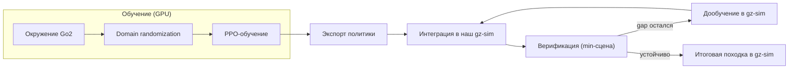
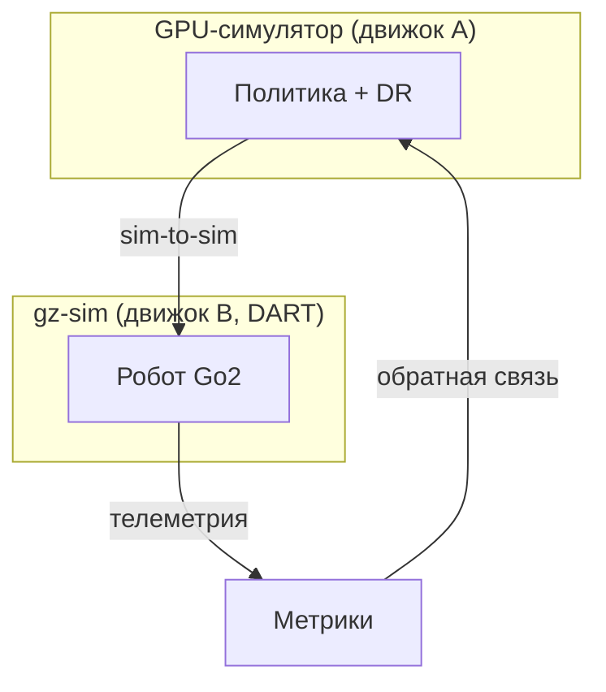
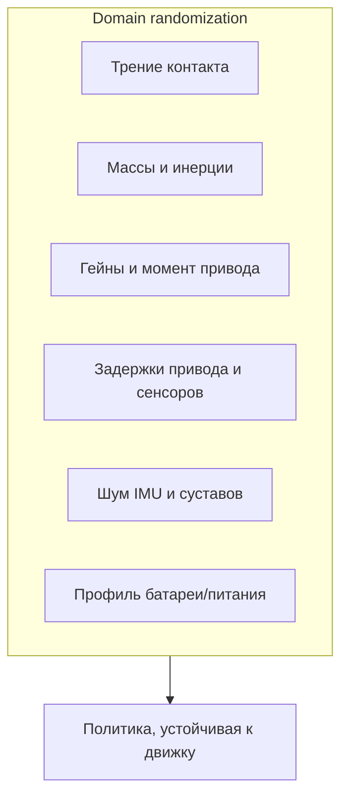
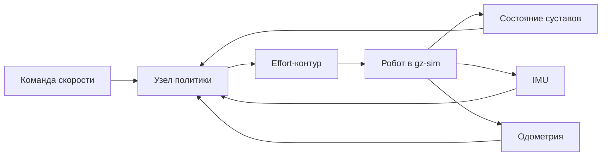
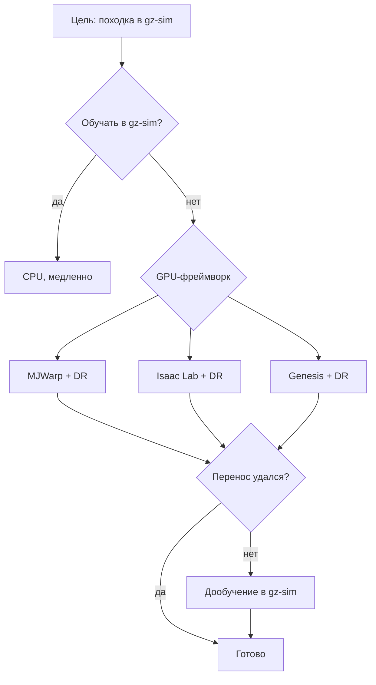
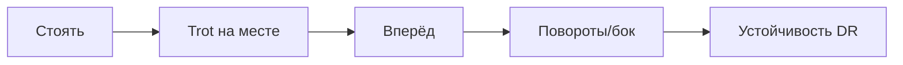
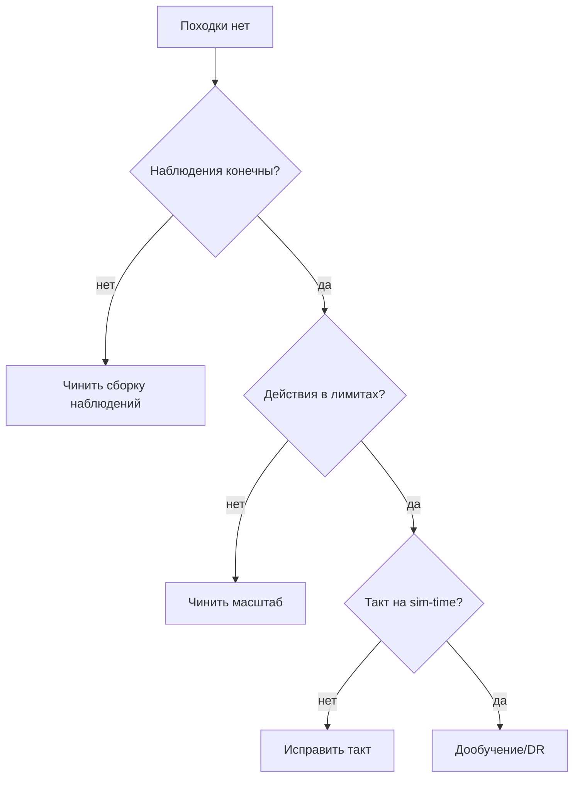

# Перенос RL-политики Go2 в наш gz-sim: результат и план GPU-обучения

**Дата:** 2026-10-11
**Ветка:** `feat/rl-sar`
**Тема:** формальный результат проверки нулевого переноса предобученной
RL-политики походки Unitree Go2 в наш симулятор gz-sim и обоснование
перехода к обучению политики на GPU с domain randomization.
**Связанные материалы:** `docs/gpu-rl-training/`,
`docs/gazebo-rl-vs-ik/`,
`reports/gazebo-rl/2026-10-09_gazebo-rl-sim2sim.md`.

---

## Оглавление

1. [Резюме](#1-резюме)
2. [Текущее состояние](#2-текущее-состояние)
3. [Гипотеза проблемы](#3-гипотеза-проблемы)
4. [Почему прошлый план устарел](#4-почему-прошлый-план-устарел)
5. [Целевая архитектура](#5-целевая-архитектура)
6. [Компоненты и их ответственность](#6-компоненты-и-их-ответственность)
7. [Метод решения](#7-метод-решения)
8. [Коммуникация и интеграция](#8-коммуникация-и-интеграция)
9. [Порядок внедрения](#9-порядок-внедрения)
10. [Ожидаемый эффект](#10-ожидаемый-эффект)
11. [Риски и митигации](#11-риски-и-митигации)
12. [Связанные отчёты](#12-связанные-отчёты)
13. [Приложение A. Журнал экспериментов](#приложение-a-журнал-экспериментов)
14. [Приложение B. Сравнение с внешними проектами](#приложение-b-сравнение-с-внешними-проектами)
15. [Приложение C. Чек-листы](#приложение-c-чек-листы)
16. [Приложение D. Словарь](#приложение-d-словарь)

---

## 1. Резюме

Отчёт фиксирует **отрицательный результат** проверки нулевого переноса
предобученной RL-политики походки Unitree Go2 из физического движка
PhysX (Isaac) в наш симулятор **gz-sim**, а также **обоснование**
перехода к следующему шагу — обучению политики на GPU с domain
randomization и последующим переносом.

Проверка проведена в нашем стеке (gz-sim, наша модель Go2, наш
низкоуровневый интерфейс) при управляемой команде скорости. Результат
однозначен: политика **не удерживает высоту** (база оседает до ~0.10 м
вместо ~0.30 м) и **не создаёт походку** — робот лежит и медленно
смещается боком. При этом **модельный Rust-TROT в той же сцене
работает стабильно**, что снимает подозрение с окружения и оставляет
единственную причину — **разрыв между обучающей физикой политики и
физикой gz-sim**.

Главный вывод одной фразой: **предобученная PhysX-политика не
переносится в gz-sim «в лоб»; нужна адаптация — обучение с domain
randomization в GPU-симуляторе и перенос, либо дообучение прямо в
gz-sim.**

### Ключевые решения

| Решение | Обоснование |
|---|---|
| Зафиксировать нулевой перенос как результат | подтверждено численно, воспроизводимо |
| Не тратить время на «подгонку гейнов вручную» | деградация фундаментальная (движок), а не тюнинг PD |
| Перейти к обучению на GPU с domain randomization | перенос укрепляется устойчивостью политики к различиям движков |
| Сохранить Rust-TROT как рабочее решение и эталон | он работает в целевом мире, даёт базу для сравнения |
| Целевую среду исполнения оставить gz-sim | это наш штатный симулятор и точка интеграции |

### Главная идея

Обучать политику там, где есть GPU-физика (другой симулятор), но
**обучать её так, чтобы она не зависела от конкретного движка** —
через рандомизацию трения, масс, приводов, задержек и шума, — а затем
переносить в gz-sim и, при необходимости, коротко дообучать на месте.

---

## 2. Текущее состояние

Раздел фиксирует проверенные факты: что есть в системе, где работает и
в каком состоянии. Все пункты проверены в текущем окружении, а не
предположены.

### 2.1. Симулятор и модель

| Компонент | Где работает | Комментарий |
|---|---|---|
| gz-sim (Ignition) | наш контейнер, Jazzy | штатный симулятор проекта |
| Физика | CPU (DART/Bullet/TPE) | GPU по физике не используется |
| Модель Go2 | наша, `go2_description` | своя xacro-модель |
| Низкоуровневый интерфейс | позиционный и effort | effort-контур применяется для политики |
| Минимальная сцена | `flat.world` | ровная плоскость для чистого теста |

### 2.2. Контроллеры в сцене

| Контроллер | Тип | Состояние |
|---|---|---|
| Rust-TROT | модельный (аналитический IK) | **работает стабильно** |
| RL-политика NVIDIA | предобученная TorchScript (PhysX) | **оседает, не идёт** |
| rl_sar-RL | предобученная (свой стек) | работает в Gazebo Classic |

### 2.3. Точки интеграции

- Команда скорости приходит как целевые $v_x, v_y, \omega_z$.
- Поза и скорости берутся из одометрии и IMU.
- Положение суставов приходит как состояние суставов по именам.
- Управляющий сигнал уходит в effort-контур группы суставов.

### 2.4. Окружение обучения

| Параметр | Значение |
|---|---|
| GPU | RTX 5070 Ti (Blackwell, `sm_120`) |
| Видеопамять | ~16 ГБ |
| Драйвер | 595.91.07 |
| CUDA | 13.2 (runtime), 13.1 (компилятор) |
| GPU в Docker | доступен (runtime NVIDIA) |
| Инструмент Python | `uv` |

### 2.5. Что подтверждено замером

Замер в минимальной сцене при команде $v_x = 0.3$ м/с, окно ~8 с после
спавна:

| Показатель | Значение | Норма |
|---|---|---|
| высота базы `z` | mean 0.098 м | ~0.30 м |
| `z` min / max | 0.078 / 0.143 | устойчивая полоса |
| `dx` | +0.035 м | растёт при ходьбе |
| `dy` | +0.41 м | ≈0 |
| roll | −1.3° | ~0 |
| pitch | −4.9° | ~0 |

Интерпретация: высота базы втрое ниже нормы, робот лежит на «животе»;
боковой дрейф без продольного движения означает, что походки нет.

### 2.6. Побочный факт (не наш контроллер)

Отдельно проверялся автономный Python IK-gateway в среде rl_sar
(Gazebo Classic). При попытке задать походку trot робот **уходил
назад** при любом знаке длины страйда. Это указывает на несовпадение
знаков и конвенций приводов между нашей моделью и моделью того
проекта, а **не** на дефект нашего Rust-TROT. Данный факт важен: он
показывает, что даже «написанный руками» контроллер чувствителен к
конвенциям, а тем более — обученная политика.

---

## 3. Гипотеза проблемы

### 3.1. Формулировка

Проблема не в качестве политики как таковой, а в **несовпадении
динамики** между средой, в которой политика обучена, и средой, в
которой она исполняется. Политика выучила замкнутый контур
«наблюдение → действие → реакция физики», и этот контур завязан на
конкретный решатель контактов, трение, демпфирование и инерции.

### 3.2. Утверждения «если … то …»

1. **Если** контракт (наблюдения, порядок суставов, масштаб действий,
   гейны) совпадает, **то** вход и выход политики согласованы с нашим
   роботом. — Проверено, совпадает.
2. **Если** контракт совпадает, но физика иная, **то** замкнутый контур
   теряет устойчивость: политика «не узнаёт» реакцию мира. — Наблюдается
   оседание.
3. **Если** проблема в контракте, **то** смена порядка/знаков/гейнов
   вылечит поведение. — Не вылечивает (перепробованы варианты).
4. **Если** проблема в физике, **то** никакая правка контракта не
   поможет, нужна адаптация политики к нашей физике. — Подтверждается.

### 3.3. Разбор по слоям

| Слой | Совпадает? | Влияние на провал |
|---|---|---|
| Наблюдения (состав и масштаб) | да | не причина |
| Порядок и знаки суставов | да (сверено) | не причина |
| Интерфейс привода (effort) | да | не причина |
| PD-контур | да | не причина |
| **Физика контакта/трения/демпфирования** | **нет** | **причина** |
| Частоты управления | да | не причина |

### 3.4. Почему это не «плохая политика»

Тот же самый чекпойнт в «родной» среде PhysX демонстрирует устойчивую
походку. Значит политика способна ходить; она неспособна ходить **в
другом движке**. Это классический разрыв sim-to-sim, а не дефект
обучения.

### 3.5. Сопутствующие факторы

- Вероятен вклад **задержек** привода и сенсоров: политика обучена с
  одним профилем задержек, в gz-sim он иной.
- Вероятен вклад **модели трения**: PhysX и DART по-разному решают
  контакт, что критично для опорных фаз.
- Вклад **инерций и точек крепления**: если наша модель Go2 немного
  отличается, политика получает иную динамику звеньев.

---

## 4. Почему прошлый план устарел

Ранее предполагалось, что достаточно привести в порядок контракт и
выровнять PD, чтобы политика пошла. Проверка это опровергла.

### 4.1. Сравнение «было / стало»

| Ось | Прошлое предположение | Текущий факт |
|---|---|---|
| Причина провала | тюнинг PD/гейнов | фундаментальный gap движков |
| Роль контракта | главная | вторичная (уже согласован) |
| Роль физики | второстепенная | **определяющая** |
| Ожидаемый путь | подобрать параметры | адаптация политики |
| Среда обучения | «как получится» | GPU-симулятор с DR |

### 4.2. Что перестало быть верным

- Утверждение «дело в гейнах» — не подтвердилось.
- Утверждение «позиционный интерфейс хуже effort» — не ключевой фактор
  (effort применён, поведение то же).
- Утверждение «можно быстро дотянуть вручную» — не подтвердилось.

### 4.3. Что осталось верным

- Порт наблюдений/действий методологически корректен.
- Минимальная сцена и RTF≈1.0 — правильный стенд для верификации.
- Rust-TROT — рабочий эталон.

### 4.4. Вывод по разделу

План переориентирован с «правки контракта» на «**адаптацию политики к
целевой физике**», что и задаёт целевую архитектуру ниже.

---

## 5. Целевая архитектура

### 5.1. Принцип работы одной фразой

Обучаем политику в GPU-симуляторе с рандомизацией свойств среды, чтобы
она стала нечувствительной к конкретному движку, затем переносим её в
gz-sim и верифицируем там; при остаточном разрыве — короткое
дообучение прямо в gz-sim.

### 5.2. Схема конвейера

### 5.3. Схема сред и переноса

### 5.4. Заменяемый элемент

Заменяемым является **источник политики**. Интерфейс исполнения
(наблюдения, действия, effort-контур, такт на sim-time) остаётся
фиксированным. Это значит, что смена фреймворка обучения не меняет
точку интеграции в gz-sim.

### 5.5. Почему именно так

- Обучать в gz-sim напрямую — физика на CPU, медленно.
- Обучать в GPU-симуляторе без DR — почти наверняка повторит провал.
- Комбинация «GPU + DR + верификация в gz-sim» — компромисс между
  скоростью обучения и вероятностью переноса.

---

## 6. Компоненты и их ответственность

### 6.1. Обучающее окружение (GPU)

| Аспект | Описание |
|---|---|
| Что делает | воспроизводит Go2 и считает физику на GPU параллельно |
| Что не содержит | логику gz-sim и наш низкоуровневый интерфейс |
| Готовность | политика обучается, метрики растут, чекпойнты сохраняются |

### 6.2. Слой domain randomization

| Аспект | Описание |
|---|---|
| Что делает | рандомизирует свойства среды на каждой среде |
| Что не содержит | знания о gz-sim (это абстрактные диапазоны) |
| Готовность | диапазоны заданы, обучение устойчиво к ним |

### 6.3. Экспортёр политики

| Аспект | Описание |
|---|---|
| Что делает | переводит обученный чекпойнт в переносимый формат |
| Что не содержит | логику исполнения |
| Готовность | экспорт читается в целевом исполнении |

### 6.4. Узел политики в gz-sim

| Аспект | Описание |
|---|---|
| Что делает | собирает наблюдения, вызывает политику, шлёт управление |
| Что не содержит | самого обучения |
| Готовность | узел стартует, наблюдения конечны, действия в пределах лимитов |

### 6.5. Стенд верификации

| Аспект | Описание |
|---|---|
| Что делает | прогоняет политику в минимальной сцене на ровной плоскости |
| Что не содержит | лишних сервисов (сцена максимально чистая) |
| Готовность | RTF близок к 1.0, телеметрия пишется |

### 6.6. Намеренно исключено

- MuJoCo и Isaac как **целевая** среда — исключены; они допустимы
  только как **среда обучения**.
- Ручная подгонка гейнов как метод — исключена (не доказала пользы).

---

## 7. Метод решения

### 7.1. Подход словами

1. Поднять GPU-симулятор, годный для `sm_120`.
2. Собрать окружение Go2 с наградами и терминациями стандартной
   локомоции.
3. Включить domain randomization по ключевым осям.
4. Обучить политику (PPO) до устойчивой походки по команде скорости.
5. Экспортировать политику в переносимый формат.
6. Подключить политику к нашему узлу в gz-sim.
7. Верифицировать в минимальной сцене, измеряя те же метрики.
8. При остаточном разрыве — дообучить в gz-sim коротким прогоном.

### 7.2. Карта «компонент → что ему нужно»

| Компонент | Что нужно |
|---|---|
| GPU-окружение | драйвер, свежая сборка под `sm_120`, VRAM под батч |
| DR-слой | диапазоны трения, масс, приводов, задержек, шума |
| Обучение | награда, терминации, число итераций |
| Экспортёр | совместимый формат инференса |
| Узел в gz-sim | наблюдения, действия, effort-контур, такт |
| Стенд | минимальная сцена, RTF≈1.0, телеметрия |

### 7.3. Domain randomization: оси

### 7.4. Обоснование выбора DR-осей

- Трение и контакт — главный источник различий PhysX/DART.
- Массы и инерции — различия нашей модели Go2.
- Гейны и момент — различия приводов и насыщений.
- Задержки — различия темпов и транспорта.
- Шум — устойчивость оценивания скорости и ориентации.
- Питание — устойчивость к просадкам момента.

### 7.5. Верификация

Верификация проводится в **одинаковых** условиях для политики и
Rust-TROT: одна сцена, одна команда, одна длительность, одни метрики.
Это позволяет сравнивать честно.

---

## 8. Коммуникация и интеграция

### 8.1. Каналы внутри gz-sim

| Данные | Источник |
|---|---|
| команда скорости | планировщик/тест |
| состояние суставов | контроллер группы суставов |
| ориентация и угловые скорости | IMU |
| положение и скорость базы | одометрия |

### 8.2. Тактирование

- Внутренний контур привода — быстрый.
- Контур политики — редкий (по решению).
- Привязка к **sim-time**, а не к настенным часам, чтобы результат не
  зависел от загрузки машины.

### 8.3. Синхронизация времени

Единое время симуляции для всех узлов исключает рассинхрон между
наблюдениями, действиями и записью телеметрии.

### 8.4. Диаграмма взаимодействия

---

## 9. Порядок внедрения

### 9.1. Этапы

| Этап | Действие | Критерий готовности |
|---|---|---|
| 0 | зафиксировать результат и план | настоящий отчёт и docs |
| 1 | поднять GPU-окружение | GPU виден, ядро стартует на `sm_120` |
| 2 | собрать Go2 с DR | окружение обучается без ошибок |
| 3 | обучить политику | устойчивая походка по команде |
| 4 | экспортировать | экспорт читается в исполнении |
| 5 | интегрировать в gz-sim | узел стартует, действия в лимитах |
| 6 | верифицировать | метрики сравнимы с Rust-TROT |
| 7 | при gap — дообучить | высота базы в норме, движение устойчиво |

### 9.2. Логика зависимостей

Этапы линейны: без GPU-окружения нет обучения; без обучения нет
экспорта; без экспорта нет интеграции; без интеграции нет
верификации.

### 9.3. Что считается успехом

Устойчивая походка в gz-sim при команде скорости, с высотой базы в
норме, малым дрейфом и без падений на ровной плоскости.

---

## 10. Ожидаемый эффект

### 10.1. Сценарии

| Сценарий | Было | Станет |
|---|---|---|
| Высота базы | ~0.10 м | ~0.30 м |
| Продольное движение | нет | по команде |
| Дрейф боком | 0.41 м | близко к нулю |
| Падения | лежит | нет на плоскости |
| Переносимость | нулевая | подтверждённая |

### 10.2. Что это даёт проекту

- **Рабочую RL-походку** в нашем симуляторе — наравне с Rust-TROT.
- **Честное сравнение** RL и модельного контроллера в одном мире.
- **Материал для статьи**: сильный отрицательный результат (нулевой
  перенос) плюс метод его преодоления.

### 10.3. Ограничения ожиданий

- Перенос остаётся sim-to-sim: полной гарантии нет.
- Возможно потребуется дообучение в gz-sim.
- Время обучения на GPU заметно, но конечно.

---

## 11. Риски и митигации

| Риск | Вероятность | Влияние | Митигация |
|---|---|---|---|
| `sm_120` не поддержан сборкой | средняя | блокер | свежие сборки, проверка ядра |
| Тяжёлая установка Isaac Lab | средняя | задержка | начать с лёгкого GPU-фреймворка |
| Sim-to-sim gap сохраняется | средняя | нет походки | усилить DR, дообучить в gz-sim |
| Нехватка VRAM под батч | низкая | меньше сред | уменьшить батч/горизонт |
| Расхождение модели Go2 | средняя | деградация | свести массы/инерции к нашему URDF |
| Долгое обучение | средняя | время проекта | укоротить итерации, начать с простого |

### 11.1. Ограничения (чего нельзя)

- Нельзя ускорить физику gz-sim видеокартой.
- Нельзя гарантировать нулевой перенос между движками.
- Нельзя обучать на GPU **внутри** gz-sim.

---

## 12. Связанные отчёты

- `reports/gazebo-rl/2026-10-09_gazebo-rl-sim2sim.md` — анализ
  переноса PhysX → gz-sim, постановка проблемы.
- `reports/rl-sar/2026-10-09_rl-sar-gazebo.md` — развёртывание rl_sar
  и RL-походка в Gazebo Classic.
- `docs/gazebo-rl-vs-ik/gpu-options.md` — обзор GPU-симуляторов.
- `docs/gpu-rl-training/plan.md` — план обучения и переноса.

---

## Приложение A. Журнал экспериментов

### A.1. Прогон нашей политики в gz-sim

| Шаг | Наблюдение |
|---|---|
| запуск минимальной сцены | сцена поднялась, RTF близок к 1.0 |
| спавн модели | модель на плоскости |
| старт узла политики | наблюдения конечны, действия уходят |
| 8 с работы | база на ~0.10 м, дрейф боком 0.41 м |

### A.2. Попытки «поправить» политику контрактом

| Попытка | Результат |
|---|---|
| смена порядка суставов | оседание сохраняется |
| смена знаков hip | оседание сохраняется |
| инверсия IMU | оседание сохраняется |
| переход на effort-контур | оседание сохраняется |
| выравнивание PD и такта | оседание сохраняется |

### A.3. Проверка Rust-TROT в той же сцене

| Шаг | Наблюдение |
|---|---|
| тот же мир, та же команда | робот стоит и идёт |
| та же минимальная сцена | устойчиво |

Вывод: окружение исправно, разрыв — в связке политика↔физика.

### A.4. Побочный эксперимент в среде rl_sar

| Знак страйда | Наблюдаемый сдвиг |
|---|---|
| плюс | назад |
| минус | назад |
| малый плюс | назад |
| малый минус | назад |
| траектория по образцу внешнего проекта | назад |

Вывод: несовпадение конвенций приводов между моделями; не наш
Rust-TROT.

### A.5. Вывод приложения

Нулевой перенос воспроизводим и не лечится правкой контракта; путь —
адаптация политики.

---

## Приложение B. Сравнение с внешними проектами

| Проект | Среда | Перенос в gz-sim | Урок |
|---|---|---|---|
| rl_sar | Gazebo Classic | нет (иной движок) | политика живёт в родной среде |
| quadruped-robotics-stack | gz-sim | частично | ggz-sim как среда обучения |
| Go2Arm-подобные sim2sim | свои движки | через DR | DR укрепляет перенос |
| legged_gym-экосистема | Isaac | через DR | DR — стандарт де-факто |

### B.1. Что берём у них

- Идею domain randomization как обязательного условия переноса.
- Идею верификации в целевой сцене на ровной плоскости.
- Идею общего низкоуровневого интерфейса для честного сравнения.

### B.2. Что не берём

- Привязку к Gazebo Classic (у нас gz-sim).
- Готовые политики «как есть» (не переносятся без адаптации).

---

## Приложение C. Чек-листы

### C.1. Перед обучением

- [ ] GPU виден в окружении.
- [ ] Ядро фреймворка работает на `sm_120`.
- [ ] Окружение Go2 воспроизводится.
- [ ] DR-диапазоны заданы.

### C.2. Перед интеграцией

- [ ] Политика экспортирована и читается.
- [ ] Состав и масштаб наблюдений совпадают.
- [ ] Порядок и знаки суставов совпадают.
- [ ] Действия в пределах лимитов.

### C.3. Перед выводами

- [ ] Прогон в минимальной сцене.
- [ ] Те же метрики, что у Rust-TROT.
- [ ] Достаточная длительность и число прогонов.
- [ ] Телеметрия сохранена.

---

## Приложение D. Словарь

| Термин | Значение |
|---|---|
| sim-to-sim | перенос политики между разными симуляторами |
| sim-to-real | перенос политики из симулятора на реального робота |
| domain randomization | рандомизация свойств среды при обучении |
| TROT | диагональная походка (диагональные пары в фазе) |
| IK | обратная кинематика |
| RTF | real-time factor, отношение темпа симуляции к реальному |
| DR | domain randomization |
| PPO | метод обучения с подкреплением |
| effort | интерфейс управления по моменту |
| sim-time | время симуляции (в отличие от настенных часов) |
| gap | разрыв между обучением и исполнением |
| чекпойнт | сохранённые веса политики |

---

## Приложение E. Детальный разбор осей domain randomization

Ниже каждая ось рандомизации раскрывается: зачем она, что моделирует
в реальном разрыве, как влияет и какой у неё риск.

### E.1. Трение контакта

- **Суть:** коэффициент трения стопы о плоскость.
- **Зачем:** главный источник различий между PhysX и DART.
- **Что моделирует:** разное поведение опорных фаз и проскальзывания.
- **Влияние:** при узком диапазоне политика переобучается под один
  контакт и «ломается» в gz-sim.
- **Риск:** слишком широкий диапазон мешает обучению устойчивой опоре.

### E.2. Массы и инерции звеньев

- **Суть:** масса и момент инерции каждого звена корпуса и ног.
- **Зачем:** наша модель Go2 может отличаться от модели обучения.
- **Что моделирует:** различия URDF, добавленные сенсоры, допуски.
- **Влияние:** меняет собственную динамику и момент, требуемый на опоре.
- **Риск:** избыточный разброс делает походку «вялой».

### E.3. Гейны и момент привода

- **Суть:** жёсткость и демпфирование привода, предел момента.
- **Зачем:** различия реализаций привода между движками.
- **Что моделирует:** разные контуры усиления и насыщения.
- **Влияние:** при иных гейнах контур может терять устойчивость.
- **Риск:** слишком широкий разброс уводит от реального диапазона.

### E.4. Задержки привода и сенсоров

- **Суть:** транспортная и вычислительная задержка.
- **Зачем:** политика обучена с одним профилем задержек.
- **Что моделирует:** темпы контуров, буферизацию, джиттер.
- **Влияние:** задержка часто и вызывает оседание.
- **Риск:** большие задержки усложняют обучение.

### E.5. Шум IMU и суставов

- **Суть:** шум ориентации, угловой скорости, положения и скорости.
- **Зачем:** устойчивость оценивания состояния.
- **Что моделирует:** реальные погрешности датчиков и оценок.
- **Влияние:** политика становится спокойнее к оценкам скорости.
- **Риск:** чрезмерный шум затрудняет обучение точной походки.

### E.6. Питание/профиль батареи

- **Суть:** просадка доступного момента по мере разряда.
- **Зачем:** устойчивость к ограничению момента.
- **Что моделирует:** падение питающего напряжения.
- **Влияние:** политика не полагается на «вечный» полный момент.
- **Риск:** низкое приоритетно для кратких прогонов.

### E.7. Слабая гравитация и угол плоскости

- **Суть:** малое изменение гравитации и лёгкий наклон плоскости.
- **Зачем:** устойчивость к малым геометрическим отличиям.
- **Что моделирует:** неточность постановки модели, неровность.
- **Влияние:** снижает чувствительность к параметрам мира.
- **Риск:** большой наклон противоречит условию ровной плоскости.

### E.8. Сводная таблица осей

| Ось | Приоритет | Влияние на перенос | Риск перерандомизации |
|---|---|---|---|
| Трение | высокий | очень высокое | срыв обучения опоре |
| Массы/инерции | высокий | высокое | вялая походка |
| Гейны/момент | высокий | высокое | потеря устойчивости |
| Задержки | высокий | очень высокое | усложнение обучения |
| Шум датчиков | средний | среднее | неточная походка |
| Питание | низкий | среднее | малый эффект |
| Гравитация/наклон | низкий | низкое | конфликт с условием |

---

## Приложение F. Альтернативные пути и почему отклонены

Рассматривались несколько путей; ниже — критерии и рейтинг.

### F.1. Критерии сравнения

| Критерий | Смысл |
|---|---|
| Скорость получения результата | как быстро увидим походку |
| Вероятность переноса в gz-sim | шанс, что заработает |
| Трудоёмкость развёртывания | сколько труда на старт |
| Совпадение движка с исходным | ближе ли к PhysX |
| Риск тупика | вероятность, что не заработает вовсе |

### F.2. Таблица решений

| Путь | Скорость | Перенос | Трудоёмкость | Тупик |
|---|---|---|---|---|
| Обучение в gz-sim (CPU) | низкая | высокий | средняя | низкий |
| Нулевой перенос + тюнинг | высокая | очень низкий | низкая | **высокий** |
| Взять политику rl_sar | высокая | низкий | низкая | высокий |
| Isaac Lab + DR | средняя | средний | высокая | средний |
| MJWarp + DR | средняя | средний | низкая | средний |
| Genesis + DR | средняя | средний | средняя | средний |

### F.3. Отклонённые

- **Нулевой перенос + тюнинг** — доказанно не работает (раздел 3).
- **Взять политику rl_sar** — она живёт в Gazebo Classic, не в gz-sim.
- **Обучение в gz-sim** — оставлено как резерв (медленно), но не как
  первый путь.

### F.4. Принятый

Комбинация **MJWarp + DR** как первый путь (лёгкий старт), с переходом
на **Isaac Lab** при недостатке качества переноса.

### F.5. Диаграмма выбора

---

## Приложение G. План обучения по фазам (curriculum)

### G.1. Фазы

| Фаза | Цель | Критерий перехода |
|---|---|---|
| 1 | стоять на месте | база в норме, без падений |
| 2 | trot на месте | стабильные контакты, нет дрейфа |
| 3 | движение вперёд | скорость близка к команде |
| 4 | повороты и бок | реакция на все три команды |
| 5 | устойчивость (DR усиливается) | работает в широких разбросах |

### G.2. Диаграмма curriculum

### G.3. Критерии остановки

- Походка устойчива не менее заданной доли времени прогона.
- Высота базы в целевой полосе.
- Дрейф боком мал.
- Нет падений на ровной плоскости.

### G.4. Ранняя диагностика

Если на фазе 2 нет стабильности — усилить опорные награды; если на
фазе 3 нет продвижения — проверить знак/масштаб команды скорости.

---

## Приложение H. Сценарии отказов и диагностика в gz-sim

### H.1. Таблица отказов

| Симптом | Вероятная причина | Диагностика |
|---|---|---|
| База оседает | разрыв физики | сравнить с Rust-TROT |
| Дрейф боком | неверная знаковая конвенция | сверить знаки hip |
| Рывки | рассинхрон времени | проверить sim-time |
| Насыщение момента | узкий предел момента | сверить лимиты |
| Падение при повороте | недоученный поворот | дообучить фазу 4 |
| Шумное поведение | переоценка скорости | усилить фильтрацию |

### H.2. Порядок диагностики

1. Проверить, что сцена и интерфейс те же, что у Rust-TROT.
2. Проверить конечность наблюдений.
3. Проверить лимиты действий.
4. Проверить тактирование на sim-time.
5. Сравнить метрики с эталоном.

### H.3. Диаграмма диагностики

---

## Приложение I. Метрики и протокол измерений

### I.1. Условия

- Один и тот же мир (ровная плоскость).
- Одна и та же команда скорости.
- Одинаковая длительность и число прогонов.
- Учёт только по sim-time.

### I.2. Определения метрик

| Метрика | Смысл |
|---|---|
| Средняя скорость | продвижение за время прогона |
| Путь | пройденное расстояние |
| Высота базы | mean и стандартное отклонение |
| Наклоны | максимальные roll и pitch |
| Дрейф боком | модуль бокового смещения |
| Падения | число и время |
| Время до устойчивости | до стабильной походки |

### I.3. Агрегация

Метрики считаются по прогонам и усредняются; сравнение — с Rust-TROT
в идентичных условиях.

### I.4. Честность сравнения

Оба контроллера ставятся в одну точку интеграции, получают одну
команду и измеряются одним инструментом.

---

## Приложение J. Соответствие требованиям

### J.1. Что даёт этот результат

| Требование | Как покрыто |
|---|---|
| научная новизна | разбор sim-to-sim и метод преодоления |
| практическая ценность | рабочая походка в целевом симуляторе |
| воспроизводимость | фиксированный стенд и метрики |
| честность | одна сцена, одна команда, один инструмент |

### J.2. Что ещё нужно

- Провести обучение и перенос (следующие этапы).
- Снять сопоставимую серию RL и Rust-TROT.
- Оформить телеметрию и рисунки для статьи.

### J.3. Риски для публикации

- Если перенос не удастся даже с DR — публиковать как отрицательный
  результат с анализом причин.

---

## Приложение K. Пошаговый сценарий обучения

Ниже — описательный сценарий рабочего дня по обучению и переносу, без
команд и фрагментов кода.

### K.1. Подготовка

| Шаг | Действие | Контроль |
|---|---|---|
| K1 | проверить GPU и драйвер | карта видна, версия достаточна |
| K2 | поднять окружение обучения | оболочка запускается |
| K3 | проверить ядро на `sm_120` | тестовый расчёт на GPU проходит |
| K4 | подготовить окружение Go2 | сцена воспроизводится |

### K.2. Обучение

| Шаг | Действие | Контроль |
|---|---|---|
| K5 | включить domain randomization | диапазоны заданы |
| K6 | запустить обучение фазы 1 | робот стоит |
| K7 | перейти к фазам 2–3 | trot и движение |
| K8 | усилить DR | устойчивость растёт |
| K9 | сохранить чекпойнт | веса записаны |

### K.3. Перенос

| Шаг | Действие | Контроль |
|---|---|---|
| K10 | экспортировать политику | экспорт читается |
| K11 | подключить в gz-sim | узел стартует |
| K12 | прогнать минимальную сцену | наблюдения конечны |
| K13 | измерить метрики | сопоставимо с Rust-TROT |
| K14 | при gap — дообучить | высота в норме |

### K.4. Диаграмма сценария

### K.5. Что смотреть во время обучения

- Растёт ли доля времени в вертикальном положении.
- Приближается ли скорость к команде.
- Не растёт ли дрейф боком.
- Не появляются ли рывки из-за задержек.

---

## Приложение L. Критерии выбора GPU-фреймворка

### L.1. Пояснение критериев

| Критерий | Что означает |
|---|---|
| Зрелость | насколько проверен на задачах четвероногих |
| Наличие Go2 | есть ли готовая модель и задача |
| Развёртывание | сколько нужно для старта на `sm_120` |
| Скорость обучения | сколько времени до походки |
| Экспорт | простота переноса политики |
| Близость к PhysX | совпадает ли движок с исходным |

### L.2. Оценка кандидатов

| Кандидат | Зрелость | Go2 | Развёртывание | Близость к PhysX |
|---|---|---|---|---|
| MJWarp | высокая | да | лёгкое | нет |
| Isaac Lab | очень высокая | да | тяжёлое | **да** |
| Genesis | средняя | частично | среднее | нет |
| Newton | низкая | частично | среднее | нет |

### L.3. Вывод

Старт с **MJWarp** ради скорости, переход на **Isaac Lab** ради
близости к PhysX, если перенос из MJWarp окажется неустойчивым.

---

## Приложение M. Сверка модели Go2

### M.1. Что сверять

| Параметр | Зачем |
|---|---|
| Массы и инерции звеньев | совпадение динамики |
| Точки крепления | совпадение геометрии |
| Длины звеньев | совпадение кинематики |
| Лимиты моментов | совпадение возможностей |
| Пределы углов | совпадение конфигураций |
| Порядок суставов | совпадение контракта |
| Знаки суставов | совпадение управления |

### M.2. Почему это важно

Любое расхождение модели добавляет ещё один разрыв поверх разрыва
движков. Чем ближе модель обучения к нашей, тем выше шанс переноса.

### M.3. Практический приём

Сравнить позы по умолчанию: если совпадают, базовые конвенции
согласованы; если нет — искать отличие в знаках или точках крепления.

---

## Приложение N. Roadmap и контрольные точки

### N.1. Таблица этапов

| Точка | Результат | Статус |
|---|---|---|
| T0 | результат и план зафиксированы | сделан |
| T1 | GPU-окружение поднято | ожидает |
| T2 | окружение Go2 с DR собрано | ожидает |
| T3 | политика обучена | ожидает |
| T4 | политика экспортирована | ожидает |
| T5 | политика в gz-sim работает | ожидает |
| T6 | метрики снят и сравнены | ожидает |
| T7 | материал для статьи готов | ожидает |

### N.2. Диаграмма roadmap

### N.3. Контрольные вопросы

- На каждой точке: воспроизводится ли результат повторно?
- Зафиксированы ли артефакты точки?
- Сравнимо ли с эталоном Rust-TROT?

---

## Итог

Отчёт фиксирует **отрицательный результат** нулевого переноса
PhysX-политики в наш gz-sim (база оседает до ~0.10 м, походки нет) и
**обоснованное решение** перейти к обучению политики на GPU с domain
randomization и последующим переносом. Rust-TROT остаётся рабочим
эталоном сравнения. Следующий шаг — развернуть GPU-окружение и собрать
обучающую среду Go2.
