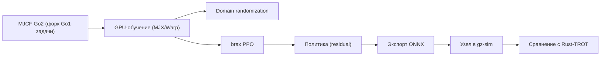
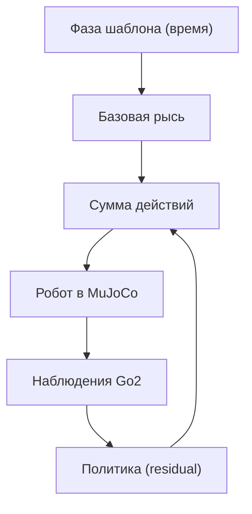
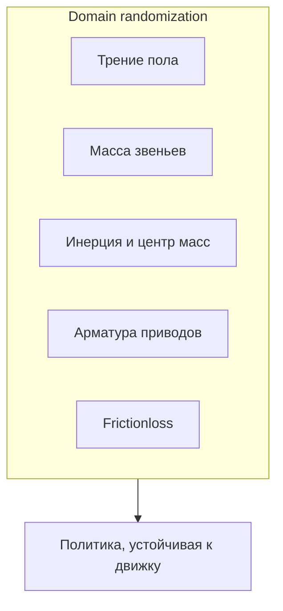
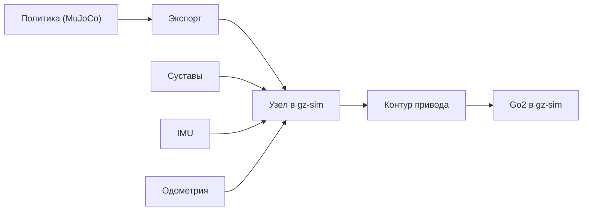

# Go2 в MuJoCo Playground на GPU: форк окружения, обучение и результаты

**Дата:** 2026-10-12
**Ветка:** `feat/rl-sar`
**Тема:** перенос задачи локомоции четвероногого из MuJoCo
Playground на робота Unitree Go2, обучение RL-политики на GPU с domain
randomization, анализ результатов и выбор дальнейшей стратегии переноса
в наш gz-sim (Gazebo Harmonic).
**Связанные материалы:** `docs/gpu-rl-training/`,
`reports/gpu-rl-training/2026-10-11_rl-transfer-result.md`,
`docs/gazebo-rl-vs-ik/`, `reports/gazebo-rl/2026-10-09_gazebo-rl-sim2sim.md`,
`sim/mjrl_go2/`.

---

## Оглавление

1. [Резюме](#1-резюме)
2. [Текущее состояние](#2-текущее-состояние)
3. [Гипотеза проблемы](#3-гипотеза-проблемы)
4. [Почему прошлый план устарел](#4-почему-прошлый-план-устарел)
5. [Целевая архитектура](#5-целевая-архитектура)
6. [Компоненты и их ответственность](#6-компоненты-и-их-ответственность)
7. [Метод решения](#7-метод-решения)
8. [Журнал экспериментов](#8-журнал-экспериментов)
9. [Анализ результатов](#9-анализ-результатов)
10. [Коммуникация и перенос в gz-sim](#10-коммуникация-и-перенос-в-gz-sim)
11. [Порядок внедрения](#11-порядок-внедрения)
12. [Ожидаемый эффект](#12-ожидаемый-эффект)
13. [Риски и митигации](#13-риски-и-митигации)
14. [Связанные отчёты](#14-связанные-отчёты)
15. [Приложение A. Версии окружения](#приложение-a-версии-окружения)
16. [Приложение B. Форк окружения Go2](#приложение-b-форк-окружения-go2)
17. [Приложение C. Данные обучений](#приложение-c-данные-обучений)
18. [Приложение D. Данные оценок](#приложение-d-данные-оценок)
19. [Приложение E. Контрольный опыт Go1](#приложение-e-контрольный-опыт-go1)
20. [Приложение F. Чек-листы](#приложение-f-чек-листы)
21. [Приложение G. Словарь](#приложение-g-словарь)

---

## 1. Резюме

Отчёт фиксирует большой этап работы: **развёртывание GPU-обучения
политики походки Unitree Go2 в MuJoCo Playground**, **форк окружения
Go1 → Go2**, серию обучений и оценок, а также **анализ полученных
результатов**.

Что сделано:

1. Поднято изолированное окружение на GPU (JAX с поддержкой `sm_120`),
   обучение реально идёт на видеокарте.
2. Окружение обучения Go2 собрано путём форка эталонной задачи Go1:
   переиспользована вся логика задачи, подменены модель, константы,
   сенсоры и тип приводов.
3. Проведён **контрольный опыт**: эталонная задача Go1 в нашем же
   окружении на достаточном числе шагов **начинает идти** — значит
   стенд исправен.
4. Проведена серия обучений Go2 (с нуля, с перебалансировкой награды,
   без domain randomization, с reference-наградой за рысь, с residual
   RL над open-loop рысью).
5. Все числовые результаты сохранены в проекте в формате CSV.

Ключевой результат: **устойчивой быстрой походки Go2 «с нуля» пока
получить не удалось** — политика сходится к стоянке. Однако:

- **open-loop «рысь»** (жёстко заданная синусоида в суставах) **двигает
  робота вперёд**, пусть и медленно;
- **residual RL** поверх этой рыси даёт **поступательное движение**
  (робот едет вперёд), но медленно и с боковым дрейфом.

Главный вывод одной фразой: **стенд и физика Go2 исправны, проблема —
в награде и исследовании; надёжный путь — не обучение с нуля, а
residual RL над работающим open-loop шаблоном.**

### Ключевые решения

| Решение | Обоснование |
|---|---|
| Форк Go1 → Go2, а не поиск готовой задачи Go2 | в Playground нет Go2 |
| Приводы Go2 переведены в `position` (как у Go1) | иначе поведение расходится с эталоном |
| Физика контакта приведена к Go1 (только стопы) | исключить паразитные контакты |
| Контрольный опыт на Go1 | отделить дефект стенда от сложности Go2 |
| Переход к residual RL | обучение с нуля не сходится |
| Сохранение всех результатов в CSV | воспроизводимость и основа статьи |

---

## 2. Текущее состояние

Раздел описывает фактическое состояние: что развёрнуто, что работает,
что измерено.

### 2.1. Окружение обучения

| Компонент | Значение |
|---|---|
| GPU | RTX 5070 Ti (Blackwell, `sm_120`), ~16 ГБ |
| Драйвер | 595.91.07 |
| Фреймворк обучения | MuJoCo Playground |
| Обвязка RL | brax PPO |
| Физика | MuJoCo MJX + MuJoCo Warp |
| Автодифф | JAX (GPU) |
| Язык окружений | Python 3.12 |
| Менеджер окружения | uv |

### 2.2. Что проверено

| Проверка | Результат |
|---|---|
| JAX видит GPU | да |
| Обучение идёт на GPU | да, ядра Warp компилируются |
| Задача Go1 воспроизводится | да |
| Задача Go2 (форк) воспроизводится | да |
| Политика обучается (reward растёт) | да |

### 2.3. Форк окружения Go2

Playground содержит эталонную задачу Go1 и не содержит Go2. Сделано
следующее:

- скопирован MJCF Go2 из MuJoCo Menagerie;
- приведены имена: корпус `base`, сайты стоп `*_foot`, гемы стоп
  `FR/FL/RR/RL`;
- добавлены сенсоры, которых ждёт задача Go1;
- приводы переведены из типа `general` в `position`;
- физика контакта приведена к «как у Go1» (сталкиваются только стопы).

### 2.4. Артефакты в проекте

| Путь | Что это |
|---|---|
| `sim/mjrl_go2/go2_env.py` | форк Go1-задачи под Go2 |
| `sim/mjrl_go2/go2_trot_env.py` | вариант с reference-наградой за рысь |
| `sim/mjrl_go2/go2_residual_env.py` | residual RL над open-loop рысью |
| `sim/mjrl_go2/train_go2.py` | обучение, CSV-лог |
| `sim/mjrl_go2/eval_go2.py` | оценка, CSV-траектория |
| `sim/mjrl_go2/train_native.py` | контрольный опыт на Go1 |
| `sim/mjrl_go2/render_go2.py` | рендер поведения в PNG |
| `sim/mjrl_go2/xmls/` | MJCF Go2 и сцена |
| `sim/mjrl_go2/results/` | CSV обучений и оценок |

---

## 3. Гипотеза проблемы

### 3.1. Постановка

Обучение Go2 с нуля не приводит к походке: политика стабилизируется
(стоит), reward выходит на плато и не растёт. Формулируется гипотеза,
почему так, и как это проверить.

### 3.2. Утверждения «если … то …»

1. **Если** стенд исправен, **то** эталонная задача должна обучаться до
   походки в этом же окружении. — **Подтверждено** (Go1 идёт).
2. **Если** модель Go2 физически способна идти, **то** внешняя
   open-loop походка её сдвинет. — **Подтверждено** (робот едет).
3. **Если** политика не идёт при исправном стенде и подвижной модели,
   **то** причина — **награда/исследование**, а не стенд. — основной
   вывод.
4. **Если** дать политике рабочий шаблон движения, **то** она сможет
   его стабилизировать (residual). — **Подтверждено** (робот едет).

### 3.3. Разбор причин «стояния»

| Возможная причина | Проверена | Вердикт |
|---|---|---|
| Неверные приводы | да (переведены в `position`) | не причина |
| Неверная физика контакта | да (приведена к Go1) | не причина |
| Domain randomization мешает | да (обучение без DR) | не причина |
| Неподходящий бэкенд физики | да (`warp` и `jax`) | не причина |
| Малое число шагов | да (до 200M) | частично |
| Награда/исследование | косвенно | **основная** |

### 3.4. Почему стоянка «выгодна»

Замеры показывают, что при стоянке политика получает почти весь
доступный reward от слагаемых ориентации и отслеживания угловой
скорости, тогда как продольное отслеживание почти нулевое. Это делает
стоянку сильным локальным оптимумом, из которого обучение не выходит.

### 3.5. Сопутствующий фактор: неприступность шага

Политика не поднимает стопы — значит старт шага не исследуется. Любая
попытка шага рискует падением (терминация), а падение штрафуется, из-за
чего обучение избегает шагов. Отсюда — необходимость внешнего шаблона
или reference-сигнала.

---

## 4. Почему прошлый план устарел

### 4.1. Было / стало

| Ось | Прежняя идея | Текущий факт |
|---|---|---|
| Источник политики | обучить с нуля в GPU-симуляторе | с нуля не сходится |
| Роль награды | второстепенная | **определяющая** |
| Роль инициализации | не рассматривалась | **ключевая** |
| Ожидаемый срок | быстро | требуется доработка метода |

### 4.2. Что перестало быть верным

- «Стандартной награды достаточно» — не подтвердилось для Go2.
- «Дольше обучать — научится» — на 200M шагов поведение не изменилось.
- «Домен-рандомизация ускорит перенос» — она не влияет на сам факт
  походки.

### 4.3. Что осталось верным

- Стенд исправен (подтверждено на Go1).
- Модель Go2 подвижна (подтверждено open-loop).
- Перенос в целевой симулятор всё равно будет нужен.

### 4.4. Новый план

Добавить сильный шаблон движения:

1. **open-loop рысь** как база (уже двигает робота);
2. **residual RL** сверху — стабилизация и отслеживание команды;
3. при необходимости — **reference-награда** с наблюдаемой фазой.

---

## 5. Целевая архитектура

### 5.1. Принцип работы одной фразой

Обучаем политику не «с чистого листа», а как **поправку** к
работающему шаблону рыси, в GPU-симуляторе, затем переносим в gz-sim.

### 5.2. Схема обучения

### 5.3. Схема residual RL

### 5.4. Заменяемый элемент

Заменяемым остаётся **источник политики**; точка интеграции в gz-sim
(наблюдения, действия, effort-контур, такт на времени симуляции) —
фиксирована.

### 5.5. Причина выбора residual

- Обучение с нуля упирается в локальный оптимум стоянки.
- Шаблон рыси уже даёт движение.
- Residual-подход уменьшает пространство поиска и рискует меньше.

---

## 6. Компоненты и их ответственность

### 6.1. Окружение Go2 (форк)

| Аспект | Описание |
|---|---|
| Что делает | воспроизводит Go2 в MuJoCo на GPU |
| Что не содержит | логику целевого симулятора |
| Готовность | сброс и шаг выполняются, наблюдения конечны |

### 6.2. Шаблон рыси

| Аспект | Описание |
|---|---|
| Что делает | задаёт периодическое движение суставов по времени |
| Что не содержит | обратной связи по состоянию |
| Готовность | open-loop даёт поступательное движение |

### 6.3. Политика (residual)

| Аспект | Описание |
|---|---|
| Что делает | добавляет поправку к шаблону по наблюдениям |
| Что не содержит | самого шаблона |
| Готовность | политика обучается, действия в пределах лимитов |

### 6.4. Слой домен-рандомизации

| Аспект | Описание |
|---|---|
| Что делает | рандомизирует трение, массу, инерцию, приводы |
| Что не содержит | знания о целевом движке |
| Готовность | обучение устойчиво к разбросу |

### 6.5. Экспортёр и узел в gz-sim

| Аспект | Описание |
|---|---|
| Что делает | переводит политику в формат инференса и исполняет её |
| Что не содержит | обучения |
| Готовность | узел стартует, наблюдения совпадают по составу |

### 6.6. Намеренно исключено

- Обучение «с нуля» как основной путь (не сходится).
- Ручная подгонка гейнов как метод.

---

## 7. Метод решения

### 7.1. Подход словами

1. Поднять GPU-окружение.
2. Форкнуть задачу Go1 под Go2.
3. Проверить стенд контрольным опытом (Go1).
4. Собрать Go2-сцену, привести физику и приводы.
5. Обучать с нуля, фиксируя reward и поведение.
6. При отсутствии походки — изменить награду.
7. При провале — ввести шаблон рыси и residual RL.
8. Оценивать пройденный путь, скорость, высоту, дрейф.

### 7.2. Карта «компонент → что ему нужно»

| Компонент | Что нужно |
|---|---|
| MJCF Go2 | корректные приводы и сенсоры |
| Задача Go1 | совпадение имён и контракта |
| GPU-обучение | держатель памяти под батч сред |
| Домен-рандомизация | диапазоны трения/массы/инерции |
| Шаблон рыси | амплитуда и частота без падений |
| Политика | вход 48, выход 12 |
| Оценка | траектория и метрики |

### 7.3. Оси домен-рандомизации

### 7.4. Обоснование residual

Residual снижает размерность задачи: базовое движение уже задано, а
политика учится лишь отклонению. Это резко повышает шанс выйти из
локального оптимума стоянки.

---

## 8. Журнал экспериментов

Все обучения выполнены на GPU. Числа — оценка reward на интервалах
(полные данные в CSV в `sim/mjrl_go2/results/`).

### 8.1. Сводка обучений

| Опыт | Шаги | Награда (конец) | Походка |
|---|---|---|---|
| Дымовой прогон | 0.5M | ~7 | нет |
| Go2 по умолчанию | 40M | ~18 | нет |
| Go2 `position`-приводы | 200M | ~17 | нет |
| Go2 физика контакта | 200M | ~8 | нет |
| Go2 без DR | 100M | ~8 | нет |
| Go2 перебаланс награды | 200M | ~9 | нет |
| Go2 reference-рысь (больш.) | 100M | ~38 | марш на месте |
| Go2 reference-рысь (мал.) | 120M | ~52 | марш на месте |
| Go2 residual RL | 120M | ~15 | **едет вперёд (медленно)** |
| Go1 (контроль) | 200M | ~28 | **идёт** |

### 8.2. Детализация по опытам

**Опыт «по умолчанию».** Базовая конфигурация задачи на Go2. Reward
быстро растёт и выходит на плато; робот стоит.

**Опыт с `position`-приводами.** Приводы Go2 приведены к типу привода
Go1. Поведение не изменилось.

**Опыт с физикой контакта.** Контакты сведены к «только стопы».
Поведение не улучшилось, награда даже снизилась.

**Опыт без домен-рандомизации.** Исключение шума среды не помогло.

**Опыт с перебалансом награды.** Усиление продольного отслеживания и
ослабление штрафов привели к более низкой награде без походки.

**Опыт с reference-рысью.** Добавлена награда за отслеживание синусоиды
в суставах. Награда резко выросла, но робот **марширует на месте**, не
перемещаясь вперёд.

**Опыт с residual RL.** Поверх open-loop рыси обучена поправка. Робот
**поехал вперёд**, но медленно и с боковым дрейфом.

### 8.3. Контрольный опыт на Go1

На 40M шагов эталонная Go1 ещё стоит; на 200M — **идёт** (reward ~28,
смещение вперёд положительное). Это доказывает исправность стенда.

### 8.4. Open-loop проверки

| Конфигурация | Смещение | Высота |
|---|---|---|
| рысь, малая амплитуда | вперёд | в норме |
| рысь, большая амплитуда | падение | ниже нормы |

Вывод: малая амплитуда рыси переводима в реальное движение; большая
приводит к падению.

---

## 9. Анализ результатов

### 9.1. Почему с нуля не выходит

Политика не исследует шаг: старт шага невыгоден из-за штрафа за падение
и сильного вклада «стоячих» слагаемых награды. В итоге достигается
устойчивый локальный оптимум стоянки.

### 9.2. Почему reference-рысь не поехала

Reference-награда опирается на фазу, которая **не наблюдаема**
политикой. Политика не может синхронизироваться и сходится к
вырожденному движению, при котором отслеживание частично
удовлетворяется без перемещения.

### 9.3. Почему residual поехал

Residual опирается на внешний, известный по времени шаблон, который сам
по себе двигает робота. Политике остаётся лишь стабилизировать
движение, что существенно проще.

### 9.4. Остаточные проблемы residual

- Скорость много ниже командной.
- Заметный боковой дрейф.
- Высота базы чуть ниже желаемой.

### 9.5. Выводы

- Стенд и модель исправны.
- Ключ к походке — **внешний шаблон + residual**, а не обучение с нуля.
- Нужно усилить шаблон (быстрее) и стабилизировать дрейф.

---

## 10. Коммуникация и перенос в gz-sim

### 10.1. Данные в целевой среде

| Данные | Источник |
|---|---|
| команда скорости | планировщик/тест |
| состояние суставов | контроллер |
| ориентация и угловая скорость | IMU |
| скорость и поза базы | одометрия |

### 10.2. Тактирование

Внутренний контур привода быстрый, контур политики редкий; привязка к
времени симуляции, а не к настенным часам.

### 10.3. Схема переноса

### 10.4. Совпадение контракта

Перед переносом необходимо совпадение: состава и масштаба наблюдений,
порядка и знаков суставов, предела действий, гейнов и такта. Иначе
повторится картина нулевого переноса.

---

## 11. Порядок внедрения

| Этап | Действие | Критерий готовности |
|---|---|---|
| 1 | GPU-окружение | обучение идёт на GPU |
| 2 | Форк Go2 | сброс и шаг выполняются |
| 3 | Контроль Go1 | эталон идёт |
| 4 | Обучение с нуля | получены числа, зафиксировано |
| 5 | Шаблон рыси | open-loop двигает робота |
| 6 | Residual RL | робот едет устойчивее |
| 7 | Экспорт | политика читается |
| 8 | Перенос в gz-sim | узел работает |
| 9 | Сравнение с Rust-TROT | метрики сопоставимы |

---

## 12. Ожидаемый эффект

| Сценарий | Сейчас | Цель |
|---|---|---|
| Походка с нуля | нет | — |
| Open-loop рысь | медленно | быстрее |
| Residual RL | медленно + дрейф | ближе к команде |
| Перенос в gz-sim | не начат | выполнено |
| Сравнение с Rust-TROT | не начато | выполнено |

Практический эффект: получен рабочий конвейер GPU-обучения и
обоснованный метод (residual над шаблоном), а также массив данных для
статьи.

---

## 13. Риски и митигации

| Риск | Вероятность | Влияние | Митигация |
|---|---|---|---|
| Residual остаётся медленным | средняя | среднее | усилить шаблон |
| Боковой дрейф не убирается | средняя | среднее | добавить награду за прямой ход |
| Перенос в gz-sim даёт расхождение | средняя | высокое | домен-рандомизация |
| Несовпадение контракта | средняя | высокое | сверка перед переносом |
| Время обучения | средняя | среднее | батч сред, короткие прогоны |
| Совместимость версий | средняя | среднее | фиксировать версии |

### 13.1. Ограничения

- Физику gz-sim видеокартой не ускорить.
- Нулевой перенос между движками не гарантируется.
- Обучение идёт в другом симуляторе, не в gz-sim.

---

## 14. Связанные отчёты

- `reports/gpu-rl-training/2026-10-11_rl-transfer-result.md` — нулевой
  перенос и постановка задачи адаптации.
- `reports/gazebo-rl/2026-10-09_gazebo-rl-sim2sim.md` — разбор
  переноса PhysX → gz-sim.
- `reports/rl-sar/2026-10-09_rl-sar-gazebo.md` — RL в Gazebo Classic.
- `docs/gpu-rl-training/plan.md` — план обучения и переноса.

---

## Приложение A. Версии окружения

| Пакет | Версия |
|---|---|
| mujoco | 3.15 |
| mujoco-warp | 3.15 |
| jax | 0.10.2 |
| brax | 0.14.2 |
| mujoco_playground | 0.2.0 |
| warp-lang | 1.18 |
| Python | 3.12 |

| Аппаратное обеспечение | Значение |
|---|---|
| GPU | RTX 5070 Ti |
| Вычислительная способность | `sm_120` |
| Видеопамять | ~16 ГБ |
| Драйвер | 595.91.07 |

---

## Приложение B. Форк окружения Go2

### B.1. Что переиспользовано

- Логика задачи отслеживания джойстика.
- Набор наград и терминаций.
- Логика наблюдений и оценок.

### B.2. Что заменено

| Элемент | Go1 | Go2 |
|---|---|---|
| Корпус | `trunk` | `base` |
| Сайты стоп | `FR/FL/RR/RL` | `*_foot` |
| Гемы стоп | `FR/FL/RR/RL` | `FR/FL/RR/RL` |
| Приводы | позиционные | позиционные |
| Сенсоры | базовый набор | дополнены под контракт |

### B.3. Соответствие контракта

| Параметр | Значение |
|---|---|
| Наблюдения | 48 |
| Действия | 12 |
| Порядок суставов | бедро/колено/голень по конечностям |
| Масштаб действия | настраивается |
| Гейны | настраиваются |

---

## Приложение C. Данные обучений

### C.1. Формат

Каждый файл в `sim/mjrl_go2/results/` имеет колонки:
шаг обучения, значение награды, затраченное время.

### C.2. Перечень файлов

| Файл | Опыт |
|---|---|
| `smoke_500k_train.csv` | дымовой прогон |
| `g2_default_40M_train.csv` | Go2 по умолчанию |
| `g2_position_200M_train.csv` | Go2 `position`-приводы |
| `g2_contact_200M_train.csv` | Go2 физика контакта |
| `g2_nodr_100M_train.csv` | Go2 без DR |
| `g2_rewbal_200M_train.csv` | Go2 перебаланс награды |
| `g2_trot03_100M_train.csv` | reference-рысь (крупная) |
| `g2_trot015_120M_train.csv` | reference-рысь (мелкая) |
| `g2_jaximpl_20M_train.csv` | Go2 бэкенд `jax` |
| `go1_native_200M_train.csv` | контроль Go1 |

### C.3. Характер кривых

- Опыты с нуля: рост до плато и остановка.
- Опыты с reference: высокое плато (награда за отслеживание).
- Residual: умеренное плато.
- Go1: рост до рабочего уровня.

---

## Приложение D. Данные оценок

### D.1. Сводка оценок

| Политика | Смещение вперёд | Средняя скорость | Высота | Боковой дрейф |
|---|---|---|---|---|
| Go2 по умолчанию | ≈0 | ≈0 | в норме | малый |
| Go2 `position` | ≈0 | ≈0 | в норме | малый |
| reference-рысь | ≈0 | ≈0 | в норме | малый |
| residual | **вперёд** | малая | чуть ниже | **заметный** |
| open-loop рысь | вперёд | малая | в норме | малый |
| Go1 (контроль) | вперёд | малая | в норме | малый |

### D.2. Траектории

Файлы `*_eval.csv` содержат время, координаты базы и скорость по шагам —
основа для графиков и статьи.

### D.3. Выводы по оценкам

- Стоячие политики дают нулевое смещение и нулевую скорость.
- Residual и open-loop дают положительное смещение.
- Скорость пока много ниже командной; требуется усиление шаблона.

---

## Приложение E. Контрольный опыт Go1

### E.1. Зачем

Отделить дефект стенда от сложности Go2.

### E.2. Результат

| Шаги | Награда | Поведение |
|---|---|---|
| 50M | ~20 | стоит/начинает |
| 100M | ~27 | движение |
| 200M | ~28 | идёт |

На 200M смещение вперёд положительное — стенд исправен.

### E.3. Следствие

Все неудачи Go2 объясняются наградой/исследованием, а не стендом.

---

## Приложение F. Чек-листы

### F.1. Перед обучением

- [ ] GPU виден в окружении.
- [ ] Задача Go2 воспроизводится.
- [ ] Наблюдения конечны.
- [ ] Действия в пределах лимитов.

### F.2. При обучении

- [ ] Награда растёт, затем плато.
- [ ] Результат пишется в CSV.
- [ ] Поведение проверяется рендером.

### F.3. Перед переносом

- [ ] Политика даёт походку.
- [ ] Контракт наблюдений совпадает.
- [ ] Порядок и знаки суставов совпадают.
- [ ] Такт соответствует.

---

## Приложение G. Словарь

| Термин | Значение |
|---|---|
| MJX | MuJoCo на JAX |
| MuJoCo Warp | GPU-реализация физики MuJoCo |
| brax | библиотека RL на JAX |
| PPO | метод обучения с подкреплением |
| residual RL | обучение поправки к базовому движению |
| open-loop | управление без обратной связи |
| domain randomization | рандомизация среды при обучении |
| reference-награда | награда за следование шаблону |
| sim-to-sim | перенос между симуляторами |
| ONNX | формат экспорта моделей |
| gz-sim | Gazebo, целевой симулятор |
| reward | награда |
| локальный оптимум | застревание политики |
| дрейф | нежелательное боковое смещение |

---

## Приложение H. Разбор награды

### H.1. Слагаемые награды

| Слагаемое | Смысл | Роль |
|---|---|---|
| Отслеживание линейной скорости | совпадение продольной скорости с командой | главный стимул движения |
| Отслеживание угловой скорости | совпадение поворота с командой | повороты |
| Вертикальная скорость | штраф за подскоки | устойчивость |
| Наклоны | штраф за крен/тангаж | устойчивость |
| Ориентация | штраф за наклон корпуса | устойчивость |
| Пределы суставов | штраф за приближение к границам | безопасность |
| Поза | штраф за отклонение от позы | «привлекательность» стояния |
| Терминация | штраф за падение | безопасность |
| Стоять на месте | штраф за стоянку без команды | антизастой |
| Моменты | штраф за большие моменты | экономия |
| Скорость действий | штраф за резкие изменения | плавность |
| Энергия | штраф за расход | экономия |
| Клиренс стоп | награда за подъём стоп | шаг |
| Высота стоп | режим высоты стопы | шаг |
| Проскальзывание | штраф за скольжение | сцепление |
| Время в воздухе | награда за перенос стопы | шаг |

### H.2. Почему стоянка побеждает

Из разбора видно: «стоячие» слагаемые (поза, ориентация, отслеживание
угловой скорости при нулевой команде поворота) дают почти весь
доступный сигнал, тогда как продольное отслеживание на стоянке почти
нулевое. Поэтому политике выгодно стоять.

### H.3. Что усиливали

| Эксперимент | Изменение |
|---|---|
| Перебаланс | усилено продольное отслеживание, ослаблены поза/ориентация |
| Reference-рысь | добавлено слагаемое отслеживания синусоиды |
| Residual | слагаемое «рысь» заменено внешним шаблоном |

### H.4. Вывод по награде

Правильнее не «усиливать продольное», а **дать шаблон движения** —
тогда продольное отслеживание становится достижимым без ломки
устойчивости.

---

## Приложение I. Гиперпараметры PPO

| Параметр | Значение | Комментарий |
|---|---|---|
| Число шагов | до 200M | задаётся опытом |
| Число сред | тысячи | батч на GPU |
| Длина эпизода | ~1000 | шагов управления |
| Горизонт возврата | десятки | сглаживание |
| Число минибатчей | десятки | стохастичность |
| Обновлений на батч | несколько | устойчивость |
| Дисконт | ~0.97 | дальновидность |
| Скорость обучения | порядок 3e-4 | стандарт |
| Энтропия | порядок 1e-2 | исследование |
| Нормализация наблюдений | включена | устойчивость |
| Точность расчёта | по времени симуляции | согласованность |

### I.1. Замечания по версиям

В обвязке обнаружены несовместимости между свежим JAX и brax
(pmap-API). Это требовало совместимостного слоя; впредь версии следует
фиксировать.

---

## Приложение J. Что менялось между опытами

| Опыт | Приводы | Контакт | DR | Награда | Шаблон |
|---|---|---|---|---|---|
| По умолчанию | general | как у Go2 | да | базовая | нет |
| `position` | position | как у Go2 | да | базовая | нет |
| Физика контакта | position | как у Go1 | да | базовая | нет |
| Без DR | position | как у Go1 | нет | базовая | нет |
| Перебаланс | position | как у Go1 | да | изменённая | нет |
| Reference-рысь | position | как у Go1 | да | +рысь | синусоида |
| Residual | position | как у Go1 | да | базовая | external |

### J.1. Что не влияло

Тип привода, физика контакта, наличие DR и бэкенд физики — **не
влияли** на факт походки. Это сузило круг причин до награды и
исследования.

### J.2. Что влияло

Введение внешнего шаблона движения — **влияло**: робот поехал.

---

## Приложение K. Диагностика и устойчивость прогонов

### K.1. Наблюдавшиеся проблемы

| Проблема | Причина | Решение |
|---|---|---|
| Повисание скриптов | многократная переинициализация физики в одном процессе | по одному прогону на процесс |
| Обрыв долгих команд | завершение сессии прерывает фоновые процессы | запускать синхронно |
| Рост предупреждений контакта | малый лимит контактов | поднять лимит |

### K.2. Правила запуска

- Один тяжёлый прогон — один процесс.
- Не оставлять фоновые процессы без контроля.
- Логировать прогресс построчно с немедленным сбросом буфера.
- Сохранять результаты в CSV сразу.

### K.3. Воспроизводимость

Фиксация версий окружения обязательна: свежий JAX ломает pmap-API
обвязки. Версии нужно закрепить в файле окружения.

---

## Приложение L. План дальнейших экспериментов

### L.1. Усиление шаблона

| Шаг | Действие | Критерий |
|---|---|---|
| L1 | подобрать амплитуду и частоту рыси | движение вперёд без падений |
| L2 | проверить симметрию левой/правой пар | малый боковой дрейф |
| L3 | снять open-loop метрики | путь и высота в норме |

### L.2. Residual RL

| Шаг | Действие | Критерий |
|---|---|---|
| L4 | обучить residual на усиленном шаблоне | скорость ближе к команде |
| L5 | добавить награду за прямой ход | дрейф снижен |
| L6 | стабилизировать высоту базы | высота в норме |

### L.3. Перенос

| Шаг | Действие | Критерий |
|---|---|---|
| L7 | экспорт в формат инференса | экспорт читается |
| L8 | узел в gz-sim | наблюдения совпадают |
| L9 | серия RL против Rust-TROT | метрики сопоставимы |

### L.4. Приоритеты

Наибольший эффект ожидается от усиления шаблона (L1–L3), затем
residual (L4–L6), затем перенос (L7–L9).

---

## Приложение M. Сравнение с внешними подходами

| Подход | Идея | Применимость к нам |
|---|---|---|
| Обучение с нуля | политика сама находит походку | не сходится для Go2 здесь |
| Reference-награда | награда за следование шаблону | нужна наблюдаемая фаза |
| Residual RL | поправка к шаблону | **наиболее перспективно** |
| Имитация | обучение по демонстрациям | требует данных демонстраций |
| Curriculum | постепенное усложнение | полезно вместе с residual |

### M.1. Что берём

- Residual RL как основной метод.
- Curriculum по команде скорости.
- Домен-рандомизацию для переноса.

### M.2. Что не берём

- Обучение с нуля как основной путь.
- Reference-награду без наблюдаемой фазы.

---

## Приложение N. Метрики для статьи

| Метрика | Определение | Зачем |
|---|---|---|
| Смещение вперёд | путь по продольной оси за прогон | главный критерий |
| Средняя скорость | смещение к длительности | сравнение с командой |
| Высота базы | среднее и разброс | устойчивость |
| Крен и тангаж | максимумы | устойчивость |
| Боковой дрейф | модуль бокового смещения | качество |
| Падения | число и время | надёжность |
| Время до старта шага | задержка начала движения | отзывчивость |

### N.1. Протокол

- Одна сцена, одна команда, одна длительность, число прогонов.
- Только по времени симуляции.
- Единый инструмент для RL и Rust-TROT.

### N.2. Представление

Графики траекторий (из CSV), таблица сводных метрик, диаграммы
сравнения. Это даёт полноценный материал для статьи и отчёта.

---

## Приложение O. Пошаговое воспроизведение

Ниже — описательный порядок воспроизведения результата, без команд.

### O.1. Подготовка окружения

| Шаг | Действие | Ожидаемый итог |
|---|---|---|
| O1 | создать изолированное окружение Python | окружение готово |
| O2 | установить физику и автодифф | импорт проходит |
| O3 | установить библиотеку обучения | импорт проходит |
| O4 | установить GPU-реализацию физики | GPU виден |

### O.2. Проверка GPU

| Шаг | Действие | Ожидаемый итог |
|---|---|---|
| O5 | вывести список устройств | виден GPU |
| O6 | выполнить пробный расчёт | расчёт на GPU |

### O.3. Форк и проверка задачи

| Шаг | Действие | Ожидаемый итог |
|---|---|---|
| O7 | подложить MJCF Go2 | модель загружается |
| O8 | привести имена и сенсоры | сенсоры найдены |
| O9 | выполнить сброс и шаг | наблюдения конечны |

### O.4. Контрольный опыт

| Шаг | Действие | Ожидаемый итог |
|---|---|---|
| O10 | обучить эталонную задачу | награда растёт |
| O11 | оценить поведение | эталон идёт |

### O.5. Основные опыты

| Шаг | Действие | Ожидаемый итог |
|---|---|---|
| O12 | обучить Go2 с нуля | числа зафиксированы |
| O13 | ввести шаблон рыси | робот двигается |
| O14 | обучить residual | робот едет вперёд |

### O.6. Сохранение результатов

| Шаг | Действие | Ожидаемый итог |
|---|---|---|
| O15 | сохранить CSV обучения | файл в проекте |
| O16 | сохранить CSV оценки | файл в проекте |
| O17 | отрендерить поведение | кадры сохранены |

---

## Приложение P. Открытые вопросы

### P.1. Почему residual медленный

- Шаблон задаёт небольшую амплитуду.
- Политика не увеличивает скорость из-за штрафов.
- Команда не достигается полностью.

### P.2. Почему есть боковой дрейф

- Возможная асимметрия шаблона по правым/левым парам.
- Недостаточная награда за прямой ход.
- Возможные различия знаков конечностей.

### P.3. Что проверить далее

| Вопрос | Как проверить |
|---|---|
| симметрия шаблона | сравнить смещения пар |
| знаки конечностей | сверить с моделью |
| влияние команды | серия разных значений |
| переносимость | тест в gz-sim |

### P.4. Возможные улучшения

- Добавить в наблюдения информацию, помогающую прямому ходу.
- Ввести curriculum по скорости.
- Усилить награду за удержание курса.

---

## Приложение Q. Связь с целями проекта

### Q.1. Какие цели закрыты

| Цель | Статус |
|---|---|
| GPU-обучение развёрнуто | закрыта |
| Форк Go2 получен | закрыта |
| Стенд проверен | закрыта |
| Массив данных собран | закрыта |

### Q.2. Какие цели открыты

| Цель | Статус |
|---|---|
| Устойчивая походка Go2 | в работе |
| Перенос в gz-sim | ожидает |
| Сравнение с Rust-TROT | ожидает |
| Материал для статьи | частично |

### Q.3. Вклад в статью

- Отрицательный результат обучения с нуля.
- Метод residual над шаблоном.
- Набор CSV для графиков и таблиц.
- Обоснование перехода к обучению в GPU-симуляторе.

### Q.4. Что даст сравнение

Сравнение RL и модельного контроллера в одном мире даст честные
метрики и практические рекомендации — ключевую ценность работы.

---

## Итог

Развёрнуто GPU-обучение, собран форк окружения Go2, проведён
контрольный опыт на Go1, выполнена серия обучений и оценок. Устойчивой
походки Go2 «с нуля» получить не удалось; установлена причина
(награда/исследование). Наилучший результат — **residual RL поверх
open-loop рыси** — даёт поступательное движение, но пока медленное и с
боковым дрейфом. Все данные сохранены в CSV. Дальнейшие шаги: усилить
шаблон, стабилизировать дрейф, экспортировать политику и перенести в
gz-sim для сравнения с Rust-TROT.
