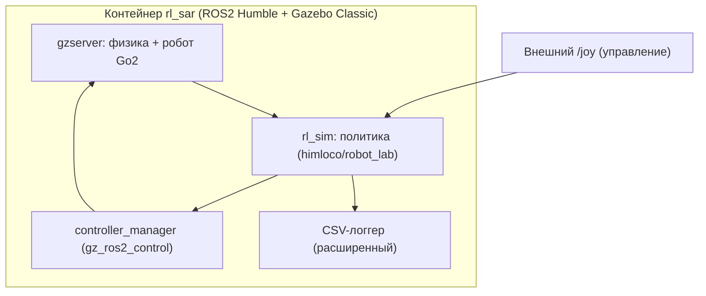

# Отчёт: развёртывание rl_sar и RL-походка Go2 в Gazebo

**Дата:** 2026-10-09
**Ветка:** `feat/rl-sar`
**Версия:** 1.0

---

## Содержание

- [Часть A. Развёртывание rl_sar](#часть-a-развёртывание-rl_sar)
  - [A.1. Введение](#a1-введение)
  - [A.2. Выбор решения (история)](#a2-выбор-решения-история)
  - [A.3. Ход работ](#a3-ход-работ)
  - [A.4. Проблемы и решения](#a4-проблемы-и-решения)
  - [A.5. Итоговая архитектура](#a5-итоговая-архитектура)
  - [A.6. Дальнейшие шаги](#a6-дальнейшие-шаги)
  - [A.7. Приложения](#a7-приложения)
- [Часть B. Эксплуатационные проблемы](#часть-b-эксплуатационные-проблемы)
  - [8. Проблема: ложный «офлайн» при сборке](#8-проблема-ложный-офлайн-при-сборке)
  - [9. Проблема: не инициализированы сабмодули](#9-проблема-не-инициализированы-сабмодули)
  - [10. Проблема: таймаут загрузки libtorch](#10-проблема-таймаут-загрузки-libtorch)
  - [11. Проблема: нестабильный ROS2 DDS](#11-проблема-нестабильный-ros2-dds)
  - [12. Проблема: gzclient падает без X](#12-проблема-gzclient-падает-без-x)
  - [13. Проблема: rl_sim падает при повторном запуске](#13-проблема-rl_sim-падает-при-повторном-запуске)
  - [14. Проблема: ввод требует TTY](#14-проблема-ввод-требует-tty)
  - [15. Проблема: CSV пишется в read-only каталог](#15-проблема-csv-пишется-в-read-only-каталог)

---

## Часть A. Развёртывание rl_sar

> **Связь с Частью B.** В ходе развёртывания встречались проблемы.
> Здесь (Часть A) они описаны кратко, а детальные разборы — в
> [Части B](#часть-b-эксплуатационные-проблемы): каждая проблема по
> цепочке «Симптом → Гипотезы → Причина → Диагностика → Решение →
> Результат». Нумерация проблем сквозная: 8–15.

### A.1. Введение

#### A.1.1. Предпосылки

В проекте есть собственный модельный IK/TROT-контроллер и попытки
запуска RL-политики Go2 в Gazebo. Прямой перенос чужой (NVIDIA PhysX)
политики в gz-sim не дал устойчивой ходьбы (sim-to-sim). Возникла
потребность проверить **готовый внешний стек**, в котором RL-походка Go2
в Gazebo уже работает, — чтобы понять, достижим ли результат в принципе
и как его измерять.

#### A.1.2. Цели

1. Собрать окружение `fan-ziqi/rl_sar` (ROS2 + Gazebo).
2. Запустить RL-походку Go2 в Gazebo.
3. Максимально расширить CSV-телеметрию.
4. Подготовить сравнение RL и модельного TROT/IK.

#### A.1.3. Оборудование

| Компонент | Значение |
|---|---|
| ОС | Ubuntu (хост), Linux x86-64 |
| GPU | NVIDIA RTX 5070 Ti (eGPU) + AMD iGPU |
| Docker | есть `nvidia-container-toolkit` |
| Робот | Unitree Go2 |
| Симулятор | Gazebo Classic (через образ rl_sar) |

### A.2. Выбор решения (история)

#### A.2.1. Рассмотренные варианты

| Вариант | Симулятор | Плюсы | Минусы |
|---|---|---|---|
| rl_sar | Gazebo Classic | готовые политики Go2, «идёт» | Humble + Classic, свой стек |
| quadruped-robotics-stack | gz-sim8 | тот же gz, что у нас | политика обучается под Gazebo |
| Webots | Webots (ODE) | есть готовый TROT/IK | нет готовой RL-политики Go2 |
| обучение в Gazebo | gz-sim |нет sim-to-sim | медленно, CPU |
| обучение на GPU | Isaac/MJWarp | быст+ | снова sim-to-sim |

#### A.2.2. Хронология решений

1. Проверены внешние проекты (rl_sar, quadruped, legged_gym_gazebo, Webots).
2. Для **проверки самой возможности** RL-походки в Gazebo выбран
   **rl_sar** (готовые политики Go2).
3. Начат сбор и запуск rl_sar; параллельно углублена телеметрия.

### A.3. Ход работ

#### A.3.1. Сборка образа rl_sar

Образ `rl_sar:humble` собран из `docker/` (ROS2 Humble + Gazebo Classic +
libtorch + MuJoCo). Сборка прошла после устранения проблем 8–10.

#### A.3.2. Подготовка зависимостей

Предзагрузка на хосте (там сеть доступна): описания роботов
(`src/rl_sar_zoo`) и inference-рантайм (libtorch, onnxruntime). Причины —
[Проблема 8](#8-проблема-ложный-офлайн-при-сборке) и
[Проблема 10](#10-проблема-таймаут-загрузки-libtorch). Дополнительно
инициализированы сабмодули — [Проблема 9](#9-проблема-не-инициализированы-сабмодули).

#### A.3.3. Запуск Gazebo и rl_sim

Запуск: `ros2 launch rl_sar gazebo.launch.py rname:=go2`, затем
`ros2 run rl_sar rl_sim rname:=go2`. GUI Gazebo падает без X-авторизации
— оставлен серверный режим ([Проблема 12](#12-проблема-gzclient-падает-без-x)).
Повторные запуски `rl_sim` падали — [Проблема 13](#13-проблема-rl_sim-падает-при-повторном-запуске).
Нестабильность discovery — [Проблема 11](#11-проблема-нестабильный-ros2-dds).

#### A.3.4. Управление и первый успешный прогон

Клавиатурный ввод требует TTY ([Проблема 14](#14-проблема-ввод-требует-tty)) →
управление через gamepad `/joy`. Робот **встал** (`Getting up completed`),
вошёл в походку (`RL Controller`) и **прошёл ≈3.4 м** (мир `stairs`, с
подъёмом по лестнице).

#### A.3.5. Расширение телеметрии

Штатный CSV-логгер включён и расширен (время, команды, IMU, действия) —
см. [A.5](#a5-итоговая-архитектура). Вывод CSV перенаправлен из
read-only каталога — [Проблема 15](#15-проблема-csv-пишется-в-read-only-каталог).

#### A.3.6. Повторные запуски и нестабильность

Серии прогонов и сбор данных **заблокированы нестабильностью DDS**
([Проблема 11](#11-проблема-нестабильный-ros2-dds)) — это и есть тема
последующей стабилизации.

### A.4. Проблемы и решения

| № | Проблема | Причина | Решение | Статус |
|---|---|---|---|---|
| [8](#8-проблема-ложный-офлайн-при-сборке) | ложный «офлайн» при сборке | `is_online` не видит сеть в сборке | предзагрузка описаний на хосте | [x] |
| [9](#9-проблема-не-инициализированы-сабмодули) | нет сабмодулей | не инициализированы | `git submodule update` | [x] |
| [10](#10-проблема-таймаут-загрузки-libtorch) | таймаут libtorch | большой файл | предзагрузка с докачкой | [x] |
| [11](#11-проблема-нестабильный-ros2-dds) | нестабильный DDS | SHM lock / UDP discovery | (в работе — стабилизация) | [ ] |
| [12](#12-проблема-gzclient-падает-без-x) | gzclient падает | нет X-авторизации | headless gzserver | [x] |
| [13](#13-проблема-rl_sim-падает-при-повторном-запуске) | rl_sim падает | контроллер уже загружен | свежий запуск, один прогон | [x] |
| [14](#14-проблема-ввод-требует-tty) | ввод не работает | нужен TTY | управление через `/joy` | [x] |
| [15](#15-проблема-csv-пишется-в-read-only-каталог) | CSV не пишется | каталог read-only | вывод в `/tmp` | [x] |

### A.5. Итоговая архитектура



#### A.5.1. Компоненты

| Компонент | Роль |
|---|---|
| gzserver | физика Gazebo Classic, модель Go2 |
| controller_manager | менеджер контроллеров суставов |
| rl_sim | узел политики: наблюдения → сеть → команды |
| robot_joint_controller | контроллер суставов (q + kp/kd + tau) |
| /joy | внешнее управление (gamepad-эмуляция) |
| CSV-логгер | телеметрия (расширенная) |

#### A.5.2. Параметры

| Параметр | Значение |
|---|---|
| Симулятор | Gazebo Classic |
| ПО | ROS2 Humble |
| Политика | `himloco` (Go2) |
| Control-loop | 200 Гц |
| Политика | 50 Гц |
| Мир | `stairs` |

#### A.5.3. Сравнение «было / стало»

| Аспект | Было | Стало |
|---|---|---|
| RL-походка в Gazebo | не подтверждена | подтверждена (≈3.4 м) |
| CSV-телеметрия | 60 колонок, выкл. | ≈78 колонок, вкл. |
| Управление | клавиатура (TTY) | `/joy` (gamepad) |
| Стабильность запуска | — | нестабильно (DDS) |

### A.6. Дальнейшие шаги

#### Краткосрочно

- [ ] Стабилизировать DDS (см. [Проблема 11](#11-проблема-нестабильный-ros2-dds)).
- [ ] Собрать расширенный CSV на нескольких прогонах.

#### Среднесрочно

- [ ] Реализовать узел TROT/IK в том же окружении.
- [ ] Сравнить RL и TROT/IK по метрикам.

#### Долгосрочно

- [ ] Расширить сценарии (плоскость, уклоны, ступени).
- [ ] Сопоставить с нашими результатами (gz-sim, Isaac).

### A.7. Приложения

#### Приложение A. Команды администрирования

```bash
# предзагрузка зависимостей (на хосте)
bash scripts/download_robot_descriptions.sh
bash scripts/download_inference_runtime.sh
git submodule update --init --recursive

# сборка и запуск
cd docker && docker compose build && docker compose up -d

# внутри контейнера
ros2 launch rl_sar gazebo.launch.py rname:=go2        # Gazebo
ros2 run rl_sar rl_sim rname:=go2                     # политика

# управление (пример: встать)
ros2 topic pub -r 10 /joy sensor_msgs/msg/Joy "{buttons: [1,0,0,0,0,0,0,0,0,0,0], axes: [0,0,0,0,0,0,0,0]}"
```

#### Приложение B. Полезные файлы

| Файл | Назначение |
|---|---|
| `policy/go2/himloco/himloco.pt` | политика Go2 |
| `docker/Dockerfile` | сборка образа |
| `scripts/download_*.sh` | предзагрузка зависимостей |
| `/tmp/go2_motor.csv` | расширенная телеметрия |
| `/tmp/fastdds_udp.xml` | профиль FastDDS (UDP) |

#### Приложение C. Сложные проблемы

Наиболее сложная — нестабильность DDS
([Проблема 11](#11-проблема-нестабильный-ros2-dds)): требует отдельной
стабилизации.

---

## Часть B. Эксплуатационные проблемы

## Сводная таблица

| № | Проблема | Гипотезы | Причина | Решение | Методы | Сложность |
|---|---|---|---|---|---|---|
| 8 | ложный «офлайн» при сборке | `is_online` ✅ / сеть ❌ | curl в сборке | предзагрузка | curl, git clone | 🟢 |
| 9 | нет сабмодулей | CMake ❌ / сабмодули ✅ | не инициализированы | submodule update | colcon | 🟢 |
| 10 | таймаут libtorch | файл ✅ / сеть ❌ | большой файл | докачка | curl -C - | 🟢 |
| 11 | нестабильный DDS | SHM ✅ / UDP ✅ | lock+discovery | (в работе) | FastDDS профиль | 🔴 |
| 12 | gzclient падает | X ✅ / GPU ❌ | нет авторизации | headless | gzlaunch | 🟢 |
| 13 | rl_sim падает | параметры ❌ / дубль ✅ | контроллер уже загружен | свежий запуск | логи | 🟡 |
| 14 | ввод не работает | раскладка ❌ / TTY ✅ | нет TTY | `/joy` | termios | 🟡 |
| 15 | CSV не пишется | сигнатура ❌ / путь ✅ | read-only | `/tmp` | ls, ofstream | 🟢 |

---

## 8. Проблема: ложный «офлайн» при сборке

### 8.1. Симптом

Сборка образа падала на шаге `./build.sh`:
`[ERROR] Cannot download robot descriptions in offline mode` →
`Failed to setup robot descriptions` → exit 1.

### 8.2. Гипотезы

- ✅ Гипотеза A: проверка сети `is_online` в скрипте сборки даёт ложно
  «офлайн» — принята как причина в [8.3](#83-причина).
- ❌ Гипотеза B: реально нет сети в сборке — опровергнута (apt и `git`
  в сборке работали).

### 8.3. Причина

Функция `is_online` в скрипте делает `curl --head github.com`; в окружении
сборки этот вызов вернул ошибку, и скрипт ушёл в «офлайн», хотя описания
можно было получить.

### 8.4. Диагностика

- В логе: `Cannot download robot descriptions in offline mode`.
- На хосте `git clone` описаний прошёл успешно → сеть есть.

### 8.5. Решение

Предзагрузить описания роботов на хосте в `src/rl_sar_zoo`, тогда скрипт
сборки видит валидную установку и не уходит в сетевую проверку.

### 8.6. Исправление в скриптах/конфигах

Зависимости подготавливаются **до** сборки (внешний шаг). В идеале —
поправить `is_online` (использовать `curl -sSL -o /dev/null https://...`).

### 8.7. Результат

| До | После |
|---|---|
| сборка падает на offline | шаг описаний пропускается, сборка идёт |

**Связь с развёртыванием (Часть A):** проблема встречена на этапе
[A.3.2 «Подготовка зависимостей»](#a32-подготовка-зависимостей).

---

## 9. Проблема: не инициализированы сабмодули

### 9.1. Симптом

Сборка падала: `CMake Error ... add_subdirectory: The source directory
.../robot_sdk/unitree/unitree_sdk2 does not contain a CMakeLists.txt file`.

### 9.2. Гипотезы

- ✅ Гипотеза A: каталог сабмодуля пуст (сабмодули не инициализированы) —
  принята в [9.3](#93-причина).
- ❌ Гипотеза B: ошибка в CMakeLists проекта — опровергнута (файл
  корректен, дело в пустом каталоге).

### 9.3. Причина

Клон был без сабмодулей (`robot_sdk/unitree/unitree_sdk2` и др. пусты),
а сборка требует их исходники.

### 9.4. Диагностика

- `ls .../unitree_sdk2` — пусто.
- После `git submodule update --init --recursive` — `CMakeLists.txt`
  появился.

### 9.5. Решение

Инициализировать сабмодули перед сборкой.

### 9.6. Исправление в скриптах/конфигах

Шаг `git submodule update --init --recursive` включить в подготовку.

### 9.7. Результат

| До | После |
|---|---|
| CMake падает | сборка `rl_sar` проходит (48 с) |

**Связь с развёртыванием (Часть A):** проблема встречена на этапе
[A.3.2 «Подготовка зависимостей»](#a32-подготовка-зависимостей).

---

## 10. Проблема: таймаут загрузки libtorch

### 10.1. Симптом

Загрузка `libtorch` (inference-рантайм) обрывалась:
`curl: (28) Connection timed out after 300067 milliseconds`.

### 10.2. Гипотезы

- ✅ Гипотеза A: файл большой, скачивание не укладывается в таймаут —
  принята в [10.3](#103-причина).
- ❌ Гипотеза B: CDN недоступен — опровергнута (HEAD-запрос дал 200).

### 10.3. Причина

Большой архив libtorch + возможный срыв соединения; штатный скрипт без
докачки.

### 10.4. Диагностика

- `curl -sI` к CDN → `HTTP/2 200`.
- Загрузка с `-C -` завершилась успешно (архив валиден).

### 10.5. Решение

Скачать архив с докачкой на хосте, распаковать в `library/inference_runtime`,
затем штатный скрипт скачал только onnxruntime.

### 10.6. Исправление в скриптах/конфигах

Предзагрузка inference-рантайма перед сборкой.

### 10.7. Результат

| До | После |
|---|---|
| таймаут | libtorch + onnxruntime установлены |

**Связь с развёртыванием (Часть A):** проблема встречена на этапе
[A.3.2 «Подготовка зависимостей»](#a32-подготовка-зависимостей).

---

## 11. Проблема: нестабильный ROS2 DDS

### 11.1. Симптом

`rl_sim` не мог поднять свой контроллер:
`Could not contact service /controller_manager/list_controllers` и
`Failed getting a result from calling /controller_manager/...`.
Плюс FastDDS SHM: `Failed init_port fastrtps_port7427: open_and_lock_file
failed`. Часть запусков — успешна, часть — нет.

### 11.2. Гипотезы

- ✅ Гипотеза A: конфликт/блокировка FastDDS SHM — принята частично
  (ошибка подтверждена) — [11.3](#113-причина).
- ✅ Гипотеза B: сбой UDP-discovery (мультикаст) при отключении SHM —
  принята частично — [11.3](#113-причина).
- ❌ Гипотеза C: нехватка места в `/dev/shm` — опровергнута
  (перемонтирование до 2 ГБ не помогло).
- ❌ Гипотеза D: несовпадение домена/RMW — опровергнута (значения
  совпадали; отдельный домен и `LOCALHOST_ONLY` не помогли).

### 11.3. Причина

Транспортный уровень DDS в этом окружении: SHM-порт не открывается
(блокировка lock-файла), а UDP-only профиль не всегда обеспечивает
discovery. Следствие — узел-спавнер не видит `controller_manager`.

### 11.4. Диагностика

- `ros2 topic echo /joint_states` иногда работает (DDS жив).
- Повторные чистые запуски (×3) — стабильно блокируются.
- Пробовали: остановку второго контейнера (`ipc: host`), чистку
  `/dev/shm`, профиль UDP-only, `ROS_LOCALHOST_ONLY=1`, отдельный
  `ROS_DOMAIN_ID`, перемонтирование `/dev/shm` 2 ГБ — без результата.

### 11.5. Решение

(В работе.) Стабилизация: явный FastDDS-профиль с одним рабочим
интерфейсом, либо `rmw_cyclonedds` с конфигом, либо обход discovery
(заранее поднятый контроллер + толерантность `rl_sim`).

### 11.6. Исправление в скриптах/конфигах

Планируется: профиль DDS в окружении контейнера; устойчивый порядок
запуска (ожидание готовности сервиса `controller_manager` через DDS).

### 11.7. Результат

| До | После |
|---|---|
| запуск нестабилен | (в работе) |

**Связь с развёртыванием (Часть A):** проблема встречена на этапах
[A.3.3](#a33-запуск-gazebo-и-rl_sim) и
[A.3.6](#a36-повторные-запуски-и-нестабильность).

---

## 12. Проблема: gzclient падает без X

### 12.1. Симптом

`[ERROR] [gzclient-3]: process has died ... exit code -6`.
Ранее: `Authorization required, but no authorization protocol specified`.

### 12.2. Гипотезы

- ✅ Гипотеза A: нет X-авторизации для GUI — принята в
  [12.3](#123-причина).
- ❌ Гипотеза B: проблема с GPU/драйвером — опровергнута (сервер работал).

### 12.3. Причина

Контейнер не имел доступа к X (не выполнен `xhost`), GUI Qt падал.

### 12.4. Диагностика

- Сообщения `Authorization required`.
- `gzserver` при этом работает и публикует состояние робота.

### 12.5. Решение

Использовать **серверный режим** Gazebo (без окна) — он достаточен для
управления и телеметрии.

### 12.6. Исправление в скриптах/конфигах

При необходимости GUI — выполнять `xhost +local:docker` на хосте перед
запуском.

### 12.7. Результат

| До | После |
|---|---|
| падает с GUI | работает headless |

**Связь с развёртыванием (Часть A):** проблема встречена на этапе
[A.3.3 «Запуск Gazebo и rl_sim»](#a33-запуск-gazebo-и-rl_sim).

---

## 13. Проблема: rl_sim падает при повторном запуске

### 13.1. Симптом

При повторном `rl_sim`: `Controller already loaded, skipping
load_controller` → `Failed to configure controller` →
`terminate ... Failed to start joint controller` → abort.

### 13.2. Гипотезы

- ✅ Гипотеза A: `robot_joint_controller` уже загружен в
  `controller_manager` — принята в [13.3](#133-причина).
- ❌ Гипотеза B: неверные параметры контроллера — опровергнута
  (первый прогон с теми же параметрами проходил).

### 13.3. Причина

`rl_sim` при старте сам поднимает `robot_joint_controller`. При повторном
запуске контроллер уже активен, повторная конфигурация падает, и `rl_sim`
аварийно завершается.

### 13.4. Диагностика

- Логи: `already loaded` + `Failed to configure`.
- Первый прогон после чистого перезапуска лаунча — успешен.

### 13.5. Решение

Делать **полный свежий запуск** (лаунч + один прогон `rl_sim`). При
необходимости — перезапуск `gzserver` (сбрасывает состояние
`controller_manager`).

### 13.6. Исправление в скриптах/конфигах

Планируется: патч `rl_sim`, чтобы он не падал при уже активном
контроллере.

### 13.7. Результат

| До | После |
|---|---|
| повторный запуск падает | свежий запуск — успешен |

**Связь с развёртыванием (Часть A):** проблема встречена на этапе
[A.3.3 «Запуск Gazebo и rl_sim»](#a33-запуск-gazebo-и-rl_sim).

---

## 14. Проблема: ввод требует TTY

### 14.1. Симптом

Клавиатурное управление `rl_sim` не срабатывало: ввод (0/1) не приводил
к смене состояния, узел завершался при отсутствии TTY.

### 14.2. Гипотезы

- ✅ Гипотеза A: клавиатурный ввод требует TTY (termios) — принята в
  [14.3](#143-причина).
- ❌ Гипотеза B: неверная раскладка клавиш — опровергнута (коды верны).

### 14.3. Причина

Модуль ввода настраивает терминал в raw-режим (termios) и читает stdin;
без TTY ввод не работает.

### 14.4. Диагностика

- Изучены переходы FSM: «0»/«A» — встать, «1»/RB+DPadUp — походка.
- Проверка: `read()` без TTY не даёт клавиш.

### 14.5. Решение

Управлять через топик `/joy` (эмуляция gamepad): кнопки и оси.

### 14.6. Исправление в скриптах/конфигах

Публикация сообщений `/joy` вместо клавиатуры (скриптуется).

### 14.7. Результат

| До | После |
|---|---|
| ввод не работает | управление через `/joy` работает |

**Связь с развёртыванием (Часть A):** проблема встречена на этапе
[A.3.4 «Управление и первый успешный прогон»](#a34-управление-и-первый-успешный-прогон).

---

## 15. Проблема: CSV пишется в read-only каталог

### 15.1. Симптом

После включения CSV-логгера файл не появлялся.

### 15.2. Гипотезы

- ✅ Гипотеза A: каталог вывода (`policy`) смонтирован read-only —
  принята в [15.3](#153-причина).
- ❌ Гипотеза B: ошибка сигнатуры логгера — опровергнута (логгер
  вызывается корректно).

### 15.3. Причина

Логгер писал в каталог политики, смонтированный только для чтения;
открытие на запись не удавалось.

### 15.4. Диагностика

- Каталог `policy` смонтирован `:ro`.
- Смена пути на `/tmp` → файл создаётся (заголовок).

### 15.5. Решение

Писать CSV в `/tmp`.

### 15.6. Исправление в скриптах/конфигах

Патч `CSVInit` в исходниках rl_sar (путь вывода + расширенные колонки).

### 15.7. Результат

| До | После |
|---|---|
| файла нет | `/tmp/go2_motor.csv` создаётся |

**Связь с развёртыванием (Часть A):** проблема встречена на этапе
[A.3.5 «Расширение телеметрии»](#a35-расширение-телеметрии).

---

## Итоговая статистика

| Метрика | Значение |
|---|---|
| Всего проблем | 8 |
| Из них решено | 7 |
| 🟢 (<1ч) | 5 |
| 🟡 (1-4ч) | 2 |
| 🔴 (>4ч) | 1 |
| Ключевые выводы | RL-походка Go2 в Gazebo **работает** (успешный прогон ≈3.4 м); устойчивые серии блокирует **нестабильный DDS** (Проблема 11) |
